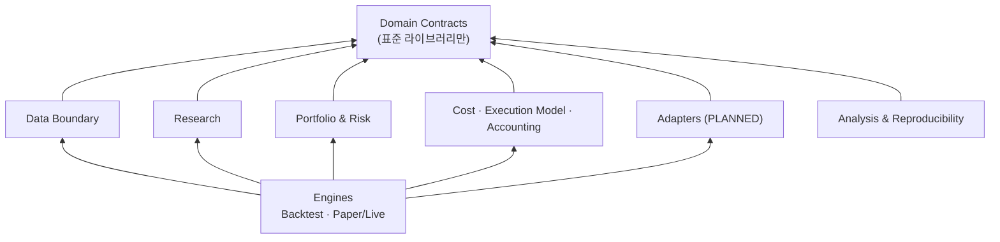

# ADR-0004: 시장 데이터와 도메인 계층 경계 (Market Data and Domain Boundaries)

## 1. Title

공용 데이터 모델의 책임 분리, 소유 계층(owning layer), 의존성 방향 (결정 ID D-01)

## 2. Status

**ACCEPTED** (2026-10-16)

| 항목 | 내용 |
|---|---|
| 승인일 | 2026-10-16 |
| 승인 주체 | 프로젝트 사용자 |
| 승인 근거 | 사용자의 명시적 승인 (작업 P0-02B-FINAL) |
| 승인 범위 | **핵심 아키텍처 설계 원칙** (아래 "승인된 원칙"). §6의 제목 "Proposed Decision"은 ADR 서식의 이름이며, 그 가운데 아래 원칙이 승인된 결정이다 |
| 구현 상태 | **미구현.** 도메인 계약, 계층 정리, V1 입력 변환기 모두 아직 구현되지 않았다 |
| 인수 테스트 | **명세만 존재, 미구현** (§10) |
| 미해결 질문 | §11의 Open Questions를 모두 유지한다 |
| 의미 | ACCEPTED는 설계 원칙이 승인되었다는 뜻이다. 구현 완료, 금융 공식의 독립 검증 완료, 실전 매매 준비 완료를 뜻하지 않는다 |
| 변경 규칙 | 핵심 결정을 바꾸려면 새 ADR로 대체한다 (`SUPERSEDED by NNNN`). 오탈자, 링크, 명백한 문서 오류만 직접 고친다 |

**승인된 원칙**

1. 도메인 계약(Domain Contracts)을 기존 백테스트 러너와 분리한다 (§6.1, §6.2).
2. 관측값, 체결 가정, 위험 입력의 책임을 분리한다 (§6.3).
3. 하위 금융 계산 계층은 백테스트 러너나 브로커 Adapter에 역방향 의존하지 않는다 (§6.2 R-1~R-3).
4. Raw Tradable Price와 Back-adjusted Price의 역할을 구분한다 (§6.4).
5. 관측 시각과 데이터 이용 가능 시각을 구분한다 (§6.5).
6. 기존 V1 API와 재현성을 보호하면서 새 도메인 계약을 추가한다 (§6.7).
7. 대규모 패키지 개편은 별도 결정(D-10)으로 남긴다 (§6.1).

**승인되지 않은 사항 (Open Questions로 유지)**

| 사항 | 관련 질문 |
|---|---|
| Stage 1의 방식: 기존 타입 2개를 옮기고 재export할지(대안 A, 권장안), 이동 없이 `TYPE_CHECKING`·`Protocol` 방식(대안 A-0)으로 먼저 의존성을 해소할지 | Q4-1 |
| 새 `RESEARCH` API에서 날짜별 위험 예산 직접 입력을 완전히 금지할지, 명시적 조건 아래 제한적으로 허용할지 | Q4-7 |
| 상세 도메인 타입의 물리적 위치와 이름 | Q4-2 |
| schema version과 fingerprint 보존의 구체적 구현 방식 | ADR-0001 Q1-9, D-11 (§6.7 P-1, P-4) |

- 작성일: 2026-10-16 (작업 P0-02B)
- 기준 커밋: `ac239b0` (`python -m pytest -q -W error` → 306 passed, 경고 0)
- 관련 P0-01 항목: GAP `A-01`, `A-02`, `A-08`, `A-12`, `F-02`, `F-06`, `F-10`. [V1_DEPENDENCY_ANALYSIS.md](../architecture/V1_DEPENDENCY_ANALYSIS.md) §1, §2
- 관련 ADR: [0001](0001-execution-timing-and-valuation.md) (ACCEPTED), [0002](0002-warmup-and-tradability.md) (ACCEPTED), [0003](0003-pretrade-risk-policy.md) (ACCEPTED), [0005](0005-backtest-paths-and-v1-compatibility.md) (ACCEPTED), [0006](0006-futures-etf-instrument-model.md) (ACCEPTED)
- **이 ADR이 정하는 것**: 개념별 책임, 소유 계층, 의존성 방향, V1 보호 규칙, 단계 순서
- **이 ADR이 정하지 않는 것**: 필드 목록, 자료형, 검증 규칙의 최종 명세 (P0-03 Domain Contracts), 물리적 패키지 배치 (D-10), schema version 세부 정책 (D-11), 브로커 adapter API (D-12)

## 3. Context

### 3.1 현재 데이터 타입의 위치 (CONFIRMED)

| 타입 | 정의 위치 | 감사용 계층 분류 | 내용 | 시각 정보 |
|---|---|---|---|---|
| `InstrumentSpec` | `instrument.py:5-37` | 기본 타입 | symbol, currency, multiplier, tick_size | 없음 |
| `ContractPrice` | `futures_data.py:6-17` | 데이터 | date, contract, close | `date`만 |
| `RollEvent` | `futures_data.py:20-36` | 데이터 | date, old_contract, new_contract | `date`만. 언제 알려졌는지 없음 (F-07) |
| `BackAdjustedPrice` | `futures_data.py:39-44` | 데이터 | date, active_contract, **raw_price, adjusted_price** | `date`만. raw와 adjusted가 한 객체에 있음 |
| `ContractQuote` | `roll_execution.py:15-18` | **비용/체결 모듈** | bid, ask | 없음 |
| `ExecutionMarketDay` | `system_backtest.py:28-47` | **백테스트 러너** | date, daily_cash_vol_target, quotes, commission_per_contract, fx_to_base, slippage_ticks, margin_per_contract_base | `date`만 |
| `ContractAwareBacktestDayInput` | `contract_aware_backtest.py:14-36` | 러너 입력 | 전일·당일 adjusted price, 위험 예산, vol, forecast, quotes, 수수료, roll_to, 슬리피지, fx, margin | 없음 (날짜 필드도 없음) |
| `ResearchSignalPoint`, `PointInTimeResearchSignalPoint` | `research_pipeline.py:25-38, 173-189` | 신호 | raw·adjusted 가격, vol, forecast | `date` / `as_of_date` |
| `PortfolioRiskPolicy` | `risk_guardrail.py:157-185` | 위험 | max_gross_leverage, max_margin_usage | 없음 |
| `BacktestConfig` | `backtest_config.py:71-191` | 설정 | EWMAC 설정, 연간 vol 목표, 버퍼, risk_policy, 거래일 256 | 없음 |

시장 관측값 타입이 데이터 모듈(`futures_data`), 체결 모듈(`roll_execution`), 러너(`system_backtest`)에 흩어져 있다.

### 3.2 역방향 의존 (GAP A-01)

| 관찰 | 근거 | 확인 |
|---|---|---|
| `data_quality`가 `system_backtest.ExecutionMarketDay`를 import한다 | `data_quality.py:7-9` | CONFIRMED |
| 쓰임새는 `validate_execution_days`의 **타입 주석뿐**이다. 생성자 호출이나 `ExecutionMarketDay`에 대한 `isinstance` 검사가 없다 | `data_quality.py:97-101`, 읽는 필드는 `:105-190` | CONFIRMED |
| `import carver_quant.data_quality` 한 번으로 `carver_quant` 하위 모듈 21개(패키지 자신을 포함하면 22개)가 로드된다. 여기에 `system_backtest`, `contract_aware_backtest`, `research_pipeline`, `forecast`, `volatility`, 그리고 `pandas`, `numpy`가 포함된다 | 2026-10-16 probe (새 인터프리터에서 `sys.modules` 확인) | CONFIRMED |
| `system_backtest`가 앞으로 입력 검증을 위해 `data_quality`를 import하면 순환이 생긴다 | import 그래프 | INFERRED |

그 밖의 계층 이상 (CONFIRMED, [V1_DEPENDENCY_ANALYSIS.md](../architecture/V1_DEPENDENCY_ANALYSIS.md) §1):

| 의존 | 성격 |
|---|---|
| `performance → portfolio_backtest` (`performance.py:6-8`) | 분석 계층이 러너 결과 타입에 묶임 (A-08) |
| `portfolio_backtest → system_backtest` (`PreparedEWMACBacktest`) | 포트폴리오 러너가 EWMAC 전용 준비 타입을 입력으로 받음 |
| `system_backtest → roll_execution` (`ContractQuote`) | 시장 관측 타입이 체결 모듈에 정의됨 |
| `contract_ledger → roll` (`ContractTrade`) | 장부가 거래 생성 모듈의 타입에 의존 |
| `volatility`, `forecast → futures_data` (`BackAdjustedPrice`) | 신호 계산의 입력 타입이 **선물 전용** 조정 가격 타입이다 (`volatility.py:7-8, 18`, `forecast.py:7, 161`). ETF 조정 시계열을 넣을 공통 타입이 없다 (ADR-0006) |

### 3.3 `ExecutionMarketDay`의 책임 혼합 (GAP A-02)

| 종류 | 필드 | 성격 | 추가 관찰 (CONFIRMED) |
|---|---|---|---|
| 시장 관측값 | `date`, `quotes`, `fx_to_base` | 외부 데이터. 관측 시각과 이용 가능 시각이 필요함 | `fx_to_base`는 상품·날짜별 스칼라이고 통화로 찾지 않는다 (ADR-0001 §6.2 R2) |
| 체결 가정 | `commission_per_contract`, `slippage_ticks` | 브로커·시뮬레이션 설정 | 날짜마다 다른 값을 넣을 수 있는 일별 필드다 |
| 위험 입력 | `daily_cash_vol_target`, `margin_per_contract_base` | 계좌·거래소 설정 | 아래 표 |

`daily_cash_vol_target`은 **경로에 따라 의미가 다르다** (CONFIRMED, 이번 조사에서 새로 확인):

| 경로 | 의미 | 근거 |
|---|---|---|
| 시스템 경로 (`run_ewmac_system_backtest`) | **상품 수준** 일간 현금 vol 목표. 그대로 스텝의 사이징에 쓰인다 | `system_backtest.py:168-171`, `contract_aware_daily_step.py:134-159` |
| 포트폴리오 legacy 모드 | **계좌 수준** 목표. 상품끼리 값이 같아야 하고, 가중치 × IDM을 곱해 상품 목표로 바꾼다 | `portfolio_backtest.py:365-386, 400-433` |
| 포트폴리오 동적 모드 | 계산에는 **쓰이지 않는다.** 개장 계좌로 다시 계산한 값으로 덮어쓴다. 다만 경로 D에서는 `data_quality`가 이 값이 유한한 양수인지 여전히 검증한다 | `portfolio_backtest.py:321-340, 428-433`, `portfolio_system_backtest.py:114-116` → `data_quality.py:120-129` |

`margin_per_contract_base`는 포트폴리오 경로의 사후 가드레일에서만 쓰인다 (`portfolio_backtest.py:111-122`). `contract_aware_backtest` 러너는 이 값을 스텝에 넘기지 않는다 (`contract_aware_backtest.py:69-86`, GAP A-04). `data_quality`는 이 값을 검증하지 않는다.

### 3.4 시각 정보와 가격 종류

- 어떤 타입에도 `observed_at`, `data_available_at`이 없다. 모든 관측값은 `date` 하나로만 표현된다 (CONFIRMED). ADR-0001 I-1(주문에 쓴 모든 입력은 `decision_at`까지 이용 가능해야 함)을 코드로 검사할 수 없다.
- raw 가격과 adjusted 가격이 같은 객체(`BackAdjustedPrice`, `ResearchSignalPoint`)에 들어 있다. 러너 입력 `ContractAwareBacktestDayInput`의 `previous_adjusted_price`, `current_adjusted_price`는 PIT 경로에서 **full-history 연속 시계열**의 값이다. 이 값의 수준(level)에는 미래 롤의 gap이 반영되어 있고, 하루 차분에만 쓰인다 (`system_backtest.py:258-261, 359-378, 413-421`). 숫자만 보고는 거래 가능한 가격인지 알 수 없다.
- V1은 이미 가격 종류의 의미를 주석으로 구분한다. `PointInTimeResearchSignalPoint.snapshot_adjusted_price`에는 "서로 다른 날짜의 snapshot 값을 빼서 PnL을 계산하면 안 된다"는 주석이 있다 (`research_pipeline.py:181-185`). 이 구분을 타입으로 올리는 것이 이 ADR의 출발점이다.

### 3.5 fingerprint의 작동 방식 (CONFIRMED)

- 입력 fingerprint는 canonical JSON의 SHA-256이다. dataclass는 **필드 이름과 값만** 직렬화하고, 클래스 이름이나 모듈 이름은 넣지 않는다 (`backtest_manifest.py:332-346`). 키는 정렬된다 (`:394-403`).
- payload에는 `InstrumentSpec`, `ContractPrice`, `RollEvent`, `ExecutionMarketDay`(안의 `ContractQuote`와 margin dict 포함), `BacktestConfig`(안의 `PortfolioRiskPolicy` 포함)가 **필드 전체**로 들어간다 (`backtest_manifest.py:571-631`). 같은 함수가 `:405-517`에도 정의되어 있지만 본문이 같고, 뒤의 정의가 앞의 정의를 덮어쓰므로 실제로 쓰이는 것은 `:519-631`이다 (GAP A-11). 이 함수를 고칠 때는 두 정의를 모두 확인해야 한다.
- 2026-10-16 probe (저장소 밖 일회성 스크립트, 같은 입력으로 계산):

| 변경 | 입력 fingerprint | 기존과 같은가 |
|---|---|---|
| V1 타입 그대로 | `4c8483d1…` | — |
| 필드가 같은 타입을 **다른 이름·다른 모듈**로 정의 | `4c8483d1…` | **같음** |
| `ExecutionMarketDay`에 선택 필드 `observed_at=None` 추가 | `5b776aea…` | 다름 |
| `InstrumentSpec`에 선택 필드 `asset_type=None` 추가 | `0c2f6f18…` | 다름 |

- 따라서 **타입을 옮기는 것은 fingerprint를 바꾸지 않지만, 필드를 하나라도 추가하거나 이름을 바꾸면 기본값이 있어도 fingerprint가 바뀐다.**
- **현재 테스트는 fingerprint의 실제 값을 고정하지 않는다** (CONFIRMED: `tests/`에 64자리 해시 리터럴 0건). 테스트는 순서 무관성, 입력이 바뀌면 값이 바뀌는지, 같은 실행이 같은 값을 내는지만 확인한다. 그래서 fingerprint를 바꾸는 변경도 지금은 306개 테스트를 그대로 통과한다.

### 3.6 테스트가 의존하는 import 경로 (CONFIRMED)

| 이름 | import 경로 | 테스트 파일 수 |
|---|---|---|
| `ContractQuote` | `carver_quant.roll_execution` | 13 |
| `ContractPrice` | `carver_quant.futures_data` | 9 |
| `InstrumentSpec` | `carver_quant.instrument` | 8 |
| `ExecutionMarketDay` | `carver_quant.system_backtest` | 7 |
| `BackAdjustedPrice` | `carver_quant.futures_data` | 4 |
| `_prepare_backtest_from_point_in_time_signals` (비공개) | `carver_quant.system_backtest` | 1 (`tests/test_system_backtest.py:19`) |

타입을 옮기더라도 이 경로들은 그대로 동작해야 한다. 비공개 이름도 테스트가 쓰고 있으므로 사실상 호환 대상이다.

## 4. Decision Drivers

1. **시점 무결성**: 관측값은 내용 시각(`observed_at`)과 이용 가능 시각(`data_available_at`)을 구분해 가져야 한다 (ADR-0001 §5.1).
2. **관측값과 가정값의 분리**: 시장에서 관측한 값, 백테스트가 가정한 값, 위험 정책 값은 출처와 바뀌는 이유가 다르다. 한 객체에 무조건 넣지 않는다.
3. **Backtest/Paper/Live 공유**: 세 모드가 같은 도메인 타입과 같은 계산 코드를 쓴다 (CLAUDE.md §4). Live 코드가 백테스트 러너를 import해야 하는 구조를 만들지 않는다.
4. **의존성 방향**: 하위 계층은 러너를 import하지 않는다. 순환 import를 만들지 않는다.
5. **V1 보호**: 기존 V1 API의 입력, 동작, fingerprint를 바꾸지 않는다 (ADR-0001~0003 §8.0).
6. **단계적 도입**: 대규모 디렉터리 개편과 모듈 이동은 조사와 승인 없이 하지 않는다 (CLAUDE.md §4, §5).
7. **자산 유형 확장**: 도메인 타입이 선물 전용 개념을 기본으로 가정하지 않는다 (ADR-0006).

## 5. Considered Options

### 5.1 공통 개념 정의 (모든 대안에 공통)

| 개념 | 종류 | 시각 속성 | V1 대응 |
|---|---|---|---|
| 상품 사양 (ADR-0006) | 참조 데이터 | 유효 기간 | `InstrumentSpec` |
| **Raw Tradable Price** | 관측값 | `observed_at`, `data_available_at` | `ContractPrice.close`, `BackAdjustedPrice.raw_price` |
| **Quote** (bid/ask) | 관측값 | `observed_at`, `data_available_at` | `ContractQuote` (시각 없음) |
| Valuation Price `V[c,t]` (ADR-0001) | 관측값 (raw). 어떤 관측을 평가가격으로 쓸지는 평가 정책이 정함 | `observed_at` = `valuation_at(t)` 기준, `data_available_at` | 없음 (adjusted 종가로 암묵 처리) |
| FX 관측 `fx[κ,t]` | 관측값 | `observed_at`, `data_available_at`, 통화쌍 | `ExecutionMarketDay.fx_to_base` |
| 롤 이벤트 (선물) / 기업 행사 (ETF) | 참조 이벤트 | 효력일, 알려진 시각(known_at) | `RollEvent` (`date`만) / 없음 |
| **Back-adjusted Price** | 파생값 (연구 전용) | `as_of` (PIT) | `BackAdjustedPrice.adjusted_price`, `snapshot_adjusted_price` |
| 신호 snapshot (vol, forecast, 적격성) | 파생값 | `as_of`, 계산 시각 | `ResearchSignalPoint`, `PointInTimeResearchSignalPoint` |
| **Execution Assumptions** | 가정값 (Backtest·Paper) | 적용 기간 | `ExecutionMarketDay.commission_per_contract`, `slippage_ticks` |
| **Risk Budget** | `LIVE` 프로필: 결정 시점 계좌와 위험 목표에서 계산한 값. `RESEARCH`에서 명시적 입력을 허용할지는 미정 (Q4-7) | `decision_at` | `ExecutionMarketDay.daily_cash_vol_target` (의미 모호, §3.3), `BacktestConfig.annual_volatility_target` |
| **Risk Policy** | 정책 (ADR-0003) | 적용 기간 | `PortfolioRiskPolicy` |
| 증거금 요구량 | 참조 데이터 (거래소·브로커) 또는 가정값 | `as_of`, 출처 | `ExecutionMarketDay.margin_per_contract_base` |
| 의사결정 기록 | 기록 | `decision_at` | 없음 |
| 주문 의도·체결 | 기록 | `order_submitted_at`, `fill_at` | `RollExecution`, `Fill` (시각 없음) |
| 계좌 평가 | 기록 | `valuation_at` | `account_ledger`, `PortfolioBacktestDayResult` |

### 5.2 대안 A — 평면 패키지를 유지하고 공용 타입만 별도 모듈로 이동

- **내용**: `ExecutionMarketDay`와 `ContractQuote`를 의존 대상이 없는 모듈(가칭 `market_data_v1.py`)로 옮긴다. 원래 위치(`system_backtest`, `roll_execution`)에서는 **같은 클래스 객체**를 재export한다. `data_quality`는 새 모듈에서 import한다.
- **최소 변형 A-0**: 타입을 옮기지 않고 `data_quality`의 import를 `TYPE_CHECKING` 안으로 옮기거나 구조적 타입(`Protocol`)으로 바꾼다 (V1_DEPENDENCY_ANALYSIS §2.4 대안 C). 런타임 결합은 사라지지만 타입의 소유자는 여전히 러너다.
- **해결하는 것**: 역방향 의존(A-01), 런타임 로드 체인(§3.2).
- **해결하지 못하는 것**: 책임 혼합(A-02), 시각 정보 부재, raw/adjusted 혼재, 위험 예산의 의미 모호성.

### 5.3 대안 B — 도메인 모델 전용 모듈을 추가하고 기존 API에는 호환 계층을 둠

- **내용**: §5.1의 개념을 책임별 새 타입으로 정의하는 도메인 계약 모듈을 **추가**한다 (P0-03이 필드를 정함). 관측값, 가정값, 위험 입력을 서로 다른 타입으로 둔다. 시각 메타데이터와 가격 종류를 타입에 넣는다. 기존 V1 타입과 V1 API는 그대로 둔다. V1 입력을 새 타입으로 바꾸는 **명시적 변환기**(호환 계층)를 둔다. 새 연구 API와 Paper/Live는 새 타입만 받는다.
- **해결하는 것**: 책임 혼합, 시각 정보, 가격 종류 구분, Paper/Live 재사용.
- **비용**: 과도기 동안 V1 타입과 새 타입이 공존한다. 변환기를 유지해야 한다.

### 5.4 대안 C — Data / Domain / Research / Backtest / Execution 하위 패키지 구조

- **내용**: 34개 모듈을 계층별 하위 패키지로 옮긴다. 원래 모듈 경로에는 호환용 shim 모듈을 둔다.
- **해결하는 것**: 의존성 방향이 디렉터리 구조로 드러나고, import 규칙을 도구로 검사하기 쉽다.
- **비용**: 테스트 38개 파일이 34개 모듈 경로 전부에서 import한다 (CONFIRMED, grep). 모든 경로를 유지하려면 shim 모듈이 많이 필요하다. 이동 중 shim과 새 패키지가 서로 import하면서 순환이 생길 수 있다. CLAUDE.md §4("실제 구조를 조사하기 전에는 대규모 디렉터리 개편을 하지 않는다")와 §5(모듈 이동은 승인 필요)에 직접 걸린다.

### 5.5 비교

| 기준 | A (타입 이동 + 재export) | B (도메인 모듈 추가 + 호환 계층) | C (하위 패키지) |
|---|---|---|---|
| 의존성 방향 | 데이터 → 중립 타입. 역방향 의존 해소. 나머지 이상(§3.2 표)은 남음 | 새 코드는 규칙대로 시작함. V1 모듈의 이상은 동결된 채 남음 | 구조로 강제됨. 다만 기존 이상을 모두 풀어야 옮길 수 있음 |
| 순환 import 가능성 | 낮음 (중립 모듈은 의존 대상 없음) | 낮음 (도메인 모듈은 표준 라이브러리만 의존하도록 규칙화) | 과도기에 높음 (shim ↔ 새 패키지) |
| 기존 테스트 영향 | 없음 (재export, 같은 클래스 객체) | 없음 (추가만 함) | shim이 완전하지 않으면 다수 실패. shim 대신 테스트 import를 고치면 테스트 수정 승인이 필요 |
| 공개 API 호환성 | 유지 (`is` 동일성까지 유지) | 유지 (V1 API 불변) | shim에 의존. 비공개 이름까지 옮겨야 함 |
| 변경 파일 규모 | 새 모듈 1개, 수정 3개 (`system_backtest`, `roll_execution`, `data_quality`) | 새 모듈 수 개 (도메인 계약, 변환기). V1 모듈 수정 0개 | 모듈 34개 이동 + shim 최대 34개, 또는 테스트 38개 파일 수정 |
| fingerprint 영향 | 없음 (probe: 필드가 같으면 해시 같음) | 없음 (V1 payload는 V1 타입만 받음) | 없음 (필드 불변이면) — 다만 변경량이 커서 회귀 위험이 큼 |
| Paper/Live 확장 | 효과 작음 (V1 타입은 시각·책임 분리가 없음) | **높음** (adapter가 새 도메인 타입을 만들어 공용 코어에 넘김) | 높음 (B와 결합할 때) |
| 코드 이동 없이 단계적 도입 | A-0는 이동 없음. A는 작은 이동 2건 | **가능** (추가만으로 시작) | 불가능 (이동이 본질) |
| 책임 혼합 해소 (A-02) | 안 됨 | 됨 (새 타입에서) | 그 자체로는 안 됨 |

## 6. Proposed Decision

### 6.1 결정 요지

**B를 목표 구조로 채택한다. Stage 1에서 역방향 의존을 없앤다. C(하위 패키지)는 이 ADR에서 채택하지 않고 D-10(상세 패키지 변경 계획)으로 넘긴다.**

- **Stage 1의 방식은 승인되지 않았다** (Q4-1). 대안 A(타입 2개 이동 + 재export)가 권장안이고, 대안 A-0(이동 없는 `TYPE_CHECKING`·`Protocol`)도 선택지로 남는다. 구현 전에 사용자 승인이 필요하다.

- 이 ADR은 **논리 계층과 의존성 방향**을 정한다. 물리적 위치(파일·패키지 이름)는 정하지 않는다.
- V1 타입과 V1 API는 바꾸지 않는다. 새 타입은 추가로만 도입한다.
- 구현은 이 ADR의 범위 밖이다. 각 단계는 별도 작업 명세와 승인을 거친다 (§6.8).

### 6.2 논리 계층과 의존성 규칙 (D4-1)

| 계층 | 책임 | 의존해도 되는 계층 | V1에서 대응하는 모듈 (감사용 분류) |
|---|---|---|---|
| **Domain Contracts** | 상품 사양, 식별자, 가격 종류, 관측값, 이벤트, 가정값·정책 값, 기록 타입 | 없음 (표준 라이브러리만) | `instrument`, 각 모듈에 흩어진 타입 (§3.1) |
| **Data Boundary** | 입력 검증, 정규화, PIT 뷰(이용 가능 시각 기준 필터), adapter 출력 검증 | Domain | `data_quality`, `futures_data`의 검증 부분 |
| **Research** | 연구용 조정 시계열, vol, forecast, 결합, 거래 허용 정책 (ADR-0002) | Domain (+ pandas) | `futures_data`(조정), `volatility`, `forecast`, `combined_forecast`, `research_pipeline` |
| **Portfolio & Risk** | 위험 예산, 사이징, 버퍼링, 거래 전 위험 L1·L2 (ADR-0003) | Domain | `risk_target`, `portfolio`, `position`, `buffering`, `risk_guardrail` |
| **Cost · Execution Model · Accounting** | 비용 계산, 체결 시뮬레이션 함수(순수 계산), 일반화 회계식 (ADR-0001), 두 포지션 집합의 차이를 계산하는 순수 함수. 어떤 체결 가정을 쓸지는 Engines의 설정이 정한다 (§6.3) | Domain | `costs`, `execution`, `roll`, `roll_execution`, `pnl`, `account_ledger`, 장부 모듈 |
| **Engines** (Imperative Shell) | Backtest replay 루프, Paper/Live 조율, L3 상태 게이트 | 위 모든 계층, Adapters | `*_daily_step`, `backtest`, `*_backtest` 러너 |
| **Adapters** (PLANNED) | 시장 데이터·브로커와 통신하고 Domain 타입을 만듦 | Domain | 없음 |
| **Analysis & Reproducibility** | 성과 분석, manifest, fingerprint | Domain, 결과 계약 | `performance`, `backtest_manifest`, `backtest_result_bundle` |

화살표는 "import한다"는 뜻이다.

**규칙**

| ID | 규칙 |
|---|---|
| R-1 | Domain Contracts는 `carver_quant`의 다른 계층을 import하지 않는다. pandas도 쓰지 않는다 |
| R-2 | Data Boundary, Research, Portfolio & Risk, Cost·Execution Model은 **Engines를 import하지 않는다** (A-01 같은 역방향 의존 금지) |
| R-3 | 핵심 계산 계층(R-2의 네 계층)은 Adapters를 import하지 않는다. 브로커 API를 직접 호출하지 않는다 (CLAUDE.md §4) |
| R-4 | Engines만 계층을 조립한다. Backtest와 Paper/Live의 차이는 Engines와 Adapters에만 둔다 |
| R-5 | Analysis는 러너 내부 타입이 아니라 결과 계약(P0-03)에 의존한다. 기존 `performance → portfolio_backtest`는 V1 범위에서 그대로 둔다 |
| R-6 | 새 규칙은 **새 코드부터** 적용한다. 기존 V1 모듈의 계층 이상(§3.2 표)은 동결하고, 정리는 별도 작업과 승인으로 한다 |

### 6.3 `ExecutionMarketDay` 책임 분리 (D4-2)

새 도메인 계약에서는 `ExecutionMarketDay`의 내용을 다음 세 묶음으로 나눈다. **세 묶음을 한 객체에 무조건 합치지 않는다.**

| 묶음 | 내용 | 소유 계층 | 바뀌는 이유 | 시각 |
|---|---|---|---|---|
| (1) 시장 관측값 | 월물별 quote, 월물별 평가가격, 통화별 FX | Data Boundary (Domain 타입) | 시장이 움직임 | `observed_at`, `data_available_at` |
| (2) 체결 가정 | 수수료표, 슬리피지 모델, 체결 규칙(어느 quote에서 체결하는지), 데이터 지연 가정 | Engines (Backtest·Paper 설정). 가정을 적용하는 계산 함수는 Cost·Execution Model 계층 | 시뮬레이션 설정, 브로커 수수료 변경 | 적용 기간 |
| (3) 위험 입력 | 위험 예산(`LIVE`: 결정 시점 계좌와 위험 목표에서 계산. `RESEARCH`의 명시적 시계열 허용 여부는 Q4-7), 위험 정책(ADR-0003), 증거금 요구량(출처 표시) | Portfolio & Risk | 계좌 변화, 정책 변경, 거래소·브로커 공지 | `decision_at`, 적용 기간, `as_of` |

- **위험 예산의 출처**:
  - `LIVE` 프로필(Paper/Live)에서는 승인된 정책(ADR-0003 §6.4)에 따라 **결정 시점에 알려진 계좌와 위험 목표**로 위험 예산을 계산한다.
  - `RESEARCH` 프로필에서 명시적 위험 예산 시계열(날짜별 위험 예산을 호출자가 직접 넣는 방식, V1 legacy 모드와 같은 형태, GAP F-11)을 허용할지는 **미정**이다 (Q4-7). R0 초안은 금지를 권장했지만, 승인 범위에서 제외되어 열린 질문으로 남았다.
  - 허용을 검토한다면 최소한 다음을 함께 정해야 한다: 수준(계좌 / 상품), 단위(BC/d 등), 출처, 시점(값이 `decision_at`까지 이용 가능했는지, ADR-0001 I-1), 적용할 정책 프로필, 재현성 기록(manifest).
  - V1 재현(기존 V1 API, `V1_COMPAT`를 명시한 재현 실행)은 현재 입력 의미를 보존한다. V1 legacy 모드의 날짜별 위험 예산은 변환기가 수준을 명시받아 그대로 재현한다 (AT-0004-4, ADR-0005 AT-0005-3).
  - 구체적인 허용·금지 결정은 P0-03 설계 때 사용자 승인 대상이다.
- 증거금은 거래소·브로커가 공지하는 참조 데이터다. 백테스트에서는 과거 공지값이나 가정값을 쓴다. 어느 쪽인지 출처를 기록한다 (Q4-5).
- **호출자가 받는 영향**:
  - V1 API 호출자: 영향 없음. `ExecutionMarketDay`를 그대로 쓴다.
  - 새 연구 API 호출자: 관측값, 가정값, 위험 정책을 따로 넘긴다. 날짜마다 같은 수수료를 반복해서 넣는 대신 적용 기간이 있는 가정값을 한 번 넘긴다. 날짜별 위험 예산을 직접 넣을 수 있는지는 Q4-7에 따른다 (`LIVE`에서는 결정 시점 계좌로 계산하므로 넣지 않는다).
  - V1 입력을 새 API로 재현하려는 호출자: 변환기를 쓴다. 변환기는 `daily_cash_vol_target`이 **상품 수준인지 계좌 수준인지 호출자가 명시해야만** 동작한다 (§3.3의 의미 모호성 때문, AT-0004-4). 데이터 지연 가정도 명시해야 한다. 기본값으로 추측하지 않는다.

### 6.4 가격 종류의 분리 (D4-3)

| 가격 종류 | 정의 | 쓰는 곳 | 쓰면 안 되는 곳 |
|---|---|---|---|
| Raw Tradable Price | 특정 월물(또는 ETF 종목)의 실제 거래 가격 | 체결, 평가, 명목가치, 증거금, 현금 | — |
| Quote | 특정 월물의 bid/ask | 체결가 결정, mid 기준 비용 측정, 거래 전 위험의 `P_ref` 후보 (ADR-0003 Q3-3) | 연구 신호 |
| Valuation Price | `valuation_at`의 raw 가격 | 손익 평가 (ADR-0001) | 신호 |
| Back-adjusted (연구용 조정) Price | 롤 gap(선물) 또는 분배금·분할(ETF)을 반영한 연속 시계열. `as_of`에 묶임 | 신호 계산 | 체결, 평가, 명목가치, 증거금, 현금. 서로 다른 `as_of` snapshot끼리의 차분 |

- 가격 종류는 **타입(또는 종류 표시)으로 구분**한다. 숫자만 보고는 구분할 수 없으므로 런타임 값 검사로 대신할 수 없다 (ADR-0001 §6.2 전제조건과 같음).
- 조정 가격은 Research 계층만 만든다. raw로 되돌리는 암묵적 변환을 두지 않는다.
- 신호 계산 함수의 입력은 자산 유형과 무관한 "연구용 조정 시계열" 계약으로 둔다. 지금은 선물 전용 `BackAdjustedPrice`다 (§3.2). 선물(가산)과 ETF(분배금·분할) 조정 시계열이 모두 이 계약을 만든다 (ADR-0006 §6.6).
- V1의 `ContractAwareBacktestDayInput.*_adjusted_price`는 V1 의미(같은 연속 시계열 안의 차분 전용)를 유지한다. 변환기는 이 값을 "차분 전용 adjusted"로 표시하고, 거래 가능한 가격으로 바꾸지 않는다.

### 6.5 시각 메타데이터의 소유 (D4-4)

| 시각 | 소유하는 기록 | 비고 |
|---|---|---|
| `observed_at` | 각 관측값 (raw price, quote, FX, 평가가격) | 데이터의 내용 시각 |
| `data_available_at` | 각 관측값 | 실제로 쓸 수 있게 된 시각. 공급자 수정값은 새 `data_available_at`을 가진 별도 관측으로 보관한다 (ADR-0001 §5.1.1, GAP F-10) |
| `signal_as_of` | 신호 snapshot (Research 소유) | 신호 계산에 쓴 입력 가운데 가장 늦은 `observed_at` (ADR-0001 §5.1.1) |
| known_at (알려진 시각) | 롤 이벤트, 기업 행사 | 언제 결정·공표되었는지. 롤 일정을 사후 정보로 만들었는지 검사하는 근거 (GAP F-07) |
| `decision_at` | 의사결정 기록 (Engines 소유) | 이 시각까지 이용 가능한 관측값만 결정 입력으로 쓴다 (ADR-0001 I-1). Data Boundary의 PIT 뷰가 이 필터를 제공한다 |
| `order_submitted_at`, `fill_at` | 주문·체결 기록 | ADR-0001 I-2. 주문 상태 모델은 D-09 |
| `valuation_at` | 평가 주기 정의와 평가 기록 | 평가 주기 귀속 규칙은 ADR-0001 §5.1.3 |

- **시장 데이터 관측값에는 `decision_at`을 넣지 않는다.** `decision_at`은 데이터의 성질이 아니라 의사결정의 성질이다.
- 백테스트에서 `data_available_at`은 가정값이다 (예: "종가 + 일정 지연"). 이 가정은 (2) 체결 가정 묶음에 속하고 manifest에 기록한다. 가정이 없으면 fail-closed로 하는 것을 권장한다 (Q4-3).

### 6.6 Backtest/Paper/Live의 재사용 방식

- Paper/Live의 Market Data Adapter와 Broker Adapter(PLANNED, D-12)는 **같은 Domain 타입**을 만들어 Data Boundary에 넘긴다.
- Research, Portfolio & Risk, Cost·Accounting 계층은 입력이 백테스트에서 왔는지 브로커에서 왔는지 모른다.
- Backtest에만 있는 것: replay 루프, 체결 가정(2), 시뮬레이션 체결. Paper/Live에만 있는 것: adapter, L3 상태 게이트, Reconciliation 절차(브로커 조회와 상태 전이, ADR-0003). 두 포지션 집합의 차이를 계산하는 순수 함수 자체는 공유 계산으로 둘 수 있다 (ADR-0005 §5.1). 이 차이는 Engines와 Adapters에만 둔다 (R-4).
- 따라서 Live 코드가 백테스트 러너나 V1 타입(`ExecutionMarketDay`)을 import할 이유가 없다. 이것이 V1_DEPENDENCY_ANALYSIS §2.2가 지적한 위험의 해결 방식이다.

### 6.7 V1 입력 구조와 fingerprint 보호 (D4-5)

| ID | 규칙 | 근거 |
|---|---|---|
| P-1 | ADR-0001 Q1-9(fingerprint 보존 방법)가 P0-03/D-11에서 결정되기 전까지, V1 타입(`ExecutionMarketDay`, `ContractQuote`, `ContractPrice`, `RollEvent`, `InstrumentSpec` 등)의 필드 이름, 기본값, 순서를 바꾸지 않고 필드를 추가하지 않는다. **잠정 규칙이다.** Q1-9에서 "호환 모드에서 새 필드를 payload에서 빼는 방식"이나 "schema version 분기"를 고르면 이 규칙을 그 방식에 맞춰 개정한다 | probe: 현재 payload 동작에서는 선택 필드 하나만 추가해도 해시가 바뀜 (§3.5) |
| P-2 | 타입을 옮길 때는 **같은 클래스 객체**를 원래 경로에서 재export한다. 복사·서브클래스로 대체하지 않는다 | 테스트의 `isinstance`와 import 경로 유지 (§3.6) |
| P-3 | V1 payload 생성 함수(`build_backtest_input_payload`, 결과 payload)는 바꾸지 않고, 새 도메인 타입을 받지 않는다 | 새 타입이 V1 해시에 섞이지 않게 함 |
| P-4 | 새 도메인 입력은 별도 payload와 별도 schema version을 쓴다 | 세부 정책은 D-11. ADR-0001 Q1-9의 "별도 타입" 방식에 해당 (최종 선택은 P0-03/D-11) |
| P-5 | 타입 이동 전에 **fingerprint 값을 고정하는 회귀 테스트**를 먼저 추가한다 | 현재는 값이 고정되어 있지 않음 (§3.5). ADR-0005 Stage 0 |
| P-6 | 테스트가 import하는 비공개 이름(`_prepare_backtest_from_point_in_time_signals`)도 같은 경로에 남긴다 | §3.6 |

### 6.8 단계 적용 (구현은 이 ADR의 범위 밖)

단계 번호는 ADR-0005 §6.7의 Stage 번호와 같다.

| 단계 | 내용 | V1 영향 | 승인 |
|---|---|---|---|
| Stage 0 | V1 fingerprint와 결과를 고정하는 golden 테스트 추가 | 없음 (테스트 추가만) | 작업 명세 승인 |
| Stage 1 | 역방향 의존 해소. **방식은 미승인 (Q4-1)**. 대안 A(권장): `ExecutionMarketDay`, `ContractQuote`를 중립 모듈로 옮기고 원래 경로에서 재export, `data_quality`는 중립 모듈에서 import. 대안 A-0: 타입을 옮기지 않고 `TYPE_CHECKING` 또는 `Protocol`로 런타임 의존을 없앰 | 없음 (A: P-1, P-2, probe. A-0: 타입 이동 없음) | 방식 선택에 사용자 승인 필요. A는 모듈 이동이므로 CLAUDE.md §5의 승인 대상 |
| Stage 2 (대안 B) | P0-03 명세에 따라 도메인 계약 모듈을 추가하고, V1 입력 → 새 계약 변환기(명시적 변환, 기본값 추측 없음)를 함께 추가 | 없음 (추가만) | P0-03 승인, 구현 승인 |
| Stage 3 | 새 연구 엔진이 새 계약을 사용하고, V1 경로와 차등 비교 (ADR-0005 AT-0005-3) | 없음 | 구현 승인 |
| — | 하위 패키지 구조 (대안 C) | 판단 보류 | D-10 |

### 6.9 ACCEPTED ADR과의 정합성

| ACCEPTED 결정 | 이 ADR의 대응 | 충돌 여부 |
|---|---|---|
| ADR-0001 시점 계약 (`observed_at`, `data_available_at`, `decision_at`, `valuation_at`, I-1~I-3) | §6.5에서 각 시각의 소유 기록을 정함. 관측값에는 `decision_at`을 넣지 않음 | 없음 |
| ADR-0001 raw/adjusted 구분, "P0-03 데이터 계약의 타입으로 강제" | §6.4에서 가격 종류를 타입으로 구분하기로 함 | 없음 (같은 방향을 구체화) |
| ADR-0001 R2 통화별 `fx[κ,t]`, 월물별 `M[c]` | FX 관측을 통화쌍으로 키를 잡는 관측값으로 둠. 승수는 ADR-0006 상품 계약에 둠 | 없음 |
| ADR-0001~0003 §8.0 `V1_COMPAT` 적용 범위 | §6.7 P-1~P-6. V1 API·fingerprint 불변, 새 경로는 새 타입 | 없음 |
| ADR-0001 Q1-9 (fingerprint 보존 방법은 P0-03) | "V1 타입 불변 + 새 타입은 별도 payload"를 권장안으로 제시. 최종 선택은 P0-03/D-11에 남김. P-1은 그때까지의 잠정 규칙 | 없음 (열린 질문을 닫지 않음) |
| ADR-0002 거래 허용 정책은 계산 함수 밖의 순수 함수 계층 | Research 계층에 둠. 계산 함수는 그대로 | 없음 |
| ADR-0002 LIVE fail-closed (시점 정보가 없으면 위험 증가 차단) | 관측값에 시각이 없으면 PIT 뷰가 판단할 수 없음 → 같은 결론 | 없음 |
| ADR-0003 L1·L2 공유 순수 함수, L3는 Paper/Live 전용 Imperative Shell | L1·L2는 Portfolio & Risk, L3는 Engines | 없음 |
| ADR-0003 §6.4 판단 시점의 계좌와 가격만 사용 | `LIVE`에서는 위험 예산을 `decision_at` 계좌로 계산한 값으로 둠. `RESEARCH`에서 명시적 시계열을 허용하더라도 그 값은 `decision_at`까지 이용 가능해야 함 (ADR-0001 I-1) | 없음 |

## 7. Consequences / Trade-offs

**장점**
- 데이터 검증이 러너와 pandas 없이 동작한다 (AT-0004-1).
- 관측값, 가정값, 위험 입력이 분리되어 Paper/Live adapter가 관측값만 만들면 된다.
- 시각과 가격 종류가 타입에 들어가 ADR-0001 I-1과 raw/adjusted 규칙을 코드로 검사할 수 있게 된다.
- V1은 그대로 남아 재현성 기준값이 유지된다.

**단점과 비용**
- 과도기 동안 V1 타입과 새 타입이 공존한다. 이름이 비슷하면 혼동될 수 있으므로 P0-03에서 이름 규칙을 정해야 한다.
- 변환기가 V1의 모호한 의미(위험 예산 수준, 데이터 지연)를 호출자에게 명시하라고 요구하므로 재현 작업이 번거로워진다. 이것은 의도한 비용이다.
- 계층 규칙은 새 코드에만 적용되므로, V1 모듈의 계층 이상은 당분간 남는다 (R-6).

**하지 않는 것**
- 기존 모듈을 옮기거나 이름을 바꾸지 않는다 (Stage 1에서 대안 A를 고르면 타입 2개를 옮기며, 이것은 별도 승인 대상이다).
- 필드 목록과 검증 규칙을 확정하지 않는다 (P0-03).

## 8. Compatibility with V1

이 ADR은 ADR-0001 §8.0(세 ADR 공통)의 `V1_COMPAT` 적용 범위를 그대로 따른다.

| 항목 | 영향 |
|---|---|
| 기존 306개 테스트 | 변경 없음 (INFERRED. Stage 1을 대안 A로 구현하면 재export로 import 경로와 클래스 동일성을 유지하고, A-0는 타입을 옮기지 않음. 구현 후 회귀 확인 필요) |
| 기존 V1 API의 입력 구조 | 변경 없음 (P-1) |
| 기존 입력·결과 fingerprint | 변경 없음. 입력 fingerprint는 probe로 CONFIRMED (필드가 같으면 해시가 같음). 결과 fingerprint도 같은 `to_canonical_json`을 쓰므로 같을 것으로 본다 (INFERRED, `backtest_result_bundle.py:172-191`). 실제 이동 구현은 Stage 0 golden 테스트로 확인해야 함 |
| 테스트 import 경로 | 유지 (P-2, P-6) |

## 9. Financial Integrity Implications

- **Look-ahead**: 관측값에 `data_available_at`이 생기면 ADR-0001 I-1을 PIT 뷰에서 강제할 수 있다. 백테스트의 지연 가정은 manifest에 남는다.
- **가격 종류 혼동**: adjusted 가격으로 명목가치·증거금·체결을 계산하면 롤 gap이나 분배금만큼 틀린다 (AT-0004-2: 10% 과대). 타입으로 막는다.
- **위험 예산 의미**: V1의 `daily_cash_vol_target`을 잘못된 수준으로 해석하면 포지션이 가중치 × IDM 배수만큼 틀린다 (AT-0004-4). 변환기가 수준 명시를 요구한다.
- **데이터 수정 이력**: 수정값을 새 관측으로 보관하는 원칙만 정한다. 저장 방식은 Phase 1 데이터 계층(F-10)이다.
- **비용 가정의 가시성**: 체결 가정이 관측값과 분리되면 "슬리피지 0" 같은 낙관적 기본값(GAP F-05)이 설정에 명시적으로 드러난다.

## 10. Acceptance Criteria

인수 테스트는 **명세**다. 이번 작업에서 구현하지 않았다.

### AT-0004-1 데이터 검증 모듈이 백테스트 러너를 import하지 않고 동작한다 (인수 테스트 명세 1)

- **입력**: 새 인터프리터에서 데이터 검증 모듈만 import한다. 그다음 V1 `ExecutionMarketDay` 목록, `ContractPrice` 목록, `RollEvent` 목록을 현재 테스트(`tests/test_data_quality.py`)와 같은 값으로 검증한다.
- **기대 결과**:
  - `sys.modules`에 `carver_quant.system_backtest`, `contract_aware_backtest`, `portfolio_backtest`, `portfolio_system_backtest`, `backtest`, `research_pipeline`이 **없다**. Q4-8에서 Data Boundary의 pandas 금지를 채택하면 `pandas`도 없어야 한다.
  - 검증 결과(통과 여부, 예외 종류와 메시지)가 현재와 같다.
  - (Stage 1을 대안 A로 적용한 경우) `carver_quant.system_backtest.ExecutionMarketDay is <중립 모듈>.ExecutionMarketDay`가 참이다 (P-2). A-0를 쓴 경우에는 중립 모듈이 없으므로 이 항목은 해당하지 않는다.
- **전제조건**: §6.8 Stage 1(또는 A-0)이 적용됨.
- **예외조건**: 검증기가 쓰는 필드가 없는 객체를 넣으면 현재와 같은 예외가 나야 한다. 검증 의미를 바꾸지 않는다.
- **현재 상태**: **실패한다** (CONFIRMED: probe에서 `system_backtest`, `research_pipeline`, `pandas` 등이 함께 로드됨. `carver_quant` 하위 모듈 21개). 이 테스트는 목표 상태를 정의한다.
- **V1 호환성 영향도**: 없음. API, import 경로, fingerprint가 같다.
- **새 테스트 후보**: `test_data_quality_does_not_import_backtest_runners`, `test_reexported_execution_market_day_is_same_class`

### AT-0004-2 Raw Price와 Adjusted Price를 잘못 바꿔 쓰면 거부된다 (인수 테스트 명세 7)

- **입력**:
  - (a) 선물: ADR-0001 AT-0001-3과 같은 숫자. 구월물 A 5 ct, M = 10. t−1의 raw A = 100. roll일 t의 gap = V[B,t] − V[A,t] = 111 − 101 = 10이므로, 신월물 기준 back-adjusted 가격은 t−1에서 100 + 10 = **110**이다. 새 API의 명목가치 계산에 adjusted 종류의 110을 넘긴다.
  - (b) ETF: 분배금 반영 조정 가격 49.5(raw 50.0)를 체결가로 넘긴다.
  - (c) 서로 다른 `as_of` snapshot의 조정 가격 두 개로 차분을 구하려 한다.
- **기대 결과**:
  - (a), (b), (c) 모두 계산 전에 **가격 종류 불일치로 거부**된다 (ValueError 또는 타입 오류. 형태는 P0-03).
  - 참고 계산: 올바른 명목가치는 5 × 100 × 10 = **5,000**. adjusted를 쓰면 5 × 110 × 10 = 5,500 (**10% 과대**).
- **전제조건**: 가격 값에 종류가 붙어 있다 (P0-03). 조정 가격은 Research 계층만 만든다.
- **예외조건**: 종류 정보가 없는 가격은 새 API에서 거부한다 (fail-closed). V1 값은 변환기가 V1 의미에 맞는 종류("차분 전용 adjusted")를 붙인 뒤에만 들어온다.
- **V1 호환성 영향도**: 없음. V1 경로의 adjusted 차분 계산은 그대로다.
- **새 테스트 후보**: `test_notional_rejects_adjusted_price_kind`, `test_fill_rejects_research_adjusted_price`, `test_snapshot_adjusted_prices_cannot_be_differenced_across_as_of`

### AT-0004-3 타입 이동은 V1 fingerprint를 바꾸지 않는다 (인수 테스트 명세 2의 일부)

- **입력**: Stage 0 golden fixture(ADR-0005 AT-0005-1)의 입력. Stage 1 전후에 `calculate_backtest_input_fingerprint`와 결과 fingerprint를 계산한다.
- **기대 결과**: 전후 값이 **문자 단위로 같다**. 2026-10-16 probe에서는 필드가 같은 타입을 다른 이름·모듈로 정의해도 해시가 같았다 (`4c8483d1…`).
- **전제조건**: P-1(필드 불변), P-2(같은 클래스 객체 재export). Stage 1을 대안 A로 구현하는 경우에 적용한다. A-0를 고르면 타입 이동이 없으므로 fingerprint 불변은 ADR-0005 AT-0005-1로 확인한다.
- **예외조건**: 해시가 달라지면 이동을 되돌린다. golden 값을 고쳐서 맞추지 않는다.
- **V1 호환성 영향도**: 이 테스트가 V1 fingerprint 보존의 직접 근거다.
- **새 테스트 후보**: `test_v1_input_fingerprint_matches_golden_after_type_relocation`

### AT-0004-4 V1 입력을 새 계약으로 바꿀 때 위험 예산 수준을 명시해야 한다

- **입력**: V1 `ExecutionMarketDay`(`daily_cash_vol_target` = 625,000 BC/d, 수수료, 슬리피지, quote, fx, margin). 상품 가중치 0.5, IDM 1.2.
- **기대 결과**:

| 변환 요청 | 결과 |
|---|---|
| 수준을 지정하지 않음 | **거부** (기본값으로 추측하지 않음) |
| 수준 = 계좌 (V1 포트폴리오 legacy 의미) | 상품 위험 예산 = 625,000 × 0.5 × 1.2 = **375,000** BC/d |
| 수준 = 상품 (V1 시스템 경로 의미) | 상품 위험 예산 = **625,000** BC/d |

  - quote와 fx는 관측값 묶음(1)으로, 수수료와 슬리피지는 체결 가정 묶음(2)으로, margin은 위험 입력 묶음(3)으로 나뉜다. 데이터 지연 가정을 지정하지 않으면 거부한다.
- **전제조건**: §6.3, §6.8 Stage 2 (변환기).
- **예외조건**: V1 동적 모드 입력에서는 이 필드를 무시한다는 V1 의미를 변환 결과에 기록한다 (값을 쓰지 않음).
- **V1 호환성 영향도**: 없음. 변환기는 새 API 재현용이고 V1 API는 바뀌지 않는다.
- **새 테스트 후보**: `test_v1_execution_day_conversion_requires_risk_budget_level`, `test_v1_execution_day_conversion_splits_observations_and_assumptions`

## 11. Open Questions

| ID | 질문 | 결정 주체 |
|---|---|---|
| Q4-1 | Stage 1을 타입 이동 + 재export(A)로 할 것인가, 이동 없는 `TYPE_CHECKING`·`Protocol` 방식(A-0)으로 할 것인가? 권장은 A다 (의존 그래프가 정적으로도 깨끗해지고 변환기가 러너를 import하지 않아도 됨). **승인 범위 밖, 미결정** | 사용자 (구현 전) |
| Q4-2 | 새 도메인 계약의 물리적 위치와 이름 규칙 (V1 타입과 혼동되지 않게) | D-10, P0-03 |
| Q4-3 | 백테스트의 데이터 지연 가정(`data_available_at`)을 어떤 형태로 표현하고 manifest에 남길 것인가? 기본값 없이 fail-closed로 할 것인가? | P0-03, D-11 |
| Q4-4 | 데이터 수정 이력(vintage)을 어떻게 보관할 것인가? | Phase 1 데이터 계층 (F-10) |
| Q4-5 | 증거금 요구량의 출처(거래소 공지, 브로커, 가정값)를 어떻게 구분하고, 포트폴리오 증거금 모델(ADR-0003 Q3-11)과 어떻게 연결할 것인가? | 시장·브로커 선정 후 |
| Q4-6 | `performance → portfolio_backtest` 의존을 결과 계약으로 끊는 시점 (A-08) | P0-03, D-10 |
| Q4-7 | 새 `RESEARCH` API에서 명시적 위험 예산 시계열(날짜별 위험 예산 직접 입력, GAP F-11)을 완전히 금지할 것인가, 명시적 조건(수준, 단위, 출처, 시점, 정책 프로필, 재현성 기록) 아래 제한적으로 허용할 것인가? `LIVE`에서는 결정 시점 계좌와 위험 목표를 쓰고(승인된 원칙), V1 재현은 현재 의미를 보존한다. **승인 범위 밖, 미결정** | 사용자 (P0-03 설계 시) |
| Q4-8 | Domain Contracts와 Data Boundary를 pandas 없이 유지한다는 규칙(R-1)을 Data Boundary까지 넓힐 것인가? | 사용자 |

## 12. Related Code and Documents

- 코드: `instrument.py:5-37`, `futures_data.py:6-44`, `data_quality.py:7-9, 97-190`, `roll_execution.py:15-18`, `system_backtest.py:28-47, 168-171, 258-261, 359-378, 413-421`, `contract_aware_backtest.py:14-36, 69-86`, `portfolio_backtest.py:111-122, 321-433`, `research_pipeline.py:25-38, 173-189`, `volatility.py:7-8, 18`, `forecast.py:7, 161`, `backtest_manifest.py:303-403, 519-631` (같은 함수의 앞선 정의 `:405-517`은 덮어써짐)
- 테스트: `tests/test_data_quality.py`, `tests/test_backtest_manifest.py`, `tests/test_backtest_result_bundle.py`, `tests/test_system_backtest.py:19`
- 문서: [V1_DEPENDENCY_ANALYSIS.md](../architecture/V1_DEPENDENCY_ANALYSIS.md) §1, §2; [V1_INVENTORY.md](../architecture/V1_INVENTORY.md) §3.1~3.2, §4; [V1_GAP_ANALYSIS.md](../quality/V1_GAP_ANALYSIS.md) A-01, A-02, A-08, F-02, F-06, F-10; [P0-02B_DECISION_SUMMARY.md](../architecture/P0-02B_DECISION_SUMMARY.md)
- 관련 ADR: [0001](0001-execution-timing-and-valuation.md), [0002](0002-warmup-and-tradability.md), [0003](0003-pretrade-risk-policy.md), [0005](0005-backtest-paths-and-v1-compatibility.md), [0006](0006-futures-etf-instrument-model.md)

## 13. 개정 이력

| 개정 | 날짜 | 내용 |
|---|---|---|
| R0 | 2026-10-16 | 최초 제안 (P0-02B). 상태 PROPOSED. 작성 후 읽기 전용 독립 검토의 지적 사항을 반영함 ([P0-02B_DECISION_SUMMARY.md](../architecture/P0-02B_DECISION_SUMMARY.md) §13) |
| ACCEPTED | 2026-10-16 | 상태를 PROPOSED에서 **ACCEPTED**로 변경 (사용자의 명시적 승인, 범위는 §2). 승인 범위에 맞춰 다음 표현을 조정했다. 새 결정은 추가하지 않았다. (1) Stage 1의 방식(A/A-0)을 미승인으로 명시 (§6.1, §6.8, §7, §8, AT-0004-3, Q4-1). (2) `RESEARCH`의 날짜별 위험 예산 입력 정책을 R0의 "금지 권장"에서 미결정으로 되돌리고, `LIVE`의 결정 시점 계산과 V1 재현의 의미 보존을 명시 (§5.1, §6.3, §6.9, Q4-7). (3) 관련 ADR 상태 표기 갱신 |
