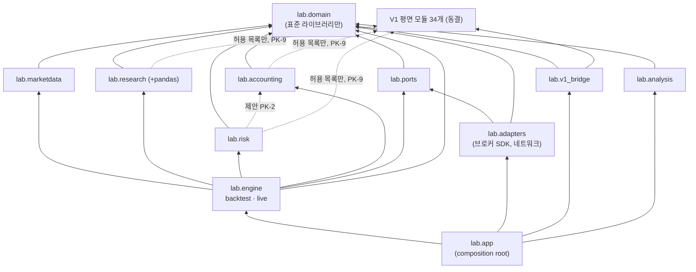

# ADR-0010: 물리적 패키지 경계와 이전 계획 (Physical Package Boundaries and Migration Plan)

## 1. Title

새 코드의 물리적 배치, import 허용·금지 방향, V1 모듈과의 경계, 단계별 이전 순서 (결정 ID D-10)

## 2. Status

**ACCEPTED** (2026-10-16)

| 항목 | 내용 |
|---|---|
| 승인일 | 2026-10-16 |
| 승인 주체 | 프로젝트 사용자 |
| 승인 근거 | 사용자의 명시적 승인 (작업 P0-02C2-FINAL, P0-02C2-R1 검토 후) |
| 승인 범위 | **핵심 아키텍처 설계 원칙만** (아래 "승인된 원칙"). §6의 제목 "Proposed Decision"은 ADR 서식의 이름이며, 그 가운데 아래 원칙이 승인된 결정이다. §6 안의 세부 규칙은 아래 "규칙별 승인 상태" 표를 따른다 |
| 제외 범위 | 아래 "승인되지 않은 사항"과 §11의 Open Questions 전부 (Q10-1~Q10-8), 구체 구현 규칙, 운영 기본값, 코드 구현 |
| 구현 상태 | **미구현.** |
| 인수 테스트 | **명세만 존재, 미구현** (§10, AT-0010-1~6) |
| 의미 | 문서 수준의 설계 원칙 승인이다. 코드 구현, 의존성 추가, 테스트 작성, 금융 계산 검증, Paper/Live 준비를 허가하거나 완료했다는 뜻이 아니다 |
| 변경 규칙 | 핵심 결정을 바꾸려면 새 ADR로 대체한다 (`SUPERSEDED by NNNN`). 오탈자, 링크, 명백한 문서 오류만 직접 고친다. 기존 ACCEPTED ADR과 충돌하는 변경은 별도 결정과 승인이 필요하다 |

**승인된 원칙**

1. V1의 기존 평면 모듈 34개를 현재 위치에 보존한다 (§6.1, §6.4).
2. 새 시스템은 V1과 분리된 우산 하위 패키지 아래에 둔다. 구조 대안 B-2의 원칙을 채택한다 (§6.1, §6.2). 이름은 가칭이다 (Q10-1).
3. 기존 V1 모듈을 전부 옮기고 shim만 남기는 대안 C는 채택하지 않는다 (§6.1, §3.4).
4. V1의 공개 import 경로, 클래스 동일성, fingerprint, 테스트 의미를 보호한다 (§6.4, §8, PK-8, PK-12).
5. 새 코드에는 명시적인 계층·의존성 규칙을 적용하고 순환 의존을 금지한다 (§6.3, PK-13).
6. 핵심 금융 계산, 외부 Adapter, 실행 엔진의 책임을 분리한다 (§6.2, PK-3, PK-5, PK-6).
7. 브로커 SDK와 실제 주문 실행 경계를 제한한다 (PK-10, PK-11).
8. V1 재배선이나 구조 변경에는 사전 golden master와 별도 승인이 필요하다 (§6.5, ADR-0005 승인 원칙 6·7).
9. 단계별 이전과 단계별 검증 원칙을 유지한다 (§6.5). 어느 단계도 이 승인으로 실행 승인되지 않는다.
10. V1에서 이미 확인된 계층 이상(L-1~L-9)은 이 승인으로 자동 수정되지 않는다 (§3.3, ADR-0004 R-6).

**규칙별 승인 상태** (§6.3의 PK-1~PK-13. 원문은 바꾸지 않았다)

| 규칙 | 상태 |
|---|---|
| PK-1, PK-3, PK-7, PK-8, PK-10, PK-11, PK-12, PK-13 | 원칙 승인 (원칙 4~7). PK-1, PK-7은 ACCEPTED ADR-0004 R-1, R-5와 같은 내용 |
| PK-2 | 코어 패키지가 `domain`에 의존한다는 기본 원칙만 승인. **`risk → accounting` 의존은 미승인이며 실행 금지** (ACCEPTED ADR-0004 §6.2 표와 다름, Q10-4). `marketdata`의 pandas는 ADR-0004 Q4-8 |
| PK-4, PK-5 | Adapter가 금융 코어와 엔진을 import하지 않는다는 분리 원칙만 승인. **`ports`를 Domain Contracts의 일부로 보는 분류는 미승인** (Q10-4) |
| PK-6 | 엔진이 계층을 조립하고 구체 Adapter를 주입받는다는 원칙만 승인. **`app`을 Engines의 일부로 보는 분류와 그것이 ADR-0004 의존 표에 미치는 영향은 미승인** (Q10-4) |
| PK-9 | **미승인이며 실행 금지.** 코어 → V1 공식 모듈 의존은 ADR-0004 §6.2 표와 다르고, ADR-0001 §8.0 해석이 필요하다 (Q10-2) |

**승인되지 않은 사항 (Open Questions로 유지)**

| 사항 | 관련 질문 |
|---|---|
| 새 패키지의 최종 이름 (`carver_quant.lab`은 가칭) | Q10-1 |
| V1 순수 공식 함수의 재사용 범위, ADR-0001 §8.0 "V1 API" 금지 범위의 해석 | Q10-2 |
| import 규칙 검사 방법(AST 테스트 / 외부 도구)과 테스트 작성 시점 | Q10-3 |
| `risk → accounting` 의존 예외, `ports`·`app`의 계층 분류와 ADR-0004 해석 | Q10-4 |
| Composition root와 Live 활성화 장치 | Q10-5 |
| V1 내부 의존성·중복 코드 정리 | Q10-6 |
| `tzdata` 등 타임존 데이터 의존성 추가 | Q10-7 |
| 테스트 디렉터리 재구성 | Q10-8 |
| Stage 1 타입 이동 방식 A/A-0 | ADR-0004 Q4-1 |
| §6.5의 각 단계 실행 | 단계별 별도 명세와 승인 |


- 작성일: 2026-10-16 (작업 P0-02C2)
- 기준 커밋: `a02aede` (`python -m pytest -q -W error` → 306 passed, 경고 0)
- 관련 P0-01 항목: GAP `A-01`, `A-03`, `A-08`, `A-11`, `A-14`. [V1_DEPENDENCY_ANALYSIS.md](../architecture/V1_DEPENDENCY_ANALYSIS.md) §1, §5 D-10; [V1_INVENTORY.md](../architecture/V1_INVENTORY.md) §4
- 관련 ADR (모두 ACCEPTED): [0004](0004-market-data-and-domain-boundaries.md) (논리 계층 R-1~R-6, V1 보호 P-1~P-6, Stage 0~3, Q4-1, Q4-2, Q4-6), [0005](0005-backtest-paths-and-v1-compatibility.md) (V1 경로 동결, Stage 0~5, Q5-5), [0003](0003-pretrade-risk-policy.md) (L1·L2 공유 순수 함수, L3 Imperative Shell), [0002](0002-warmup-and-tradability.md) (Paper/Live에서 `V1_COMPAT` 금지), [0009](0009-order-fill-and-position-lifecycle.md) (공유 순수 계산과 모드별 책임 §6.5, Q9-9)
- **이 ADR이 정하는 것**: 새 코드의 물리적 위치 원칙, import 허용·금지 방향, V1 모듈과 새 코드의 경계, 이전 단계와 단계별 승인 조건
- **이 ADR이 정하지 않는 것**: 패키지 실제 생성, 모듈 이동, ADR-0004 Stage 1의 방식 (Q4-1, 미승인), 도메인 타입의 필드 (P0-03), 최종 패키지 이름 (Q10-1). 아래의 모든 패키지 이름은 **가칭**이고 모든 새 패키지는 **PLANNED**다

## 3. Context

### 3.1 현재 패키지 (CONFIRMED, `a02aede`)

- `src/carver_quant/`에는 `__init__.py`와 모듈 34개가 있다. 하위 패키지는 없다.
- `__init__.py`는 **비어 있다.** 패키지 수준 재export가 없으므로 공개 경로는 `carver_quant.<모듈>.<이름>` 하나뿐이다.
- P0-01 감사 이후 `src/`, `tests/`는 바뀌지 않았다 (`git log -- src tests`: `258e564`, `df6547e`만 있음).
- `pyproject.toml`에는 import 규칙 검사 도구(mypy, import-linter 등) 설정이 없다. 패키지 탐색은 `[tool.setuptools.packages.find] where = ["src"]`다.

### 3.2 현재 모듈 의존 그래프 (CONFIRMED, 이번 조사에서 AST로 다시 추출)

모든 `from carver_quant.X import`와 `import carver_quant.X`를 추출했다. "깊이"는 의존 대상 중 가장 깊은 모듈의 깊이 + 1이다. 계산이 끝났다는 것 자체가 **순환이 없다**는 뜻이다. 결과는 [V1_INVENTORY.md](../architecture/V1_INVENTORY.md) §4와 같다.

| 깊이 | 모듈 → 의존 대상 |
|---|---|
| 0 | `account_ledger`, `execution`, `futures_data`, `fx`, `instrument`, `portfolio`, `position_ledger`, `risk_guardrail`, `risk_target`, `roll`, `trade` (내부 의존 없음) |
| 1 | `backtest_config → risk_guardrail` · `contract_ledger → roll` · `costs → fx` · `pnl → fx` · `position → fx` · `volatility → futures_data` (+pandas) |
| 2 | `backtest_manifest → backtest_config, instrument, portfolio` · `buffering → position` · `daily_step → account_ledger, costs, execution, pnl, position, position_ledger, trade` · `forecast → futures_data, volatility` (+pandas) · `roll_execution → contract_ledger, costs, execution, roll` |
| 3 | `backtest → daily_step` · `combined_forecast → forecast, futures_data, volatility` · `contract_aware_daily_step → account_ledger, buffering, pnl, position, roll, roll_execution, trade` · `roll_aware_daily_step → account_ledger, pnl, position, roll, roll_execution, trade` |
| 4 | `contract_aware_backtest → contract_aware_daily_step, instrument, roll_execution` · `research_pipeline → combined_forecast, forecast, futures_data, volatility` |
| 5 | `system_backtest → contract_aware_backtest, forecast, futures_data, instrument, research_pipeline, roll_execution` |
| 6 | `data_quality → futures_data, system_backtest` · `portfolio_backtest → contract_aware_daily_step, instrument, portfolio, risk_guardrail, risk_target, system_backtest` |
| 7 | `performance → portfolio_backtest` · `portfolio_system_backtest → backtest_config, data_quality, futures_data, instrument, portfolio, portfolio_backtest, risk_guardrail, system_backtest` |
| 8 | `backtest_result_bundle → backtest_manifest, performance` |

- 외부 라이브러리는 표준 라이브러리 외에 `pandas`(`volatility`, `forecast`)뿐이다.
- 측정 (2026-10-16, 저장소 `.venv`): `instrument`, `fx`, `pnl`, `costs`, `position`만 import하면 `pandas`가 로드되지 않는다. `portfolio_system_backtest`를 import하면 `carver_quant` 모듈 27개와 `pandas`가 로드된다.

### 3.3 계층 이상 (ADR-0004 §3.2 + 이번 조사)

ADR-0004 §6.2의 논리 계층으로 V1 모듈을 분류하면 다음 의존이 계층 규칙과 맞지 않는다. ADR-0004 R-6에 따라 V1 안의 이상은 **동결**하고 별도 작업으로만 정리한다.

| # | 의존 | 계층 관계 | 근거 | 추적 |
|---|---|---|---|---|
| L-1 | `data_quality → system_backtest` | Data Boundary → Engines (역방향) | `data_quality.py:7-9` | GAP A-01, ADR-0004 Stage 1 (Q4-1) |
| L-2 | `performance → portfolio_backtest` | Analysis → Engines (러너 결과 타입) | `performance.py:6-8` | GAP A-08, ADR-0004 Q4-6 |
| L-3 | `portfolio_backtest → system_backtest` | Engines → Engines (EWMAC 전용 준비 타입) | `portfolio_backtest.py:19-21, 33-36` | GAP A-14 |
| L-4 | `system_backtest → roll_execution` (`ContractQuote`) | 시장 관측 타입이 체결 모듈에 있음 | `roll_execution.py:15-18` | ADR-0004 §3.2 |
| L-5 | `contract_ledger → roll` (`ContractTrade`) | 장부가 거래 생성 모듈의 타입에 의존 | `contract_ledger.py:1` | ADR-0004 §3.2 |
| L-6 | `volatility`, `forecast → futures_data` (`BackAdjustedPrice`) | 신호 입력이 선물 전용 조정 가격 타입 | `volatility.py:7-8`, `forecast.py:7` | ADR-0004 §3.2, ADR-0006 |
| L-7 | `backtest_manifest → backtest_config, portfolio` | Analysis → 설정·Portfolio 입력 타입 (기록하려고 입력 타입을 import) | `backtest_manifest.py:18-28` | 이번 조사에서 기록. ADR-0004 R-5는 Analysis가 결과 계약에 의존하도록 정함 |
| L-8 | `backtest_config → risk_guardrail` (`PortfolioRiskPolicy`) | 설정 → Portfolio & Risk 정책 타입 | `backtest_config.py:5` | 이번 조사에서 기록. 설정이 정책 타입을 담는 것은 자연스럽지만, V1_INVENTORY는 `backtest_config`를 Analysis로 분류했다 |
| L-9 | `costs`, `pnl`, `position → fx` | 핵심 계산 계층끼리의 의존. `fx`는 ADR-0004 계층 표에 없다 (V1_INVENTORY는 Base로 분류) | `costs.py:2`, `pnl.py:2`, `position.py:3` | 이번 조사에서 기록. 새 코드에서는 환산 규칙의 위치를 정해야 한다 (§6.3 PK-2) |

### 3.4 테스트가 의존하는 경로와 동작 (CONFIRMED)

| 항목 | 내용 | 근거 |
|---|---|---|
| 테스트 파일 | 39개. 그 가운데 38개가 `carver_quant`를 import한다 (`test_environment.py` 제외) | `tests/` |
| import되는 모듈 | 34개 모듈 **전부**가 적어도 한 테스트 파일에서 import된다. 이름은 97개 | AST 추출 |
| 가장 많이 쓰는 경로 | `roll_execution` 13개 파일, `futures_data` 12개, `system_backtest` 8개, `instrument` 8개 | AST 추출 |
| 비공개 이름 | `_prepare_backtest_from_point_in_time_signals` 1건 | `tests/test_system_backtest.py:19, 374` |
| 모듈 속성 패치 | `monkeypatch.setattr(roll_execution, "execute_market_order", spy)`로 체결 함수를 감시하고, 검증 실패 시 체결이 한 번도 일어나지 않았음을 `assert execution_calls == []`로 확인한다 | `tests/test_roll_execution.py:122-179` (`:152`, `:179`) |
| 클래스 동일성 | `isinstance(signal, PointInTimeResearchSignalPoint)` | `tests/test_portfolio_system_backtest.py:517`, `tests/test_v1_acceptance.py:238` |

**모듈을 옮기고 이전 경로에 재export shim을 두는 경우의 문제 (probe, 2026-10-16)**

저장소 밖에서 같은 구조의 장난감 패키지로 확인했다 (CONFIRMED: 메커니즘).

- 구현을 새 모듈로 옮기고 이전 모듈에 `from 새모듈 import ...`만 남긴 뒤, 테스트처럼 **이전 모듈의 속성**을 spy로 바꿨다.
- 구현 함수는 자기 모듈의 전역 이름으로 체결 함수를 찾으므로 spy가 **한 번도 호출되지 않았다.**
- 일부러 "체결 후 검증"으로 순서를 바꾼 결함 코드에서도 spy 호출 목록은 `[]`였다. 즉 `assert execution_calls == []`가 **결함이 있어도 통과**했다. 구현 모듈의 속성을 패치하면 호출이 `[1, 2]`로 잡혔다.
- 따라서 `roll_execution`을 옮기면 `test_roll_validation_happens_before_any_execution`은 실패하지 않고 **의미만 사라진다** (INFERRED: 실제 테스트에 적용한 결과는 메커니즘에서 추론). 306개 통과가 보호를 뜻하지 않는 경우다.

**하위 패키지 이름이 V1 모듈 이름과 겹치는 경우 (probe, 2026-10-16)**

- `pkg/portfolio.py`와 `pkg/portfolio/__init__.py`가 함께 있으면 `import pkg.portfolio`는 **하위 패키지를 로드한다.** 오류나 경고 없이 V1 모듈이 가려진다 (CONFIRMED: 장난감 패키지).
- V1 모듈 이름(`portfolio`, `execution`, `performance`, `instrument`, `forecast`, `costs`, `fx`, `roll` 등 34개)과 같은 이름의 하위 패키지를 `carver_quant` 바로 아래에 만들면 V1 import 경로가 조용히 깨진다.

### 3.5 환경 관찰 (CONFIRMED)

- 저장소 `.venv`(Python 3.14.6, Android aarch64)에서 `zoneinfo.ZoneInfo("America/New_York")`는 `ZoneInfoNotFoundError`다. `tzdata` 패키지가 설치되어 있지 않고, `zoneinfo.TZPATH`의 `/usr/share/zoneinfo`도 Termux에 없다.
- 따라서 ACCEPTED ADR-0007의 IANA 타임존 규칙(C7-1, C7-2)을 구현하려면 **의존성 추가**(예: `tzdata`)가 필요하다. 이것은 `pyproject.toml` 변경이므로 사용자 승인 대상이다 (CLAUDE.md §5). P0-02C1에서 DST 예제를 계산할 때는 저장소 밖 임시 환경에 tzdata 2026.5를 설치해 썼다.

## 4. Decision Drivers

1. **V1 결과와 fingerprint 보호**: V1 API의 입력, 동작, fingerprint를 바꾸지 않는다 (ADR-0005 C5-1~C5-4, ADR-0001 §8.0).
2. **공개 import 경로와 클래스 동일성**: 같은 경로에서 같은 클래스 객체(`is`)가 import되어야 한다 (ADR-0004 P-2, P-6).
3. **테스트 의미 보존**: 테스트가 통과하는 것뿐 아니라 검사 대상을 계속 검사해야 한다 (CLAUDE.md §5의 테스트 약화 금지). §3.4의 shim 문제가 예다.
4. **의존 방향과 순환 금지**: ADR-0004 R-1~R-6.
5. **실주문 격리**: 금융 계산 코어는 브로커 SDK를 import하지 않고, 실제 주문은 Adapter와 명시적 실행 경계를 거쳐서만 나간다 (CLAUDE.md §4, §8, ADR-0004 R-3).
6. **Backtest/Paper/Live 공유**: 같은 계산 코드를 세 모드가 쓴다 (CLAUDE.md §4).
7. **단계적 이전**: 각 단계가 독립적으로 검증되고 되돌릴 수 있어야 한다 (ADR-0005 §4).
8. **개인 운영 비용**: 새 도구와 의존성을 최소로 한다.

## 5. Considered Options

### 5.1 대안 A — 평면 패키지에 새 모듈 추가

- **내용**: `src/carver_quant/` 바로 아래에 새 모듈(도메인 계약, 새 엔진, adapter 등)을 계속 추가한다. 계층은 모듈 이름 접두사와 규칙 문서로 표시한다.
- **장점**: V1 모듈을 건드리지 않는다. 테스트 영향이 없다. 가장 작다.
- **단점**: V1 모듈 34개와 새 모듈이 한 네임스페이스에 섞인다. 새 코드가 V1 러너를 실수로 import하기 쉽다. 계층을 디렉터리로 검사할 수 없어 모듈마다 허용 목록이 필요하다. V1 모듈 이름과 비슷한 새 이름이 혼동을 만든다 (예: V1 `portfolio`와 새 포트폴리오 위험 모듈).

### 5.2 대안 B — V1 평면 모듈을 유지하고 새 코드를 하위 패키지에 추가

- **B-1**: 계층별 하위 패키지를 `carver_quant` 바로 아래에 둔다 (`carver_quant.domain`, `carver_quant.engine` …).
- **B-2**: 새 코드 전체를 **우산 하위 패키지 하나** 아래에 두고, 그 안에 계층별 하위 패키지를 둔다 (`carver_quant.<새 루트>.domain` …).
- **장점 (공통)**: V1 모듈을 옮기지 않는다. 테스트 영향이 없다. 계층이 디렉터리로 드러나고, 패키지 단위로 import 규칙을 검사할 수 있다.
- **B-1의 단점**: 새 하위 패키지 이름이 V1 모듈 이름과 겹치면 V1 모듈을 조용히 가린다 (§3.4 probe). 이름마다 충돌을 피해야 하고, V1과 새 코드가 같은 수준에 섞인다.
- **B-2의 단점**: import 경로가 한 단계 길어진다. 우산 이름을 정해야 한다.

### 5.3 대안 C — 기존 모듈도 하위 패키지로 이동하고 이전 경로에 호환 shim

- **내용**: V1 모듈 34개를 계층별 하위 패키지로 옮기고, 이전 경로에는 같은 객체를 재export하는 shim 모듈을 둔다 (ADR-0004 §5.4의 대안 C와 같음).
- **장점**: 최종 구조가 가장 깔끔하다.
- **단점**: shim 최대 34개. 비공개 이름까지 재export해야 한다. 모듈 속성 패치 테스트가 의미를 잃는다 (§3.4 probe). 과도기에 shim과 새 패키지 사이 순환 위험이 있다 (ADR-0004 §5.5). §3.3의 계층 이상 L-1~L-9를 먼저 풀어야 옮길 수 있다. CLAUDE.md §4("조사 전 대규모 개편 금지"), §5(모듈 이동은 승인 필요), ADR-0005 승인 원칙 2("기존 경로를 즉시 삭제하거나 재배선하지 않는다")와 정면으로 부딪힌다.

### 5.4 비교

| 기준 | A (평면 추가) | B-1 (계층 하위 패키지) | B-2 (우산 + 계층) | C (전부 이동 + shim) |
|---|---|---|---|---|
| 기존 V1 결과 보호 | 높음 (V1 무수정) | 높음. 단 이름 충돌 시 V1 모듈이 가려짐 | **높음** (V1 무수정, 이름 충돌 없음) | 중간. 필드가 같으면 fingerprint는 그대로지만 (ADR-0004 §3.5) 변경량이 커서 회귀 위험이 큼 |
| 공개 import 경로·클래스 동일성 | 유지 | 유지 (충돌 이름 제외) | **유지** | shim 34개와 비공개 이름 재export에 의존 |
| 테스트 의미 | 영향 없음 | 영향 없음 | **영향 없음** | monkeypatch 테스트가 조용히 무력화될 수 있음 |
| 순환 의존 | 규칙을 모듈 단위로만 검사 → 중간 | 패키지 단위 검사 → 낮음 | **낮음** | 과도기에 높음 |
| 코드 변경 규모 | 새 파일만 | 새 파일만 | **새 파일만** | 34개 이동 + shim 최대 34개 |
| Backtest/Paper/Live 공유 | 가능 | 가능 | **가능** (코어 패키지를 엔진이 공유) | 가능 |
| 책임 분리의 가시성 | 낮음 (이름 관례) | 높음 | **높음** + V1/새 코드 경계가 한 줄로 드러남 | 높음 |
| 단계적 이전 | 가능 | 가능 | **가능** | 어려움 (이동이 본질) |
| 규칙 검사의 단순함 | 모듈별 허용 목록 | 패키지별 규칙 + 이름 충돌 검사 | 패키지별 규칙 + "V1 ↔ 새 루트" 규칙 하나 | 패키지별 규칙 |

## 6. Proposed Decision

### 6.1 결정 요지

**B-2를 채택한다.** V1 모듈 34개는 현재 평면 경로에 동결된 채 그대로 둔다. 새 코드(도메인 계약, 새 연구 엔진, Paper/Live 조율, adapter, 새 재현성 도구)는 V1 모듈 이름과 겹치지 않는 **새 우산 하위 패키지 하나**(가칭 `carver_quant.lab`, 이름은 Q10-1) 아래 계층별 하위 패키지에 둔다. **C(기존 모듈 이동)는 채택하지 않는다.**

- 이 ADR은 **배치 원칙과 import 방향**만 정한다. 패키지 생성, 모듈 이동, 테스트 추가는 각각 별도 작업 명세와 사용자 승인을 거친다 (§6.7).
- 이 ADR을 승인해도 ADR-0004 Q4-1(Stage 1 방식 A/A-0)이나 어떤 리팩터링도 **자동으로 승인되지 않는다** (§6.6).
- 이 ADR은 ACCEPTED ADR-0004 §6.2의 논리 계층을 물리 배치로 옮긴 것이다. 다만 ADR-0004 §6.2 표와 다른 의존 두 가지(PK-2의 `risk → accounting`, PK-9의 코어 → V1 공식 모듈)를 제안하며, 이는 승인 전까지 쓰지 않는다 (§6.8, Q10-2, Q10-4).

### 6.2 목표 패키지 구조 초안 (PLANNED, 이름은 모두 가칭)

```
src/carver_quant/
├── __init__.py            V1: 비어 있음. 그대로 둔다
├── <V1 모듈 34개>          V1: 동결. 경로·이름·동작·fingerprint 불변
└── lab/                   PLANNED. 새 코드의 유일한 루트 (가칭, Q10-1)
    ├── domain/            Domain Contracts
    ├── marketdata/        Market Data / Validation (Data Boundary, PIT 뷰)
    ├── research/          Research / Forecast (신호, 거래 허용 정책 ADR-0002)
    ├── risk/              Portfolio / Risk (위험 예산, 사이징, 버퍼링, L1·L2 ADR-0003)
    ├── accounting/        Cost / Accounting (비용, 체결 시뮬레이션 함수, 회계식 ADR-0001,
    │                      통화별 현금·NAV ADR-0008, 체결 기록 → 포지션 계산 ADR-0009)
    ├── engine/
    │   ├── backtest/      Backtest Engine (replay 루프, 체결 가정 적용)
    │   └── live/          Paper / Live Execution (주문 상태 추적, L3 상태 게이트,
    │                      Reconciliation 조율, 실행 경계)
    ├── ports/             Adapter 계약 (Protocol, 결과·오류 분류). ADR-0012
    ├── adapters/          Broker / Data / Persistence / Paper Simulator 구현
    ├── analysis/          Analysis / Reproducibility (성과, 새 manifest·fingerprint, ADR-0011)
    ├── v1_bridge/         V1 입력 → 새 계약 변환기 (ADR-0004 Stage 2), V1 golden 추출 도구
    └── app/               Composition root: 설정 로드, 자격증명 분리, adapter 연결, 실행 모드 결정
```

| 패키지 | 책임 | V1 대응 (감사용 분류) | 근거 ADR |
|---|---|---|---|
| `domain` | 상품 사양, 식별자, 가격 종류, 관측값, 이벤트, 가정값·정책 값, 주문·체결·현금 기록, 결과 계약 | `instrument`와 여러 모듈에 흩어진 타입 | 0004 §6.2, 0006, 0009 |
| `marketdata` | 입력 검증, 정규화, PIT 뷰, 상품별 데이터 상태 (`FRESH` 등) | `data_quality`, `futures_data` 검증 부분 | 0004, 0007 |
| `research` | 연구용 조정 시계열, vol, forecast, 결합, 거래 허용 정책 | `futures_data` 조정, `volatility`, `forecast`, `combined_forecast`, `research_pipeline` | 0002, 0004 |
| `risk` | 위험 예산, 사이징, 버퍼링, 거래 전 위험 L1·L2 | `risk_target`, `portfolio`, `position`, `buffering`, `risk_guardrail` | 0003 |
| `accounting` | 비용, 체결가 시뮬레이션 함수, 일반화 회계식, 통화별 현금·NAV 분해, 체결 기록에서 실제·예상 포지션 계산, 대조 차이 계산 | `costs`, `execution`, `roll`, `roll_execution`, `pnl`, `account_ledger`, 장부 모듈, `fx` | 0001, 0008, 0009 §6.5 |
| `engine/backtest` | replay 루프, 체결 가정 적용, 정책 프로필 검증, 결과 조립 | `*_daily_step`, `*_backtest` 러너 | 0005 §6.4 |
| `engine/live` | 일간 실행 일정, 주문 상태 기계, L3 상태 게이트, Reconciliation 조율, **실행 경계** (§6.3 PK-11) | 없음 | 0003 §6.5, 0009, 0012 |
| `ports` | Broker Query·Broker Order·Market Data·Persistence·Clock 계약 (Protocol)과 요청 결과 분류. ADR-0004 계층상 Domain Contracts의 일부로 보는 분류는 제안 (미승인, Q10-4) | 없음 | 0004, 0012 §6.2 |
| `adapters` | 브로커 SDK, 데이터 공급자, 저장소, Paper 시뮬레이터 | 없음 | 0012 |
| `analysis` | 성과 분석(결과 계약 기반), 새 manifest·fingerprint, golden 비교 보고 | `performance`, `backtest_manifest`, `backtest_result_bundle` (V1은 그대로) | 0011 |
| `v1_bridge` | V1 입력 → 새 계약 변환 (위험 예산 수준 명시 필수, ADR-0004 AT-0004-4), V1 결과에서 golden 값 추출 | 없음 | 0004 Stage 2, 0011 |
| `app` | 실행 모드(Backtest/Paper/Live)와 프로필 결정, 자격증명 로드, adapter 생성·주입. ADR-0004 계층상 **Engines(Imperative Shell)의 일부**로 보는 분류는 제안 (미승인, Q10-4. R-4 "Engines만 계층을 조립한다") | 없음 | 0004 R-4, CLAUDE.md §8 |

### 6.3 import 허용·금지 방향

화살표는 "import해도 된다"는 뜻이다. 표에 없는 방향은 **금지**다.



| ID | 규칙 | 근거 |
|---|---|---|
| PK-1 | `lab.domain`은 표준 라이브러리만 import한다. pandas, `carver_quant`의 다른 모듈(V1 포함), 다른 `lab` 패키지를 import하지 않는다 | ADR-0004 R-1 |
| PK-2 | Pure Finance Core(`marketdata`, `research`, `risk`, `accounting`)의 **`lab` 내부 import**는 `domain`과 이 ADR에 명시한 코어 사이 의존만 허용한다. 제안하는 코어 사이 의존은 `risk → accounting`(사전 비용 추정, 명목가치) 하나다. 이것은 ACCEPTED ADR-0004 §6.2 표(Portfolio & Risk, Cost·Accounting은 Domain에만 의존)와 **다르므로** 승인이 필요하다 (Q10-4). V1 모듈 import는 PK-9를 따른다. 외부 라이브러리는 ADR-0004 계층 표대로 `research`의 pandas만 명시적으로 허용하고, `marketdata`(Data Boundary)의 pandas 허용 여부는 ADR-0004 Q4-8로 열어 둔다. 통화 환산 규칙은 `accounting`이 소유한다 (V1 L-9를 새 코드에서 반복하지 않음). 새 의존을 추가하려면 이 표를 개정한다 | ADR-0004 R-2, §6.2, Q4-8, §3.3 L-9 |
| PK-3 | Pure Finance Core는 `engine`, `ports`, `adapters`, `app`를 import하지 않는다. 네트워크·파일·현재 시각 조회·난수를 쓰지 않는다 | ADR-0004 R-2, R-3, CLAUDE.md §4 (Functional Core) |
| PK-4 | `ports`는 `domain`만 import한다. 계약(Protocol)과 결과·오류 분류만 담는다 | ADR-0012 |
| PK-5 | `adapters`는 `domain`, `ports`, 외부 SDK만 import한다. `ports`는 계약(Protocol)과 결과 분류만 담으므로 ADR-0004 계층상 **Domain Contracts의 일부**로 분류한다 (이 분류도 승인 대상, Q10-4). 금융 계산 코어와 `engine`을 import하지 않는다. Paper 시뮬레이터에 필요한 체결가 계산은 `app`이 `accounting`의 순수 함수를 **주입**한다 (adapter가 직접 import하지 않음) | ACCEPTED ADR-0004 §6.2 표 (Adapters는 Domain에만 의존) |
| PK-6 | `engine`은 `domain`, 코어, `ports`를 import한다. 구체 adapter는 import하지 않고 `app`이 주입한다. V1 모듈을 직접 import하지 않는다 | ADR-0004 R-4 |
| PK-7 | `analysis`는 `domain`(결과 계약 포함)만 import한다. `engine` 내부 타입과 V1 러너 결과 타입에 의존하지 않는다 | ADR-0004 R-5, GAP A-08 |
| PK-8 | **V1 모듈은 `lab`을 import하지 않는다.** V1 동작이 새 코드 때문에 바뀌는 경로를 원천적으로 막는다 | ADR-0005 승인 원칙 2, ADR-0001 §8.0 |
| PK-9 | `lab`에서 V1 모듈을 import할 수 있는 곳은 (a) `v1_bridge`, (b) 코어가 **V1 순수 공식 모듈 허용 목록**을 재사용하는 경우뿐이다. 허용 목록 후보: `fx`, `pnl`, `position`, `buffering`, `costs`, `execution`, `trade`, `account_ledger`, `risk_target`, `portfolio`, `futures_data`, `volatility`, `forecast`, `combined_forecast`, `roll`. 후보는 모두 러너를 전이적으로 import하지 않음을 이번 조사에서 확인했다 (§3.2). 목록에 없는 모듈은 허용하지 않는다. 특히 러너·스텝(`*_backtest`, `*_daily_step`, `backtest`), `data_quality`(L-1), `performance`(L-2), `backtest_manifest`·`backtest_result_bundle`(V1 재현성 전용), `research_pipeline`(full-history 신호 경로 포함, ADR-0005 E-2), `risk_guardrail`(V1 사후 검사, ADR-0003 §8), `roll_execution`(V1 `ContractQuote`와 체결 집계를 묶음), `instrument`(V1 타입, 새 코드는 `lab.domain` 상품 계약)는 제외한다. **채택 여부와 ADR-0001 §8.0과의 관계는 Q10-2** | CLAUDE.md §4 (같은 계산 재사용), P0-02B·P0-02C1 요약의 목표 흐름 ("V1 함수 재사용") |
| PK-10 | 브로커 SDK, 네트워크 라이브러리, 자격증명 로드는 `adapters`와 `app`에만 둔다 | CLAUDE.md §4, §5, §8 |
| PK-11 | **실행 경계**: 주문 제출·취소·정정 port를 호출하는 코드는 `engine/live`의 실행 경계 하나뿐이다. 실행 경계는 호출 전에 실행 모드, Live 활성화 설정, Trading State, 거래 전 위험 결과, 제출 시도 기록이 저장소에 영속화되었다는 확인(ADR-0012 BR-3)을 확인한다. 확인이 없으면 호출하지 않는다. Backtest 엔진에는 주문 port가 없다. 실제 브로커 adapter는 `app`이 Live 모드와 명시적 활성화 설정이 있을 때만 만든다 | CLAUDE.md §8, ADR-0003 §6.5, ADR-0012 |
| PK-12 | `lab` 아래 어떤 하위 패키지도 V1 모듈 이름과 같은 이름을 `carver_quant` 바로 아래에 만들지 않는다 (§3.4 이름 충돌 probe). 우산 루트 이름도 V1 모듈 34개와 겹치지 않아야 한다 | §3.4 |
| PK-13 | 순환 import를 만들지 않는다. V1과 `lab`을 합친 전체 그래프가 비순환이어야 한다 | ADR-0004 Decision Driver 4 |

**V1 타입이 새 코드에 들어오는 지점**: PK-9로 V1 공식 함수를 재사용하면 일부 함수는 V1 타입을 받는다 (예: `volatility`는 `BackAdjustedPrice` 목록을 받음, §3.3 L-6). 이 변환은 해당 코어 패키지 안의 호출부에만 두고, `lab.domain` 타입의 필드에 V1 타입을 넣지 않는다. V1 클래스를 `lab` 안에 복사하거나 서브클래스로 다시 정의하지 않는다 (ADR-0004 P-2).

**규칙 검사 방법 (제안, 구현은 승인 후)**: 이번 조사에서 쓴 것과 같은 **AST 기반 import 규칙 테스트**를 `tests/`에 추가하는 방식을 권장한다. 새 의존성이 없다. 대안인 import-linter는 개발 의존성 추가라서 `pyproject.toml` 변경 승인이 필요하다 (Q10-3). 현재 V1 이상 L-1~L-9는 테스트의 명시적 예외 목록으로 기록하고, 새 이상이 생기면 실패하게 한다.

### 6.4 V1과 새 코드의 경계

| 항목 | V1 (동결) | 새 코드 (`lab`, PLANNED) |
|---|---|---|
| 위치 | `carver_quant.<모듈>` 34개 | `carver_quant.lab.<계층>` |
| 변경 규칙 | 동결. 결함 수정도 별도 승인과 golden 갱신 기록 (ADR-0005 §6.2) | 새 기능의 유일한 구현 위치 (ADR-0005 §6.1) |
| import 방향 | `lab`을 import하지 않는다 (PK-8) | V1은 `v1_bridge`와 공식 허용 목록으로만 (PK-9) |
| 진입점 | 기존 V1 API (암묵적 `V1_COMPAT`) | 새 연구 API (프로필 명시 필수), Paper/Live (`LIVE`만) (ADR-0001 §8.0) |
| 타입 | V1 dataclass (필드 불변, ADR-0004 P-1) | `lab.domain` 타입 (P0-03) |
| fingerprint | V1 canonical JSON과 V1 payload 그대로 | 새 인코더·새 payload·새 schema version (ADR-0011) |
| 테스트 | 기존 306개 + Stage 0 golden (ADR-0011) | 새 테스트. 차등 비교로 V1과 연결 (ADR-0005 AT-0005-3) |
| 주문 | 없음 (시뮬레이션 체결만) | `engine/live`의 실행 경계를 통해서만 (PK-11) |

### 6.5 단계별 이전 순서와 회귀 위험

단계 번호는 ADR-0005 §6.7, ADR-0004 §6.8의 Stage와 맞춘다. **어느 단계도 이 ADR로 승인되지 않는다.**

| 단계 | 내용 | V1 결과 변경 위험 | 테스트 영향 | 회귀 확인 | 승인 |
|---|---|---|---|---|---|
| Stage 0 | V1 golden master 고정 (ADR-0011) | 없음 | 테스트 추가만 | golden 자체 | ADR-0005 Q5-4, Q5-9 (미결정) |
| Stage 0a (선택) | import 규칙 테스트 추가: 현재 V1 그래프와 이상 L-1~L-9를 예외 목록으로 고정 | 없음 | 테스트 추가만 | 306 통과 + 새 테스트 | Q10-3 |
| Stage 1 | ADR-0004 역방향 의존 해소. 방식 A/A-0는 Q4-1 | 없음 (golden이 보호) | 없음 | golden, AT-0004-1, AT-0004-3, AT-0010-1 | Q4-1 + (A이면) 모듈 이동 승인 |
| Stage 2 | `lab/` 뼈대, `lab.domain`, `lab.v1_bridge` **추가** | 없음 (V1 무수정) | 새 테스트만 | AT-0010-1~4 | P0-03 승인, Q10-1, 구현 승인 |
| Stage 3 | `lab.engine.backtest`와 코어 패키지, V1 차등 비교 | 없음 | 새 테스트만 | ADR-0005 AT-0005-3 | 구현 승인, Q10-2 |
| Stage 4 | 일반 모드 기능 (ADR-0001 일반 회계, ADR-0002, ADR-0003, ADR-0006~0008) | 없음 | 새 테스트만 | 기능별 독립 수치 검증 (CLAUDE.md §3.2) | 기능별 명세·승인 |
| Stage P | `lab.ports`, Paper 시뮬레이터, `lab.engine.live` (Paper 모드) | 없음 | 새 테스트만 | ADR-0012 AT-0012-10 | ADR-0012 원칙 승인 완료(2026-10-16), P0-03, 구현 승인 (별도) |
| Stage L | 실제 브로커 adapter와 Live 활성화 | 없음 (V1 무관) | 새 테스트만 | 기능 확인 (ADR-0012 §6.3), Kill Switch·복구 설계 | 브로커 선정, Kill Switch·복구 설계 문서 승인, **명시적 Live 승인** (CLAUDE.md §8) |
| Stage 5 (선택) | V1 모듈 이동, V1 러너 재배선, `performance → portfolio_backtest` 해소, B1 삭제 | **높음** | 기존 테스트 기대값·의미가 바뀔 수 있음 (§3.4) | golden 동일성 증명 + 차등 비교 | **별도 ADR + 사용자 승인** (ADR-0005 승인 원칙 7). 이 ADR은 채택하지 않음 |

- Stage 0이 끝나기 전에는 V1 모듈을 수정하는 어떤 단계(Stage 1의 A, Stage 5)도 시작하지 않는다 (ADR-0005 승인 원칙 6).
- Stage 2~4는 V1을 바꾸지 않으므로 이론상 Stage 0 없이도 V1 위험이 없다. 그러나 차등 비교(Stage 3)의 기준값이 golden이므로 Stage 0을 먼저 하는 것을 권장한다.

### 6.6 ADR-0004 Stage 1과의 관계

- 이 ADR은 Stage 1의 방식(A: 타입 이동 + 재export, A-0: 이동 없는 `TYPE_CHECKING`·`Protocol`)을 정하지 않는다. **Q4-1은 미결정 그대로다.**
- 대안 A를 고르더라도 옮길 중립 모듈은 **V1 평면 네임스페이스**(ADR-0004의 가칭 `market_data_v1.py`)에 둔다. `lab` 아래에 두면 V1 모듈(`system_backtest`, `roll_execution`)이 `lab`을 import하게 되어 PK-8을 어긴다.
- 대안 A가 옮기는 것은 타입(`ExecutionMarketDay`, `ContractQuote`)이다. 함수가 아니므로 §3.4의 monkeypatch 문제는 생기지 않는다. 다만 `ContractQuote`를 13개 테스트 파일이 `roll_execution`에서 import하므로 같은 클래스 객체를 재export해야 한다 (ADR-0004 P-2).

### 6.7 사용자 승인이 필요한 생성·이동 작업

| # | 작업 | 이유 | 관련 질문 |
|---|---|---|---|
| 1 | `lab/` 우산 패키지와 계층 하위 패키지 생성, 최종 이름 | 새 패키지 구조 도입 | Q10-1 (ADR-0004 Q4-2, ADR-0005 Q5-5) |
| 2 | import 규칙 테스트 추가와 검사 도구 선택 | 테스트 추가. 도구에 따라 의존성 추가 | Q10-3 |
| 3 | ADR-0004 Stage 1 (A이면 중립 모듈 추가 + V1 모듈 3개 수정) | V1 모듈 수정 | Q4-1 |
| 4 | V1 순수 공식 모듈 허용 목록 채택 | 새 코드와 V1의 결합 방식, ADR-0001 §8.0 해석 | Q10-2 |
| 5 | 코어 패키지 사이 의존 (`risk → accounting`) | 계층 규칙 확장 | Q10-4 |
| 6 | `performance → portfolio_backtest` 해소 방식 (권장: V1은 그대로 두고 `lab.analysis`를 결과 계약 위에 새로 작성) | V1 모듈 수정 여부 | Q10-6 (ADR-0004 Q4-6) |
| 7 | `backtest_manifest`의 중복 함수 정리 (GAP A-11) | V1 모듈 수정. golden 이후에만 | Q10-6과 함께, ADR-0005 Q5-3 |
| 8 | `tzdata` 같은 타임존 데이터 의존성 추가 (ADR-0007 구현 전제, §3.5) | `pyproject.toml` 변경 | Q10-7 |
| 9 | V1 모듈 이동 (대안 C 또는 그 일부) | 대규모 이동, 테스트 의미 변화 | 별도 ADR (Stage 5) |
| 10 | 테스트 디렉터리 재구성 (예: `tests/v1/`, `tests/lab/`) | 기존 테스트 파일 이동 | Q10-8 |

### 6.8 ACCEPTED ADR과의 정합성

| ACCEPTED 결정 | 이 ADR의 대응 | 충돌 여부 |
|---|---|---|
| ADR-0004 R-1~R-6 논리 계층과 의존 방향 | PK-1~PK-7로 물리 배치에 옮김. R-6(새 규칙은 새 코드부터)에 따라 V1 이상은 예외 목록으로 동결. `app`을 Engines의 일부로 보는 분류는 제안 (미승인, Q10-4) | 없음 |
| ADR-0004 §6.2 표: Portfolio & Risk, Cost·Accounting은 Domain에만 의존 | **차이 1**: PK-2가 `risk → accounting`을 추가한다. **차이 2**: PK-9가 코어 패키지에 V1 공식 모듈 import를 허용한다 (예: `lab.risk`가 V1 `costs`를 사용) | **ACCEPTED 표와 다름.** 숨기지 않고 승인 대상으로 기록한다 (Q10-4, Q10-2). 승인 전에는 이 두 의존을 쓰지 않는다 |
| ADR-0004 Q4-8 (Data Boundary까지 pandas 금지를 넓힐지) | PK-2가 정하지 않고 열어 둠 | 없음 (열린 질문을 닫지 않음) |
| ADR-0004 §6.2 표: Adapters는 Domain에만 의존 | PK-5. `ports`를 Domain Contracts의 일부로 분류해 `adapters → ports`를 Domain 의존으로 본다. Paper 시뮬레이터의 체결가 계산은 주입으로 해결 | 해석 사항. 분류를 승인받아야 한다 (Q10-4) |
| ADR-0004 P-2, P-6 (같은 클래스 객체 재export, 비공개 이름 유지) | V1 무이동이 기본. Stage 1 A에서도 같은 원칙 (§6.6) | 없음 |
| ADR-0004 Q4-1 (Stage 1 방식 미결정) | 정하지 않음. A·A-0 모두와 양립 (§6.6) | 없음 (열린 질문을 닫지 않음) |
| ADR-0004 Q4-2 (새 계약의 물리 위치), ADR-0005 Q5-5 (새 엔진 진입점 위치) | `lab.domain`, `lab.engine.backtest`를 **제안**. 이름은 Q10-1 | 없음 (제안이며 승인 전까지 열림) |
| ADR-0004 Q4-6 (`performance` 의존 해소 시점) | V1은 그대로, 새 분석은 결과 계약 위에 (Q10-6) | 없음 |
| ADR-0005 승인 원칙 2, 3, 4, 7 (기존 경로 보존, 새 기능은 새 엔진, 재배선은 별도 ADR) | 대안 C 불채택. Stage 5는 별도 ADR | 없음 |
| ADR-0005 승인 원칙 6 (구조 변경 전 golden) | Stage 0 선행 (§6.5) | 없음 |
| ADR-0003 L1·L2는 공유 순수 함수, L3는 Paper/Live 전용 | `lab.risk`(L1·L2), `lab.engine.live`(L3) | 없음 |
| ADR-0009 §6.5 공유 순수 계산과 모드별 책임, Q9-9 (기록의 보관 위치·형식) | 공유 계산은 `lab.accounting`, 상태 추적은 `lab.engine.live`, 기록 저장은 `lab.adapters`(persistence). 형식은 Q9-9 그대로 | 없음 |
| ADR-0001 §8.0: "기존 V1 API는 Paper/Live의 주문 경로에서 호출하지 않는다" | PK-9의 V1 공식 함수 재사용이 이 규칙의 "V1 API"에 해당하는지 문언상 불명확하다. §8.0은 "현재 `src/carver_quant`의 공개 함수"라고 정의하고 예시로 러너만 든다 | **해석 충돌 가능성.** 숨기지 않고 Q10-2로 기록한다. 해석이 정해지기 전에는 PK-9를 Paper/Live 주문 경로에 적용하지 않는다 |

## 7. Consequences / Trade-offs

**장점**
- V1을 한 줄도 바꾸지 않고 새 구조를 시작할 수 있다. 기존 306개 테스트와 그 의미가 그대로다.
- V1과 새 코드의 경계가 `carver_quant.lab` 한 줄로 드러난다. "V1은 `lab`을 import하지 않는다"는 규칙 하나로 V1 결과가 새 코드 때문에 바뀌는 경로가 막힌다.
- 브로커 SDK와 실주문 호출 위치가 패키지 단위로 제한되어 검사할 수 있다.

**단점과 비용**
- 당분간 V1 평면 모듈과 `lab` 두 구조가 공존한다. 같은 개념(예: 포트폴리오)이 두 위치에 있다.
- V1 공식 함수를 재사용하면(PK-9) V1 타입이 코어 호출부에 들어온다. 재사용하지 않으면 공식을 복제하게 되어 공식 일치를 따로 검증해야 한다 (Q10-2).
- import 규칙을 테스트로 검사하지 않으면 규칙은 문서로만 남는다.
- V1 안의 계층 이상 L-1~L-9는 그대로 남는다.

## 8. Compatibility with V1

이 ADR은 ADR-0001 §8.0(세 ADR 공통)의 `V1_COMPAT` 적용 범위를 그대로 따른다.

| 항목 | 영향 |
|---|---|
| V1 모듈 34개 | 이동·수정 없음 |
| 공개 import 경로, 비공개 이름, 클래스 동일성 | 변경 없음 |
| 모듈 속성 패치 테스트 | 영향 없음 (V1 함수를 옮기지 않음) |
| 기존 306개 테스트 | 변경 없음 (이 ADR은 문서만 추가) |
| V1 fingerprint | 변경 없음 (V1 타입·payload 불변, ADR-0011) |
| 새 하위 패키지 | V1 모듈 이름과 겹치지 않게 함 (PK-12). 겹치면 V1 모듈이 가려진다 (§3.4) |

## 9. Financial Integrity Implications

- **조용한 V1 변경**: 하위 패키지 이름이 V1 모듈을 가리거나 V1이 새 코드를 import하면 V1 결과가 표시 없이 바뀔 수 있다. PK-8, PK-12가 막는다.
- **검사 무력화**: 함수 이동 + shim은 "검증 후 체결" 같은 금융 안전 순서를 검사하는 테스트를 조용히 무력화할 수 있다 (§3.4). 대안 C를 채택하지 않는 이유다.
- **실주문 누출**: 금융 코어나 백테스트 엔진이 브로커 SDK를 import하면 연구 코드에서 실제 주문이 나갈 수 있다. PK-3, PK-10, PK-11이 막는다.
- **의미 혼용**: V1 타입(예: 차분 전용 adjusted 가격)이 새 도메인 타입에 섞이면 가격 종류 구분(ADR-0004 §6.4)이 무너진다. V1 타입은 호출부에서만 쓰고 도메인 필드에 넣지 않는다 (§6.3).
- **타임존 데이터 부재**: 검증된 환경에 IANA 타임존 데이터가 없다 (§3.5). ADR-0007 구현 전에 의존성과 버전 기록이 필요하다 (ADR-0011).

## 10. Acceptance Criteria

인수 테스트는 **명세**다. 이번 작업에서 구현하지 않았다.

### AT-0010-1 `lab`을 추가해도 V1 import 표면과 테스트 의미가 같다

- **입력**: (1) 테스트가 import하는 97개 이름 (`from 모듈 import 이름` 96개 + `from carver_quant import roll_execution` 모듈 import 1개, 비공개 이름 1개 포함). (2) ADR-0005 AT-0005-1 (a)의 더 넓은 V1 공개 API 목록(시그니처, dataclass 필드)이 있으면 그것도 함께 쓴다. `lab/` 뼈대를 추가한 뒤의 패키지.
- **기대 결과**:
  - 97개 이름이 모두 같은 경로에서 import되고, 클래스는 추가 전과 `is`로 같다. (2)의 시그니처와 필드도 같다.
  - `tests/test_roll_execution.py:122`의 spy가 검증 실패 시나리오에서는 호출 0회이고, **양성 대조 시나리오**(정상 롤)에서는 호출 1회 이상이다. 즉 패치가 실제 구현에 닿는다.
  - 306개 테스트가 통과하고 경고가 0이다.
- **전제조건**: Stage 2.
- **예외조건**: 어떤 V1 경로라도 다른 객체를 돌려주면 실패한다.
- **V1 호환성 영향도**: 이 테스트가 이 ADR의 V1 보호 근거다.
- **새 테스트 후보**: `test_v1_import_surface_unchanged_after_lab_added`, `test_roll_execution_spy_reaches_implementation`

### AT-0010-2 import 규칙 위반을 검출한다

- **입력**: 다음 의존을 하나씩 가진 가상의 모듈 (테스트 fixture 안의 소스 문자열로 검사):
  - (a) `lab.domain`이 `pandas`를 import
  - (b) `lab.risk`가 `lab.engine`을 import
  - (c) `lab.accounting`이 `lab.adapters`를 import
  - (d) V1 `costs`가 `lab.domain`을 import
  - (e) `lab.engine`이 V1 `system_backtest`를 import
  - (f) `lab.adapters`가 `lab.accounting`을 import
- **기대 결과**: (a)~(f) 모두 위반으로 보고된다 (PK-1, PK-3, PK-3, PK-8, PK-6, PK-5). 현재 V1 그래프는 L-1~L-9를 예외 목록에 두면 통과한다. 예외 목록에 없는 새 V1 의존이 생기면 실패한다.
- **전제조건**: Stage 0a.
- **예외조건**: 예외 목록에 항목을 추가하려면 이 ADR 개정과 승인이 필요하다.
- **새 테스트 후보**: `test_package_import_rules`, `test_v1_dependency_graph_matches_recorded_exceptions`

### AT-0010-3 도메인 계약은 무거운 의존 없이 로드된다

- **입력**: 새 인터프리터에서 `lab.domain`만 import한다.
- **기대 결과**: `sys.modules`에 `pandas`, `numpy`, V1 러너 모듈, `lab.engine`, `lab.adapters`가 없다. 비교: 현재 `portfolio_system_backtest`를 import하면 `carver_quant` 모듈 27개와 `pandas`가 로드된다 (§3.2 측정).
- **전제조건**: Stage 2.
- **새 테스트 후보**: `test_domain_import_has_no_heavy_dependencies`

### AT-0010-4 V1 모듈 이름과 같은 하위 패키지를 만들 수 없다

- **입력**: `carver_quant/portfolio/__init__.py`를 만드는 변경 (§3.4 probe와 같은 구조)
- **기대 결과**: 규칙 테스트가 실패한다 (PK-12). 이 검사가 없으면 `import carver_quant.portfolio`가 새 패키지를 로드해 V1 테스트가 실패하거나, 같은 이름을 쓰는 경우 조용히 다른 코드를 실행한다.
- **새 테스트 후보**: `test_no_subpackage_shadows_v1_module`

### AT-0010-5 브로커 SDK와 실주문 호출이 정해진 위치에만 있다

- **입력**: `lab` 전체 소스.
- **기대 결과**:
  - `socket`, `http.client`, `urllib.request`, 브로커 SDK 이름 목록(브로커 선정 후 확정)을 import하는 모듈은 `lab.adapters`와 `lab.app`뿐이다.
  - 주문 제출·취소·정정 port 메서드를 호출하는 곳은 `lab.engine.live`의 실행 경계 하나뿐이다 (PK-11).
  - `lab.engine.backtest`에는 주문 port 참조가 없다.
- **새 테스트 후보**: `test_network_and_broker_sdk_confined_to_adapters`, `test_order_port_called_only_by_execution_boundary`

### AT-0010-6 전체 그래프가 비순환이다

- **입력**: V1과 `lab`을 합친 import 그래프.
- **기대 결과**: 순환이 없다. 현재 V1 그래프는 깊이 0~8로 계산이 끝난다 (§3.2).
- **새 테스트 후보**: `test_import_graph_is_acyclic`

## 11. Open Questions

| ID | 질문 | 결정 주체 |
|---|---|---|
| Q10-1 | 새 우산 패키지와 계층 하위 패키지의 최종 이름 (가칭 `lab`). V1 모듈 34개와 겹치지 않아야 한다 (ADR-0004 Q4-2, ADR-0005 Q5-5와 함께) | 사용자 |
| Q10-2 | 새 코어가 V1 순수 공식 함수를 허용 목록으로 재사용할 것인가(PK-9), `lab` 안에 다시 구현하고 V1과의 일치를 검증할 것인가? 재사용한다면 ACCEPTED ADR-0001 §8.0의 "기존 V1 API는 Paper/Live의 주문 경로에서 호출하지 않는다"가 러너만 뜻하는지, 공식 함수까지 포함하는지 해석이 필요하다. **해석이 정해지기 전에는 Paper/Live 주문 경로에서 V1 함수를 쓰지 않는다**. PK-9는 ACCEPTED ADR-0004 §6.2 표(코어 계층은 Domain에만 의존)와도 다르다 | 사용자 |
| Q10-3 | import 규칙 검사 방법: AST 테스트(새 의존성 없음, 권장) / import-linter(개발 의존성 추가). 추가 시점 | 사용자 |
| Q10-4 | 코어 패키지 사이 의존을 어디까지 허용할 것인가 (제안: `risk → accounting`만). 이것은 ACCEPTED ADR-0004 §6.2 표와 다르다. 또한 `ports`를 Domain Contracts의 일부로, `app`을 Engines의 일부로 분류하는 것을 승인하는가 | 사용자 (P0-03 설계 시) |
| Q10-5 | Composition root(`lab.app`)의 위치와 Live 활성화 장치(설정 플래그, 자격증명 분리, 실행 권한 분리)의 형태 (CLAUDE.md §8) | 사용자 (Paper 설계 시) |
| Q10-6 | `performance → portfolio_backtest`(L-2)와 `backtest_manifest` 중복 정의(A-11)를 V1 안에서 고칠 것인가, V1은 그대로 두고 `lab.analysis`를 새로 만들 것인가? 권장: V1은 그대로 (ADR-0004 Q4-6, ADR-0005 Q5-3) | 사용자 |
| Q10-7 | IANA 타임존 데이터 의존성(`tzdata` 등)을 추가할 것인가? 검증된 환경에는 타임존 데이터가 없다 (§3.5). ADR-0007 구현 전제 | 사용자 |
| Q10-8 | 테스트 디렉터리를 V1용과 새 코드용으로 나눌 것인가? 기존 테스트 파일 이동은 승인 사항이다 | 사용자 |

## 12. Related Code and Documents

- 코드: `src/carver_quant/__init__.py` (빈 파일), `data_quality.py:7-9`, `performance.py:6-8`, `portfolio_backtest.py:19-21, 33-36`, `roll_execution.py:15-18, 36, 123-133`, `contract_ledger.py:1`, `volatility.py:7-8`, `forecast.py:7`, `backtest_manifest.py:18-28`, `backtest_config.py:5`, `costs.py:2`, `pnl.py:2`, `position.py:3`, `pyproject.toml`
- 테스트: `tests/test_roll_execution.py:122-179`, `tests/test_system_backtest.py:19, 374`, `tests/test_portfolio_system_backtest.py:517`, `tests/test_v1_acceptance.py:238`
- 문서: [V1_INVENTORY.md](../architecture/V1_INVENTORY.md) §4; [V1_DEPENDENCY_ANALYSIS.md](../architecture/V1_DEPENDENCY_ANALYSIS.md) §1, §2, §5; [V1_GAP_ANALYSIS.md](../quality/V1_GAP_ANALYSIS.md) A-01, A-03, A-08, A-11, A-14; [P0-02B_DECISION_SUMMARY.md](../architecture/P0-02B_DECISION_SUMMARY.md) §9; [P0-02C2_DECISION_SUMMARY.md](../architecture/P0-02C2_DECISION_SUMMARY.md)
- 관련 ADR: [0001](0001-execution-timing-and-valuation.md), [0002](0002-warmup-and-tradability.md), [0003](0003-pretrade-risk-policy.md), [0004](0004-market-data-and-domain-boundaries.md), [0005](0005-backtest-paths-and-v1-compatibility.md), [0007](0007-multi-market-calendar-and-valuation.md), [0009](0009-order-fill-and-position-lifecycle.md), [0011](0011-backtest-reproducibility-and-schema-versioning.md), [0012](0012-broker-adapter-boundaries.md)

## 13. 개정 이력

| 개정 | 날짜 | 내용 |
|---|---|---|
| R0 | 2026-10-16 | 최초 제안 (P0-02C2). 상태 PROPOSED. 작성 후 읽기 전용 독립 검토의 지적을 반영함 ([P0-02C2_DECISION_SUMMARY.md](../architecture/P0-02C2_DECISION_SUMMARY.md) §14) |
| R1 | 2026-10-16 | P0-02C2-R1. ADR-0012 BR-3 수정에 맞춰 PK-11의 실행 경계 조건을 "제출 시도 기록의 영속화 확인"으로 고침. 그 밖의 결정과 질문은 그대로. 상태 PROPOSED 유지 |
| FINAL | 2026-10-16 | P0-02C2-FINAL — 사용자 핵심 원칙 승인. 상태를 PROPOSED에서 **ACCEPTED**로 변경 (범위는 §2). §2에 승인 기록, 승인된 원칙, PK 규칙별 승인 상태, 미승인 사항을 추가. PK-2의 `risk → accounting`, PK-9, `ports`·`app` 분류는 미승인·실행 금지로 명시. 독립 검토에 따라 본문 §6.2의 `ports`·`app` 행, §6.5 Stage P의 승인 조건, §6.8 첫 행에 승인 상태만 표시. 규칙, 단계, 인수 테스트, 질문 ID의 내용은 바꾸지 않음 |
