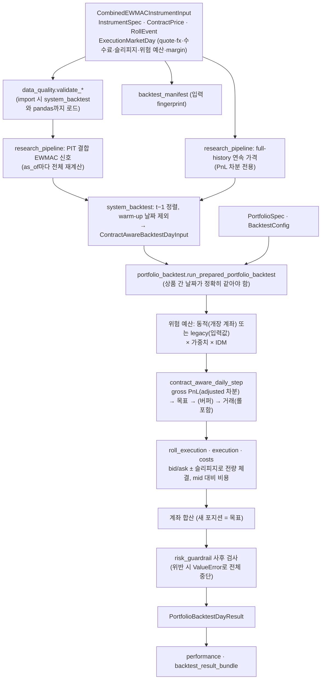
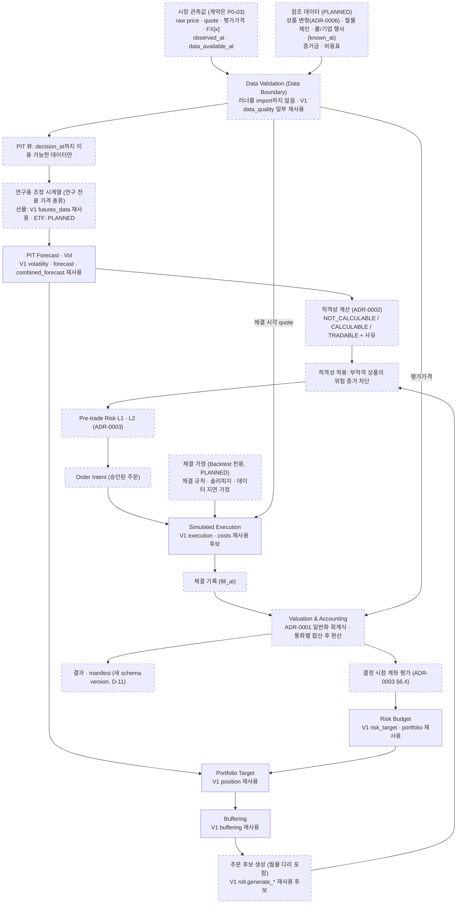
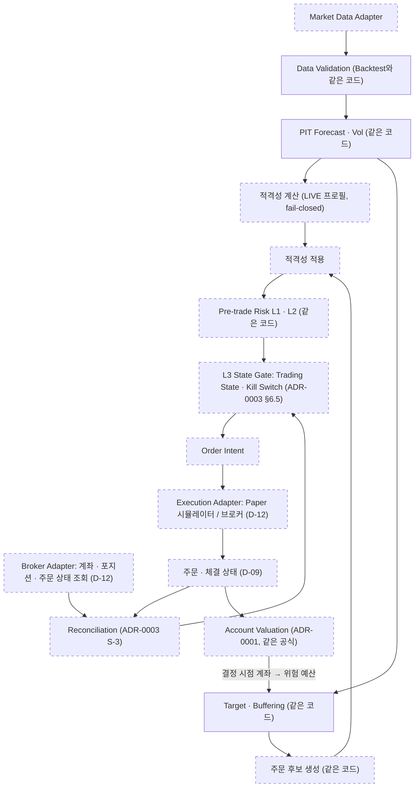

# P0-02B 결정 요약 (Data Boundaries, Backtest Paths & Asset Model)

- 작업: P0-02B Data Boundaries, Backtest Paths & Asset Model
- 기준 커밋: `ac239b0` (작업 시작 시 `python -m pytest -q -W error` → 306 passed, 경고 0)
- 작성일: 2026-10-16
- 상태: **세 ADR 모두 ACCEPTED** (2026-10-16, 사용자의 명시적 승인, 작업 P0-02B-FINAL). 승인 범위는 **핵심 아키텍처 설계 원칙**이다 (§0).
- P0-02B에서는 새 Markdown 파일 4개만 작성했다. P0-02B-FINAL에서는 세 ADR의 상태와 승인 기록, 이 요약, CLAUDE.md의 ADR 정보만 갱신했다. 두 작업 모두 `src/`, `tests/`, `pyproject.toml`, ACCEPTED ADR-0001~0003, P0-01 감사 문서를 변경하지 않았다.
- 표기: `CONFIRMED` / `INFERRED` / `UNVERIFIED` (CLAUDE.md §7). 실제로 존재하지 않는 모듈과 기능은 **PLANNED**로 표시한다.

---

## 0. 승인 기록 (P0-02B-FINAL)

| 항목 | 내용 |
|---|---|
| 승인일 | 2026-10-16 |
| 승인 주체 | 프로젝트 사용자 |
| 승인 근거 | 사용자의 명시적 승인 |
| 승인 대상 | ADR-0004 (Market Data and Domain Boundaries), ADR-0005 (Backtest Paths and V1 Compatibility), ADR-0006 (Futures and ETF Instrument Model)의 **핵심 아키텍처 설계 원칙** |
| 구현 상태 | **미구현.** 세 ADR이 설명하는 도메인 계약, 새 연구 엔진, golden 테스트, 새 상품 모델은 아직 하나도 구현되지 않았다 |
| 인수 테스트 | 명세만 존재, 미구현 |
| 미해결 질문 | 각 ADR의 Open Questions를 모두 유지한다 |
| 코드·테스트 | P0-02B와 P0-02B-FINAL 모두 `src/`, `tests/`, `pyproject.toml`을 변경하지 않았다 |

> **"ADR ACCEPTED"는 "구현 완료", "금융 공식 독립 검증 완료", "실전 매매 준비 완료"를 뜻하지 않는다.** 기존 306개 테스트 통과는 V1 코드가 유지되었다는 회귀 근거일 뿐, 새 설계의 구현 검증이 아니다.

### 0.1 승인된 원칙

| ADR | 승인된 원칙 |
|---|---|
| 0004 | 도메인 계약을 기존 백테스트 러너와 분리 · 관측값, 체결 가정, 위험 입력의 책임 분리 · 하위 금융 계산 계층은 백테스트 러너나 브로커 Adapter에 역방향 의존하지 않음 · Raw Tradable Price와 Back-adjusted Price의 역할 구분 · 관측 시각과 데이터 이용 가능 시각 구분 · 기존 V1 API와 재현성을 보호하면서 새 도메인 계약 추가 · 대규모 패키지 개편은 별도 결정 |
| 0005 | `run_combined_ewmac_portfolio_backtest`를 V1 기준 통합 진입점으로 지정 · 기존 경로를 즉시 삭제하거나 새 엔진으로 재배선하지 않음 · 기존 경로를 V1 재현·교육·비교 기준으로 보존 · 새 금융 기능은 새 연구 엔진에 구현 · 새 엔진에 ACCEPTED ADR-0001~0003의 원칙 적용 · 구조 변경 전에 V1 결과와 입력·결과 fingerprint를 golden master로 고정 · V1 경로를 새 엔진으로 옮기려면 별도 ADR, 회귀 검증, 사용자 승인 필요 |
| 0006 | 자산 유형별 Tagged Union · 공통 구성요소의 합성 재사용 · `FuturesInstrument`와 `EtfInstrument` 구분 · 선물의 상품 ID와 월물 ID 구분 · ETF의 거래 단위는 상장 종목 · 선물 롤과 ETF 분배금·분할은 서로 다른 금융 이벤트 · 거래 가능한 raw 가격과 연구용 조정 가격 구분 · V1 `InstrumentSpec` 보호 · 상품별 승수·통화·수량 단위와 자산 유형별 비용·자금 제약 구분 |

### 0.2 승인되지 않은 선택 사항 (Open Questions로 유지)

| ADR | 미승인 사항 | 질문 |
|---|---|---|
| 0004 | Stage 1 방식: 타입 2개 이동 + 재export(A, 권장안) / 이동 없는 `TYPE_CHECKING`·`Protocol`(A-0) | Q4-1 |
| 0004 | 새 `RESEARCH` API의 날짜별 위험 예산 직접 입력: 완전 금지 / 명시적 조건 아래 제한적 허용. `LIVE`는 결정 시점 계좌와 위험 목표를 쓴다(승인된 원칙). V1 재현은 현재 의미를 보존한다. 허용을 검토하면 수준, 단위, 출처, 시점, 정책 프로필, 재현성 기록이 필요하다 | Q4-7 (P0-03 설계 시 사용자 결정) |
| 0004 | 상세 도메인 타입의 물리적 위치와 이름 | Q4-2 |
| 0004 | schema version과 fingerprint 보존의 구체적 구현 방식 | ADR-0001 Q1-9, D-11 |
| 0005 | golden master의 저장 형식과 상세 fixture 범위 | Q5-4 |
| 0005 | golden master의 구체적인 구현 시점과 실행 작업 (원칙만 승인됨. 테스트 코드 작성은 승인되지 않음) | Q5-9 |
| 0005 · 0006 | 첫 구현 자산 유형: 선물 / ETF / 동시. 현재 V1이 선물 중심이라는 사실만으로 정하지 않는다 | Q5-8, Q6-1 |
| 0005 | 차등 비교의 허용 오차 | Q5-6 |
| 0005 | 레거시 경로의 향후 폐기 시점 | Q5-1 |
| 0006 | 선물 만기일을 연구 경로에서까지 필수로 할지 | Q6-2 |
| 0006 | 월물별 승수의 구체적인 상속 규칙 | Q6-3 |
| 0006 | ETF 공매도 지원 범위 | Q6-4 |
| 0006 | 레버리지·인버스 ETF 지원 여부 | Q6-8 |
| 0006 | 시장별 수수료, 세금, 거래 단위, 결제일, 증거금 모델 | Q6-5, ADR-0003 Q3-11, Q4-5 |
| 0006 | 구체적인 Python 타입과 필드 목록 | P0-03 |

golden master는 V1의 현재 출력을 고정하는 회귀 장치이며, 그 값이 금융적으로 옳다는 것을 증명하지 않는다 (ADR-0005 §6.7). 금융 무결성 검증은 P0-04에서 한다.

## 1. 작성한 ADR

| ADR | 제목 | 결정 ID | 관련 GAP | 상태 |
|---|---|---|---|---|
| [0004](../adr/0004-market-data-and-domain-boundaries.md) | 시장 데이터와 도메인 계층 경계 | D-01 | A-01, A-02, A-08, A-12, F-02, F-06, F-10 | ACCEPTED (설계 원칙, 2026-10-16) |
| [0005](../adr/0005-backtest-paths-and-v1-compatibility.md) | 백테스트 경로와 V1 호환 전략 | D-02 | A-03~A-06, A-08, F-03, F-04, F-11, F-13, F-14 | ACCEPTED (설계 원칙, 2026-10-16) |
| [0006](../adr/0006-futures-etf-instrument-model.md) | 선물·ETF 공통 상품 모델 | D-04 | F-03, F-05, F-06, F-07, F-10 | ACCEPTED (설계 원칙, 2026-10-16) |

## 2. 세 결정 비교표

| 항목 | ADR-0004 데이터 경계 | ADR-0005 백테스트 경로 | ADR-0006 상품 모델 |
|---|---|---|---|
| 대안 | A: 공용 타입만 중립 모듈로 이동 + 재export / B: 도메인 계약 모듈 추가 + V1 호환 계층 / C: 하위 패키지 구조 | A: 다섯 경로 동등 유지 / B: `portfolio_system_backtest`를 기준 진입점으로 지정 / C: 공용 엔진 + 모든 경로 adapter화 | A: `InstrumentSpec`에 선택 필드 추가 / B: 공통 사양 + 전용 사양 합성 / C: 자산 유형별 Tagged Union |
| **결정 (승인된 원칙 + 미승인 선택)** | **B를 목표로 (승인). Stage 1에서 역방향 의존 해소 (방식 A/A-0는 미승인, A 권장). C는 D-10으로 보류.** 논리 계층 규칙 R-1~R-6. `ExecutionMarketDay`를 관측값·체결 가정·위험 입력으로 나눔. 가격 종류를 타입으로 구분 | **B 채택 (승인).** 다섯 경로 모두 동결. D가 V1 기준 진입점. 새 금융 기능은 새 연구 엔진(PLANNED)에만. 기존 경로를 새 엔진 위로 옮기는 일은 별도 ADR. golden 형식·범위·시점, 허용 오차, 폐기 시점은 미승인 | **C에 B의 공통 구성요소를 합성 (승인).** `FuturesInstrument`(+ `FuturesContract`) / `EtfInstrument` (가칭). V1 `InstrumentSpec`은 바꾸지 않음. 구현 순서와 시장별 값은 미승인 |
| 핵심 근거 | `data_quality` import 한 번에 `carver_quant` 하위 모듈 21개와 pandas가 로드됨 (CONFIRMED, probe). `daily_cash_vol_target`의 의미가 경로마다 다름 (CONFIRMED) | 최상위 경로의 손익·포지션·비용·계좌 값과 fingerprint를 고정한 테스트가 없음 (CONFIRMED. 고정된 리터럴은 위험 예산 값 4개뿐). 통합하면 결과가 바뀌는 지점이 6곳 이상 | `InstrumentSpec`에 선택 필드 하나만 추가해도 모든 V1 fingerprint가 바뀜 (CONFIRMED, probe) |
| V1 영향 | 없음. 타입 이동은 필드가 같으면 fingerprint가 같음 (probe) | 없음. V1 동결 | 없음. V1 타입 불변 |
| 남는 위험 | 과도기에 V1 타입과 새 타입 공존 | V1 동결본과 새 엔진 두 벌 유지. V1 결함은 V1 안에 남음 | ETF를 실제로 쓰려면 비용·현금·결제·기업 행사 모델이 더 필요 |

## 3. 통합 데이터 흐름

점선 테두리 노드는 **PLANNED**(아직 없음)이다. "V1 재사용"은 기존 함수를 그대로 쓸 수 있는 후보라는 뜻이다 (INFERRED).

### 3.1 현재 V1의 실제 흐름 (경로 D, CONFIRMED)

V1에 없는 것: 관측 시각과 이용 가능 시각, 거래 허용 정책, 거래 전 위험 검사, 주문 의도와 주문 상태, Reconciliation, 통화 키 FX, ETF.

### 3.2 향후 Backtest 공통 흐름 (PROPOSED)

### 3.3 향후 Paper/Live 흐름 (PROPOSED)

### 3.4 흐름 순서와 ACCEPTED ADR-0003의 관계

작업 명세의 예시 흐름은 "PIT Forecast → Tradability Policy → Portfolio Target"이다. ACCEPTED ADR-0003 §6.1의 처리 순서는 "목표 포지션 → 버퍼링 → 거래 허용 판단 → L2 → L3 → 주문"이다. 두 순서는 다음과 같이 함께 성립한다.

- **적격성 계산**은 신호와 데이터만으로 하므로 forecast 직후에 할 수 있다.
- **적격성 적용**(부적격 상품의 위험 증가 차단)은 버퍼링 후의 주문 후보에 대해 한다. 이 부분은 ADR-0003의 순서를 그대로 따른다.

ACCEPTED 결정을 바꾸지 않았다.

## 4. 현재 구조와 목표 구조의 차이

| 측면 | 현재 V1 (CONFIRMED) | 목표 (PROPOSED) | 근거 |
|---|---|---|---|
| 데이터 타입의 위치 | 데이터 모듈, 체결 모듈(`ContractQuote`), 러너(`ExecutionMarketDay`)에 흩어짐 | Domain Contracts 계층 (표준 라이브러리만 의존) | 0004 |
| 데이터 검증의 의존 | `data_quality → system_backtest` (하위 모듈 21개 + pandas 로드) | Data Boundary는 Domain만 의존 | 0004 |
| 관측값·가정·위험 입력 | `ExecutionMarketDay` 한 객체 | 세 묶음으로 분리 | 0004 |
| 시각 | `date`만 | 관측값은 `observed_at`·`data_available_at`, 이벤트는 known_at, 기록은 `decision_at`·`fill_at`·`valuation_at` | 0001, 0004 |
| 가격 종류 | raw와 adjusted가 한 객체. 숫자로 구분 불가 | 타입으로 구분. 조정 가격은 연구 전용 | 0001, 0004 |
| 위험 예산 | 일별 입력. 경로마다 의미가 다름 | `decision_at` 계좌로 계산한 값 | 0003, 0004 |
| 백테스트 경로 | 다섯 개, 위상 미정 | 다섯 개 모두 동결, D가 V1 기준, 새 연구 엔진(PLANNED) 추가 | 0005 |
| 새 금융 기능의 위치 | 정해지지 않음 | 새 연구 엔진만 | 0005 |
| 신호 경로 | full-history + PIT | 새 엔진은 PIT만 | 0005 |
| warm-up 처리 | 날짜 제외 | 날짜 유지 + 거래 차단 (`V1_COMPAT` 제외) | 0002, 0005 |
| 위험 검사 | 사후 검사, ValueError로 중단 | 거래 전 L1·L2 (Paper/Live는 L3 추가) | 0003 |
| 상품 모델 | `InstrumentSpec` 하나 (선물 해석) | Tagged Union (`FUTURES` / `ETF`), 상품과 월물 구분 | 0006 |
| 통화 | `InstrumentSpec.currency`는 계산에 안 쓰임. fx는 상품별 스칼라 | 통화 키 `fx[κ,t]` | 0001, 0006 |
| 비용 | 계약당 수수료 (10개 모듈에 전달) | 자산 유형별 비용표 + 공통 스프레드·슬리피지 | 0006 |
| 자금 | 손익 누적만 | 증거금(선물)과 현금(ETF) 분리, 현금 원장 (후속) | 0003, 0006 |
| fingerprint 보호 | 값을 고정한 테스트 없음 | Stage 0 golden 테스트 | 0004, 0005 |
| 패키지 구조 | 평면 34개 모듈 | 논리 계층 규칙만 정함. 물리 구조는 D-10 | 0004 |

## 5. 기존 306개 테스트와 fingerprint의 호환 위험

이번 작업은 코드를 바꾸지 않았으므로 **현재 위험은 없다.** 아래는 이후 구현 단계의 위험이다.

| 위험 | 메커니즘 | 현재 보호 장치 | 완화 |
|---|---|---|---|
| 타입 이동으로 import 경로가 깨짐 | 테스트 38개 파일이 34개 모듈 경로 전부에서 import. `ContractQuote`는 13개 파일, `ExecutionMarketDay`는 7개 파일 | 306개 테스트 | 같은 클래스 객체 재export (ADR-0004 P-2), AT-0004-1 |
| V1 타입에 필드를 추가해 fingerprint가 바뀜 | canonical JSON이 필드 전체를 직렬화. 선택 필드 하나로도 해시가 바뀜 (probe) | **없음** (해시 값을 고정한 테스트 0건) | V1 타입 필드 불변 (P-1), Stage 0 golden |
| 경로 정리로 결과 숫자가 바뀜 | ADR-0005 §5.4의 6개 지점 | 최상위 경로의 손익·포지션·계좌 값 비교 0건 (리터럴 비교 4건은 위험 예산 값) | V1 동결, Stage 0 golden, Stage 5는 별도 ADR |
| 테스트가 쓰는 비공개 이름이 사라짐 | `_prepare_backtest_from_point_in_time_signals` (1개 파일) | 306개 테스트 | ADR-0004 P-6 |
| "306 passed"를 결과 보존으로 오해 | fingerprint와 최상위 결과가 고정되지 않음 | — | Stage 0을 모든 구조 작업보다 먼저 함 (ADR-0005 §6.7) |
| 롤일 동치성 | ADR-0001 C-2는 INFERRED | — | AT-0005-3 |
| 변환기가 V1 값의 의미를 잘못 해석 | `daily_cash_vol_target` 수준이 경로마다 다름 | — | 수준 명시 요구 (AT-0004-4) |

## 6. ETF·선물 확장 시 금융적 제약

| 제약 | 선물 | ETF | 처리 |
|---|---|---|---|
| 거래 단위와 수량 단위 | 월물, 계약 수 | 상장 종목, 주 수 (lot 배수) | ADR-0006 I6-3~I6-5. 단위가 다른 수량을 더하지 않음 |
| 승수 | 월물별 `M[c]` | 1 고정 | I6-6 |
| 신호용 가격 조정 | 가산 back-adjustment | 곱셈 조정 또는 총수익 (방법 미정) | ETF는 PIT만 (F-03). Q6-6 |
| vol 단위 | 가격 차이 (pt/d) | 곱셈 조정 시계열에서는 현재 raw 단위 vol과 다를 수 있음 (INFERRED) | P0-04, 공식 변경은 승인 |
| 연속성 이벤트 | 롤 (체결 다리) | 분배금(`D` 항), 분할(수량·기준가격 변환) | I6-1, I6-2, I6-8, I6-9 |
| 만기 | 최종 거래일 이후 보유 금지 | 없음 | Q6-2 |
| 비용 | 계약당 수수료 | 비율 수수료, 최소 수수료, 매도 세금 (UNVERIFIED) | 새 공식은 명세·독립 검증·승인 |
| 자금 | 증거금 | 매수 대금, 결제일 T+n (UNVERIFIED) | ADR-0003 L1. 현금 원장은 후속 |
| NAV와 현금 | 일일 정산이 일반적 (UNVERIFIED) | NAV ≠ 사용 가능 현금 | AT-0006-3 |
| 공매도 | 일반적으로 가능 | 미확인 (UNVERIFIED) | LIVE에서 fail-closed 권장 (Q6-4) |
| FX | 손익 환산 | 외화 ETF 매수 시 외화 현금 필요 | D-08 |
| 반올림 | 정수 계약 | lot 배수 (새 규칙) | 명세·독립 검증 필요 |
| 호가 단위 | 고정 tick이 일반적 | 가격대별 표일 수 있음 (UNVERIFIED) | 참조 데이터 |
| 상장폐지·데이터 수정 | 월물 소멸은 정상 | 상장폐지 (survivorship) | F-10, Phase 1 |

## 7. ACCEPTED ADR-0001~0003과의 정합성

세 ADR 모두 각자 "ACCEPTED ADR과의 정합성" 절을 두었다 (ADR-0004 §6.9, ADR-0005 §6.8, ADR-0006 §6.8). P0-02B-FINAL에서 세 ADR이 ACCEPTED가 되면서, 미승인 선택 사항이 결정된 것처럼 읽히는 표현을 승인 범위에 맞게 고쳤다 (§0.2, 각 ADR의 개정 이력).

작성 후 독립 검토(§13)에서, ACCEPTED ADR의 열린 질문을 **사실상 좁히는 표현 두 가지**가 발견되어 고쳤다.

| 발견 | 수정 |
|---|---|
| ADR-0005가 새 엔진의 거래 전 위험 기본 정책을 "B"로 적음. B/C 선택은 ADR-0003 Q3-2로 열려 있음 | "기본 정책(B 또는 C)은 ADR-0003 Q3-2에 따른다"로 수정 (ADR-0005 E-6, §6.6) |
| ADR-0004 P-1("V1 타입에 필드를 추가하지 않는다")이 ADR-0001 Q1-9의 선택지 두 가지(호환 모드에서 새 필드를 payload에서 빼기, schema version 분기)를 막음 | Q1-9가 결정되기 전까지의 **잠정 규칙**으로 수정. 다른 선택지를 고르면 개정한다 (ADR-0004 P-1, ADR-0006 §5.2) |

수정 후 남은 결정 모순은 발견되지 않았다.

- ACCEPTED ADR의 Open Questions(Q1-4, Q1-5, Q1-9, Q3-7, Q3-9, Q3-11 등)는 닫지 않고 열린 채로 두었다. ADR-0004는 Q1-9에 대한 권장 방향("V1 타입 불변 + 새 타입은 별도 payload")만 제시했다.
- 흐름 순서에 대한 설명은 §3.4에 있다.

## 8. 인수 테스트 명세 색인

| 작업 명세의 테스트 | ADR 인수 테스트 | 관련 |
|---|---|---|
| 1. 데이터 검증 모듈이 백테스트 러너를 import하지 않고 동작 | ADR-0004 AT-0004-1 | 현재는 실패 (probe) |
| 2. 기존 V1 API와 결과 fingerprint 보존 | ADR-0005 AT-0005-1 | ADR-0004 AT-0004-3 |
| 3. 새 연구 경로에서 정책 프로필 생략 시 거부 | ADR-0005 AT-0005-2 | ADR-0002 AT-0002-7 |
| 4. ETF에 선물 Roll 데이터를 넣으면 거부 | ADR-0006 AT-0006-1 | — |
| 5. 선물에 Contract Identifier가 없으면 거부 | ADR-0006 AT-0006-2 | — |
| 6. 통화·승수가 다른 두 상품을 같은 포트폴리오에서 처리 | ADR-0006 AT-0006-3 | ADR-0001 AT-0001-9 |
| 7. Raw Price와 Adjusted Price를 잘못 교환하면 거부 | ADR-0004 AT-0004-2 | — |
| 8. 기존 경로와 새 경로의 같은 입력 결과 비교 | ADR-0005 AT-0005-3 | ADR-0001 C-2 |
| 추가 | ADR-0004 AT-0004-4, ADR-0005 AT-0005-4, ADR-0006 AT-0006-4, AT-0006-5 | — |

모든 인수 테스트는 명세이며 구현되지 않았다.

## 9. 다른 결정과의 경계 (D-07~D-12)

이번 작업에서는 아래 결정을 **확정하지 않았다.** 세 ADR이 남긴 제약과 후속 의존성만 기록한다.

| 결정 | 세 ADR이 남긴 제약 | 넘길 질문 |
|---|---|---|
| D-07 다시장 거래일 달력 정렬 | 상품 식별 정보에 거래소(venue)가 있다 (ADR-0006). 새 엔진은 D-07 전까지 날짜가 맞지 않으면 fail-fast하고, 앞 날짜 값으로 채우지 않는다 (ADR-0005 §6.6). 선물과 ETF가 다른 거래소에 있으면 혼합 포트폴리오는 D-07이 필요하다 | 거래소별 평가 일정(`valuation_at`), 휴장일 상품의 평가 방식 |
| D-08 FX 데이터와 환율 변동 회계 | FX 관측은 통화 키와 시각을 가진다 (ADR-0004). 외화 ETF는 외화 현금이 필요하다 (ADR-0006). 환율 변동 자체의 평가 효과는 ADR-0001 Q1-10 | 환율 출처와 시각, 다통화 현금, 외화 현금 재평가, 수수료 통화 |
| D-09 주문·부분 체결·포지션 상태 | 새 엔진은 포지션을 체결 기록에서 계산한다 (ADR-0005 E-8). 현금 원장과 결제일이 필요하다 (ADR-0006 §6.5) | 주문 상태 기계, 부분 체결, 포지션 산출, 현금 원장 위치 |
| D-10 상세 패키지 변경 계획 | 논리 계층과 import 규칙 R-1~R-6 (ADR-0004). 하위 패키지(대안 C)는 보류 | 물리 배치, 모듈 이름, shim 정책, import 규칙 검사 도구 |
| D-11 재현성과 schema version | V1 payload는 바꾸지 않고, 새 입력은 별도 payload와 schema version을 쓴다 (ADR-0004 P-3, P-4). Stage 0 golden이 먼저다 (ADR-0005) | schema version 정책, golden 저장 형식, `code_version`의 Git 연동, 데이터 vintage |
| D-12 브로커 adapter API | adapter는 Domain 타입을 만들고, 핵심 계산은 adapter를 import하지 않는다 (ADR-0004 R-3) | 인터페이스, 오류·timeout 의미, 멱등성(같은 주문을 두 번 내지 않는 보장) |

참고: P0-01 문서(V1_DEPENDENCY_ANALYSIS §5)에서 D-10은 "하위 패키지 도입 여부, 계층 간 import 규칙, ADR 위치"였고 D-11은 "재현성 범위"였다. 이번 작업 명세는 D-10을 "상세 패키지 변경 계획", D-11을 "결과 재현성과 schema version 세부 정책"으로 정의했다. ADR 위치는 P0-02A-FINAL에서 확정되었고, import 규칙은 ADR-0004가 논리 계층 수준(R-1~R-6, PROPOSED)으로 제안했다. 따라서 D-10에 남은 범위는 물리 배치와 그 실행 계획이다.

**P0-03은 Domain Contracts 설계 단계다.** 세 ADR은 책임, 소유 계층, 의존성 방향, 경계 규칙만 정했고, 필드 목록과 검증 규칙은 P0-03에 넘긴다.

## 10. P0-03 Domain Contracts에 넘길 계약 후보

이름은 모두 가칭이다 (INFERRED, 설계 대상 목록).

| 계약 후보 | 출처 |
|---|---|
| `InstrumentIdentity`, `QuantityConvention`, `PriceIncrementRule` | ADR-0006 |
| `FuturesInstrument`, `FuturesContract`, `EtfInstrument` (판별자 포함) | ADR-0006 |
| `RollEvent`(known_at 포함), `CorporateAction`(분배금, 분할) | ADR-0006, ADR-0004 |
| raw 가격, quote, 평가가격, FX 관측 (`observed_at`, `data_available_at`) | ADR-0004, ADR-0001 |
| 연구용 조정 시계열 (가격 종류, `as_of`) | ADR-0004 |
| 신호 snapshot과 적격성 상태·사유 코드 | ADR-0002 |
| 체결 가정 (수수료표 참조, 슬리피지 모델, 체결 규칙, 데이터 지연 가정) | ADR-0004 |
| 비용표 (선물: 계약당 / ETF: 비율·최소·세금) | ADR-0006 |
| 위험 예산, 위험 정책, 증거금 요구량 (출처, `as_of`) | ADR-0003, ADR-0004 |
| 의사결정 기록, 주문 후보, 주문 의도, 체결 기록, 계좌 평가 | ADR-0001, ADR-0003, ADR-0005 |
| 정책 프로필과 검증 | ADR-0002 §8.0 |
| V1 입력 변환기의 입력 (위험 예산 수준, 데이터 지연 가정을 명시) | ADR-0004 |
| 새 입력 payload와 schema version 분리 | ADR-0004 P-4, D-11 |

## 11. 사용자가 결정해야 할 질문

> P0-02B-FINAL 기준: B-U1~B-U3의 **설계 원칙은 승인으로 해결**되었다. 그 안의 세부 선택(Stage 1 방식, golden 세부, 허용 오차, 폐기 시점, 구체 타입)은 미결정이다. 나머지 질문은 모두 미결정이다. 전체 미승인 목록은 §0.2에 있다.

### 11.1 지금 결정할 수 있는 것 (정책·방향)

| ID | 질문 | 관련 |
|---|---|---|
| B-U1 | **[원칙 승인됨 2026-10-16]** ADR-0004 (B를 목표로, C는 D-10). **미결정**: Stage 1을 타입 이동(A)으로 할지 이동 없는 방식(A-0)으로 할지 | Q4-1 |
| B-U2 | **[원칙 승인됨 2026-10-16]** ADR-0005 (D를 V1 기준 진입점으로, 기존 경로 보존, 새 기능은 새 엔진에만, 기존 경로 재배선은 별도 ADR. 경로별 위상은 ADR-0005 §6.2). **미결정**: 레거시 경로 폐기 시점, full-history 경로의 명칭, V1 결함 처리 | Q5-1, Q5-2, Q5-3 |
| B-U3 | **[원칙 승인됨 2026-10-16]** ADR-0006 (공통 구성요소를 합성한 Tagged Union, V1 `InstrumentSpec` 보호). **미결정**: 구체적인 Python 타입과 필드 (P0-03) | — |
| B-U4 | **[원칙 승인됨: 구조 변경 전에 golden으로 고정]** **미결정**: Stage 0 golden master 테스트를 언제, 어떤 작업으로 구현할 것인가? fixture 범위와 저장 형식은? (기존 테스트 수정 없음) | Q5-4, Q5-9 |
| B-U5 | **미결정**: 새 `RESEARCH` API에서 날짜별 위험 예산 직접 입력을 완전히 금지할 것인가, 명시적 조건(수준, 단위, 출처, 시점, 정책 프로필, 재현성 기록) 아래 제한적으로 허용할 것인가? `LIVE`는 결정 시점 계좌와 위험 목표를 쓴다 (승인된 원칙). P0-03 설계 시 결정 | Q4-7 |
| B-U6 | **미결정**: 첫 구현 자산 유형: 선물 / ETF / 동시. 현재 V1이 선물 중심이라는 사실만으로 정하지 않는다 | Q5-8, Q6-1 |
| B-U7 | **미결정**: 선물 만기일을 연구 경로에서까지 필수로 할지, 월물별 승수의 상속 규칙, ETF 공매도 지원 범위, 레버리지·인버스 ETF 지원 여부 | Q6-2, Q6-3, Q6-4, Q6-8 |
| B-U8 | 단일 상품 연구를 "상품 하나짜리 포트폴리오"로 처리할지, Data Boundary까지 pandas 없이 유지할지 | Q5-7, Q4-8 |

### 11.2 시장·브로커가 정해진 뒤 결정할 것

| ID | 질문 |
|---|---|
| B-U9 | 증거금 요구량의 출처와 포트폴리오 증거금 모델 (Q4-5, ADR-0003 Q3-11) |
| B-U10 | ETF lot size, 호가 단위 표, 수수료율, 최소 수수료, 세율, 결제일, 단주 처리 (Q6-5) |
| B-U11 | 분배금 귀속일과 세금 (Q6-7, ADR-0001 Q1-5) |

### 11.3 P0-04 근거를 보고 정할 것

| ID | 질문 |
|---|---|
| B-U12 | 차등 비교의 허용 오차 정책 (기본은 정확 일치, Q5-6) |
| B-U13 | ETF 신호용 조정 방식과 vol 단위 (Q6-6, 공식 변경 승인 사항) |

### 11.4 P0-03, D-10, D-11에서 정할 것

| ID | 질문 |
|---|---|
| B-U14 | 새 도메인 계약의 위치와 이름 규칙 (Q4-2), 새 엔진 진입점 (Q5-5) |
| B-U15 | 백테스트 데이터 지연 가정의 표현과 manifest 기록 (Q4-3) |
| B-U16 | `performance → portfolio_backtest` 의존을 결과 계약으로 끊는 시점 (Q4-6) |
| B-U17 | 현금 원장, 결제일, 외화 현금을 다룰 결정 (Q6-9) |
| B-U18 | 데이터 수정 이력(vintage) 보관 방식 (Q4-4, Phase 1 데이터 계층) |

## 12. 이번 작업에서 수행한 검증

| 검증 | 결과 |
|---|---|
| `python -m pytest -q -W error` (작업 시작 시, Python 3.14.6) | 306 passed, 경고 0 |
| Git 상태 (작업 시작 시) | `master`, HEAD `ac239b0` (기대값과 같음), 작업 트리 clean, `origin/master`보다 1커밋 앞섬 (push하지 않은 상태) |
| probe 1: 새 인터프리터에서 `import carver_quant.data_quality` | `carver_quant` 하위 모듈 21개(패키지 포함 22개) 로드. `system_backtest`, `contract_aware_backtest`, `research_pipeline`, `forecast`, `volatility`, `pandas`, `numpy` 포함 |
| probe 2: 입력 fingerprint (저장소 밖 일회성 스크립트) | 필드가 같은 타입을 다른 이름·모듈로 정의: 해시 같음 (`4c8483d1…`). `ExecutionMarketDay` + `observed_at=None`: 다름. `InstrumentSpec` + `asset_type=None`: 다름 |
| grep: 테스트의 해시 리터럴 | 0건 |
| 경로별 테스트의 리터럴 값 비교 수 (여러 줄에 걸친 `approx(` 호출 포함) | `test_backtest` 5, `test_contract_aware_backtest` 23, `test_system_backtest` 9, `test_combined_system_backtest` 0, `test_portfolio_backtest` 19, `test_portfolio_system_backtest` 4 (모두 위험 예산 값), `test_v1_acceptance` 0. 처음에는 한 줄 grep으로 세어 일부를 적게 셌고, 독립 검토에서 바로잡았다 |
| 숫자 예제 독립 산술 | AT-0004-2 (5,000 / 5,500), AT-0004-4 (375,000), AT-0006-3 (1,069,525 KRW, W1 1,000,051.5, W2 17,550,999,325, 현금 1,008.50 USD, 명목 176,000,000 / 8,181,000), AT-0006-4 (80 / −2,960) 모두 문서 값과 일치 |
| 인용 후보 테스트 이름 16개 존재 확인 | 15개 존재. 1개는 P0-01 문서의 오기 (§14) |
| (FINAL) `python -m pytest -q -W error` | 306 passed, 경고 0. V1 회귀 근거일 뿐, 새 설계의 구현 검증이 아니다 |
| (FINAL) 상태 일치 | ADR-0001~0006 모두 ACCEPTED. 이 요약(§0, §1)과 CLAUDE.md(§2, §7.1)가 일치 |
| (FINAL) 보존 확인 (편집 전 snapshot과 비교) | 인수 테스트 13개(AT-0004-1~4, AT-0005-1~4, AT-0006-1~5) 그대로. 숫자 예제, 코드 인용, 질문 ID 손실 0건. 추가된 질문은 Q5-9 하나 (golden 구현 시점, 미승인 항목 기록용) |
| (FINAL) 링크와 ID 참조 | 상대 링크 70개 모두 유효. 정의되지 않은 질문·인수 테스트 ID 참조 0건 |
| (FINAL) 미승인 선택이 결정처럼 쓰였는지 | Stage 1 방식, `RESEARCH` 위험 예산 입력, 첫 구현 자산 유형, golden 구현 여부를 검사. 해당 표현 없음 |
| (FINAL) 변경 범위 | `src/`, `tests/`, `pyproject.toml`, ACCEPTED ADR-0001~0003, P0-01 감사 문서 변경 없음 |

## 13. 독립 검토와 반영

작성 후 읽기 전용 검토 agent가 네 문서의 코드 인용, 테스트 인용, 산술, ACCEPTED ADR과의 정합성, 링크, ID 참조, Mermaid 문법을 확인했다. 검토 결과 다음은 문제가 없었다: 산술 전부, 상태 표기(세 ADR 모두 PROPOSED), 상대 링크 50개, 질문·인수 테스트 ID 참조, Mermaid 문법, ADR-0003 처리 순서. 지적된 사항은 모두 반영했다.

| 분류 | 지적 | 반영 |
|---|---|---|
| 수치 오류 | 테스트의 리터럴 값 비교 수를 한 줄 grep으로 세어 적게 셈. 최상위 경로에도 위험 예산 값 4개가 고정되어 있음 | ADR-0005 §3.3, 이 문서 §2, §5, §12 수정. 결론("최상위 손익·포지션·계좌·fingerprint는 고정되지 않음")은 유지 |
| 인용 오류 | payload 생성 함수의 덮어써진 앞선 정의(`:405-517`)를 인용함 | 실제로 쓰이는 `:519-631`로 수정하고 중복을 명시 (ADR-0004 §3.5, §12) |
| 사실 오류 | "세 번째 관측일부터 거래" (실제 첫 거래는 네 번째 가격일) | ADR-0005 §6.3 수정 |
| 문서 간 불일치 | 날짜별 위험 예산을 금지한다면서 AT-0005-3이 legacy 모드 재현을 요구함 | `V1_COMPAT` 재현 실행에서만 허용하는 예외를 명시 (ADR-0004 §6.3, Q4-7, ADR-0005 E-11, §6.6, AT-0005-3). 이후 P0-02B-FINAL에서 `RESEARCH`의 허용 여부는 미결정으로 되돌렸고, V1 재현의 의미 보존은 유지했다 (§0.2) |
| 자기 모순 | AT-0004-1이 A-0도 허용하면서 중립 모듈의 클래스 동일성을 요구함 | 동일성 확인은 대안 A일 때만 |
| 열린 질문 축소 | §7의 두 건 | §7 참조 |
| 경미 | 모듈 수(21/22), `isinstance` 표현, 동적 모드 값 검증, "전달"→"전달하거나 검증", 롤 검사 라인, 결과 fingerprint의 근거 수준, Q4-3·Q4-8·Q6-2를 본문이 미리 답한 표현, E-3·E-6 범위, AT-0005-4 조건, Reconciliation과 체결 가정의 계층 설명, `signal_as_of` 소유, 16,410배, B-U18 누락, 다이어그램(계획 노드 표시, 평가가격·quote 입력 경로, Paper/Live 위험 예산 피드백), D-10/D-11 의미 변화 | 모두 반영 |

## 14. 발견한 문서 오류

| 위치 | 내용 | 처리 |
|---|---|---|
| [V1_DEPENDENCY_ANALYSIS.md](V1_DEPENDENCY_ANALYSIS.md) §3.6 | 테스트 이름 `test_backtest_reproduces_manual_day_1_to_day_5`는 존재하지 않는다. 실제 이름은 `test_run_backtest_reproduces_manual_day_1_to_day_5` (`tests/test_backtest.py:94`) | P0-01 문서는 이번 작업의 변경 범위 밖이라 고치지 않았다. ADR-0005에는 올바른 이름을 썼다 |

## 15. 개정 이력

| 개정 | 날짜 | 내용 |
|---|---|---|
| R0 | 2026-10-16 | 최초 작성 (P0-02B). 세 ADR 모두 PROPOSED. 독립 검토 반영 (§13) |
| FINAL | 2026-10-16 | P0-02B-FINAL. 세 ADR을 **ACCEPTED**로 변경 (사용자의 명시적 승인, 범위는 §0). §0 승인 기록 추가: 승인된 원칙과 미승인 선택 사항을 분리. §1·§2 상태 갱신, §11에 해결·미결정 표시, B-U5(위험 예산)를 미결정으로 되돌림, §13 관련 항목 주석. Open Questions, P0-03 계약 후보(§10), D-07~D-12 목록(§9)은 그대로 유지 |
