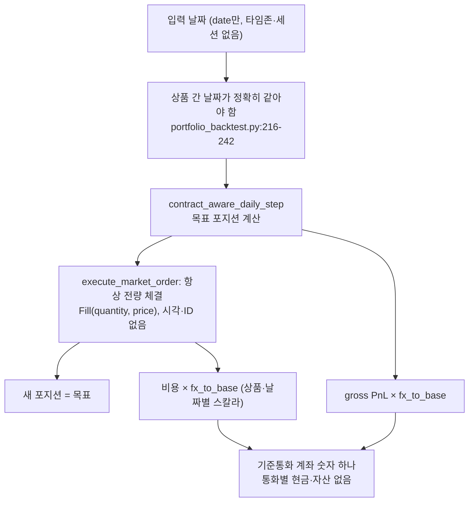
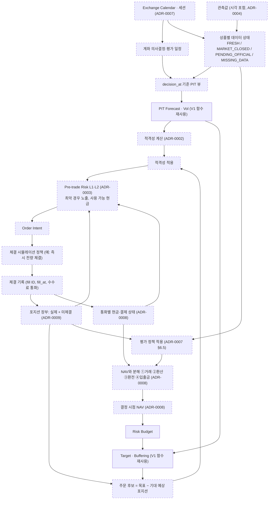
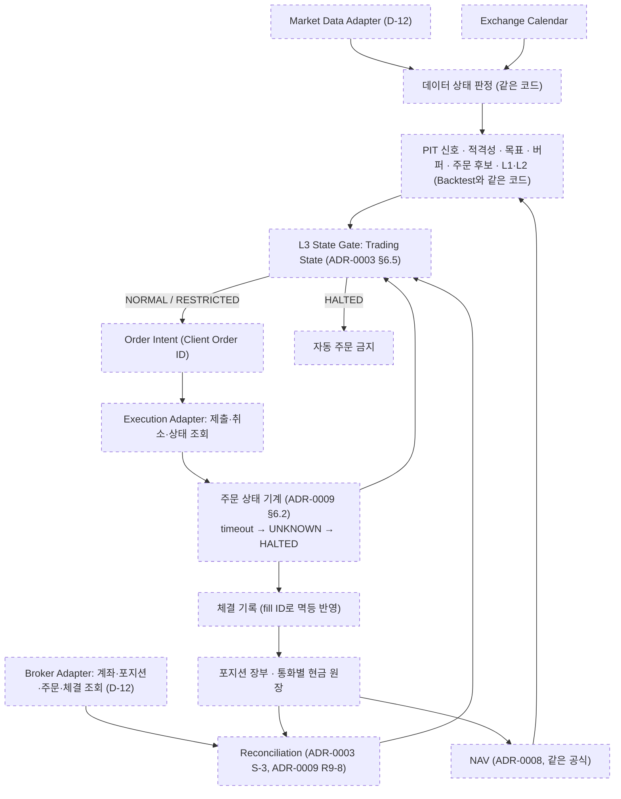

# P0-02C1 결정 요약 (Calendar, FX Accounting & Order Lifecycle)

- 작업: P0-02C1 Calendar, FX Accounting & Order Lifecycle Architecture
- 기준 커밋: `709d0df` (작업 시작 시 `python -m pytest -q -W error` → 306 passed, 경고 0)
- 작성일: 2026-10-16
- 상태: **세 ADR 모두 ACCEPTED** (2026-10-16, 사용자의 명시적 승인, 작업 P0-02C1-FINAL). 승인 범위는 **핵심 설계 원칙과 R1에서 보완한 안전·정합성 원칙**이다 (§0).
- 개정: **R1** (2026-10-16, P0-02C1-R1). 세 ADR의 금융·시점·주문 상태 정합성을 보완했다 (§13). (당시 상태는 모두 PROPOSED였다.)
- P0-02C1과 P0-02C1-R1에서는 새 Markdown 파일 4개만 작성·보완했다. P0-02C1-FINAL에서는 세 ADR의 상태와 승인 기록, 이 요약, CLAUDE.md의 ADR 정보만 갱신했다. 세 작업 모두 `src/`, `tests/`, `pyproject.toml`, ACCEPTED ADR-0001~0006, 기존 감사·요약 문서를 변경하지 않았다.
- 표기: `CONFIRMED` / `INFERRED` / `UNVERIFIED`. 존재하지 않는 기능은 **PLANNED**. 예제의 시장, 상품, 환율, 수수료는 모두 가상이다.

---

## 0. 승인 기록 (P0-02C1-FINAL)

| 항목 | 내용 |
|---|---|
| 승인일 | 2026-10-16 |
| 승인 주체 | 프로젝트 사용자 |
| 승인 근거 | 사용자의 명시적 승인 (P0-02C1-R1 보고서 검토 후) |
| 승인 대상 | ADR-0007 (Multi-Market Calendar and Valuation Schedule), ADR-0008 (Multi-Currency FX and Cash Accounting), ADR-0009 (Order, Fill and Position Lifecycle)의 **핵심 설계 원칙과 R1에서 보완한 안전·정합성 원칙** |
| 제외 범위 | 각 ADR의 Open Questions (Q7-1~Q7-9, Q8-1~Q8-11, Q9-1~Q9-11), 시장·브로커·데이터 공급자 세부사항, 운영 기본값, 코드 구현, 실전 주문 활성화 |
| 구현 상태 | **미구현.** 달력·일정·데이터 상태 판정, 통화별 현금 원장과 NAV, 주문 상태 기계·체결 기록·포지션 장부는 아직 하나도 구현되지 않았다 |
| 인수 테스트 | 명세만 존재, 미구현 (ADR-0007 7개, ADR-0008 10개, ADR-0009 10개) |
| ADR-0001과의 관계 | 이 승인은 ACCEPTED ADR-0001의 승인 범위를 넓히지 않는다. ADR-0001의 수수료 통화 잠정 가정과 Q1-4의 미결정 상태는 그대로다. ADR-0001~0006 파일은 바꾸지 않았다 |
| 코드·테스트 | P0-02C1, R1, FINAL 모두 `src/`, `tests/`, `pyproject.toml`을 변경하지 않았다 |

> **"ADR ACCEPTED"는 "구현 완료", "금융 계산 검증 완료", "Paper/Live 준비 완료"를 뜻하지 않는다.** 기존 306개 테스트 통과는 V1 코드가 유지되었다는 회귀 근거일 뿐, 새 설계의 구현 검증이 아니다.

### 0.1 승인된 원칙

각 ADR §2에 절 번호와 함께 전체 목록이 있다.

| ADR | 승인된 원칙 |
|---|---|
| 0007 | 세션·관측·의사결정·평가를 시각(instant)으로 표현 · UTC 기반 비교와 IANA 타임존 · 계좌 단위 일간 의사결정·평가 일정 · 범용 장중 이벤트 엔진은 이번 목표 밖 · `FRESH`/`MARKET_CLOSED`/`PENDING_OFFICIAL`/`MISSING_DATA` 구분 · 휴장과 결측은 달력과 실제 관측을 함께 보고 판정 · (R1) 마지막 공식 가격 평가는 정책이 고른 평가값이며 실제 현재 시장가치와 같다고 단정하지 않음 · 이전 가격·잠정 평가·공표 전 가격은 명시적 평가 정책으로 통제 · (R1) 관측·공표 예상·실제 이용 가능 시각 구분 · (R1) 주문 의도 생성·주문 제출·체결 가능 시각 구분 · 미래 데이터, 표시 없는 forward fill, 보간, 가격 0 대입, 고정 시차 변환 금지 · V1 날짜 처리와 fingerprint 보존 |
| 0008 | 통화별 현금과 자산 평가액 분리 · 통화별 순자산을 기준통화 환율로 환산해 NAV 계산 · 통화별 현금 이벤트 원장 · ADR-0001 `PnL[t]`를 그대로 NAV 변화의 거래 손익으로 사용 · 거래 손익, FX 환산 손익, 환전 결과, 외부 현금흐름 구분 (분해식은 **항등식으로서만** 승인) · 입출금은 투자 손익이 아님 · ETF 매수 대금은 현금과 자산의 교환 · 선물 개시 증거금은 비용이 아니며 NAV를 직접 줄이지 않음 · 수수료와 체결 비용의 이중 반영 금지 · 서로 다른 통화를 환산 전에 더하지 않음 · 환율 방향, 관측·이용 가능 시각, 평가 환율 명시 · 환율 결측을 1로 대체하지 않음 · (R1) ADR-0001의 잠정 수수료 통화 가정과 다통화 수수료 처리 제안을 구분 · (R1) 수수료는 부과 통화에서 정확히 한 번, 손익에 이중 반영 금지 (F8-1, F8-2의 원칙 부분) |
| 0009 | 목표·실제·예상 포지션 구분 · 주문·체결 기록과 포지션 장부 분리 · 실제 포지션 = 검증된 기준 포지션 + 중복 제거된 체결 · 진행 중 주문의 남은 수량 반영 · 기대 예상 포지션과 최악 경우 예상 포지션을 따로 계산 · 주문 상태 11종과 `UNKNOWN` 구분 · `UNKNOWN`을 거부·취소·실패로 보지 않음 · `UNKNOWN`·대조 불일치·체결 기록 충돌은 ADR-0003 `HALTED` · `HALTED` 자동 해제 없음 (원인 해소 확인 + 대조 완료 + 사용자 승인) · 취소 요청 ≠ 취소 확정 · 롤 다리별 주문 상태 · 부분 체결은 개별 체결 기록 · 체결 ID 기반 멱등성 · (R1) 체결 키의 고유성 범위와 같은 키의 내용 충돌 검사 · (R1) 정정의 원자성·수량 의미가 불확실하면 보수적 최악 경우 노출, 단순 `max`를 조건 없이 쓰지 않음, 정정 상태를 확인할 수 없으면 위험 증가 차단, `UNKNOWN`이면 `HALTED` · 백테스트 즉시 전량 체결은 시뮬레이션 정책일 뿐 · V1 경로 불변 |

### 0.2 승인되지 않은 사항 (Open Questions로 유지)

| ADR | 미승인 사항 | 질문 |
|---|---|---|
| 0007 | 실제 계좌 의사결정 시각과 평가 시각 | Q7-1 |
| 0007 | 실제 시장 달력과 데이터 공급자 | Q7-2 |
| 0007 | `MISSING_DATA`, `MARKET_CLOSED`의 구체적 처리 정책 (ADR-0007 §6.5 표의 "권장 처리" 포함) | Q7-3 |
| 0007 | 공식 가격 공표 전 잠정 평가·평가 연기·장중 가격 사용 중 선택 | Q7-4 |
| 0007 | 신선도 임계값 | Q7-5 |
| 0007 | 시장이 닫힌 시각에 만든 주문 의도를 다음 세션까지 유지할지, 다시 계산할지, 제출 시점에 위험을 다시 검사할지 | Q7-6 |
| 0007 | 실제 시장별 세션·조기 폐장·거래 중단·DST 예외 처리 세부 규칙 | Q7-7, Q7-8 |
| 0007 | 장 밖 주문 접수 허용 여부와 주문 유형 | Q7-9 |
| 0008 | NAV 분해의 보고 관례 (거래 손익과 환산 손익 사이 교차항의 배분) | Q8-3 |
| 0008 | 상품 통화와 다른 수수료 통화의 운영 처리, 수수료 환산 시각, 브로커 자동 환전 수수료 (F8-3, F8-4), 수수료 현금 이벤트의 구체 기록 형식 (F8-1) | Q8-11, ADR-0001 Q1-4 |
| 0008 | FX 공급자, 평가 환율 시각, 시장 평가 시각과 다를 때의 허용 범위 | Q8-1, Q8-2 |
| 0008 | 환율 결측 처리 정책 | Q8-7 |
| 0008 | 환전 실행 방식 | Q8-4 |
| 0008 | 현금 이자·차입 비용 | Q8-8 |
| 0008 | ETF 결제 규칙, 분배금 귀속일과 세금 | Q8-5, ADR-0001 Q1-5 |
| 0008 | 선물 실제 증거금과 정산 규칙 | Q8-6, ADR-0003 Q3-11 |
| 0008 | 기준통화 KRW 고정 여부 | Q8-9 |
| 0008 | 입출금이 있는 기간의 수익률 산출 방식 | Q8-10 |
| 0009 | 실제 브로커 주문 상태와 내부 상태의 대응 | Q9-1, D-12 |
| 0009 | 브로커 정정의 원자성, 정정 수량의 의미 | Q9-10 |
| 0009 | 체결 ID의 실제 고유성 범위와 대체 키, 체결 정정·취소 이벤트 형식 | Q9-11, Q9-1 |
| 0009 | 실제 주문 유형과 유효기간 | Q9-2 |
| 0009 | 롤 다리 제출 순서, 한 다리만 체결된 경우의 자동 대응 | Q9-3 |
| 0009 | timeout 기준 시간과 재조회 주기 | Q9-4 |
| 0009 | Reconciliation 기준 시각과 주기, 세션 종료 시 남은 수량 처리 | Q9-5 (ADR-0003 Q3-12), Q9-6 |
| 0009 | 부분 체결·주문 거부의 백테스트·Paper 시뮬레이션 범위 | Q9-7 |
| 0009 | Kill Switch의 실제 복구·취소 절차 | Q9-8 |
| 0009 | 주문·체결 이벤트 기록의 보관 위치와 형식 | Q9-9 |
| 0009 | 실제 주문 활성화 | 별도 승인 (CLAUDE.md §8) |

ADR-0001이 D-08에 넘긴 Q1-10은 ADR-0008 승인으로 **원칙 수준의 답**(외화 순자산의 환율 효과를 ② 환산 손익으로 따로 계산)을 얻었다. 실제 환산 시각(Q8-1, Q1-4)과 보고 관례(Q8-3)는 미해결이며, ADR-0001 파일의 질문 표기는 바꾸지 않았다. ADR-0001 Q1-4, Q1-5, Q1-8은 계속 열려 있다.

## 1. 작성한 ADR

| ADR | 제목 | 결정 ID | 관련 GAP | 상태 |
|---|---|---|---|---|
| [0007](../adr/0007-multi-market-calendar-and-valuation.md) | 다시장 거래일과 평가 시점 | D-07 | A-06, F-02, F-10 | ACCEPTED (2026-10-16, 설계 원칙) |
| [0008](../adr/0008-multi-currency-fx-accounting.md) | 다통화 FX와 현금 회계 | D-08 | F-06, F-12, F-15 | ACCEPTED (2026-10-16, 설계 원칙) |
| [0009](../adr/0009-order-fill-and-position-lifecycle.md) | 주문·체결·포지션 생애주기 | D-09 | A-07, F-08 | ACCEPTED (2026-10-16, 설계 원칙) |

## 2. 세 결정 비교표

| 항목 | ADR-0007 달력·평가 시점 | ADR-0008 다통화 회계 | ADR-0009 주문 생애주기 |
|---|---|---|---|
| 대안 | A: 공통 거래일(교집합) / B: 합집합 + 상품별 상태 / C: 타임스탬프 이벤트 달력 | A: 단일 환산율로 손익만 / B: 통화별 자산·현금 + NAV / C: 통화별 이벤트 원장 | A: 항상 전량 체결 / B: 주문·체결·포지션 분리 / C: 전체 Event Sourcing |
| **권장안** (원칙 승인 2026-10-16, 범위는 §0) | **C의 최소 형태**: 세션·관측·의사결정·평가를 시각(instant)으로 표현. 계좌는 일간 의사결정·평가 일정. 상품별 상태 `FRESH` / `MARKET_CLOSED` / `PENDING_OFFICIAL` / `MISSING_DATA`. 평가 정책은 명시적으로 선택 (기본값 없음). (R1) 휴장 평가가격은 정책상 가격이며 실제 시장가치와 다를 수 있음. 주문 의도 생성·제출·체결 가능 시각을 구분 | **B의 NAV 정의와 분해식 + C의 최소 부분집합(통화별 현금 이벤트 원장)**. ADR-0001 `PnL[t]`는 "거래 손익"으로 그대로 사용. (R1) 수수료는 ADR-0001 공식 형태대로 부과 통화 묶음에서 한 번만 차감. 다른 수수료 통화를 운영에 쓰는 것은 ADR-0001 잠정 가정 변경이므로 사용자 결정 (제안 F8-3, F8-4) | **B**: 실제 포지션은 체결 ID로 멱등 반영한 체결 기록에서 계산. Paper/Live는 추가 전용 이벤트 기록 (보관 위치와 형식은 Q9-9로 미결정). 백테스트의 전량 체결은 시뮬레이션 정책으로만. (R1) 정정 중 노출은 기존 + 새 수량의 합이 기본. 멱등 키 (계좌, 출처, 체결 ID)와 전 필드 동일성 검사 |
| 핵심 근거 | 같은 날짜 문자열이 같은 이용 시점이 아님 (DST 계산: 미국 16:00 = 한국 06:00 또는 05:00). V1은 다시장 날짜를 거부 | ADR-0001 식은 외화 자산·현금의 환율 효과를 계산하지 않음 (Q1-10). V1은 외화 현금이 없다고 암묵적으로 가정 | V1은 새 포지션 = 목표 (`contract_aware_daily_step.py:266`). 부분 체결·거부·불명확 상태를 표현할 수 없음 |
| V1 영향 | 없음 (V1 경로 불변) | 없음 (V1 재현은 "즉시 기준통화 환산" 가정을 명시한 모드) | 없음 (V1 재현은 즉시 전량 체결 정책) |
| 남는 위험 | 달력·공표 지연 데이터 출처 없음. 휴장 뒤 손익 집중 | 환율 소스·시각 미정. 분해 관례 승인 필요 | 브로커 멱등성·체결 ID 미정 (D-12). HALTED가 길어질 수 있음 |

## 3. 세 ADR의 통합

### 3.1 역할 관계

| 구성 요소 | 무엇을 제공하는가 | 누가 쓰는가 |
|---|---|---|
| **Calendar** (ADR-0007) | 세션, 의사결정 시각, 평가 시각, 상품별 데이터 상태와 신선도 | 모든 판단의 시점 기준. ADR-0002 신선도, ADR-0003 S-7, ADR-0008 평가 시각 |
| **FX Accounting** (ADR-0008) | 통화별 현금·자산, 기준통화 NAV, 거래 손익·환산 손익 분해, 사용 가능 현금 | 위험 예산(결정 시점 계좌, ADR-0003 §6.4), ADR-0003 현금 검사, 성과 분석 |
| **Order Lifecycle** (ADR-0009) | 실제(체결) 포지션, 남은 수량, 기대·최악 경우 예상 포지션, 주문 상태 | ADR-0003 §6.3 미체결 노출, S-1~S-4, Reconciliation, ADR-0008 현금 이벤트 |
| **Signal Eligibility** (ADR-0002, ACCEPTED) | 상품의 거래 적격성 | 위험 증가 주문 차단 (상품 단위) |
| **Pre-trade Risk** (ADR-0003, ACCEPTED) | 계좌·포트폴리오 위험 판단, Trading State | 주문 허용 여부 (계좌 단위) |

### 3.2 현재 V1 흐름 (CONFIRMED, 이 세 결정과 관련된 부분)

V1에 없는 것: 휴장과 결측의 구분, 평가 일정, 통화별 현금, 환산 손익, 주문 상태, 체결 ID, 미체결 수량, Reconciliation.

### 3.3 목표 Backtest 흐름 (PROPOSED)

점선 노드는 PLANNED이다.

### 3.4 목표 Paper/Live 흐름 (PROPOSED)

ADR-0003 §6.1의 처리 순서(목표 → 버퍼링 → 거래 허용 판단 → L2 → L3 → 주문)는 그대로다. 주문 후보 계산에 "진행 중 주문의 남은 수량"을 빼는 단계(ADR-0009 R9-1)가 들어갈 뿐이다.

## 4. 핵심 숫자 예제

모든 숫자는 저장소 밖의 일회성 계산으로 확인했다. DST 시각은 IANA tz 규칙(tzdata 2026.5)으로 계산했다.

| 예제 | 결과 | 위치 |
|---|---|---|
| A. USD ETF 100주 10 USD 그대로, 환율 1,400 → 1,500 | NAV 1,400,000 → 1,500,000, **+100,000 KRW** = 전부 환산 손익. ADR-0001 거래 손익은 0 | ADR-0008 AT-0008-1 |
| B. USD 현금 200, 환율 1,400 → 1,500 | **+20,000 KRW** 환산 손익 | AT-0008-2 |
| C. ETF 100주 매수 @ 10.02, 수수료 1 USD, 평가 10.00 | USD 현금 −1,003, 자산 +1,000, 순자산 **−3 USD**, NAV **−4,200 KRW**. 대금을 손실로 보면 −1,404,200 (오류), 이중 차감하면 −7,000 (오류) | AT-0008-3 |
| D. ETF 10 → 11 USD, USD 현금 200, KRW 현금 500,000, 환율 1,400 → 1,500 | ΔNAV **+270,000** = 거래 150,000 + 환산 120,000. 다른 관례로는 140,000 + 130,000. 교차항 10,000 | AT-0008-4 |
| 환전 1,410,000 KRW → 1,000 USD @ 1,410, 수수료 1,000, 평가 1,400 | 환전 결과 **−11,000 KRW** | AT-0008-5 |
| 선물 일일 정산 +500 USD, USD 현금 10,000, 환율 1,400 → 1,500 | ΔNAV **+1,750,000** = 거래 750,000 + 환산 1,000,000. 개시 증거금은 NAV를 줄이지 않음 | AT-0008-6 |
| DST: 의사결정 05:45 KST, 미국 가상 종가 16:00 New York + 공표 30분 | 3월 5일 세션(EST): 공표 06:30 KST → **사용 불가**. 3월 10일 세션(EDT): 공표 05:30 KST → **사용 가능** | ADR-0007 AT-0007-3 |
| 한 상품 결측: 50주, 마지막 종가 20,000 KRW | 가격을 0으로 두면 −1,000,000 KRW 가짜 손실 | AT-0007-5 |
| 부분 체결: 목표 5, 체결 2, 남은 3 | 새 주문 의도 = 5 − (2 + 3) = 0. 목표 − 실제로 다시 주문하면 최대 8계약 | ADR-0009 AT-0009-1 |
| 평가 시각 뒤 체결 5계약 @ 104.1 | 주기 t 손익 0, 주기 t+1 체결분 5 × (105 − 104.1) × 10 − 10 = **35** | AT-0009-7 |
| (R1) AT-0008-7 재확인: KRW 수수료 1,400, 환율 1,400 | −2.00 USD × 1,400 − 1,400 = **−4,200 KRW** (NAV 3,800,000 → 3,795,800) | ADR-0008 AT-0008-7 |
| (R1) 같은 매수, 수수료 1.00 USD vs 1,400 KRW | 환율 그대로: 둘 다 −4,200. 환율 1,400 → 1,500: **+195,500 vs +195,600** (1 USD 수수료가 1,500으로 환산되어 100 KRW 차이). 수수료 누락 −2,800, 이중 차감 −5,600은 거부 | AT-0008-10 |
| (R1) 매수 +5를 +8로 정정 중, 원자성 미확인 | 최악 경우 롱 노출 **13** (합). max 규칙의 8은 비원자적 정정에서 과소평가 | ADR-0009 AT-0009-9 |

## 5. 기존 ACCEPTED ADR과의 정합성

세 ADR 모두 "ACCEPTED ADR과의 정합성" 절을 두었다 (ADR-0007 §6.8, ADR-0008 §6.9, ADR-0009 §6.6). **결정 모순은 발견되지 않았다.**

| 관계 | 내용 |
|---|---|
| ADR-0001 수수료 (R1) | ADR-0001 §6.2는 수수료를 부과 통화 `κ_fee`의 손익 묶음에서 빼는 공식 형태와, Q1-4가 정해질 때까지 `κ_fee = 상품 통화`라는 잠정 가정을 본문에 기재했다 (Q1-4 자체는 승인 범위 밖). ADR-0008 R1은 같은 통화일 때 공식을 그대로 쓰고, 다른 통화를 운영에 쓰는 것(F8-3)과 브로커 환전 수수료(F8-4)는 **제안**으로만 두었다. R0의 AT-0008-7 예외조건("수수료 통화를 모르면 ValueError, 상품 통화로 가정하지 않음")이 이 잠정 가정과 충돌하여 R1에서 고쳤다. (FINAL) F8-1, F8-2의 회계 무결성 원칙만 승인되었고 F8-1의 구체 기록 형식, F8-3, F8-4는 미승인이다. ADR-0001의 잠정 가정과 Q1-4는 그대로다 |
| ADR-0001 회계식 | ADR-0008은 식을 바꾸지 않고 NAV 분해의 ① 거래 손익으로 쓴다. ADR-0001이 D-08에 넘긴 Q1-10에 대한 답을 제안했고, FINAL 승인으로 **원칙 수준의 답**이 정해졌다 (실제 환산 시각과 보고 관례 Q8-3은 미해결, §0.2). Q1-4(FX 시각, 수수료 통화), Q1-5(분배금 귀속일)는 열린 채로 둔다 |
| ADR-0001 시점 계약·주기 귀속 | ADR-0007은 시각 비교로 I-1을 판정하고, ADR-0009는 `fill_at`과 `valuation_at`으로 귀속한다. Q1-8(평가 경계의 시장 확인)은 열림 |
| ADR-0002 | ADR-0007의 `MISSING_DATA`·`MARKET_CLOSED` 구분이 Q2-3(결측·거래 중단 정의)에 틀을 준다. 값은 정하지 않음 |
| ADR-0003 | ADR-0009가 §6.3 최악 경우 노출, S-1~S-4, HALTED의 입력 구조를 정의한다. (R1) 정정 중에는 기존·새 주문을 모두 미체결로 합산하여 §6.3과 같은 방향으로 더 보수적으로 계산한다. ADR-0008이 현금 검사와 증거금의 입력을 정의한다. Q3-7, Q3-11, Q3-12는 열림 |
| ADR-0004 | 관측값의 시각, 기록 타입의 시각 소유를 그대로 따른다 |
| ADR-0005 | E-8(포지션은 체결 기록에서)을 ADR-0009가 구체화한다. D-07 전 fail-fast 규칙은 ADR-0007이 원칙만 승인된 지금도, 결측·휴장 처리 정책(Q7-3, Q7-4)이 승인되고 구현되기 전까지 그대로 적용된다 |
| ADR-0006 | 거래소 → 달력 연결 (ADR-0007), 현금 원장을 어느 결정에서 다룰지(Q6-9)에 대한 원칙 수준의 답: D-08 (ADR-0008, FINAL 승인. 결제일 규칙은 Q8-5로 미해결), 월물 ID 기반 체결과 롤 그룹 (ADR-0009) |

## 6. V1 호환성 위험

이번 작업은 코드를 바꾸지 않았으므로 **현재 위험은 없다.** 세 ADR 모두 새 경로에만 적용된다.

| 위험 (이후 구현 단계) | 완화 |
|---|---|
| V1 재현을 새 엔진으로 할 때 달력·FX·체결 구조의 차이로 결과가 달라짐 | V1 재현 모드를 명시: 날짜 = 세션 하나(ADR-0007 §8), 손익 즉시 기준통화 환산(ADR-0008 §8), 즉시 전량 체결(ADR-0009 §8). 차등 비교는 ADR-0005 AT-0005-3 |
| 새 계약 필드가 V1 fingerprint에 섞임 | ADR-0004 P-1~P-4 (V1 타입 불변, 새 입력은 별도 payload) |
| 기존 테스트가 이 설계를 검증한다고 오해 | 306개 테스트는 V1 회귀 근거일 뿐이다. 세 ADR의 인수 테스트는 모두 미구현 명세다 |

## 7. 새로 발견한 금융 무결성 위험

| ID | 위험 | 근거 | 확인 수준 |
|---|---|---|---|
| N-1 | V1은 상품 통화 손익을 그날 환율로 즉시 기준통화로 바꾼다고 암묵적으로 가정한다. 외화 현금이 생기는 실제 계좌(선물 일일 정산, ETF 대금)에서는 환산 손익이 빠진다 | `account_ledger.py:4-18`, `contract_aware_daily_step.py:126-132` | 메커니즘 CONFIRMED / 영향 INFERRED |
| N-2 | 날짜 문자열 기반 정렬은 DST 기간에 따라 다른 시장 종가를 공표 전에 쓸 수 있다 (look-ahead) | ADR-0007 AT-0007-3 (tz 계산) | 메커니즘 INFERRED (V1은 다시장을 실행하지 않음) |
| N-3 | 휴장과 결측을 구분하지 않으면 결측이 "움직임 없음"으로 숨거나, 휴장이 오류로 처리된다 | ADR-0007 §6.4 | INFERRED |
| N-4 | ETF 매수 대금을 손실로 처리하면 매수 금액만큼의 가짜 손실이 생긴다 | ADR-0008 AT-0008-3 W1 | INFERRED (설계 위험) |
| N-5 | 선물 개시 증거금을 비용으로 처리하면 NAV와 drawdown이 틀어진다 | ADR-0008 X8-6 | INFERRED |
| N-6 | 진행 중 주문을 무시한 재주문, `UNKNOWN`의 실패 처리, 같은 체결의 이중 반영은 실제 노출을 목표보다 키운다 | ADR-0009 AT-0009-1, -2, -4 | INFERRED |
| N-7 | 롤 다리 순서에 따라 일시적으로 노출이 0 또는 두 배가 된다 | ADR-0009 AT-0009-6 | INFERRED |
| N-8 | 휴장 뒤 첫 날에 손익이 몰리고, 입출금을 수익으로 보면 수익률 통계가 왜곡된다. 현재 `performance.py`에는 입출금 개념이 없다 | `performance.py:37-72` | 메커니즘 CONFIRMED / 영향 INFERRED |
| N-9 | (R1) 휴장 상품의 마지막 공식 가격을 실제 시장가치로 오해하면, 다른 시장이나 환율이 움직인 사이의 가치 변화가 숨는다 | ADR-0007 §6.5 | INFERRED |
| N-10 | (R1) 수수료 통화를 상품 통화로 가정한 채 실제로는 다른 통화로 부과되면, 환율이 움직일 때 기준통화 손익이 틀어진다 (AT-0008-10: 1 USD당 환율 변화만큼) | ADR-0008 §6.10 | 메커니즘 CONFIRMED (산술) / 영향 INFERRED |
| N-11 | (R1) 비원자적 정정에서 max 규칙을 쓰면 최악 경우 노출을 과소평가한다 (+5 → +8 정정 중 실제 최대 13) | ADR-0009 §6.2a | INFERRED (브로커 동작은 UNVERIFIED) |
| N-12 | (R1) 체결 ID를 계좌·출처 없이 쓰거나, 수량·가격만 비교해 중복으로 처리하면 다른 계좌의 체결이나 시각·수수료가 다른 기록을 놓친다 | ADR-0009 §6.4a | INFERRED |

## 8. 인수 테스트 색인

| 작업 명세 | 인수 테스트 |
|---|---|
| 한국 거래일·미국 휴장일 / 한국 휴장일·미국 거래일 | ADR-0007 AT-0007-1, AT-0007-2 |
| DST 전후 같은 현지 시각 | AT-0007-3 |
| 장중 가격은 있으나 공식 평가가격 미공표 | AT-0007-4 |
| 한 상품만 결측 | AT-0007-5 |
| (추가) 야간 세션 귀속 | AT-0007-6 |
| (R1) 평가 후 의사결정, 시장은 이미 닫힘 | AT-0007-7 |
| FX 예제 A, B, C, D | ADR-0008 AT-0008-1, -2, -3, -4 |
| (추가) 환전, 선물 정산, 수수료 통화, 환율 누락·충돌, 입출금 | AT-0008-5 ~ AT-0008-9 |
| (R1) 수수료 통화만 다른 두 경우 | AT-0008-10 |
| 주문 시나리오 A~G | ADR-0009 AT-0009-1 ~ AT-0009-7 |
| (추가) ETF 결제 상태 | AT-0009-8 |
| (R1) 정정 중 동시 유효 가능성 / 같은 체결 ID의 다른 내용 | AT-0009-9, AT-0009-10 |

모든 인수 테스트는 명세이며 구현되지 않았다.

## 9. 이번 작업에서 확정하지 않은 것

| 항목 | 남겨 둔 곳 |
|---|---|
| 실제 시장의 타임존·거래시간·휴장일·정산 규칙, 세션 밖 주문 접수 | ADR-0007 Q7-2, Q7-7, Q7-9 (UNVERIFIED) |
| 의사결정·평가 시각의 값, 결측·휴장 처리 정책, 신선도 기간 | Q7-1, Q7-3, Q7-5 |
| FX 공급자와 환율 소스, 평가 환율 시각 | ADR-0008 Q8-1 (ADR-0001 Q1-4) |
| 환전 실행 방식 | Q8-4 |
| ETF 결제일, 분배금 세금 | Q8-5, ADR-0001 Q1-5, ADR-0006 Q6-7 |
| 수수료 통화의 운영 적용과 환산 시각 | Q8-11, ADR-0001 Q1-4 |
| 선물 증거금 모델과 일일 정산 규칙 | Q8-6, ADR-0003 Q3-11 |
| 브로커별 주문 ID·응답·취소 API, 멱등성, 정정 원자성, 체결 ID 범위와 정정 이벤트 | ADR-0009 Q9-1, Q9-10, Q9-11 (D-12) |
| Kill Switch 복구 절차 | Q9-8, ADR-0003 |
| D-10 패키지 물리 구조, D-11 schema version과 golden 형식, D-12 브로커 adapter | 후속 결정 |
| 첫 구현 자산 유형, Stage 1 타입 이동 방식, RESEARCH 위험 예산 입력 정책 | ADR-0005 Q5-8 / ADR-0006 Q6-1, ADR-0004 Q4-1, Q4-7 (모두 미결정 유지) |

사용자가 승인하지 않은 정책을 운영 기본값으로 두지 않았다. 평가 정책(Q7-3), 환율 결측 정책(Q8-7), 분해 관례(Q8-3)는 모두 "기본값 없음" 또는 "승인 필요"로 남겼다. P0-02C1-FINAL 승인 뒤에도 이 표의 항목은 모두 미결정이다 (전체 미승인 목록은 §0.2).

## 10. 사용자가 결정해야 할 질문

> P0-02C1-FINAL 기준: C1-U1~C1-U3의 **설계 원칙은 승인으로 해결**되었다. 그 안의 세부 선택(분해 보고 관례, 평가 정책, 브로커 동작 등)은 미결정이다. C1-U4~C1-U15는 모두 미결정이다. 전체 미승인 목록은 §0.2에 있다.

### 10.1 정책 (지금 결정 가능)

| ID | 질문 | 관련 |
|---|---|---|
| C1-U1 | **[원칙 승인됨 2026-10-16]** ADR-0007 권장안(C의 최소 형태, 상품별 데이터 상태 4종, 명시적 평가 정책). **미결정**: 처리 정책, 공표 전 평가, 신선도 임계값, 장 밖 접수, 다음 세션 처리 (C1-U4, C1-U5, Q7-5, C1-U13, C1-U15) | ADR-0007 |
| C1-U2 | **[원칙 승인됨 2026-10-16]** ADR-0008 권장안(NAV 분해 항등식 + 통화별 현금 이벤트 원장, ADR-0001 식을 거래 손익으로 유지). **미결정**: 분해 보고 관례(거래 손익은 주기 말 환율, 환산 손익은 기초 순자산)의 승인 여부 | ADR-0008, Q8-3 |
| C1-U3 | **[원칙 승인됨 2026-10-16]** ADR-0009 권장안(B, 체결 ID 멱등 반영, 주문 상태 11종, R9-1~R9-13, R1의 RP-1~RP-5와 체결 키 동일성 검사). **미결정**: 브로커 동작과 운영 값 (C1-U6, C1-U7, C1-U11, C1-U14) | ADR-0009 |
| C1-U4 | `MISSING_DATA`·`MARKET_CLOSED`·환율 결측의 처리를 프로필별로 어떻게 할 것인가? (기본값 없음) | Q7-3, Q8-7 |
| C1-U5 | 공식 가격 공표 전 평가: 잠정 평가 / 평가 연기 / 장중 가격 허용 | Q7-4 |
| C1-U6 | 롤 다리 순서와 한 다리만 체결된 상태의 처리 | Q9-3 |
| C1-U7 | 백테스트·Paper 시뮬레이터에서 부분 체결과 거부를 시뮬레이션할 것인가? | Q9-7 |
| C1-U8 | 기준통화를 KRW로 고정할 것인가? 현금 이자를 반영할 것인가? 입출금이 있을 때 수익률 방식은? | Q8-9, Q8-8, Q8-10 |
| C1-U12 | (R1) 수수료 통화: Paper/Live에서 브로커 기록의 수수료 통화를 쓸 것인가 (ADR-0001 잠정 가정 변경)? 수수료 환산 환율 시각은? 브로커 환전 수수료를 분리할 것인가? | Q8-11, ADR-0001 Q1-4 |

### 10.2 시장·브로커·데이터 선정 후

| ID | 질문 |
|---|---|
| C1-U9 | 의사결정·평가 시각, 달력 데이터 출처, 공표 지연, 조기 폐장·거래 중단 표현 (Q7-1, Q7-2, Q7-7) |
| C1-U10 | FX 소스와 시각, 환전 방식, 결제일, 증거금 통화와 정산 주기 (Q8-1, Q8-4, Q8-5, Q8-6) |
| C1-U11 | 주문 유형, timeout 기준, 세션 종료 시 남은 수량 처리 (Q9-2, Q9-4, Q9-6) |
| C1-U13 | (R1) 세션 밖(개장 전 등) 주문 접수 가능 여부와 주문 유형 (Q7-9) |
| C1-U15 | (R1) 시장이 닫힌 시각에 만든 주문 의도의 다음 세션 처리: 유지 / 재계산 / 제출 시점 위험 재검사 (Q7-6) |
| C1-U14 | (R1) 브로커 정정의 원자성과 수량 의미, 체결 ID의 고유성 범위와 체결 정정 이벤트 형식 (Q9-10, Q9-11, D-12) |

## 11. 후속 결정과 P0-03으로 넘길 사항

| 대상 | 넘길 사항 |
|---|---|
| **D-10** 패키지 물리 구조 | 달력·평가 일정(참조 데이터 + 계좌 소유), 현금 원장, 주문·체결 기록, 포지션 장부의 물리적 위치. ADR-0004의 계층 규칙을 따름 |
| **D-11** schema version, golden | NAV 기록(평가 환율과 시각 포함), 평가 상태 표시(오래된 가격, 잠정 평가), 주문·체결 이벤트 기록의 보관 형식과 버전 (Q9-9) |
| **D-12** 브로커 adapter | Client Order ID 멱등 지원, 체결 ID, 상태·취소·정정 API 의미, 브로커 상태와 ADR-0009 §6.2 상태의 대응, timeout 의미, 통화별 현금·결제 보고 |
| **P0-03** Domain Contracts | 거래소 달력·세션(UTC 시각 + IANA 타임존 + 거래일 라벨), 계좌 의사결정·평가 일정, 상품별 데이터 상태와 신선도 기록, FX 관측(BC/κ 방향, 시각), 통화별 현금 이벤트(체결 대금, 수수료, 분배금, 일일 정산, 환전, 입출금, 결제 상태), NAV와 분해 기록, 주문 의도·주문(상태, Client/Broker ID, 남은 수량)·체결(체결 ID, `fill_at`, 수수료 통화)·롤 그룹, 기대·최악 경우 예상 포지션 |
| **P0-04** 금융 검증 | NAV 분해 항등식의 독립 검증, 휴장 뒤 손익 집중이 수익률 통계에 주는 영향, 신선도 기간 근거 |

## 12. 이번 작업에서 수행한 검증

| 검증 | 결과 |
|---|---|
| `python -m pytest -q -W error` (작업 시작 시, Python 3.14.6) | 306 passed, 경고 0 |
| Git 상태 (작업 시작 시) | `master`, HEAD `709d0df` (기대값과 같음), 작업 트리 clean, `origin/master`보다 2커밋 앞섬 (push하지 않은 상태) |
| DST 계산 (저장소 밖, tzdata 2026.5) | America/New_York 16:00 → Asia/Seoul: 2026-03-05 EST 다음 날 06:00, 2026-03-10 EDT 다음 날 05:00. 2026년 미국 DST 시작은 3월 8일 |
| 숫자 예제 독립 산술 | ADR-0008 AT-0008-1~7, ADR-0007 AT-0007-1·2·5, ADR-0009 AT-0009-1·7의 값이 문서와 일치 |
| 코드 근거 확인 | V1 날짜 동기화, 결측 fail-fast, `fx_to_base` 사용처, 계좌 갱신, 전량 체결, `Fill`·`RollExecution` 구조, 새 포지션 = 목표를 해당 라인에서 확인 |
| (R1) 새 숫자 예제 독립 산술 | AT-0008-7 −4,200 재확인, AT-0008-10의 네 경우(−4,200 / −4,200 / +195,500 / +195,600)와 오류 값(−2,800, −5,600, −7,000), AT-0009-9의 13 대 8 |
| (R1) ADR-0001 §6.2 인용 확인 | `fee[k]` 입력 행과 수수료 항을 ACCEPTED 파일에서 그대로 인용 (수수료 항은 공백까지 원문 그대로, Q1-4는 발췌로 표시) |
| (R1) 작업 종료 시 `python -m pytest -q -W error` | 306 passed, 경고 0 (보고서 참조) |
| (FINAL) 시작 시 Git 상태 | `master`, HEAD `709d0df` (기대값과 같음), `origin/master`보다 2커밋 앞섬, P0-02C1 문서 4개만 추적되지 않은 상태, 추적 파일 변경 없음 |
| (FINAL) 보존 확인 (편집 전후 비교) | 세 ADR의 AT 수 7 / 10 / 10, ADR-0009 CE-1~CE-4·RP-1~RP-5·R9-1~R9-13, ADR-0008 F8-1~F8-4, Q7-1~Q7-9·Q8-1~Q8-11·Q9-1~Q9-11 모두 그대로. 세 ADR의 숫자 값 손실 없음. ADR-0001 수수료 항과 `fee[k]` 행 인용이 ACCEPTED 원문과 일치 |
| (FINAL) 상태와 참조 | ADR-0001~0009의 Status 모두 ACCEPTED. 다섯 문서의 상대 링크 모두 유효, 정의되지 않은 AT·Q·CE·RP·F8·C1-U 참조 없음. ADR-0001~0006, `pyproject.toml`, `.gitignore`, `src/`·`tests/`의 해시가 편집 전과 같음 |
| (FINAL) `python -m pytest -q -W error` | 306 passed, 경고 0 |

## 13. R1 보완 요약

| ADR | 보완 | 승인 필요 여부 |
|---|---|---|
| 0007 | `MARKET_CLOSED`의 마지막 공식 가격은 정책상 평가가격이며 실제 현재 시장가치와 다를 수 있음. "손익 0"은 그 평가가격을 유지한 경우의 평가상 손익. 주문 의도 생성, `order_submitted_at`, 체결 가능 시각을 구분. 세션 밖 접수는 시장·브로커·주문 유형에 따름. 공식 가격의 관측 시각, 실제 이용 가능 시각, 공표 예상 시각을 구분 | 세션 밖 접수 규칙은 Q7-9, 다음 세션 처리는 Q7-6 (미결정) |
| 0008 | ADR-0001 §6.2의 수수료 입력과 공식을 인용. 같은 통화면 기존 공식 그대로. 다른 통화면 공식 형태는 충분하지만 잠정 가정(`κ_fee = 상품 통화`), 환산 시각, 브로커 환전 수수료는 미승인. 제안 확장 F8-1~F8-4. AT-0008-7의 충돌 표현 수정 | F8-3, F8-4는 사용자 결정 (Q8-11, ADR-0001 Q1-4). ADR-0001 파일은 변경하지 않음 |
| 0009 | 정정 중 노출은 합이 기본, max는 원자성·수량 의미·체결 귀속이 확인될 때만. 확인할 수 없으면 자동 위험 증가 차단, timeout이면 `UNKNOWN`·`HALTED`. 체결 ID 멱등 키 (계좌, 출처, 체결 ID)와 전 필드 동일성 검사 | 브로커 동작은 Q9-10, Q9-11 (D-12) |

## 14. 개정 이력

| 개정 | 날짜 | 내용 |
|---|---|---|
| R0 | 2026-10-16 | 최초 작성 (P0-02C1). 세 ADR 모두 PROPOSED |
| R1 | 2026-10-16 | P0-02C1-R1. §2, §4, §5, §7, §8, §10, §12 갱신, §13 추가 (개정 이력은 §14로 이동). ADR-0007: 휴장 평가가격의 의미, 주문 의도·제출·체결 시각 구분, 공식 가격의 세 시각, AT-0007-7. ADR-0008: 수수료 통화와 ADR-0001의 관계(§6.10), AT-0008-7 충돌 표현 수정, AT-0008-10. ADR-0009: 정정 중 합산 규칙(§6.2a), 체결 ID 멱등 범위·동일성 검사(§6.4a), AT-0009-9, AT-0009-10. 새 질문 Q7-9, Q8-11, Q9-10, Q9-11 (C1-U12~C1-U15). 읽기 전용 독립 검토의 지적(AT-0008-10 예외조건, RP-1의 CE-2 미해결, 테스트 이름, 인용 정확도, HALTED 해제 조건, §7·§9·§10 동기화)을 반영. R0 예제와 인수 테스트는 그대로. 상태 모두 PROPOSED |
| FINAL | 2026-10-16 | P0-02C1-FINAL. 세 ADR을 **ACCEPTED**로 변경 (사용자의 명시적 승인, 범위는 §0). 승인 범위는 R0의 핵심 설계 원칙과 R1에서 보완한 안전·정합성 원칙(휴장 평가가격의 의미와 주문 시각 구분, ADR-0001 수수료 가정과 ADR-0008 확장의 경계, 비원자적 정정의 위험과 체결 ID 충돌 검사)이다. R1의 세 보완 영역(§13)은 내용 변경 없이 유지. §0 승인 기록 추가 (승인된 원칙과 미승인 사항 분리). 머리말, §1 상태, §2 권장안 표시, §5의 ADR-0001 수수료·Q1-10, ADR-0005 fail-fast, ADR-0006 Q6-9 행, §9 주석, §10의 해결·미결정 표시, §12 검증 갱신. §3.3, §3.4의 "(PROPOSED)"는 구현 전 목표 흐름이라는 뜻이므로 유지. 숫자 예제(§4), 인수 테스트 색인(§8), 위험 목록(§7), Open Questions는 그대로 |
