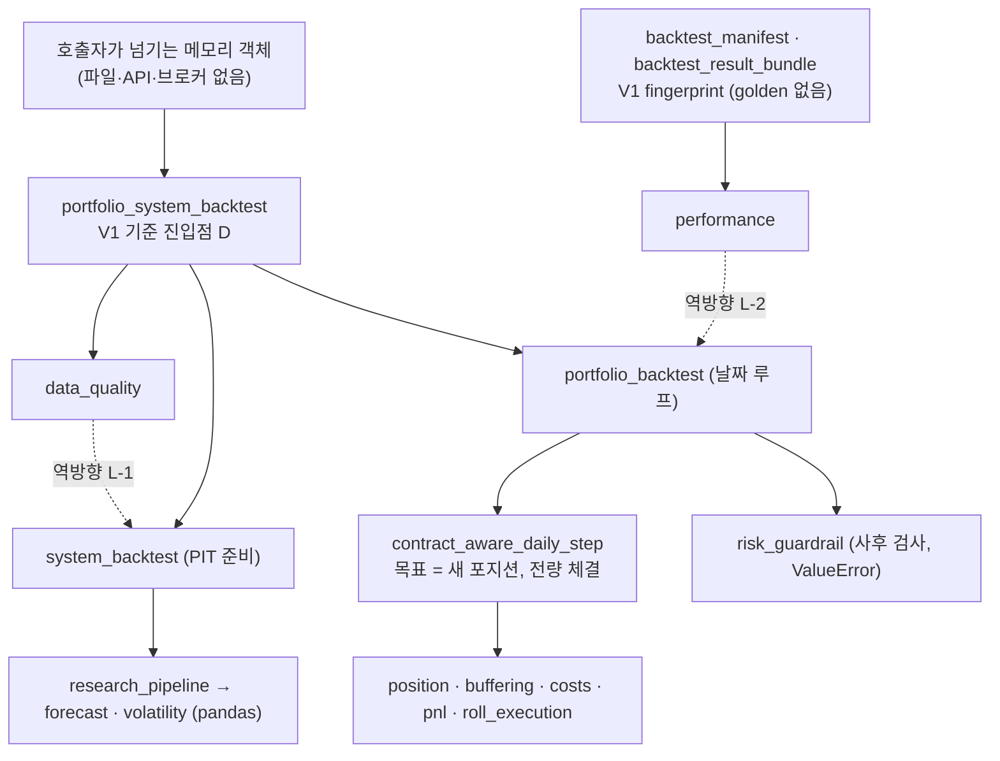
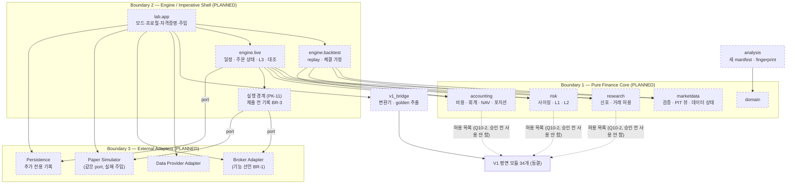

# P0-02C2 결정 요약 (Package Boundaries, Reproducibility & Broker Adapters)

- 작업: P0-02C2 Package Boundaries, Reproducibility and Broker Adapters
- 기준 커밋: `a02aede` (작업 시작 시 `python -m pytest -q -W error` → 306 passed, 경고 0)
- 작성일: 2026-10-16
- 상태: **세 ADR 모두 ACCEPTED** (2026-10-16, 사용자의 명시적 승인, 작업 P0-02C2-FINAL). 승인 범위는 **핵심 아키텍처 설계 원칙만**이다 (§0).
- 개정: **R1** (2026-10-16, P0-02C2-R1). `UNKNOWN` 주문의 최악 경우, 입력 fingerprint의 데이터 내용 반영, 브로커 조회 결과의 기준 시각, 제출 시도 기록의 내구성, `NOT_SENT` 원인 구분을 보완했다 (§15). (당시 상태는 모두 PROPOSED였다.)
- P0-02C2와 R1에서는 새 Markdown 파일 4개만 작성·보완했다. P0-02C2-FINAL에서는 세 ADR의 상태와 승인 기록, 이 요약, CLAUDE.md의 ADR 정보만 갱신했다. 세 작업 모두 `src/`, `tests/`, `pyproject.toml`, ACCEPTED ADR-0001~0009, 기존 감사·요약 문서를 변경하지 않았다. golden 테스트, Adapter, 시뮬레이터를 구현하지 않았고 어떤 브로커에도 연결하지 않았다.
- 표기: `CONFIRMED` / `INFERRED` / `UNVERIFIED`. 존재하지 않는 기능은 **PLANNED**. 패키지 이름은 모두 **가칭**이다. 브로커 동작은 모두 **UNVERIFIED**다.

---

## 0. 승인 기록 (P0-02C2-FINAL)

| 항목 | 내용 |
|---|---|
| 승인일 | 2026-10-16 |
| 승인 주체 | 프로젝트 사용자 |
| 승인 근거 | 사용자의 명시적 승인 (P0-02C2-R1 검토 후) |
| 승인 대상 | ADR-0010 (Physical Package Boundaries), ADR-0011 (Backtest Reproducibility and Schema Versioning), ADR-0012 (Broker Adapter Boundaries)의 **핵심 설계 원칙만** |
| 제외 범위 | 각 ADR §2의 "승인되지 않은 사항"과 Open Questions (Q10-1~Q10-8, Q11-1~Q11-11, Q12-1~Q12-16), 구체 구현 규칙, 운영 정책, 코드 구현 |
| 구현 상태 | **미구현.** 새 패키지, golden 테스트, 새 인코더·manifest, Adapter, 시뮬레이터, 저장소 모두 없다 |
| 인수 테스트 | 명세만 존재, 미구현 (ADR-0010 6개, ADR-0011 9개, ADR-0012 12개) |
| 의미 | 문서 수준의 원칙 승인이다. 코드 구현, 의존성 추가, golden 테스트 작성, 브로커 연결, Live 활성화를 허가하지 않는다 |

> **"ADR ACCEPTED"는 "구현 완료", "금융 계산 검증 완료", "Paper/Live 준비 완료"를 뜻하지 않는다.** 기존 306개 테스트 통과는 V1 코드가 유지되었다는 회귀 근거일 뿐이다.

### 0.1 승인된 원칙 (요약. 전체 목록과 근거 절은 각 ADR §2)

| ADR | 승인된 원칙 |
|---|---|
| 0010 | V1 평면 모듈 34개 보존 · 새 시스템은 V1과 분리된 우산 하위 패키지 아래 (B-2 원칙) · 대안 C(전부 이동 + shim) 불채택 · V1 공개 경로·클래스 동일성·fingerprint·테스트 의미 보호 · 새 코드의 명시적 계층·의존 규칙과 순환 금지 · 금융 코어, Adapter, 실행 엔진의 책임 분리 · 브로커 SDK와 실주문 실행 경계 제한 · V1 재배선·구조 변경 전 golden과 별도 승인 · 단계별 이전·검증 · V1 계층 이상은 자동 수정되지 않음 |
| 0011 | V1 구조 변경 전 golden으로 결과 고정 · V1 인코더·payload·schema version·fingerprint 불변 · fingerprint에 없는 값(날짜, 체결 다리, 위험 예산)도 golden에 보존 · 새 시스템은 버전 있는 schema·인코더·실행 manifest · 새 fingerprint는 V1과 영역·형식이 구별됨 · 실제 사용한 데이터 내용을 입력 fingerprint에 반영 · 코드·데이터·환경·타임존 데이터 버전 추적 · 관측 시각, 이용 가능 시각, 수정 이력 구분 · 세 검증의 구분 · golden 통과는 정확성 증명이 아님 · golden 자동 갱신 금지 · golden 변경에는 별도 승인과 이력 |
| 0012 | 공통 port와 브로커별 구현 분리 · Paper 시뮬레이터도 같은 port · 금융 코어는 SDK를 호출하지 않음 · 상주 라우팅 서비스는 지금 도입하지 않음 · 제출 시도 기록을 영속화하고 확인한 뒤에만 전송 · 확인이 없으면 전송하지 않음 · 시도 기록과 실제 제출·접수 상태 구분 · 쓰기 결과 4분류 · 미전송을 증명하지 못한 timeout은 `UNKNOWN` · 자동 재제출 금지 · 전송 계층 자동 재전송 금지 · 불명확 주문 노출은 ADR-0003·0009의 보수 규칙 · 체결 ID 멱등과 충돌 검사 · 취소·정정 불일치는 RP-1~RP-5 · `HALTED` 규칙 완화 금지 · 재시작 시 브로커 대조 · 필수 기능을 검증할 수 없으면 Live 거부 · Adapter는 위험 판단을 하지 않음 · Live 활성화와 수동 복구는 별도 설계와 승인 |

### 0.2 승인되지 않은 사항 (Open Questions로 유지)

| ADR | 미승인 사항 | 질문 |
|---|---|---|
| 0010 | 새 패키지 최종 이름 (`lab`은 가칭) | Q10-1 |
| 0010 | V1 순수 공식 함수 재사용(PK-9), ADR-0001 §8.0 해석. **실행 금지** | Q10-2 |
| 0010 | import 규칙 검사 방법과 시점 | Q10-3 |
| 0010 | `risk → accounting` 의존 예외(PK-2), `ports`·`app`의 계층 분류. **실행 금지** | Q10-4 |
| 0010 | Composition root와 Live 활성화 장치, V1 내부 정리, 타임존 데이터 의존성, 테스트 디렉터리 재구성 | Q10-5, Q10-6, Q10-7, Q10-8 |
| 0011 | golden 저장 형식, fixture 목록·개수·우선순위, 환경 간 허용 오차, 갱신 절차 세부, 구현 시점 | Q11-1~Q11-5 (ADR-0005 Q5-4, Q5-9) |
| 0011 | 새 인코더의 수치 규칙, 코드 버전 자동 수집, vintage 저장 구조, Q1-9의 최종 답, 기록 저장소, `content_hash` canonicalization | Q11-6~Q11-11 |
| 0011 | V1·새 엔진 차등 비교 허용 오차 | ADR-0005 Q5-6 |
| 0012 | 브로커·모의 환경 선정, Live 필수 기능과 검증 수준, 식별자 고유성, 수동 재제출 | Q12-1~Q12-4 |
| 0012 | 조회 실패 세부 정책, 증거금 출처, 저장소와 내구성, 주문 유형·timeout, 라우팅 서비스 전환 조건 | Q12-5~Q12-9 |
| 0012 | NAV 미확정 시 계좌 전체 위험 증가 차단 (BR-13) | Q12-10 |
| 0012 | 식별 정보 표시, RP-4 완화, `order_submitted_at` 정의, `UNKNOWN` 상한 축소 조건, 기준 시각 없는 브로커의 Live, 비정상 재시작 `HALTED` 정책 | Q12-11~Q12-16 |
| 0012 | Kill Switch 수동 복구 절차, 실제 Live 주문 활성화 | ADR-0003 Q3-6, ADR-0009 Q9-8, CLAUDE.md §8 |
| 기존 | Stage 1 타입 이동 방식, RESEARCH 위험 예산 직접 입력, 첫 구현 자산 유형 | ADR-0004 Q4-1, Q4-7, ADR-0005 Q5-8 / ADR-0006 Q6-1 |

### 0.3 R1 보완의 보존

`UNKNOWN` 최악 경우 노출 5 (AT-0012-5), 비원자적 정정 13 (AT-0012-6), 데이터 내용을 반영한 입력 fingerprint (FP-11~FP-13, FP-19, AT-0011-9), 신뢰할 수 있는 `as_of`와 그렇지 않은 조회의 구분 (§6.3a, AT-0012-11), 제출 시도 기록의 영속화 조건 (BR-3), 미전송 원인별 처리 (AT-0012-12), 비정상 재시작의 잔여 위험, Q11-11·Q12-14~Q12-16은 FINAL에서 바꾸지 않았다.

### 0.4 후속 단계

- **P0-03 Domain Contracts는 설계 명세 단계이며 아직 시작하지 않았다.**
- golden 구현, 새 패키지 생성, 브로커 Adapter 구현, Live 활성화는 각각 별도 명세와 사용자 승인 없이 실행하지 않는다.

## 1. 작성한 ADR

| ADR | 제목 | 결정 ID | 관련 GAP | 상태 |
|---|---|---|---|---|
| [0010](../adr/0010-physical-package-boundaries.md) | 물리적 패키지 경계와 이전 계획 | D-10 | A-01, A-03, A-08, A-11, A-14 | ACCEPTED (2026-10-16, 설계 원칙) |
| [0011](../adr/0011-backtest-reproducibility-and-schema-versioning.md) | 백테스트 재현성과 schema version | D-11 | A-09, A-11, F-10 | ACCEPTED (2026-10-16, 설계 원칙) |
| [0012](../adr/0012-broker-adapter-boundaries.md) | 브로커 Adapter 경계와 실패 의미 | D-12 | F-04, F-08, A-07 | ACCEPTED (2026-10-16, 설계 원칙) |

## 2. 세 결정 비교표

| 항목 | ADR-0010 패키지 경계 | ADR-0011 재현성 | ADR-0012 브로커 Adapter |
|---|---|---|---|
| 대안 | A: 평면에 새 모듈 추가 / B: V1 유지 + 새 하위 패키지 (B-1 계층별, B-2 우산 + 계층) / C: 전부 이동 + shim | A: 기존 테스트에 일부 값 고정 / B: golden fixture + snapshot / C: 버전 있는 schema + 실행 manifest + golden | A: SDK 직접 호출 / B: 공통 Adapter 계약 / C: B + 별도 라우팅·영속 서비스 |
| **권장안** (핵심 원칙 승인 2026-10-16, 범위는 §0. 규칙별 상태는 각 ADR §2: PK-2 `risk → accounting`, PK-9, `ports`·`app` 분류, FP-8·FP-9·FP-18, BR-13 등은 미승인) | **B-2**: V1 34개 모듈은 그대로 동결, 새 코드는 우산 패키지 하나(가칭 `carver_quant.lab`) 아래 계층별 하위 패키지. import 규칙 PK-1~PK-13. C 불채택 | **C** (새 시스템), V1은 V1 인코더·payload를 그대로 쓰는 golden(B 형태). 새 fingerprint는 영역 분리와 접두사로 V1과 구분 (FP-1~FP-19) | **B + 최소 영속 기록**: 공통 port, 브로커별 구현과 Paper 시뮬레이터가 같은 계약. 제출 전 기록(BR-3). 기능 선언으로 Live 시작 검증(BR-1). 규칙 BR-1~BR-16 |
| 핵심 근거 | shim으로 함수를 옮기면 monkeypatch 테스트가 조용히 무력화된다 (probe). 하위 패키지 이름이 V1 모듈을 가린다 (probe) | V1 결과 fingerprint에 날짜·체결 다리·위험 예산이 없다. golden이 0건. D 경로의 롤일을 지나는 테스트가 없다 | 응답 유실을 "주문 없음"으로 보면 중복 주문. 브로커 기능은 모두 UNVERIFIED |
| V1 영향 | 없음 (V1 무이동·무수정) | 없음 (V1 인코더·payload·타입 불변, golden은 새 테스트로만) | 없음 (V1에 브로커 경로 없음) |
| 남는 위험 | V1 공식 함수 재사용과 ADR-0001 §8.0의 해석 (Q10-2). V1 안의 계층 이상 L-1~L-9는 동결된 채 남음 | 환경 간 실수 차이 정책 미정 (Q11-3). golden은 V1 결함까지 고정 | `HALTED`가 잦을 수 있음 (Q12-5). 체결 ID 없는 브로커 (Q12-3) |

## 3. 통합 아키텍처

### 3.1 세 경계

| 경계 | 책임 | 위치 (ADR-0010, PLANNED) | 하지 않는 것 | 현재 V1 대응 |
|---|---|---|---|---|
| **Boundary 1 — Pure Finance Core** | Market Data 입력 계약과 검증, Forecast, Portfolio Target, Risk(L1·L2), Cost, Accounting(회계식, 통화별 현금·NAV, 체결 기록 → 포지션) | `lab.domain`, `lab.marketdata`, `lab.research`, `lab.risk`, `lab.accounting` | 브로커 SDK, 네트워크, 파일, 현재 시각 조회, 난수 (PK-3, PK-10) | V1 공식 모듈 (`volatility`, `forecast`, `position`, `buffering`, `costs`, `pnl` 등). I/O 없음 (CONFIRMED) |
| **Boundary 2 — Engine / Imperative Shell** | 일간 실행 일정, 데이터 검증 호출, 주문 후보 생성, 거래 전 위험 검사 호출, Trading State(L3), Reconciliation 조율, 실행 경계 | `lab.engine.backtest`, `lab.engine.live`, `lab.app` | 금융 공식 구현, 브로커 SDK 직접 호출 (port만 사용) | 백테스트 러너·스텝 (`*_backtest`, `*_daily_step`). L3·Reconciliation은 없음 |
| **Boundary 3 — External Adapters** | Data Provider, Broker, Paper Simulator, Persistence. 외부 통신은 여기서만 | `lab.ports`(계약), `lab.adapters`(구현) | 금융 계산, 위험 판단, 상태 결정 (BR-6) | 없음 |

### 3.2 현재 V1 구조 (CONFIRMED)

평면 모듈 34개, 하위 패키지 없음, 순환 없음, 깊이 0~8 (ADR-0010 §3.2).

### 3.3 목표 구조 (PLANNED)

ADR-0003 §6.1의 처리 순서(목표 → 버퍼링 → 거래 허용 판단 → L2 → L3 → 주문)는 그대로다. 실행 경계는 L3 다음, 주문 직전에 있다.

## 4. 실제 V1과 목표 구조의 핵심 차이

| 항목 | V1 (CONFIRMED) | 목표 (PLANNED) | 근거 |
|---|---|---|---|
| 패키지 | 평면 34개 모듈, `__init__.py` 비어 있음 | V1은 그대로, 새 코드는 `lab` 아래 계층별 | ADR-0010 |
| 의존 규칙 | 문서만 있음. 계층 이상 L-1~L-9 | PK-1~PK-13, AST 규칙 테스트 (제안) | ADR-0010 §6.3 |
| V1 ↔ 새 코드 | — | V1은 `lab`을 import하지 않음. `lab`은 `v1_bridge`와 공식 허용 목록으로만 V1 사용 | PK-8, PK-9 |
| 재현성 | V1 fingerprint는 있으나 값 고정 테스트 0건. 결과 fingerprint에 날짜·체결 다리 없음. `code_version`은 수동 문자열 | V1 golden + 새 schema·인코더·실행 manifest (코드·데이터·환경·타임존 데이터 버전). 새 입력 fingerprint는 데이터 `content_hash`를 포함 (R1) | ADR-0011 |
| 체결 | 항상 전량 체결, 새 포지션 = 목표 | 백테스트는 시뮬레이션 정책, Paper/Live는 port를 통한 주문과 체결 기록 | ADR-0009, ADR-0012 |
| 실패 처리 | 없음 (주문 없음) | 요청 결과 분류(`NOT_SENT` 원인 구분), 영속화 확인 후 전송하는 제출 시도 기록, 매 재시작 대조, 자동 재제출 금지, `UNKNOWN` → `HALTED`(최악 경우는 원래 주문 전량) | ADR-0012 BR-2~BR-5, BR-12 |
| 타임존 | 없음 (`date`만). 검증된 환경에 IANA 타임존 데이터 없음 | IANA 타임존 + 데이터 버전 기록 (의존성 추가 승인 필요) | ADR-0007, ADR-0010 §3.5, ADR-0011 FP-14 |

## 5. 단계별 구현 순서

모든 단계는 별도 작업 명세와 사용자 승인이 필요하다. 이 요약과 세 ADR은 어느 단계도 승인하지 않는다.

| 단계 | 내용 | V1 결과 변경 위험 | 전제 | 승인 |
|---|---|---|---|---|
| Stage 0 | V1 golden master (ADR-0011 §6.3~§6.7) | 없음 | — | Q5-4, Q5-9, Q11-1~Q11-5 |
| Stage 0a (선택) | import 규칙 테스트 (V1 이상은 예외 목록) | 없음 | — | Q10-3 |
| Stage 1 | ADR-0004 역방향 의존 해소 (A/A-0) | 없음 (golden이 보호) | Stage 0 | Q4-1 |
| Stage 2 | `lab` 뼈대, `domain`, `v1_bridge` 추가 | 없음 | P0-03 | Q10-1, 구현 승인 |
| Stage 3 | `engine.backtest`, 코어, V1 차등 비교 | 없음 | Stage 0, 2 | Q10-2, Q5-6 |
| Stage 4 | 일반 모드 기능 (ADR-0001~0003, 0006~0008) | 없음 | Stage 3 | 기능별 명세·독립 검증 |
| Stage P | `ports`, Paper 시뮬레이터, `engine.live` (Paper) | 없음 | ADR-0012 원칙 승인 완료(2026-10-16), P0-03 | 구현 승인 (별도) |
| Stage L | 실제 브로커 Adapter, Live 활성화 | 없음 (V1 무관) | 브로커 선정, 기능 검증(BR-1), Kill Switch·복구 설계 문서 | **명시적 Live 승인** (CLAUDE.md §8) |
| Stage 5 (선택) | V1 이동·재배선·정리 | **높음** | golden 동일성 증명 | **별도 ADR** (ADR-0005 승인 원칙 7) |

## 6. Golden Master의 역할과 한계

**역할**
- 구조 변경 전에 V1의 입력 fingerprint, 결과 fingerprint, 일별 결과(계좌, 상품, 월물별 체결 다리, 위험 예산, risk snapshot)를 고정한다 (ADR-0005 승인 원칙 6).
- V1 결과 fingerprint에 없는 값(날짜, 체결 다리, 위험 예산)도 V1 결과 객체에서 따로 꺼내 기록한다. V1 payload는 바꾸지 않는다 (ADR-0011 §6.3).
- 같은 환경에서는 실수도 정확히 비교한다 (ADR-0005 AT-0005-1).
- 차등 비교(ADR-0005 AT-0005-3)의 기준값이 된다.

**한계**
- golden은 **변화**를 잡을 뿐 **정답**을 말하지 않는다. V1 결함(F-02 mid와 평가가격 차이, A-05 손익 누락 가능성, 환산 손익 없음 등)까지 고정한다.
- fixture가 지나지 않는 계산 경로의 변화는 잡지 못한다.
- 같은 사람이 golden, 해시 목록, 승인 기록을 함께 바꾸면 테스트로는 막지 못한다. Git 검토 대상이다.
- 다른 환경에서 실수가 다를 수 있는지는 확인하지 않았다 (UNVERIFIED, Q11-3).
- 세 검증(Regression/Golden, Financial Integrity, Differential)은 서로를 대신하지 못한다 (ADR-0011 AT-0011-8).

**fingerprint 보존 요점**: V1 인코더·payload·타입·번들 필드는 그대로 (FP-1~FP-4). 새 시스템은 별도 인코더, 영역 분리, `lab-…/N:sha256:` 접두사, schema 이름 태그, 수치·시각 표현 규칙, 입력·결과·실행 manifest 분리, 배열의 순서 의미 선언을 쓴다 (FP-5~FP-16, FP-18). **새 입력 fingerprint는 데이터의 `dataset_id`나 파일 경로가 아니라 실제로 쓴 레코드의 `content_hash`를 덮는다** (FP-11~FP-13, FP-19, R1). 공급자가 과거 가격을 고치고 실행의 vintage가 그 수정본을 포함하면 `content_hash`와 입력 fingerprint가 바뀌고, 파일 경로·vintage 표기·코드 버전만 바뀌면 입력 fingerprint는 그대로이며 그 차이는 실행 manifest에 남는다 (AT-0011-9). `V1_COMPAT` 재현 실행은 V1 fingerprint를 V1 함수로 계산해 별도 필드에 담는다 (FP-17). 기존 V1 fingerprint를 새 형식으로 조용히 교체하지 않는다.

## 7. Broker Adapter 최소 기능과 미지원 위험

### 7.1 최소 기능 (ADR-0012 §6.3)

| 구분 | 기능 |
|---|---|
| **Live 필수** (미지원이면 Live 시작 거부, BR-1) | BF-1 Account Snapshot, BF-2 Positions, BF-3 Open Orders, BF-4 Order Status, BF-5 Fill History, BF-6 Cash Balance/Settlement, BF-8 Order Submission, BF-11 Client Order ID 조회(또는 미체결·체결 내역의 Client Order ID 반환), BF-9 Cancel(필수 권장, Q12-2). (R1) 대조에 쓰는 조회는 §6.3a의 A 조건(BF-1·BF-2·BF-6은 `as_of`, BF-3·BF-5는 반영 이벤트 상한, BF-4는 갱신 시각)을 갖추거나, 대체 검증이 사용자 승인을 받아야 한다 (Q12-15) |
| **조건부** | BF-7 Margin Requirement: 대체 증거금 모델이 없으면 선물 위험 증가 차단 |
| **선택** (미지원이어도 Live 가능, 대체 처리) | BF-10 Replace: 취소 확정 후 새 주문으로만. BF-12 Session Status: 달력(ADR-0007)과 제출 거부 처리로 대체 |

### 7.2 브로커가 지원하지 않을 때의 위험

| 미지원 기능 | 위험 | 처리 |
|---|---|---|
| Client Order ID 조회 (미체결·체결 내역도 Client Order ID를 돌려주지 않는 경우) | Broker Order ID 없이 timeout된 주문을 식별할 수 없음 → 중복 주문 또는 무기한 `HALTED` | Live 금지 (BF-11, AT-0012-2) |
| 체결 ID (또는 고유성 범위가 좁음) | 체결 이중 반영·누락 → 포지션·현금 오류 | 확인된 체결 ID, 또는 확인된 이벤트 순번 + 누적 수량 대조. 둘 다 없으면 Live 부적합 (§6.6, Q12-3) |
| 원자적 정정 / 정정 수량 의미 확인 | 기존·새 주문 동시 유효 → 노출 과소 평가 | RP-1 합으로 최악 경우, 미지원이면 취소 확정 후 새 주문 |
| 신뢰할 수 있는 `as_of`가 있는 포지션·현금 보고 (§6.3a의 A) | 보고 지연과 실제 불일치를 구분하지 못함 | 설명된 차이를 인정하지 않음, 모든 차이 `HALTED` (BR-10). "정지 상태"는 완전성의 증거가 아님. 대체 검증 SB-1~SB-4는 약한 일치일 뿐이며 이를 대조 완료로 인정할지와 Live 허용은 사용자 승인 (Q12-15) |
| 취소 API | 미체결을 정리할 수 없음. 복구가 수동이 됨 | Live 금지 권장 (Q12-2). 복구 설계 문서가 수동 경로를 다뤄야 함 |
| 증거금 조회 | 증거금 사용률 계산 불가 | 대체 모델이 없으면 선물 위험 증가 차단 (Q12-6) |
| 쓰기 요청의 멱등 보장 | 전송 계층 재시도로 중복 주문 | SDK 자동 재시도 금지 (BR-5), 자동 재제출 금지 (BR-4) |
| 이벤트 순번·재전송 | 재연결 후 놓친 체결 | 재연결 시 체결 내역을 겹치는 구간까지 다시 읽고 대조 (BR-8) |

## 8. 기존 ACCEPTED ADR과의 정합성

세 ADR 모두 "ACCEPTED ADR과의 정합성" 절을 두었다 (ADR-0010 §6.8, ADR-0011 §6.9, ADR-0012 §6.9). ACCEPTED 결정을 바꾸는 제안은 없다. 다만 **ACCEPTED 문서와 다르거나 해석이 필요한 지점 세 가지**를 숨기지 않고 질문으로 기록했고, 승인 전에는 해당 의존이나 해석을 쓰지 않는다: (1) ADR-0004 §6.2 표와 다른 의존 두 가지 (PK-2 `risk → accounting`, PK-9 코어 → V1 공식 모듈, Q10-4·Q10-2), (2) ADR-0001 §8.0의 "V1 API" 범위 (Q10-2), (3) ADR-0001 §5.1.1 `order_submitted_at`에 로컬 전송 시각과 브로커 접수 시각 가운데 무엇을 쓸지 (Q12-13). 독립 검토에서 처음 초안의 BR-12가 ACCEPTED ADR-0009 RP-4를 완화하고 있음이 발견되어, RP-4를 그대로 따르도록 고쳤다 (§14).

| 관계 | 내용 |
|---|---|
| ADR-0001 §8.0 "기존 V1 API는 Paper/Live의 주문 경로에서 호출하지 않는다" ↔ ADR-0010 PK-9 (새 코어가 V1 순수 공식 함수를 재사용) | §8.0은 "V1 API"를 "현재 `src/carver_quant`의 공개 함수"로 정의하고 예시로 러너만 든다. 공식 함수 재사용이 이 금지에 해당하는지 문언상 불명확하다. **Q10-2.** 해석이 정해지기 전에는 Paper/Live 주문 경로에서 V1 함수를 쓰지 않는다 |
| ADR-0004 Q4-1 (Stage 1 A/A-0), Q4-2, Q4-6 | 닫지 않음. Q4-2는 `lab.domain` 위치를 제안만 함. Stage 1 A의 중립 모듈은 V1 네임스페이스에 둬야 함 (`lab`에 두면 PK-8 위반) |
| ADR-0004 §6.2 표 "Adapters는 Domain에만 의존" | `ports`를 Domain Contracts의 일부로 분류(승인 대상, Q10-4). Paper 시뮬레이터의 체결가 계산은 주입으로 해결 (PK-5) |
| ADR-0004 §6.2 표 "Portfolio & Risk, Cost·Accounting은 Domain에만 의존" | **다름**: PK-2(`risk → accounting`), PK-9(코어 → V1 공식 모듈). 승인 전 사용하지 않음 (Q10-4, Q10-2) |
| ADR-0004 Q4-8 (Data Boundary의 pandas) | 정하지 않음. PK-2가 열어 둠 |
| ADR-0004 R-4 (Engines만 조립) | `lab.app`을 Engines(Imperative Shell)의 일부로 분류하는 제안 (미승인, Q10-4) |
| ADR-0005 승인 원칙 1~7, Q5-4, Q5-5, Q5-6, Q5-9 | V1 동결, golden 선행, 새 기능은 새 엔진. 미결정 질문은 권장안만 제시 |
| ADR-0005 AT-0005-1 (같은 경로의 실수는 정확히 같아야 함) | 같은 환경에서 정확 비교. 환경 간 문제는 AT-0005-1 범위 밖이므로 Q11-3 |
| ADR-0001 Q1-9 (fingerprint 보존 방법) | 권장 답만 제시 (ADR-0011 §6.1), 열린 채로 (Q11-9) |
| ADR-0003 §6.5 상태·해제 원칙, Kill Switch (1)·(2) | 바꾸지 않음. 연결 끊김과 계좌·포지션·미체결·주문·체결·현금 조회(BF-1~BF-6, BF-11) 실패를 "브로커 연결 이상"으로 적용. 증거금·세션 조회(BF-7, BF-12) 실패는 해당 판단만 막음 (BR-16). 복구 절차와 수동 재제출 여부는 정하지 않음 (ADR-0003 Q3-6, ADR-0009 Q9-8) |
| ADR-0003 §6.2.2 fail-closed | ADR-0012 BR-13은 NAV 미확정 시 모든 위험 증가를 막는 **확장 제안** (Q12-10) |
| ADR-0009 R9-5 | 브로커가 중복 방지를 보장해도 자동 재제출을 제안하지 않음 (BR-4) |
| ADR-0009 RP-1~RP-5, R9-8, §6.4a | 그대로 적용. 취소 확정과 체결 합이 맞지 않으면 RP-4대로 즉시 `UNKNOWN`·`HALTED` (BR-12, AT-0012-5). 대기 시간을 두는 완화는 RP-4를 바꾸는 일이라 제안하지 않음 (Q12-12) |
| ADR-0003 §6.3 (상태 불명확 주문은 체결된 것으로 간주), ADR-0009 §6.2 `UNKNOWN` 행, R9-7 | (R1) `UNKNOWN` 주문의 최악 경우는 **원래 주문 수량 전체**다. AT-0012-5에서 초안의 max(2, 3) = 3을 2 + (5 − 2) = **5**로 정정. 브로커 취소 확정 수량으로 줄이는 조건은 Q12-14 |
| ADR-0009 §6.2 `PENDING_SUBMIT` (제출 요청을 보냈음), ADR-0001 §5.1.1 `order_submitted_at` | 제출 **전** 기록은 별도의 제출 시도 이벤트이고 주문은 `INTENT`다. 저장소의 영속화 확인을 받은 뒤에만 전송 절차를 시작하고, `PENDING_SUBMIT`과 `order_submitted_at`(후보 값)은 전송 확정 지점을 넘은 뒤에 기록한다. 그 전의 실패는 `NOT_SENT`로 결과 이벤트를 남기고 주문은 `INTENT`로 남는다 (BR-3 (0)~(6), R1). 저장소가 구현·검증되기 전에는 장애 시 기록 보존을 보장하지 않으며, 매 재시작 대조로 보완 (Q12-7). 시각 정의의 해석은 Q12-13 |
| ADR-0008 F8-3, Q8-11 | Adapter는 브로커 보고 수수료 통화를 원본 기록만 함 (BR-15). 운영 사용은 미결정 그대로 |
| ADR-0007 Q7-6, Q7-9 | BF-12는 세션 상태를 **확인할 수 없을 때** 제출하지 않는다는 것만 정한다. 세션 밖 제출 허용(Q7-9)과 제출하지 못한 주문 의도의 처리(Q7-6)는 미결정 그대로 |

## 9. 이번 조사에서 새로 확인한 사실

| ID | 사실 | 근거 | 확인 수준 |
|---|---|---|---|
| N2-1 | 함수를 다른 모듈로 옮기고 이전 경로에 재export shim을 두면, 이전 모듈 속성을 패치하는 테스트의 spy가 구현에 닿지 않는다. `tests/test_roll_execution.py:122-179`의 `assert execution_calls == []`는 "검증 전에 체결"하는 결함이 있어도 통과하게 된다 | 저장소 밖 장난감 패키지 probe | 메커니즘 CONFIRMED / 실제 테스트 적용은 INFERRED |
| N2-2 | `carver_quant/portfolio/` 하위 패키지를 만들면 `import carver_quant.portfolio`가 V1 `portfolio.py` 대신 하위 패키지를 로드한다. 오류도 경고도 없다 | 장난감 패키지 probe | CONFIRMED (메커니즘) |
| N2-3 | V1 기준 진입점 D와 시스템 경로 C의 테스트는 모두 롤 없이(`roll_events=[]`, `roll_to_contract=None`) 실행된다. D 경로로 롤일을 지나는 테스트가 없다 | grep (ADR-0011 §3.3) | CONFIRMED |
| N2-4 | V1 결과 fingerprint payload에 날짜, 월물별 체결 다리, 위험 예산, risk snapshot이 없다. 이 값들은 결과 객체에는 있다 | `backtest_result_bundle.py:57-170`, 결과 dataclass | CONFIRMED |
| N2-5 | V1 canonical JSON은 `1`과 `1.0`, `-0.0`과 `0.0`, naive와 aware `datetime`을 서로 다른 문자열로 만든다. 필드가 같은 서로 다른 dataclass는 같은 문자열을 만든다 | V1 `to_canonical_json` 직접 호출 probe | CONFIRMED |
| N2-6 | 검증된 환경(`.venv`)에서 `ZoneInfo("America/New_York")`가 실패한다. `tzdata` 미설치, `/usr/share/zoneinfo` 없음. ADR-0007 구현에는 의존성 추가 승인이 필요하다 | 실행 | CONFIRMED |
| N2-7 | `__init__.py`가 비어 있어 공개 경로는 모듈 경로뿐이다. 34개 모듈 전부가 테스트에서 import된다 (이름 97개, 비공개 1개) | AST | CONFIRMED |
| N2-8 | 계층 이상 L-7(`backtest_manifest → backtest_config, portfolio`), L-8(`backtest_config → risk_guardrail`), L-9(`costs`, `pnl`, `position → fx`)는 기존 문서 목록에 없던 항목이다 | AST | CONFIRMED |

## 10. P0-03 Domain Contracts로 넘길 내용

| 출처 | 넘길 계약 |
|---|---|
| ADR-0010 | `lab.domain`의 물리 위치와 이름 규칙 (Q10-1), V1 타입을 도메인 필드에 넣지 않는 규칙, 결과 계약(분석이 러너 타입에 의존하지 않도록, PK-7) |
| ADR-0011 | 새 입력·결과·NAV·주문 이벤트·실행 manifest schema의 필드와 자료형, 수치 표현(정수/실수, `-0.0`, Decimal 여부, Q11-6), 시각 표현(UTC aware, FP-10), 데이터 버전·vintage 참조(Q11-8), `content_hash`의 정의와 계산 대상(FP-19, Q11-11), 입력 fingerprint·실행 manifest·vintage 기록의 필드 분리, 데이터 지연 가정 기록(ADR-0004 Q4-3), golden 기록의 필드(§6.3) |
| ADR-0012 | port별 함수 시그니처와 자료형, 요청 결과 분류(`NOT_SENT(LOCAL_VALIDATION)` / `NOT_SENT(CONNECTION)` / `REJECTED` / `ACKNOWLEDGED` / `UNKNOWN`), 기능 선언과 확인 수준(조회 시각 의미 `SNAPSHOT_AS_OF` / `RESPONSE_TIME_ONLY` / `NONE` 포함), 제출 시도 이벤트와 영속화 확인, 식별자 타입(Client Order ID, Broker Order ID, Fill ID, Account ID, Order Group ID, Broker Event ID), 응답의 브로커 시각·로컬 수신 시각 필드, 시뮬레이터 각본 형식 |
| 기존 (P0-02C1 §11) | 달력·세션, 데이터 상태, FX 관측, 통화별 현금 이벤트, NAV와 분해, 주문 의도·주문·체결·롤 그룹, 예상 포지션 |

## 11. P0-04 금융 검증과 연결할 항목

| 항목 | 연결 |
|---|---|
| golden 값과 독립 계산의 비교 | golden은 정답이 아니다. G-1~G-10의 대표 값을 독립 계산으로 확인 (ADR-0011 §6.2) |
| D 경로 롤일 손익 | G-2 golden과 V-06(back-adjustment gap, 롤일 손익 연속성), V-07(양쪽 롤 다리 비용) |
| warm-up 날짜 건너뛰기와 손익 누락 | G-10, AT-0011-8, GAP A-05 |
| FX 겸용 스칼라의 영향 | G-4와 V-08, ADR-0008의 환산 손익 |
| 환경 간 실수 차이 | Q11-3 판단 근거 (CI 도입 시 실제 측정) |
| 차등 비교 허용 오차 | ADR-0005 Q5-6의 근거 |
| NAV 미확정 시 차단 범위 | ADR-0012 BR-13 채택 여부의 근거 (Q12-10) |

## 12. P0-04 이후 단계로 넘길 사항

"P0-05"라는 단계는 기존 문서에 정의되어 있지 않다. 아래는 P0-04 이후에 다룰 후보이며, 단계 이름과 범위는 사용자가 정한다.

| 후보 | 내용 |
|---|---|
| Stage 0 golden 구현 | ADR-0011 원칙은 승인됨. 저장 형식·목록·시점 결정(Q5-4, Q5-9, Q11-1~Q11-5)과 구현 승인 후 |
| Kill Switch·복구 설계 문서 | ADR-0003 Kill Switch (2), Q3-6, ADR-0009 Q9-8. 취소 API가 없는 브로커의 수동 경로 포함 (ADR-0012 §6.8) |
| Paper 설계 | timeout·조회 간격(Q9-4, Q12-8), 기록 저장소(Q9-9, Q12-7), Reconciliation 기준(Q3-12), 시뮬레이터 각본 |
| 브로커 선정과 기능 검증 | ADR-0012 §6.3 기능 선언 채우기 (Q12-1~Q12-4) |
| 의존성 결정 | 타임존 데이터 (Q10-7), import 규칙 도구 (Q10-3) |

## 13. 사용자 승인이 필요한 미결정 사항

> P0-02C2-FINAL 기준: C2-U1~C2-U3의 **핵심 설계 원칙은 승인으로 해결**되었다. 그 안의 세부 선택과 C2-U4~C2-U20은 모두 미결정이다. 전체 미승인 목록은 §0.2.

### 13.1 지금 결정할 수 있는 것

| ID | 질문 | 관련 |
|---|---|---|
| C2-U1 | **[원칙 승인됨 2026-10-16]** ADR-0010 권장안(B-2: V1 동결 + 우산 패키지 아래 계층별 새 코드, 대안 C 불채택, 경계·안전 원칙). **미결정**: PK-2의 `risk → accounting`, PK-9, `ports`·`app` 분류 (실행 금지), 이름, 검사 도구 | ADR-0010, Q10-1~Q10-4 |
| C2-U2 | **[원칙 승인됨 2026-10-16]** ADR-0011 권장안(V1 golden + 새 시스템의 schema·manifest, 세 검증의 분리, 데이터 내용을 반영한 입력 fingerprint). **미결정**: FP-6·FP-7의 봉투·접두사 형식, FP-10의 고정 문자열 형식, golden 형식·목록·시점·갱신 절차·허용 오차, 인코더 세부 규칙(FP-8, FP-9, FP-18), `content_hash` canonicalization | ADR-0011, Q11-1~Q11-11 |
| C2-U3 | **[원칙 승인됨 2026-10-16]** ADR-0012 권장안(공통 port + 최소 영속 기록, 영속화 확인 후 전송, 결과 4분류, 자동 재제출 금지, 기능 검증 없는 Live 거부). **미결정**: BR-13, 운영 정책 전반 (§0.2) | ADR-0012, Q12-1~Q12-16 |
| C2-U4 | 우산 패키지 이름 (가칭 `lab`) | Q10-1, ADR-0004 Q4-2, ADR-0005 Q5-5 |
| C2-U5 | 새 코어가 V1 공식 함수를 재사용할지, 그리고 ADR-0001 §8.0의 "V1 API" 해석 | Q10-2 |
| C2-U6 | golden 저장 형식, 시나리오 목록·우선순위, 구현 시점, 갱신 절차 | Q11-1, Q11-2, Q11-4, Q11-5 (ADR-0005 Q5-4, Q5-9), 환경 간 허용 오차 Q11-3 |
| C2-U7 | ADR-0001 Q1-9의 답으로 ADR-0011 §6.1 권장안을 채택할지 | Q11-9 |
| C2-U8 | 조회 실패·연결 끊김도 `HALTED`로 하는 운영 부담 (자동 해제 예외는 Q3-5) | Q12-5 |
| C2-U9 | NAV 미확정 시 모든 위험 증가 차단 (BR-13). 취소·체결 불일치에 대기 시간을 두는 완화를 원하는지 (원하면 ADR-0009 RP-4를 바꾸는 별도 결정 필요) | Q12-10, Q12-12 |
| C2-U10 | 타임존 데이터 의존성 추가, import 규칙 검사 도구 | Q10-7, Q10-3 |
| C2-U15 | ADR-0004 §6.2 표와 다른 의존(`risk → accounting`), `ports`를 Domain Contracts로, `app`을 Engines로 분류하는 것 | Q10-4 |
| C2-U16 | `order_submitted_at`에 로컬 전송 시각과 브로커 접수 시각 가운데 무엇을 쓸지, 제출 시도 이벤트의 형식 | Q12-13 (P0-03) |
| C2-U17 | (R1) `content_hash`를 레코드 내용 기준으로 정할지 원본 바이트 기준으로 정할지 | Q11-11 (P0-03) |
| C2-U18 | (R1) 영속화 확인을 받지 못하거나 비정상 종료 뒤 재시작하면 계좌를 `HALTED`로 두는 제안 | Q12-16 |

### 13.2 시장·브로커 선정 후

| ID | 질문 |
|---|---|
| C2-U11 | 브로커 선정과 모의 환경 사용 여부 (Q12-1) |
| C2-U12 | Live 필수 기능과 요구 확인 수준, 취소 필수 여부 (Q12-2) |
| C2-U13 | 체결 ID 대안, 복구 절차가 수동 재제출을 허용할 경우의 Client Order ID 규칙 (Q12-3, Q12-4, ADR-0009 Q9-11) |
| C2-U14 | 증거금 출처 (Q12-6, ADR-0003 Q3-11) |
| C2-U19 | (R1) `UNKNOWN` 주문의 최악 경우를 원래 주문 전량보다 줄일 수 있는 조건 (Q12-14) |
| C2-U20 | (R1) 신뢰할 수 있는 `as_of`가 없는 브로커의 Live 허용과 대체 검증의 인정 범위 (Q12-15) |

### 13.3 이번 작업이 확정하지 않은 기존 미결정 사항

ADR-0004 Q4-1(Stage 1 방식), Q4-7(RESEARCH 위험 예산 입력), ADR-0005 Q5-6(차등 비교 허용 오차), Q5-8·ADR-0006 Q6-1(첫 자산 유형), ADR-0001 Q1-4·ADR-0008 Q8-11(수수료 통화·FX 시각), ADR-0009 Q9-2(주문 유형·제출 시각), ADR-0007 Q7-9(장 밖 접수), ADR-0003 Q3-6·ADR-0009 Q9-8(Kill Switch 복구 절차). 세 ADR은 이 질문들을 **닫지 않았다.**

## 14. 이번 작업에서 수행한 검증

| 검증 | 결과 |
|---|---|
| Git 상태 (작업 시작 시) | `master`, HEAD `a02aede`(기대값과 같음), `origin/master`보다 3커밋 앞섬, 작업 트리 clean |
| `python -m pytest -q -W error` (작업 시작 시, Python 3.14.6) | 306 passed, 경고 0 |
| import 그래프 | AST로 34개 모듈 의존을 다시 추출. V1_INVENTORY §4와 일치, 순환 없음, 깊이 0~8 |
| 테스트 import 표면 | 39개 테스트 파일(38개가 `carver_quant` import), 34개 모듈 전부, 이름 97개, 비공개 1개, 모듈 속성 패치 1건, `isinstance` 2건 |
| V1 canonical JSON | V1 `to_canonical_json`을 직접 호출해 §9 N2-5 확인 |
| shim·이름 충돌 | 저장소 밖 장난감 패키지로 §9 N2-1, N2-2 확인 |
| 타임존 데이터 | 저장소 `.venv`에서 `ZoneInfo` 실패 확인 (N2-6) |
| 코드 근거 | V1 schema version 상수, payload 필드, 결과 dataclass, 롤 테스트 부재를 해당 라인에서 확인 |
| 읽기 전용 독립 검토 | 코드·테스트 인용, 산술, 필수 항목은 모두 확인됨. 반드시 고칠 항목 7건을 반영: (1) BR-12·AT-0012-5가 ACCEPTED ADR-0009 RP-4를 완화하던 것을 RP-4 그대로로 수정, (2) ADR-0004 §6.2 표와 다른 의존(PK-2, PK-9)을 "충돌 없음"에서 "다름, 승인 대상"으로 수정, (3) PK-2 문구를 PK-9와 맞추고 ADR-0004 Q4-8을 열어 둠, (4) BF-12가 ADR-0007 Q7-6·Q7-9를 미리 정하던 문구 수정, (5) 제출 전 기록을 `PENDING_SUBMIT`이 아닌 별도 제출 시도 이벤트로 바꾸고 `order_submitted_at` 해석을 Q12-13으로, (6) 조회 실패 규칙의 범위를 BR-16으로 정리, (7) 수동 재제출을 복구 설계 문서 범위로 돌리고, 새 인코더의 순서 규칙 FP-18 추가. 선택 항목 가운데 롤 테스트 서술, golden 결함 목록, FP-3 필드 위치, AT-0011-7 패치 지점, 판정 `CODE_AND_ENVIRONMENT_DIFFER`, L2/L3 구분, `app`·`ports` 분류, 요약 도식도 반영 |
| 작업 종료 시 `python -m pytest -q -W error` | 최종 보고 참조 |
| (R1) ACCEPTED 원문 대조 | ADR-0003 §6.3(상태 불명확 주문은 체결 간주), ADR-0009 §6.2 `UNKNOWN` 행(전량 체결 간주), R9-4, R9-7, RP-4를 원문에서 확인. AT-0012-5의 3이 과소평가임을 확인하고 5로 정정 |
| (R1) V1 인코더 probe | 같은 payload에서 `ExecutionMarketDay` 하나만 바꿈: 클래스 이름만 다른 타입은 같은 JSON (`aeb12aa0…`), 필드 하나 추가는 다른 해시 (`fd98db44…`), 차이는 `"observed_at":null,` 19자 (AT-0011-2) |
| (R1) 읽기 전용 독립 검토 | R1-1·R1-2·R1-6 확인, probe 재현. 반드시 고칠 2건 반영: (1) BR-9·AT-0012-11이 S-3(미확인 시 `HALTED`)을 인용하던 것을 S-1(`POSITION_UNCONFIRMED`)로 정정, (2) `PENDING_SUBMIT` 기록 시점을 전송 확정 지점 이후로 정하고 `NOT_SENT` 결과 이벤트를 기록하도록 BR-3 수정 (`PENDING_SUBMIT → INTENT` 되돌림이 생기지 않게 함). 선택 항목도 반영: 비정상 재시작 `HALTED` 제안과 잔여 위험, 기능별 시각 요구, 최악 경우 값 명시(13, 5), `INPUT_DIFFERS`, 남은 표현, Q11-3 목록 추가 |
| (R1) 작업 종료 시 `python -m pytest -q -W error` | 306 passed, 경고 0 |
| (FINAL) 시작 시 Git 상태 | `master`, HEAD `a02aede`(기대값과 같음), `origin/master`보다 3커밋 앞섬, P0-02C2 문서 4개만 추적되지 않은 상태, 추적 파일 변경 없음. 306 passed, 경고 0 |
| (FINAL) 검증 | 편집 전 사본과 비교해 세 ADR의 본문 규칙·숫자·인수 테스트·질문 ID 보존 확인 (AT-0012-5의 5, AT-0012-6의 13, BR-3 영속화 조건, FP-19, Q11-11, Q12-14~Q12-16). ADR-0001~0012 상태 확인(모두 ACCEPTED). ADR-0001~0009, 기존 문서, `pyproject.toml`, `.gitignore`, `src/`·`tests/` 해시 불변. 링크·ID·표 검사 통과. 읽기 전용 독립 검토의 지적(BR-16과 Q12-5의 관계, 요약의 `app` 분류 표시, 권장안 행의 규칙별 상태, 승인 전제 문구, Q11-9 관계 등) 반영. 커밋 전 `python -m pytest -q -W error` 결과는 최종 보고 |

## 15. 개정 이력

| 개정 | 날짜 | 내용 |
|---|---|---|
| R0 | 2026-10-16 | 최초 작성 (P0-02C2). 세 ADR 모두 PROPOSED. 읽기 전용 독립 검토의 지적을 반영 (§14) |
| R1 | 2026-10-16 | P0-02C2-R1. (1) ADR-0012: `UNKNOWN` 최악 경우를 원래 주문 전량으로 정정 (AT-0012-5 3 → 5), 조회 결과 기준 시각 계약 §6.3a(A/B, SB-1~SB-4), BR-3 6단계와 내구성 비보장 명시, `NOT_SENT` 원인 구분, AT-0012-11·12, Q12-14~Q12-16. (2) ADR-0011: 입력 fingerprint에 `content_hash` 포함(FP-11~FP-13, FP-19), 책임 표, §6.6 판정 수정(`DATA_CONTENT_DIFFERS`), AT-0011-2 재작성, AT-0011-9, Q11-11. (3) ADR-0010: PK-11 문구. (4) 이 요약: 머리말, §4, §6, §7.1, §7.2, §8, §10, §13, §14 갱신. 상태 모두 PROPOSED |
| FINAL | 2026-10-16 | P0-02C2-FINAL — 사용자 핵심 원칙 승인. 세 ADR을 **ACCEPTED**로 변경 (범위는 §0). §0 승인 기록 추가 (승인된 원칙, 미승인 사항, R1 보존, 후속 단계). 머리말, §1 상태, §2 권장안 행의 승인 범위 표시, §8의 `app` 분류 표시, §5·§12의 승인 전제 문구, §13 C2-U1~C2-U3 승인 표시, §14 갱신. 미결정 질문, 숫자 예제, 인수 테스트 색인은 그대로 |
