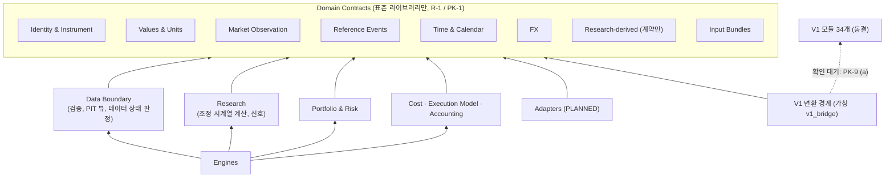
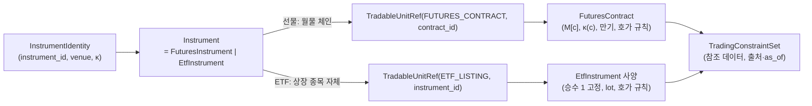
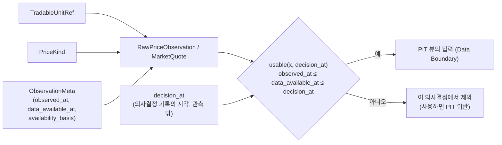
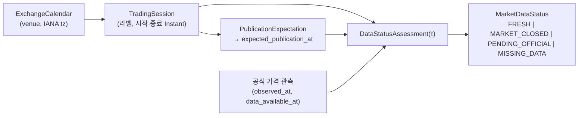
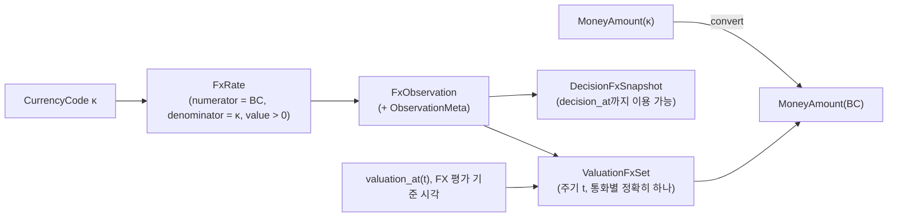
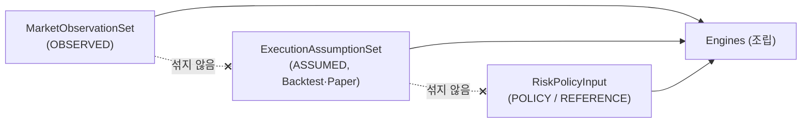

# P0-03A 공통 도메인 계약 (Common Domain Contracts)

| 항목 | 내용 |
|---|---|
| 작업 | P0-03A Common Domain Contracts Design |
| 기준 커밋 | `24cae00` (R0~R2. HEAD = `origin/master`, 작업 트리 clean, 작업 시작 시 확인). R3은 `9a6efba` (= `origin/master`) 기준 |
| 테스트 기준 | `python -m pytest -q -W error` → 306 passed, 경고 0 (작업 전·후) |
| 작성일 | 2026-10-17 |
| 개정 | R1, R2 (2026-10-17. R2 = P0-03A-FINAL: D3A-19·49·50 핵심 원칙 승인 반영, 당시 판정 FINAL BLOCKED), R3 (2026-10-19. P0-03A-FINAL-RESUME: ACCEPTED ADR-0013으로 CA-49 해소, 문서 동기화. §15) |
| 문서 상태 | **PROPOSED (설계 명세).** 이 문서는 ADR이 아니다. 이 문서는 ACCEPTED ADR-0001~0013을 적용한다. P0-03A에서 새로 승인된 것은 D3A-19·D3A-49·D3A-50의 핵심 원칙(2026-10-17, `APPROVED_PRINCIPLE`)뿐이며, D3A-49와 ADR-0006 I6-5의 충돌은 ACCEPTED [ADR-0013](../adr/0013-actual-quantity-and-order-lot-boundaries.md)(2026-10-19)으로 해소되었다 (§1.4). 그 밖에 이 문서가 새로 제안하는 내용은 승인되지 않았다. P0-03A-FINAL 판정은 [결정 등록부](P0-03A_DECISION_REGISTER.md) §9.4 |
| 구현 상태 | **미구현.** 코드, 패키지, dataclass, 테스트를 만들지 않았다. V1 코드와 테스트는 바꾸지 않았다 |
| 관련 문서 | [P0-03A_TYPE_CATALOG.md](P0-03A_TYPE_CATALOG.md) (타입 상세), [P0-03A_DECISION_REGISTER.md](P0-03A_DECISION_REGISTER.md) (미결정 사항 `D3A-xx`), [../quality/P0-03A_CONTRACT_ACCEPTANCE_SPEC.md](../quality/P0-03A_CONTRACT_ACCEPTANCE_SPEC.md) (인수 테스트 명세 `AT-03A-xx`) |

## 0. 표기 규칙

| 표기 | 의미 |
|---|---|
| **[ACCEPTED]** | ACCEPTED ADR §2의 승인된 원칙이나 규칙별 승인 표에 포함된 원칙·규칙을 그대로 적용한 것. 출처 절을 함께 쓴다. ADR-0001~0003은 §5.1·§6의 정책 원칙 전체가 승인 범위다 |
| **[ADR 본문]** | ACCEPTED ADR의 본문(규칙 표, 인수 테스트 명세)에 있지만 그 ADR §2의 승인된 원칙 목록이나 규칙별 승인 표에 직접 포함되지 않은 것. 승인된 결정처럼 쓰지 않는다. 채택하려면 사용자 확인이 필요하다 (D3A-48) |
| **[APPROVED_PRINCIPLE]** | 이 문서의 결정 등록부 항목 가운데 2026-10-17 사용자가 **핵심 원칙만** 승인한 것 (D3A-19, D3A-49, D3A-50). ACCEPTED ADR이 아니며 ADR을 바꾸지 않는다. 세부 정책은 `DETAILS_OPEN`, 구현은 `NOT_IMPLEMENTED`다 (§1.4) |
| **[APPROVED_PRINCIPLE · 적용 보류]** | 원칙은 승인되었지만 ACCEPTED ADR과의 규범 충돌이 해소될 때까지 계약 규범으로 쓰지 않는 부분. R2에서는 D3A-49 원칙 (2) 하나였다 (ADR-0006 I6-5, 결정 등록부 §9 CA-49). 2026-10-19 ACCEPTED ADR-0013으로 해소되어 **R3 현재 해당 항목이 없다** |
| **[제안]** | 이 문서가 새로 제안하는 설계. **승인되지 않았다** (`NOT_APPROVED`) |
| **[OPEN]** | 결정되지 않은 사항. [결정 등록부](P0-03A_DECISION_REGISTER.md)의 `D3A-xx`나 기존 ADR 질문(`Qn-m`)으로 연결한다 |
| `CONFIRMED` / `INFERRED` / `UNVERIFIED` | 코드·실행으로 확인 / 근거로부터 추론 / 확인하지 못함 (CLAUDE.md §7) |
| 가칭 | 이 문서의 모든 타입 이름과 패키지 이름은 가칭이다. `carver_quant.lab.domain`은 설명을 위한 이름일 뿐이고, 실제 패키지 이름과 생성은 승인되지 않았다 (ADR-0010 Q10-1) |

- 코드 근거는 `src/carver_quant/` 기준 `파일:라인`으로 쓴다. `src/`와 `tests/`는 `df6547e` 이후 바뀌지 않았다 (CONFIRMED: `git diff --stat df6547e HEAD -- src tests`가 비어 있음).
- **인수 테스트는 명세일 뿐이다.** 이 작업에서 테스트 코드를 작성하지 않았다.
- **필드 목록은 설계 후보이지 구현 승인이 아니다.** 필수 여부, 정확한 Python 타입, 기본값을 승인된 것처럼 쓰지 않는다.

---

## 1. 설계 목표와 범위

### 1.1 목표

1. Backtest, Paper, Live가 **같은 의미, 단위, 시각, 식별자**를 쓰도록 공통 도메인 계약의 논리 설계를 정한다 (ACCEPTED ADR-0004 승인 원칙 1, CLAUDE.md §4).
2. ACCEPTED ADR-0001~0012가 "P0-03 데이터 계약으로 강제한다"고 넘긴 구분을 계약 수준에서 표현한다.
   - Raw 가격과 연구용 조정 가격 (ADR-0001 §6.2 전제조건, ADR-0004 §6.4)
   - 상품 ID와 거래 단위 ID (ADR-0006 I6-3)
   - 관측 시각과 이용 가능 시각 (ADR-0004 §6.5)
   - 통화와 FX 방향 (ADR-0008 §5.1)
3. 잘못된 상태를 **생성 단계나 데이터 경계에서** 거부할 수 있게 불변조건을 정한다.
4. V1 타입, V1 공개 API, V1 fingerprint를 바꾸지 않는다 (ADR-0004 P-1~P-6, ADR-0011 FP-1~FP-4).
5. 결정되지 않은 정책을 계약의 필수 필드나 기본값으로 조용히 확정하지 않는다 (CLAUDE.md §5).

### 1.2 범위

| 포함 (P0-03A) | 제외 (다른 단계) |
|---|---|
| 상품 식별자, 거래 단위, 자산 유형 Tagged Union, 상품 사양 구성요소, 시장·브로커 의존 참조 데이터의 표현 | 주문 의도·주문·체결·포지션 기록, 주문 상태, Client/Broker Order ID, Fill ID → **P0-03B** |
| 가격 종류, Raw 가격 관측, quote, 연구용 조정 시계열 계약, 롤·기업 행사 참조 이벤트, 공급자 수정본과 vintage 참조 | 통화별 현금 이벤트 원장, 결제 상태, NAV와 분해 기록, 수수료 현금 이벤트 형식 → **P0-03B** |
| 시각(instant), 시각 역할, 거래소 달력·세션·거래일 라벨, 공표 예상 시각, 계좌 일정, 데이터 상태 4종 | 신호 snapshot·적격성 결과, 위험 결정(L2) 결과, Trading State 전이 기록, 결과·manifest·fingerprint schema → **P0-03C 후보** (§13, 범위는 사용자가 정함) |
| 통화 코드, 금액, FX 환율과 관측, FX 역할(평가·결정), 평가 환율 집합 | 브로커 port 함수 시그니처 (ADR-0012가 P0-03에 넘김) → P0-03B 후보 |
| 관측값·체결 가정·위험 입력의 입력 계약 분리, 값 출처 분류, 정책 선택 입력의 형태 | 코드, 패키지 생성, 의존성 추가, golden 작성, 실주문 → 별도 명세와 승인 |

### 1.3 이 문서가 정하지 않는 것

- 실제 시장, 브로커, 데이터 공급자의 사양 (모두 UNVERIFIED)
- 한도 값, warm-up 길이, vol 하한, 신선도 임계값, 평가 정책 선택, 체결 시각, FX 시각, 증거금 모델, 결제일 (기존 ADR Open Questions)
- Python 자료형의 최종 선택 (예: `float`와 `Decimal`, ADR-0011 Q11-6)
- 신규 ADR (이 문서는 설계 명세다. 필요하면 별도로 제안한다)

### 1.4 P0-03A 승인 현황 (R2 2026-10-17, R3 2026-10-19)

| 항목 | 승인 기록 |
|---|---|
| 승인일 | 2026-10-17 |
| 승인 주체 | 프로젝트 사용자 |
| 승인 근거 | D3A-19·D3A-49·D3A-50 핵심 원칙에 대한 명시적 승인 (작업 P0-03A-FINAL) |
| 승인 수준 | `APPROVED_PRINCIPLE` (핵심 원칙만) |
| 세부 정책 | `DETAILS_OPEN` (결정 등록부의 하위 질문 D3A-19.1~19.8, D3A-49.1~49.9, D3A-50.1~50.8) |
| 구현 상태 | `NOT_IMPLEMENTED` |
| 인수 테스트 | `SPECIFIED_NOT_IMPLEMENTED` |
| 승인되지 않은 것 | 나머지 47개 결정 항목 전부, D3A-48의 하위 항목, 기존 ADR의 Open Questions, 상태 판정의 기계적 규칙, 체결 모델, 평가 정책 |

**R3 추가 승인 (2026-10-19).** 프로젝트 사용자가 [ADR-0013](../adr/0013-actual-quantity-and-order-lot-boundaries.md)을 ACCEPTED로 승인했다 (결정 D-13, 승인 범위 AQ-13-1~AQ-13-6, 구현 상태 `NOT_IMPLEMENTED`, 인수 테스트 `SPECIFIED_NOT_IMPLEMENTED`). ADR-0013은 ADR-0006 I6-5의 lot size 배수 요구 가운데 **실제 수량, 브로커 보고 기록, 이미 제출된 주문의 기록된 잔량, 파생 예상 포지션, 계산된 주문 후보의 계산·기록 단계**에 대한 적용만 부분 대체한다 (ADR-0013 §8.1). 신규 주문 수량, 목표 포지션, 그 밖의 수량에는 I6-5가 그대로 적용되고, 수량 단위·정수·단위가 다른 수량의 합산 금지·ValueError도 그대로다. ADR-0006은 ACCEPTED 그대로다. D3A-49의 원칙 승인일은 2026-10-17 그대로이며, 원칙 (2)가 계약 규범으로 효력을 갖는 것은 ADR-0013 승인일(2026-10-19)부터다. 이 승인은 D3A-49의 세부(D3A-49.1~49.9)와 나머지 47개 결정을 승인하지 않는다.

| 항목 | 승인된 핵심 원칙 (요약. 원문은 결정 등록부) | 기존 ACCEPTED ADR과의 관계 (결정 등록부 §9) |
|---|---|---|
| D3A-19 | 세션별 상태 정보와 명시적 평가 주기로 판정한다. 같은 데이터·판정 시각·평가 주기·기준 세션 집합이면 호출 이력과 관계없이 결과가 같다. 같은 세션의 공식 가격이 늦게 도착하면 그 세션을 재판정할 수 있어야 한다. 결측 세션이 다음 세션의 시작이나 재호출 때문에 휴장으로 바뀌지 않는다. 미해결 세션을 조용히 가리지 않는다. 외부 상태는 ADR-0007의 네 가지를 유지한다. 이전에 확정해 기록한 판정을 나중 데이터로 조용히 덮어쓰지 않는다(새 기록을 남기는 방향) (대안 3-(i)의 원칙적 방향) | `INTERPRETATION_ONLY` + `POLICY_DETAIL_OPEN` (CA-19). ADR-0007 개정 불필요 |
| D3A-49 | 실제 수량과 신규 주문 수량은 의미가 다르다. 실제 체결·부분 체결·기업 행사에 따른 보유 수량은 사실대로 기록한다. 신규 주문은 거래 제약을 별도로 검증한다. 실제 수량을 조용히 반올림하거나 버리지 않는다. 미체결 잔량은 신규 주문이 아니다. 주문 검증과 장부 기록의 책임을 나눈다 | **`NORMATIVE_CONFLICT` → 해소 (2026-10-19)** (CA-49). R2에서는 원칙 (2)와 15주 예제가 ACCEPTED ADR-0006 I6-5의 lot 배수 조항과 충돌해([ADR 본문] AT-0006-3 예외조건도 같은 문장) 원칙 (2)가 적용 보류였다. 2026-10-19 ACCEPTED ADR-0013의 명시적 부분 대체(§8.1)로 해소되었고, 그날부터 원칙 (2)를 ADR-0013의 범위에서 계약 규범으로 적용한다 |
| D3A-50 | Raw는 조정하지 않은 실제 상품·월물 가격이다. Raw라고 즉시 체결 가능한 가격은 아니다. 공식 종가·정산가는 Raw이면서 평가용일 수 있다. Quote는 Fill이 아니다. 체결 기록은 실제 Fill이나 명시적 체결 시뮬레이션에서만 생긴다. 정산가를 Quote로 복사하지 않는다. 평가가격·시뮬레이션 체결가·실제 체결가를 구분한다. Raw/Adjusted 분리를 유지한다 | `INTERPRETATION_ONLY` + `POLICY_DETAIL_OPEN` (CA-50). ADR 개정 불필요 |

- **CA-49 해소 경위.** R2(2026-10-17)에서는 이 규범 충돌 때문에 P0-03A-FINAL을 BLOCKED로 판정했다 (당시 해결 경로는 결정 등록부 §9.2, §9.2.4). 2026-10-19 ACCEPTED ADR-0013의 명시적 부분 대체로 충돌이 해소되었다. P0-03A-FINAL의 현재 판정은 결정 등록부 §9.4를 따른다.
- **알려진 결과 (조건부. ADR-0013 §12.2, AQ-13-4).** lot 배수가 아닌 실제 보유가 있다는 이유만으로 자동 주문이 모두 막히는 것은 아니다. 계산된 주문 후보 = 목표 포지션 − 기대 예상 포지션 (기대 예상 포지션 = 실제 포지션 + 진행 중 주문의 남은 수량. ADR-0009 §5.1, R9-1)이다. 목표 포지션이 lot 배수라는 전제에서는, 신규 주문 후보의 lot 적합성이 기대 예상 포지션의 lot 적합성으로 정해진다. 예: lot 10, 실제 15주, 미체결 잔량 0, 목표 0 → 후보 −15주. lot 배수 검사를 통과하지 못하며 위험 축소 주문도 예외가 아니다. 반례: 실제 15주에 이미 제출된 매수 주문의 확인된 잔량 +5주가 있으면 기대 예상 포지션 20주, 목표 30주 → 후보 +10주로 lot 배수 조건을 만족한다. 그래도 실제 제출은 Trading State, 위험 한도, 중복 주문 검사, 시장 제약 등 다른 승인된 검사를 따로 통과해야 한다. `UNKNOWN` 주문의 수량은 확인된 잔량이 아니다 (ADR-0003 §6.3, §6.5). 주문이 막힌 상품을 어떻게 처리할지(상품 단위 정지, 계좌 `RESTRICTED`·`HALTED`)는 정하지 않았다 (ADR-0013 Q13-4, ADR-0003 Q3-13).
- 원칙 승인은 구현 승인이 아니다. 계약 구현에는 별도 작업 명세, 독립 수치 검증, 단위 테스트, 사용자 승인이 각각 필요하다 (CLAUDE.md §5).

---

## 2. 승인된 ADR 원칙의 적용 관계

| ADR | 승인된 원칙 (요지) | P0-03A 계약에서의 적용 | 구분 |
|---|---|---|---|
| 0001 §5.1.1 | 다섯 가지 시각과 `signal_as_of`. 공급자 수정값은 새 `data_available_at`을 가진 별개 관측 | 시각 역할 표 (§6.2), `ObservationMeta` (§5.2), 수정본 처리 (§5.6) | [ACCEPTED] |
| 0001 §5.1.2 | I-1 `observed_at ≤ data_available_at ≤ decision_at` (주문에 쓴 모든 입력), I-2, I-3 | PIT 적격성 술어 (§6.5), INV-06 | [ACCEPTED] |
| 0001 §5.1.4, §6.2 | 체결·평가는 같은 월물의 raw 가격, 신호는 조정 가격. "숫자만으로는 구분할 수 없으므로 P0-03 데이터 계약의 타입으로 강제" | `PriceKind`, `RawPriceObservation`과 `AdjustedPriceSeries`의 타입 분리 (§5) | [ACCEPTED] |
| 0001 §6.2 (R2) | 월물 c는 상품 하나와 통화 κ(c) 하나에 속함. `M[c]`는 월물 존속 기간 동안 불변. 사양이 바뀌면 다른 월물 식별자. 통화별 합산 후 환산. 같은 주기·같은 통화에 환산율 하나 | `FuturesContract` 불변조건 (INV-19, INV-20), `MoneyAmount` 규칙 (INV-11), `ValuationFxSet` (INV-26) | [ACCEPTED] |
| 0001~0003 §8.0 | 기존 V1 API 불변. 새 연구 API는 프로필 명시 필수, 기본값 없음. Paper/Live는 `LIVE`만 | `PolicyProfile` 계약 (§8.6, INV-17, INV-32) | [ACCEPTED] |
| 0002 §5.1, §6.4 | Signal Eligibility와 Trading State 구분. LIVE fail-closed (`TIMESTAMP_MISSING`, `DATA_QUALITY_UNKNOWN`, `POLICY_NOT_CONFIGURED`) | 시각이 없는 관측은 LIVE에서 적격성 판단 입력이 될 수 없음 (§6.5). 적격성 결과 자체는 P0-03C 후보 | [ACCEPTED] |
| 0003 §6.4 | 판단 시점에 알려진 계좌와 가격만 사용 | `DecisionFxSnapshot` (§7.5), 위험 입력 묶음 (§8) | [ACCEPTED] |
| 0004 승인 원칙 1~6 | 도메인 계약 분리, 관측값·체결 가정·위험 입력 분리, 역방향 의존 금지, raw/조정 구분, 관측·이용 가능 시각 구분, V1 보호 | §3, §5, §6, §8, §11 전체 | [ACCEPTED] |
| 0004 R-1 / 0010 PK-1 | Domain Contracts는 표준 라이브러리만 import. pandas와 V1 모듈을 import하지 않음 | 도메인 타입 필드에 V1 타입을 넣지 않음 (§11.3) | [ACCEPTED] |
| 0004 §6.5 | 시장 관측에는 `decision_at`을 넣지 않음. 롤·기업 행사에는 known_at | INV-21, `FuturesRollEvent.known_at`, `CorporateAction.known_at` | [ACCEPTED] |
| 0006 승인 원칙 1~9 | Tagged Union + 합성, `FuturesInstrument`/`EtfInstrument`, 상품 ID ≠ 월물 ID, ETF 거래 단위 = 상장 종목, 롤과 분배금·분할 분리, raw/조정 구분, V1 `InstrumentSpec` 보호, 상품별 승수·통화·수량 단위 | §4 전체, INV-01~03, INV-29 | [ACCEPTED] |
| 0006 §6.1, I6-1~I6-10 | 자산 유형 경계 규칙 (롤은 선물만, 기업 행사는 ETF만, 월물 ID 필수, 정수·lot 배수 수량, ETF 승수 1, raw만 체결·평가, 통화로 FX 조회). 시장·브로커 의존 값은 출처·`as_of`가 있는 참조 데이터 (§6.1). I6-5의 lot 배수 요구 가운데 일부 범위는 ADR-0013이 부분 대체 (아래 0013 행) | 같은 규칙을 타입 불변조건으로 옮김 (§10) | [ACCEPTED] (승인 원칙 1, 4~7, 9가 인용) |
| 0013 R13-1~R13-7, §8.1 (2026-10-19) | 실제 수량·브로커 보고 기록·이미 제출된 주문의 기록된 잔량·파생 예상 포지션에는 lot 배수를 요구하지 않고 사실대로 기록한다 (정수·단위 규칙은 유지. Backtest·Paper 시뮬레이션 체결은 승인된 시뮬레이션 정책 전까지 I6-5 그대로, Q13-5). 계산된 주문 후보는 lot 배수가 아니어도 계산·기록하고, 제출할 주문 수량으로 만드는 제출 전 검증에서 lot 검사를 한다. 신규 주문 수량, 목표 포지션, 그 밖의 수량(이미 제출된 주문의 정정·재제출 수량 포함, Q13-1이 정해지기 전까지)은 I6-5 그대로. 자동 반올림 없음. Trading State 규칙을 새로 만들지 않음 | `Quantity`의 역할 구분 (§4.4, INV-12), 오류 분류 (§12.2), AT-03A-21 | [ACCEPTED] (AQ-13-1~AQ-13-6) |
| 0006 I6-11 | 참조 데이터가 없으면 LIVE에서 그 상품의 위험 증가 차단 | 이 차단에 기대는 곳은 따로 표시함 (§4.3, §12.1) | [ADR 본문] (I6-11은 승인 원칙 목록에 인용되지 않음, D3A-48) |
| 0007 승인 원칙 1~12 | instant, UTC + IANA, 계좌 단위 일정, 상태 4종, 휴장과 결측은 달력과 관측으로 판정, 마지막 공식 가격 ≠ 현재 시장가치, 명시적 평가 정책, 공식 가격의 세 시각, 주문 의도·제출·체결 가능 시각 구분, 보간·0 대입·고정 시차 금지, V1 날짜 보존 | §6 전체, INV-05, INV-07, INV-08, INV-22~25 | [ACCEPTED] |
| 0008 승인 원칙 10~12 | 통화가 다른 금액을 환산 전에 더하지 않음, 환율 방향·시각·평가 환율 명시, 결측 환율을 1로 대체하지 않음 | §7 전체, INV-10, INV-11, INV-26, INV-27 | [ACCEPTED] |
| 0009 §5.1 | 목표·실제·예상 포지션, 체결 기록의 필드 | P0-03B로 넘김 (§13). P0-03A는 거래 단위 키와 수량 단위만 정함 | [ACCEPTED] (P0-03B 대상) |
| 0010 승인 원칙 1~5 | V1 34개 모듈 보존, 새 코드는 분리된 우산 하위 패키지(이름 가칭), V1 import 경로·클래스 동일성·fingerprint 보호, 명시적 계층 규칙과 비순환 | §3, §11 | [ACCEPTED] |
| 0011 승인 원칙 2, 4~8 | V1 인코더·fingerprint 불변, 새 시스템은 별도 schema·인코더, 데이터 내용은 입력 fingerprint에 반영, 관측 시각·이용 가능 시각·수정 이력 구분. `content_hash`가 같아도 시점 적합성의 근거가 아님 | §5.6, INV-14, INV-16, INV-31 | [ACCEPTED] |
| 0012 BR-1, BR-7, BR-15 | 브로커 동작은 UNVERIFIED. 필수 기능을 검증하지 못하면 Live 거부. 브로커 시각과 로컬 수신 시각을 따로 기록 | INV-18. 브로커 기록 계약은 P0-03B | [ACCEPTED] |

**이 문서가 새로 제안하는 것 (모두 [제안], `NOT_APPROVED`)**: 타입 이름과 필드 후보, `TradableUnitRef` 표현, `ValueProvenance` 분류, `ObservationMeta`의 `availability_basis`, `FxRate`의 분자·분모 통화 표현, `DataStatusAssessment`의 기준 세션 기록, 오류 분류, INV-19 이후의 일부 불변조건 확장. 항목별 미결정 사항은 결정 등록부에 있다.

---

## 3. 논리적 도메인 계층

### 3.1 Domain Contracts 안의 논리 영역

아래 영역은 **논리적 분류**다. 물리적 모듈 구조가 아니다.

| 영역 (가칭) | 책임 | 주요 타입 (가칭) | 근거 |
|---|---|---|---|
| Identity & Instrument | 상품·월물·거래소 식별자, 거래 단위, 자산 유형별 사양, 참조 데이터 출처 | `InstrumentId`, `ContractId`, `VenueId`, `TradableUnitRef`, `Instrument` (= `FuturesInstrument` \| `EtfInstrument`), `FuturesContract`, `TradingConstraintSet` | ADR-0006 |
| Values & Units | 수량, 가격, 승수, 통화, 금액 | `Quantity`, `Price`, `ContractMultiplier`, `CurrencyCode`, `MoneyAmount` | ADR-0001 R2, ADR-0006 I6-5·I6-6 |
| Market Observation | 시장에서 관측한 값과 그 시각·출처 | `PriceKind`, `ObservationMeta`, `RawPriceObservation`, `MarketQuote`, `FxObservation`, `DataVintageRef` | ADR-0004 §6.3 (1), §6.5 |
| Research-derived | 연구 전용 파생값 (계약만 도메인에 둠. 계산은 Research 계층) | `AdjustedPriceSeries` | ADR-0004 §6.4 |
| Reference Events | 롤, 분배금, 분할 | `FuturesRollEvent`, `CorporateAction` | ADR-0006 §6.2 |
| Time & Calendar | instant, 현지 시각 입력, 거래일 라벨, 달력, 세션, 공표 예상, 계좌 일정, 데이터 상태 | `Instant`, `ZonedLocalTime`, `TradingDayLabel`, `ExchangeCalendar`, `TradingSession`, `PublicationExpectation`, `AccountSchedule`, `MarketDataStatus`, `DataStatusAssessment` | ADR-0007 |
| FX | 환율 값, 역할, 평가·결정 환율 집합 | `FxRate`, `FxRole`, `ValuationFxSet`, `DecisionFxSnapshot` | ADR-0008 §5.1, §6.5 |
| Input Bundles | 관측값·체결 가정·위험 입력의 분리된 입력 계약 | `MarketObservationSet`, `ExecutionAssumptionSet`, `DataLatencyAssumption`, `RiskPolicyInput`, `PolicyProfile`, `ValuationPolicySelection`, `MarginRequirementRecord`, `ExplicitRiskBudgetSeries`(자리표시자) | ADR-0004 §6.3 |

### 3.2 ADR-0004 계층과의 관계



- 화살표는 "import해도 된다"는 뜻이다. 실선은 ACCEPTED ADR-0004 §6.2와 ADR-0010 §6.3의 승인된 방향만 다시 그린 것이다. `risk → accounting`(PK-2), `ports`의 도메인 분류(PK-4/5), V1 공식 함수 재사용(PK-9 (b))은 **승인되지 않았으므로 그리지 않았다** (Q10-2, Q10-4).
- 점선(변환 경계 → V1)은 **확인 대기**다. 변환기 자체는 ADR-0004 §6.3과 Stage 2가 요구하지만, `lab`에서 V1 모듈을 import할 수 있는 곳을 정한 명시적 규칙은 ADR-0010 PK-9 (a)뿐이고 PK-9는 전체가 미승인이다 (D3A-38, D3A-48).
- **도메인 영역 사이의 관계는 논리적 참조다.** 예: `RawPriceObservation`은 `TradableUnitRef`, `PriceKind`, `ObservationMeta`를 참조한다. 이 참조는 도메인 안에서만 일어난다.
- 도메인 계약은 Engines, Adapters, V1 모듈을 import하지 않는다. Engines와 Adapters가 도메인 계약을 만들거나 받는다 (ADR-0004 §6.6). V1과의 연결은 별도의 변환 경계에서만 한다 (§11).

---

## 4. 식별자와 상품 모델

### 4.1 식별자

| 식별자 (가칭) | 가리키는 것 | 쓰는 곳 | 근거 |
|---|---|---|---|
| `InstrumentId` | 논리 상품. 선물은 기초 상품(root), ETF는 상장 종목 | 신호, 포트폴리오 가중치, 상품 사양, 조정 시계열 | [ACCEPTED] ADR-0006 §6.2 표 |
| `ContractId` | 선물의 개별 만기 월물 | 선물의 가격·quote·포지션·체결·평가가격·증거금 | [ACCEPTED] ADR-0006 I6-3 |
| `VenueId` | 거래소 | 상품 식별 정보, 달력 연결 | [ACCEPTED] ADR-0006 `InstrumentIdentity`, ADR-0007 §6.8 |
| `TradableUnitRef` | 거래 단위 참조. 선물은 `ContractId`, ETF는 그 상품의 `InstrumentId` | 모든 raw 관측·quote의 키, (P0-03B) 포지션·체결의 키 | 규칙은 [ACCEPTED] ADR-0006 §6.2 표. 표현은 [제안] (D3A-03) |

- 식별자는 **서로 다른 타입**이다. 문자열 값이 같아도 `InstrumentId`와 `ContractId`는 같은 것으로 보지 않는다 [제안].
- 식별자 문자열에서 의미(만기월, 거래소 등)를 해석하지 않는다. 월물의 소속 상품, 만기는 `FuturesContract` 참조 데이터에서 찾는다 [제안]. 형식, 고유 범위, 대소문자 규칙은 [OPEN] D3A-02.
- 활성 월물을 추측해서 채우지 않는다 [ACCEPTED] ADR-0006 I6-3.

### 4.2 거래 단위 (`TradableUnitRef`)

| 자산 유형 | `kind` (가칭) | 담는 식별자 | 신호의 키 | 포지션·quote·체결·평가가격·증거금의 키 |
|---|---|---|---|---|
| 선물 | `FUTURES_CONTRACT` | `ContractId` | `InstrumentId` | `ContractId` |
| ETF | `ETF_LISTING` | `InstrumentId` | `InstrumentId` | `InstrumentId` (상장 종목 자체) |

- 선물 `InstrumentId`를 `TradableUnitRef`로 쓸 수 없다. 선물 상품 ID를 거래 단위 자리에 넣으면 거부한다 [ACCEPTED] I6-3.
- ETF는 월물 체인이 없다 [ACCEPTED] I6-4. ETF의 거래 단위는 상품 ID를 명시적으로 감싼 `ETF_LISTING`이다. 감싸는 방식은 [제안] (D3A-03).

### 4.3 자산 유형 Tagged Union

[ACCEPTED] ADR-0006 §6.1: 공통 구성요소를 합성한 Tagged Union.

```
Instrument = FuturesInstrument | EtfInstrument        (판별자 asset_type = FUTURES | ETF)

공통 구성요소: InstrumentIdentity (instrument_id, venue, trading_currency κ)
              QuantityConvention (unit = CONTRACT | SHARE, lot_size)
              PriceIncrementRule (고정 tick | 가격대별 표)

FuturesInstrument  : identity, quantity(CONTRACT), price increment, contract chain ref,
                     roll policy ref, margin model ref, futures cost table ref
FuturesContract    : contract_id, instrument_id, expiry·last trading day, M[c], κ(c), price increment
EtfInstrument      : identity, quantity(SHARE, lot), price increment, settlement rule ref,
                     corporate action source ref, ETF cost/tax table ref, short policy ref
                     (승수 필드 없음, 1로 고정)
```

- 판별자가 없거나 알 수 없는 값이면 거부한다 [ACCEPTED] ADR-0006 §6.2.
- 판별자별 분기에서 처리하지 않은 유형은 기본 분기에서 **거부**되어야 한다. 기본 분기가 조용히 선물로 처리하면 안 된다 [제안] (ADR-0006 §5.4가 대안 C의 장점으로 설명한 성질을 규칙으로 둔다. 승인된 규칙은 §6.2의 "판별자가 없거나 알 수 없는 값이면 거부"다).
- 시장·브로커에 따라 달라지는 값(호가 단위 표, lot size, 수수료율, 세율, 결제일, 공매도 허용, 증거금)은 사양 타입의 상수가 아니라 **출처와 `as_of`가 있는 참조 데이터**다 [ACCEPTED] ADR-0006 §6.1 (승인 원칙 1이 인용). P0-03A는 이를 `TradingConstraintSet`과 `ReferenceProvenance`로 표현한다 [제안]. 값이 없을 때 LIVE에서 위험 증가를 막는 규칙(I6-11)은 [ADR 본문]이다 (D3A-48).

### 4.4 선물과 ETF의 속성 비교

| 속성 | 선물 | ETF | 계약 표현 (가칭) | 근거 |
|---|---|---|---|---|
| 거래 단위 | 개별 월물 계약 | 상장 종목 | `TradableUnitRef(FUTURES_CONTRACT)` / `TradableUnitRef(ETF_LISTING)` | [ACCEPTED] ADR-0006 §6.2 |
| 수량 | 계약 수 (정수) | 주 수 (정수. 목표 포지션, 신규 주문 수량, 그 밖의 수량은 lot 배수. 예외 범위는 ADR-0013 §8.1) | `Quantity(unit=CONTRACT \| SHARE)` | [ACCEPTED] I6-5 (단위, 정수, 단위가 다른 수량의 합산 금지). lot 배수는 [ACCEPTED] I6-5가 목표 포지션·신규 주문 수량·그 밖의 수량(이미 제출된 주문의 정정·재제출 수량 포함, ADR-0013 Q13-1이 정해지기 전까지)에 요구하고, 실제 수량·브로커 보고 기록·기록된 주문 잔량·파생 예상 포지션·계산된 주문 후보의 계산·기록 단계에는 [ACCEPTED] ADR-0013 §8.1(2026-10-19)에 따라 요구하지 않는다. 후보는 제출 전 검증에서 lot 검사를 받는다 (R13-5). Backtest·Paper 시뮬레이션 체결은 승인된 시뮬레이션 정책 전까지 I6-5 그대로다 (R13-1, Q13-5). 실제 수량과 신규 주문 수량의 의미 분리는 [APPROVED_PRINCIPLE] D3A-49 (2026-10-17). R2의 적용 보류(CA-49)는 ADR-0013으로 해소되었다 |
| 가격 단위 | 월물의 가격 포인트 (pt) | 주당 가격. 1pt = 거래통화 1단위/주로 본다 | `Price` (거래 단위의 pt). 통화는 상품 κ에서 온다 | [ACCEPTED] ADR-0001 §6.2, ADR-0006 §5.1 |
| 계약승수 | 월물별 `M[c]` (κ/pt/계약, > 0) | 1 κ/pt/주 고정. 필드 없음 | `FuturesContract.multiplier`. ETF는 파생값 1 | [ACCEPTED] I6-6. 월물 값의 상속 규칙은 [OPEN] Q6-3 |
| 최소 가격변동 | 고정 tick이 일반적 (대상 시장 UNVERIFIED) | 가격대별 표일 수 있음 (UNVERIFIED) | `PriceIncrementRule` (값은 참조 데이터) | [ACCEPTED] ADR-0006 §6.2 |
| 만기 | 있음 (만기일, 최종 거래일) | 없음. 필드가 없음 | `FuturesContract.expiry`, `last_trading_day` | [ACCEPTED] I6-4. 연구 경로 필수 여부는 [OPEN] Q6-2 |
| 롤오버 | 있음 (`FuturesRollEvent`) | 없음. ETF에 롤을 넣으면 거부 | `FuturesRollEvent` | [ACCEPTED] I6-1 |
| 가격 연속성 이벤트 | 롤 | 분배금, 분할 (`CorporateAction`) | 서로 다른 타입 | [ACCEPTED] I6-2, I6-8, I6-9 |
| 결제·자금 제약 | 증거금, 일일 정산 (UNVERIFIED) | 매수 대금, 결제일 T+n, 분배금 (UNVERIFIED) | 참조 데이터 참조 필드. 원장 계약은 P0-03B | [ACCEPTED] ADR-0006 §6.5, ADR-0008 §6.6 |
| 공매도 | 일반적으로 가능 (대상 시장 UNVERIFIED) | 시장·브로커 규칙 (UNVERIFIED) | `EtfInstrument.short_policy_ref` | [OPEN] Q6-4 |
| 특수 상품 | — | 레버리지·인버스 ETF | 표현 여부 미정 | [OPEN] Q6-8 |

실제 거래소·브로커 사양은 확인하지 않았다 (UNVERIFIED). 위 표의 "일반적" 표현은 계약 구조를 설명하기 위한 것이며 대상 시장의 사실을 주장하지 않는다.

### 4.5 계약승수 규칙

- **회계에 쓰는 값은 체결·보유 월물의 `M[c]`다** [ACCEPTED] ADR-0001 §6.2 R2 ("체결마다 그 체결 월물의 계약승수 `M[c(k)]`를 쓴다"), ADR-0006 I6-6.
- `M[c]`는 월물 존속 기간 동안 바뀌지 않는다. 거래소가 계약 사양을 바꾸면 다른 월물 식별자로 다룬다 [ACCEPTED] ADR-0001 §6.2 전제조건 (INV-19).
- 월물의 `M[c]`를 월물마다 명시할지, 상품의 기본값에서 상속할지는 **결정되지 않았다** [OPEN] Q6-3 (ADR-0006 권장: 월물 사양에 승수를 두고 상품 값을 기본값으로 상속, 승인 범위 밖). 따라서 이 문서는 다음만 정한다.
  - 금액을 계산하기 전에 해당 월물의 확정된 `M[c]`가 있어야 한다. 없으면 금액을 계산하지 않고 거부한다 [ACCEPTED] ADR-0001 §6.2 예외조건.
  - 상품 수준의 승수 후보 값이 있더라도 회계 계산에 직접 쓰지 않는다. 그 값이 월물 값을 채우는 규칙은 Q6-3이 정한다 [제안].
  - 다른 상품의 승수나 포트폴리오 공통 승수를 쓰지 않는다 [ACCEPTED] I6-6.

### 4.6 설계 검토 질문 1·2에 대한 답

**질문 1. 상품 ID와 거래 단위 ID를 합치면 어떤 금융 오류가 생기는가?**

| 오류 | 숫자 예 (ADR-0001 AT-0001-3의 값, 가상 상품) |
|---|---|
| 롤일에 같은 키로 구월물 매도 5, 신월물 매수 5가 상쇄되어 **체결 기록이 사라짐** | 롤 비용이 누락된다. V1 호환 모드 기준 롤 비용 20 (수수료 10 + mid 대비 비용 10)이 기록되지 않음 |
| 평가가격이 같은 키 아래에서 A 월물(101)에서 B 월물(111)로 바뀌어 **가짜 손익** 발생 | 5 × (111 − 101) × 10 = **+500**의 가짜 이익. back-adjustment가 막으려는 인공 점프와 같다 |
| 증거금·명목가치를 다른 월물 가격으로 계산 | 명목가치가 월물 간 가격 차이(10pt)만큼 틀림 |
| 만기 관리 불가 | 최종 거래일이 지난 월물 보유를 검출할 수 없음 (ADR-0006 §9) |
| 브로커 대조 실패 | 브로커는 월물 단위로 포지션을 보고한다 (UNVERIFIED). 상품 합계와는 비교할 수 없다 |
| 월물별 승수가 다를 경우 잘못된 승수 적용 | Q6-3이 월물별 승수를 허용하면 손익이 승수 비율만큼 틀림 |

**질문 2. 선물 월물의 승수와 상품의 기본 승수가 다를 때 어떤 값을 쓰는가? 미승인 상속 규칙을 확정하지 않았는가?**

- 실제 손익·명목가치 계산에는 **월물의 확정된 `M[c]`만** 쓴다 (§4.5, ACCEPTED ADR-0001 R2, I6-6).
- 상품 기본 승수가 존재하는지, 월물 값이 비어 있을 때 상속하는지, 둘이 다를 때 어떻게 처리하는지는 정하지 않았다. 이것은 Q6-3이고 D3A-05에 연결했다. `FuturesInstrument`의 기본 승수 필드는 **미결정** 필드로 표시했다 ([타입 카탈로그](P0-03A_TYPE_CATALOG.md) TC-A10).

---

## 5. 가격과 시장 관측 모델

### 5.1 가격 종류와 역할

| 구분 | 계약 (가칭) | 쓰는 곳 | 쓰면 안 되는 곳 | 근거 |
|---|---|---|---|---|
| Raw Tradable Price | `RawPriceObservation` (`PriceKind` = 마지막 체결가, 공식 종가, 정산가 등) | 체결, 평가, 명목가치, 증거금, 현금 (ADR-0004 §6.4 문구 그대로. ADR-0001 §5.1.4는 "위험 검사"도 적음) | 체결 가정이나 체결 기록 없이 체결가를 정하는 근거 (아래 설명, INV-33) | [ACCEPTED] ADR-0001 §5.1.4, ADR-0004 §6.4. "쓰면 안 되는 곳" 칸과 아래의 용어 해석은 [APPROVED_PRINCIPLE] D3A-50 (2026-10-17. ADR 문구의 해석이며 ADR 개정이 필요 없음을 결정 등록부 §9 CA-50에서 확인) |
| Quote (bid/ask) | `MarketQuote` | 체결가 결정, mid 기준 비용 측정, 거래 전 위험의 `P_ref` 후보 | 연구 신호 | [ACCEPTED] ADR-0004 §6.4. `P_ref`는 [OPEN] Q3-3 |
| Valuation Price | 별도 종류가 아니다. 평가 정책이 **어떤 raw 관측을 평가가격으로 쓸지 고른 결과**다 | 손익 평가 | 신호 | [ACCEPTED] ADR-0004 §5.1 ("어떤 관측을 평가가격으로 쓸지는 평가 정책이 정함"). 선택 기록은 P0-03B |
| 연구용 조정 가격 | `AdjustedPriceSeries` (`as_of`에 묶인 snapshot) | 신호 계산 | 체결, 평가, 명목가치, 증거금, 현금. 서로 다른 `as_of` snapshot끼리의 차분 | [ACCEPTED] ADR-0004 §6.4 |

- **Raw는 "조정하지 않은, 특정 거래 단위(월물 또는 ETF 종목)의 가격"이라는 뜻이다. "지금 그 가격에 체결할 수 있다"는 뜻이 아니다** [APPROVED_PRINCIPLE] D3A-50 원칙 (1)·(2) (2026-10-17. ADR-0001 §5.1.4, ADR-0004 §6.4의 "Raw Tradable Price" 용어 해석). ADR이 쓰는 "Tradable"은 연속 시계열이 아니라 실제 거래 단위의 가격이라는 뜻으로 읽는다. ADR-0004 §6.4 표의 "쓰는 곳: 체결"은 체결 기록과 체결가 검증이 raw 가격 종류를 쓴다는 뜻이지, 어떤 raw 관측이든 체결가로 쓸 수 있다는 뜻이 아니다. 원문 대조와 근거는 결정 등록부 §9 CA-50에 있다 (ACCEPTED ADR 어디에도 "raw 관측이면 체결 가능"이라는 규범이 없음, CONFIRMED: 문서 검색).
  - 가격 종류마다 의미가 다르고 섞지 않는다. 공식 종가와 정산가는 거래소가 정한 기준 가격이고, 마지막 체결가는 과거 한 시점에 실제로 거래된 가격이며, bid/ask는 관측 시각의 호가다. 넷 다 관측이며, 그 가운데 어느 것도 이후 주문의 체결가를 보장하지 않는다 ([APPROVED_PRINCIPLE] D3A-50 원칙 (3)·(4)).
  - 관측값과 체결 가정은 책임이 분리되어 있고 [ACCEPTED] ADR-0004 원칙 2, 백테스트의 즉시 전량 체결은 시뮬레이션 정책일 뿐이다 [ACCEPTED] ADR-0009 원칙 18. 이 두 원칙에서, 체결가는 (1) 실제 체결 기록이나 (2) 명시적으로 주입된 체결 가정(`ExecutionAssumptionSet`의 `fill_rule` 등. 승인된 가정이어야 한다는 한정은 [제안])이 체결 구간의 quote 등 관측에서 계산한 값으로만 생긴다는 규칙을 이끌어 냈다. 이 규칙의 핵심 금융 의미는 [APPROVED_PRINCIPLE] D3A-50 원칙 (5)·(7)이다 (INV-33, 2026-10-17). Live의 체결은 (1), Backtest의 체결은 (2)다. Paper가 브로커 모의 환경의 체결 통보를 쓸지 자체 시뮬레이터의 (2)를 쓸지는 [OPEN] ADR-0012 Q12-1이다.
  - V1은 호출자가 넘긴 quote의 bid/ask에 슬리피지를 더해 체결가를 정한다 (ADR-0001 §3.1, `execution.py`). ADR-0001 대안 A의 전제 `mid[c,fill_at] = V[c,t]`는 체결 시각과 평가 가격의 관계에 대한 가정이지, 종가를 체결가로 쓰는 규칙이 아니다. 새 경로에서 정산가나 공식 종가를 체결가 계산에 쓰려면 그런 체결 가정을 명시적으로 선택해야 하고, 그 가정도 ADR-0001 I-2(`decision_at ≤ order_submitted_at ≤ fill_at`)와 ADR-0007 원칙 10(체결은 체결 가능 구간에서만)을 지켜야 한다 [ACCEPTED]. 평가가격, 시뮬레이션 체결가, 실제 체결가는 구분한다 ([APPROVED_PRINCIPLE] D3A-50 원칙 (7)). 결과에 가정 기반 체결가로 표시하는 형식은 [제안]이다 (AT-03A-25).
  - 체결 모델과 주문 시각 정책은 이 문서에서 정하지 않는다 [OPEN] ADR-0001 Q1-1, ADR-0007 Q7-6·Q7-9 (D3A-22, D3A-50.1~50.4).
  - 정산가를 bid/ask에 복사해 가상의 호가를 만들지 않는다 ([APPROVED_PRINCIPLE] D3A-50 원칙 (6)). 계약에는 그런 변환 경로를 두지 않는다. 공식 종가·마지막 체결가 등 다른 raw 관측으로 quote를 만드는 경로도 두지 않는다는 확장은 [제안]이다. 다만 Python 생성자가 이를 구조적으로 막는다고 주장하지 않는다 (구현 없음, UNVERIFIED). 강제 수단은 Data Boundary의 출처 확인(D3A-31, D3A-50.6)과 향후 구현의 인수 테스트다 (AT-03A-25 (b)).
- `PriceKind`의 값 목록(마지막 체결가 / 공식 종가 / 정산가 / NAV 등)과 공식·잠정 표시 방식은 [OPEN] D3A-09 (ADR-0001 Q1-2, ADR-0007 Q7-4와 연결).
- **"평가가격"을 `PriceKind`의 값으로 두지 않는다** [제안]. 같은 정산가 관측이 어떤 계좌에서는 평가가격이고 다른 용도에서는 위험 검사 가격일 수 있다. 역할은 정책과 기록이 정한다.
- 조정 가격은 `Price`가 아니다. 거래 단위(`TradableUnitRef`)를 갖지 않고 상품(`InstrumentId`)과 `as_of`를 갖는 별도 타입이다 [제안]. 그래서 체결·평가 함수의 입력 자리에 들어갈 수 없다.

### 5.2 관측 메타데이터 (`ObservationMeta`)

| 필드 (가칭) | 의미 | 상태 |
|---|---|---|
| `observed_at` | 관측값이 나타내는 시장 시각 (예: 공식 종가가 결정된 시각) | [ACCEPTED] 의미 (ADR-0001 §5.1.1). 필수 여부: 시각 판정을 하는 모든 경로에서 필수 [제안] |
| `data_available_at` | 그 값을 시스템이 의사결정에 실제로 쓸 수 있게 된 시각 | [ACCEPTED] 의미. LIVE에서 없으면 `TIMESTAMP_MISSING` (ADR-0002 §6.4) |
| `availability_basis` | `data_available_at`의 근거: Paper/Live의 실제 수신(`RECEIVED`) / 백테스트 가정(`ASSUMED`). 백테스트에서 공급자 기록 시각을 근거로 쓰더라도 실제 수신이 아니므로 가정이다 (ADR-0004 §6.5) | [제안], 형태와 값은 [OPEN] D3A-13 (ADR-0004 Q4-3) |
| `source_ref` | 값을 만든 공급원 | [OPEN] D3A-14, D3A-15. 입력 fingerprint와 실행 manifest의 경계(ADR-0011 FP-11, FP-12)와 충돌하지 않게 정해야 함 |
| 수정본 연결 (`revision_of` 등) | 공급자 수정본이 어느 관측을 고친 것인지 | [OPEN] D3A-14 (ADR-0004 Q4-4) |
| `trading_day_label`, `session_ref` | 공식 가격이 속한 거래일·세션 | [제안] (선택) |

- 시장 관측에는 `decision_at`을 넣지 않는다 [ACCEPTED] ADR-0004 §6.5 (INV-21).
- `observed_at ≤ data_available_at`은 관측 기록의 불변조건이다 [ACCEPTED] ADR-0001 I-1의 앞부분.
- `dataset_id`, 저장 위치, vintage 표기는 관측 레코드 내용이 아니라 실행 manifest에 둔다 [ACCEPTED] ADR-0011 FP-11, FP-12. 그래서 `ObservationMeta`에는 이 값들을 두지 않는다 [제안].

### 5.3 Raw 가격 관측과 quote

- `RawPriceObservation`: 거래 단위, 가격, 가격 종류, 메타데이터. 선물은 거래 단위가 반드시 월물이다 [ACCEPTED] I6-3.
- `MarketQuote`: 거래 단위, bid, ask, 메타데이터. `bid ≤ ask` (V1 규칙과 같음, `execution.py:49-50`, `data_quality.py:186-190`). bid = ask는 허용 [제안: V1과 같게].
- **가격의 부호를 보편적으로 양수라고 가정하지 않는다.** 선물 raw 가격은 음수가 될 수 있고 V1도 허용한다 (`tests/test_futures_data.py:217` `test_negative_futures_price_is_allowed`, `tests/test_data_quality.py:54`). 조정 가격은 gap을 더하는 가산 조정 때문에 raw 가격이 양수여도 음수가 될 수 있다 (INFERRED). V1의 신호 경로는 음수 가격 입력을 지원한다 (`tests/test_research_pipeline.py:140`, 롤 없는 음수 raw 가격). ETF raw 가격의 부호 제약은 [OPEN] D3A-10.
- 비유한 값(NaN, ±Infinity)은 받지 않는다 (INV-13).

### 5.4 연구용 조정 시계열 (`AdjustedPriceSeries`)

- 상품 하나, `as_of` 하나에 묶인 snapshot이다. snapshot 안의 모든 입력은 `data_available_at ≤ as_of`여야 한다 [제안, ADR-0004 §6.4 "as_of에 묶임"의 구체화].
- 조정 방식 표시가 있다: 선물 가산 back-adjustment(V1 방식), ETF 분배금·분할 조정(방식 미정, [OPEN] Q6-6).
- **차분 범위는 같은 snapshot 안으로 제한한다.** 서로 다른 `as_of` snapshot의 값을 빼지 않는다 [ACCEPTED] ADR-0004 §6.4 (INV-28). V1에도 같은 주석이 있다 (`research_pipeline.py:181-185`).
- 새 연구 엔진의 신호는 PIT 경로로만 만든다 [ACCEPTED] ADR-0005 E-2. V1의 조정값은 변환 경계에서 "차분 전용"으로 표시해서만 들어온다 [ACCEPTED] ADR-0004 §6.4. V1 `BackAdjustedPrice`는 full-history(`build_back_adjusted_prices`)일 수도 있고 as-of snapshot(`build_back_adjusted_prices_as_of`, `futures_data.py:181-206`)일 수도 있으며, 타입에 `as_of`가 없다. 그래서 변환기는 구성 방식을 추측하지 않고, 호출자가 명시하게 하거나 "구성 미상"으로 표시한다 [제안] (D3A-35).
- 조정값을 raw로 되돌리는 변환 함수를 두지 않는다 [ACCEPTED] ADR-0004 §6.4.

### 5.5 참조 이벤트: 롤과 기업 행사

| 이벤트 (가칭) | 대상 | 주요 필드 | 근거 |
|---|---|---|---|
| `FuturesRollEvent` | 선물만 | 상품 ID, 효력일, 구월물 ID, 신월물 ID, known_at | [ACCEPTED] ADR-0006 §6.2, ADR-0004 §6.5. 이름은 V1 `RollEvent`와 겹치지 않게 바꾼 [제안] (D3A-01) |
| `CorporateAction` | ETF만 | 분배금(배당락일, 지급일, 주당 금액과 통화) 또는 분할(효력일, 비율), known_at | [ACCEPTED] ADR-0006 §6.2 (분배금·분할 필드), ADR-0004 §6.5 (known_at). 분배금 귀속일 선택은 [OPEN] Q1-5/Q6-7 (두 날짜를 모두 둔다) |

- 이벤트의 회계 처리(분배금 `D[c,t]`, 분할의 수량·기준가격 변환, 롤 체결 다리)는 P0-03B다. P0-03A는 이벤트 계약만 정한다.
- known_at은 롤 일정이 사후 정보로 만들어졌는지 검사하는 근거다 (GAP F-07). V1 롤 이벤트에는 known_at이 없으므로 변환 경계에서 "제공되지 않음"으로 표시한다 [제안].

### 5.6 공급자 수정본과 vintage

- 수정값은 덮어쓰지 않고 새 `data_available_at`을 가진 **별도 관측**으로 보관한다 [ACCEPTED] ADR-0001 §5.1.1, ADR-0004 §6.5, ADR-0011 FP-13 (원칙).
- **수정본의 `observed_at`은 과거여도 `data_available_at`은 그 이후다.** 예 (가상 시장 `XUS`, AT-03A-11):

| 관측 | 대상 세션 | `observed_at` | `data_available_at` (UTC) | 값 |
|---|---|---|---|---|
| 원본 | 2026-03-05 | 2026-03-05 21:00Z (16:00 America/New_York) | 2026-03-05 21:30Z | 101.00 |
| 수정본 | 2026-03-05 | 2026-03-05 21:00Z (같음) | 2026-03-09 14:00Z (10:00 America/New_York) | 101.50 |

  - `decision_at` = 2026-03-06 00:00Z(서울 09:00)에 이용 가능한 관측은 원본(101.00)뿐이다. `decision_at` = 2026-03-10 00:00Z에는 원본과 수정본이 모두 이용 가능하다 (CONFIRMED: 시각 비교, 저장소 밖 일회성 계산). 두 번째 경우 101.50을 쓰는 것은 "이용 가능한 관측 가운데 가장 늦은 `data_available_at`의 관측" 규칙(§6.5)에 따른 결과이며, 이 규칙은 [제안]이다 (D3A-14).
  - 수정본이 있다는 사실이 과거 의사결정의 입력을 바꾸지 않는다.
- `content_hash`가 같다는 것은 **내용의 동일성**일 뿐 시점 적합성의 근거가 아니다 [ACCEPTED] ADR-0011 승인 원칙 6~8의 R1 설명 (INV-31).
- vintage의 정의(지식 기준 시각인지 공급자 snapshot 이름인지)와 수정본 연결 방식은 [OPEN] D3A-14 (ADR-0004 Q4-4, ADR-0011 Q11-8). `content_hash` 정규화는 [OPEN] D3A-15 (Q11-11).

### 5.7 설계 검토 질문 3·6에 대한 답

**질문 3. 조정 가격이 거래 가능한 가격으로 흘러갈 수 있는 경로가 남아 있는가?**

| 경로 | 이 설계의 차단 방식 | 남은 위험 |
|---|---|---|
| 조정 가격을 체결·평가 함수에 넘김 | `AdjustedPriceSeries`는 `Price`가 아니고 거래 단위가 없다. 체결·평가 입력은 `RawPriceObservation`/`MarketQuote`만 받는다 [제안] | Python은 런타임에 타입을 강제하지 않는다. 경계에서 종류 표시를 검사해야 한다 (D3A-12, D3A-34) |
| 조정 값에서 숫자를 꺼내 raw 관측으로 다시 만듦 | raw 관측 생성에는 거래 단위, 가격 종류, `ObservationMeta`(출처·시각)가 필수다 [제안]. 조정 시계열에는 거래 단위가 없으므로 자연스럽게 만들 수 없다 | 의도적인 우회는 막을 수 없다. 코드 검토와 인수 테스트(AT-03A-03)로 확인한다 |
| V1 `BackAdjustedPrice`, V1 러너 입력의 `*_adjusted_price` | 변환 경계가 raw 부분과 조정 부분을 나누고, 조정 부분은 "차분 전용"으로 표시한다 [ACCEPTED] ADR-0004 §6.4. `BackAdjustedPrice`의 구성(full-history / as-of snapshot)은 명시받거나 "구성 미상"으로 표시한다 [제안] (D3A-35) | 변환기 구현 오류. AT-03A-13, AT-03A-24 |
| "시계열 끝에서는 조정 가격 = raw 가격" 성질 (`tests/test_futures_data.py:118` `test_latest_adjusted_price_equals_current_raw_price`) | 이 성질을 근거로 마지막 조정 값을 raw로 쓰지 않는다 [제안]. 같아지는 것은 그 snapshot의 활성 월물, 그 날짜에 한정된다 | 없음 (명시적 금지) |
| ETF 총수익·분배금 조정 시계열 | 같은 `AdjustedPriceSeries` 계약, PIT 전용 [ACCEPTED] ADR-0006 §6.6, ADR-0005 E-2 | 조정 방식 미정 (Q6-6) |

**질문 6. 공급자 수정본의 날짜가 과거이더라도 이용 가능 시각은 미래일 수 있음을 표현하는가?**
그렇다. 수정본은 원본과 같은 `observed_at`, 더 늦은 `data_available_at`을 가진 별도 관측이다 (§5.6, AT-03A-11).

---

## 6. 시각·달력·데이터 가용성 모델

### 6.1 시각 표현

| 계약 (가칭) | 의미 | 규칙 | 근거 |
|---|---|---|---|
| `Instant` | 타임존이 있는 UTC 시각 | naive 시각은 거부한다. UTC가 아닌 aware 시각을 정규화할지 거부할지는 [OPEN] D3A-17 | [ACCEPTED] ADR-0007 C7-1. ADR-0011 FP-10은 같은 원칙 (고정 문자열 형식은 제안) |
| `ZonedLocalTime` | 거래소·계좌의 현지 벽시계 시각 + IANA 타임존 이름 | `Instant`로 바꿀 때는 타임존 데이터베이스만 쓴다. 고정 시차를 쓰지 않는다 | [ACCEPTED] C7-2, X7-5 |
| `TradingDayLabel` | 거래소가 세션에 붙이는 거래일 라벨 + 거래소 | UTC 날짜나 계좌 현지 날짜에서 추론하지 않는다. 다른 거래소의 같은 라벨을 같은 시각으로 보지 않는다 | ADR-0007 C7-3, X7-4 ([ACCEPTED] 원칙 11이 X7-4를 포함. C7-3은 §6.2 규칙으로 원칙 1·11과 같은 방향) |

- 시각 역할(관측·이용 가능·결정·평가)을 **별도 타입으로 만들지, 하나의 `Instant`에 역할 이름 필드로 구분할지**는 [OPEN] D3A-16. 이 문서는 하나의 `Instant` 타입과 역할 이름이 붙은 필드를 기본 설명 형태로 쓴다. 이 표현만으로는 역할을 바꿔 넣는 오류를 막지 못하므로, 시각 순서 불변조건(§6.3)과 판정 함수의 명시적 인자로 보완한다 [제안].

### 6.2 시각 역할

| 역할 | 정의 | 소유 기록 | 근거 |
|---|---|---|---|
| `observed_at` | 해당 관측이 가리키는 시장 시각 | 각 관측값 | [ACCEPTED] ADR-0001 §5.1.1, ADR-0004 §6.5 |
| `data_available_at` | 그 관측을 시스템이 의사결정에 실제로 쓸 수 있게 된 시각. 백테스트에서는 가정값 | 각 관측값 | [ACCEPTED] 같음. 백테스트 가정은 체결 가정 묶음 (ADR-0004 §6.5) |
| `expected_publication_at` | 달력과 데이터 계약(공표 지연 규칙)에 따른 예상 공표 시각 | `PublicationExpectation` (참조 데이터 또는 가정값) | [ACCEPTED] ADR-0007 §5.1 "공표 예상 시각 (expected availability)". 지연 값은 [OPEN] Q1-3 |
| `decision_at` | 의사결정 시각 (주문 후보 계산과 위험 검사를 끝낸 시각) | 의사결정 기록 (Engines, P0-03C 후보) | [ACCEPTED] ADR-0001 §5.1.1, ADR-0004 §6.5 |
| `valuation_at(t)` | 평가 주기 t의 평가 시각. 주기는 (`valuation_at(t−1)`, `valuation_at(t)`] | 계좌 평가 일정 (`AccountSchedule`) | [ACCEPTED] ADR-0001 I-3, ADR-0007 C7-4. 시각 값은 [OPEN] Q7-1 |
| known_at | 롤 일정·기업 행사가 결정·공표된 시각 | `FuturesRollEvent`, `CorporateAction` | [ACCEPTED] ADR-0004 §6.5 |
| `as_of` | 참조 데이터 값이 알려진 기준 시각, 조정 시계열 snapshot의 기준 시각 | `ReferenceProvenance`, `AdjustedPriceSeries` | [ACCEPTED] ADR-0006 I6-11 (참조 데이터), ADR-0004 §6.4 (조정) |
| `signal_as_of` | 신호 입력 가운데 가장 늦은 `observed_at` | 신호 snapshot (P0-03C 후보) | [ACCEPTED] ADR-0001 §5.1.1 |
| `order_submitted_at`, `fill_at` | 주문 제출·체결 시각 | 주문·체결 기록 (**P0-03B**) | [ACCEPTED] ADR-0001 §5.1.1. 로컬 시각과 브로커 시각 가운데 무엇을 쓸지는 [OPEN] Q12-13 (D3A-23) |

### 6.3 시각 순서 불변조건

```
관측 기록:        observed_at ≤ data_available_at                         [ACCEPTED] ADR-0001 I-1 앞부분
의사결정 입력 x:  observed_at(x) ≤ data_available_at(x) ≤ decision_at       [ACCEPTED] ADR-0001 I-1
주문:             decision_at ≤ order_submitted_at ≤ fill_at              [ACCEPTED] ADR-0001 I-2 (P0-03B)
평가 주기:        (valuation_at(t−1), valuation_at(t)]                    [ACCEPTED] ADR-0001 I-3
```

- **이 조건은 존재하지 않는 데이터를 만들거나 데이터의 정상 공표를 보장하지 않는다.** 조건을 만족하는 관측이 없으면 그 입력은 없는 것이다. 공표 예상 시각이 지났다는 사실로 관측을 만들어 내지 않는다 (INV-07).
- 참조 데이터(달력의 미래 세션, 사전 공지된 기업 행사)는 시장 관측이 아니다. "효력 시점"과 "알려진 시각(known_at, `as_of`)"으로 다룬다. 미래 세션이 달력에 있다는 것은 `as_of`에 알려진 계획이지 관측이 아니다 [제안].

### 6.4 거래소 달력, 세션, 계좌 일정

| 계약 (가칭) | 내용 | 근거 |
|---|---|---|
| `ExchangeCalendar` | 거래소, IANA 타임존, 세션 목록, 적용 기간, 출처와 `as_of` | IANA 타임존은 [ACCEPTED] ADR-0007 승인 원칙 2. 참조 데이터라는 분류는 ADR-0007 §5.1. 출처는 [OPEN] Q7-2. 타임존 데이터 출처·버전은 달력이 아니라 이 달력을 쓴 **실행 manifest**에 기록한다 ([ACCEPTED] ADR-0011 FP-14) |
| `TradingSession` | 세션 ID, 거래일 라벨, 시작·종료 `Instant`, 현지 시각과 타임존(감사용) | [ACCEPTED] ADR-0007 §5.1 |
| 세션의 제출 가능 구간·체결 가능 구간 | 두 구간을 구분해 표현할 수 있게 둔다. 값은 시장·브로커에 따름 | [ACCEPTED] ADR-0007 원칙 10 (구분). 값은 [OPEN] Q7-9 (UNVERIFIED) |
| `PublicationExpectation` | 세션별 `expected_publication_at`을 계산하는 규칙 (데이터 계약) | [ACCEPTED] ADR-0007 §6.3. 값은 [OPEN] Q1-3 |
| `AccountSchedule` | 계좌 단위 의사결정 시각 목록과 평가 시각 목록 | [ACCEPTED] C7-4. 값은 [OPEN] Q7-1 |

- 달력을 거래소 단위로 둘지, 거래소 안의 상품군별 세션 템플릿까지 둘지, 조기 폐장·임시 휴장·거래 중단을 어떻게 표현할지는 [OPEN] D3A-20 (Q7-2, Q7-7).
- 야간 세션은 거래소 규칙에 따라 다음 거래일 라벨을 가질 수 있다. 회계 주기 귀속은 라벨이 아니라 `fill_at`과 `valuation_at`의 비교로 한다 [ACCEPTED] ADR-0007 §6.6.

### 6.5 PIT 적격성 (의사결정 입력 판정)

PIT 뷰는 Data Boundary가 제공한다 (ADR-0004 §6.2). 도메인 계약은 그 판정의 **의미**만 정한다.

```
usable(x, decision_at)  ⇔  x.observed_at ≤ x.data_available_at ≤ decision_at
```

- 비교는 `Instant`로 한다. 날짜 문자열로 비교하지 않는다 [ACCEPTED] ADR-0007 §6.3, X7-4.
- 경계: `data_available_at = decision_at`은 허용, 1초 늦으면 거부. I-1의 `≤`에서 바로 나온다 [ACCEPTED]. ADR-0001 AT-0001-5 B-1, B-2에 같은 예시가 있다 [ADR 본문].
- 신호 입력만이 아니라 사이징에 쓴 계좌 값, FX, 위험 검사에 쓴 가격도 대상이다 [ACCEPTED] ADR-0001 I-1.
- 같은 대상의 관측이 여러 개(원본과 수정본)이면 `usable`인 것 가운데 가장 늦은 `data_available_at`의 관측을 쓴다 [제안] (vintage 규칙과의 관계는 D3A-14).
- LIVE에서 `observed_at` 또는 `data_available_at`이 없는 관측은 판단 불가로 본다. 적격성 사유 `TIMESTAMP_MISSING`, 위험 증가 차단 [ACCEPTED] ADR-0002 §6.4.

### 6.6 상품별 데이터 상태

[ACCEPTED] ADR-0007 §6.4. 상태는 정확히 네 가지다.

| 상태 | 조건 (ADR-0007 원문 요지) | 의미 |
|---|---|---|
| `FRESH` | τ까지 이용 가능해야 했던 최신 세션(공표 예상 ≤ τ)의 공식 가격이 있고, 실제 `data_available_at ≤ τ` | 정상 |
| `MARKET_CLOSED` | 마지막 공식 가격 이후 달력상 세션이 없었음 | 마지막 공식 가격은 **평가 정책이 고른 평가가격**이며 현재 시장가치와 같다고 단정하지 않는다. 체결은 체결 가능 구간에서만 일어나므로 즉시 거래 가능한 가격도 아니다 (원칙 10) |
| `PENDING_OFFICIAL` | 세션은 끝났지만 공식 가격의 **공표 예상 시각**이 τ보다 늦음 | 공식 가격을 아직 쓸 수 없음. 예상 시각과 실제 이용 가능 시각을 혼동하지 않는다 |
| `MISSING_DATA` | 세션이 있었고 공표 예상 시각이 τ 이전인데, 실제로 이용 가능한 공식 가격이 없음 | 결측. 실제 가격 움직임을 모름 |

- 상태는 **달력과 관측을 함께 보고** 정한다. 관측이 없다는 사실만으로 휴장으로 판단하지 않는다 [ACCEPTED] ADR-0007 §6.4, X7-6.
- 달력이 없어서 휴장인지 결측인지 판단할 수 없으면 LIVE에서는 결측으로 보고 위험 증가를 막는다 [ADR 본문] ADR-0007 AT-0007-5 예외조건 (승인 원칙 6의 적용 사례로 기술된 인수 테스트 명세, D3A-48). **판정 불가를 다섯 번째 상태로 만들지 않는다** ([APPROVED_PRINCIPLE] D3A-19 원칙 (6): 외부 상태는 네 가지를 유지, INV-24). LIVE가 아닌 프로필의 처리는 [OPEN] Q7-3.
- 상태별 평가·거래 처리(마지막 가격 사용, 잠정 평가, 평가 연기, 실행 중단 등)는 **결정되지 않았다** [OPEN] Q7-3, Q7-4, Q7-5. ADR-0007 §6.5 표의 "권장 처리" 열도 승인 범위 밖이다. 특히 "LIVE에서 `MISSING_DATA` 상품의 위험 증가 주문을 막는다"는 문장은 그 열에만 있으므로 **승인되지 않았다** (Q7-3의 선택지 하나). 이 문서는 `ValuationPolicySelection`이 명시적으로 주어져야 한다는 것만 정한다 (§8.6).
- **정책이 승인·구현되기 전까지는 평가에 필요한 가격이 없으면 fail-fast다** ([ACCEPTED] ADR-0002 §6.2. ADR-0007 §6.8은 정책 승인·구현 전까지 ADR-0005의 fail-fast를 유지한다). 이 규칙과 ADR-0007 §6.5의 "정책이 고른 마지막 가격" 사이의 관계는 [OPEN] D3A-33.
- 상태 기록(`DataStatusAssessment`)에는 판정 시각 τ, 상태, **판정의 기준이 된 세션**, 사용한 공식 가격 관측과 그 `observed_at`·`data_available_at`, 경과 시간, 사유를 둔다 [제안]. 세션별 상태 정보와 명시적 평가 주기를 판정에 쓰는 것, 이전에 확정한 판정 기록을 나중 데이터로 조용히 덮어쓰지 않고 새 기록을 남기는 방향은 [APPROVED_PRINCIPLE] D3A-19 원칙 (1)·(7)이다 (기록 형식과 정정 절차는 D3A-19.8). 신선도 임계값과의 비교 결과(ADR-0002 `STALE_DATA`)는 정책 계층의 출력이다.

**발견한 정합성 쟁점 (D3A-19. R2: 핵심 원칙 승인, 기계적 규칙은 미결)**: ADR-0007 §6.4의 조건을 글자 그대로 적용하면 여러 상태의 조건이 **동시에** 성립할 수 있다.

1. 직전 세션 공식 가격은 이용 가능하고 최신 종료 세션 공식 가격은 공표 대기인 시각: `FRESH`(직전 세션 기준)와 `PENDING_OFFICIAL`(최신 세션 기준). AT-0007-4의 기대 출력은 `PENDING_OFFICIAL`이다.
2. AT-0007-1의 K1처럼 그날 세션의 공식 가격이 들어온 상품도 "마지막 공식 가격 이후 세션 없음"이므로 `MARKET_CLOSED` 조건이 성립한다. U1처럼 휴장인 상품도 휴장 전 세션 기준으로 `FRESH` 조건이 성립한다. AT-0007-1의 기대 출력은 K1 `FRESH`, U1 `MARKET_CLOSED`다.
3. 세션 n−1의 가격이 끝내 오지 않고 세션 n이 공표 대기이면 `MISSING_DATA`와 `PENDING_OFFICIAL`이 함께 성립한다. 최신 세션만 보면 결측이 가려진다.
4. 실제 가격이 공표 예상 시각보다 **먼저** 도착한 경우(조기 도착)의 상태는 원문에 없다.
5. **(R1) 같은 세션을 다시 판정하는 경우.** `XKR` 세션 D가 15:30에 끝나고 공표 예상이 16:00일 때, 16:30 첫 판정은 `MISSING_DATA`다. 16:45에 공식 가격이 도착한 뒤 16:50에 다시 판정하면 AT-03A-05 (c)의 기대 결과는 `FRESH`다. 이 기대값은 AT-0007-1의 K1과 같은 형태로 정한 것이고, ADR-0007 §6.4 문구만으로는 16:50에 `FRESH`와 `MARKET_CLOSED`의 조건이 함께 성립한다. (R2) 16:50의 `FRESH`는 §6.4 `FRESH` 조건(세션 D의 공표 예상 16:00 ≤ τ, 실제 이용 가능 16:45 ≤ τ)을 만족하고 승인된 D3A-19 원칙 (3)과 맞는다. 이를 내는 기계적 규칙은 승인되지 않았다 (D3A-19.3). R0에서 의도로 추정했던 "직전 판정 이후 끝난 세션들" 기준을 그대로 쓰면, 16:50 판정의 대상 세션은 0개가 되어 `MARKET_CLOSED`가 된다. 가격이 끝내 오지 않았다면 결측이 휴장으로 바뀐다 (X7-6 위반). 결과가 16:30 판정의 유무(호출 이력)에 따라 달라지기도 한다 (CONFIRMED: 저장소 밖 일회성 시뮬레이션).

R0는 ADR의 인수 테스트 기대 출력을 근거로 "직전 판정 이후 끝난 세션들"이 의도라고 추정했다. 그러나 이 추정은 직전 판정이 하루 전 같은 시각일 때만 기대 출력과 맞고, 5의 반복 판정에서는 틀린다. 그래서 R1에서 이 추정과 그에 기댄 권장안을 철회했다. 결정 등록부 D3A-19에 판정 성질(호출 이력과 무관, 늦은 도착 반영, 결측 가림 금지, 비정기 재판정의 의미, 네 상태 유지, ADR-0007 인수 테스트와의 정합)과 세 대안(정기 판정 기준 + 미해결 세션 유지 / 대상 세션 명시 입력 / 세션별 내부 상태 + 네 상태 매핑)의 비교를 적었다. R1 시점에는 어느 대안도 채택하지 않았다.

**R2 (2026-10-17)**: 사용자가 D3A-19의 핵심 원칙을 승인했다 (대안 3-(i)의 원칙적 방향, [APPROVED_PRINCIPLE]). (1) 시장 데이터 상태는 세션별 상태 정보와 명시적인 평가 주기를 고려해 판단한다. (2) 같은 데이터, 같은 판정 시각, 같은 평가 주기, 같은 기준 세션 집합이면 호출 이력과 관계없이 결과가 같다. (3) 같은 세션의 공식 가격이 늦게 도착하면 그 세션을 다시 판정할 수 있어야 한다. (4) 결측 세션이 다음 세션의 시작이나 함수 재호출 때문에 휴장으로 바뀌지 않는다. (5) 미해결 세션을 다음 세션 때문에 조용히 가리지 않는다. (6) 외부 상태는 ADR-0007의 네 가지를 유지한다. 세션별 내부 상태가 있다고 외부 상태를 늘리지 않는다. (7) 이미 확정해 기록한 판정을 나중 데이터가 도착했다고 조용히 덮어쓰지 않는다. 새 판정 기록은 별도로 남기는 방향으로 설계한다 (오류 정정 절차는 D3A-19.8).

**상태 판정의 기계적 규칙은 승인되지 않았다.** 최초 평가 주기의 기준 세션, 주기의 시작·종료 규칙, 비정기 재판정이 속하는 주기, 복수 미해결 세션의 집계 우선순위, 영구 결측의 해소, 조기 도착, 평가용·의사결정용 판정의 구분, 판정 기록의 형식은 `DETAILS_OPEN`이다 (D3A-19.1~19.8). 신선도 임계값, 결측·휴장 평가 정책, 공표 전 평가, LIVE 위험 증가 차단은 Q7-3·Q7-4·Q7-5 (D3A-33)에 그대로 남는다. 이 원칙들은 ADR-0007 §6.4 조건 문구의 겹침을 ADR-0007 자신의 인수 테스트에 맞게 푸는 해석이며, ADR-0007의 네 상태, 조건 문구, 인수 테스트 기대 출력을 바꾸지 않는다 (결정 등록부 §9 CA-19: `INTERPRETATION_ONLY` + `POLICY_DETAIL_OPEN`).

### 6.7 DST와 타임존 데이터

- 고정 시차를 쓰지 않는다 [ACCEPTED] C7-2. 아래 시각은 IANA tz 규칙으로 계산했다 (CONFIRMED: 저장소 밖 일회성 계산, 이 환경의 tzdata 2026.3. 3월 두 행은 ADR-0007 AT-0007-3의 tzdata 2026.5 계산과 같다).

| 가상 시장 `XUS` 세션 | 현지 종가 | UTC | Asia/Seoul | 공표 예상 (+30분, 가상) Asia/Seoul |
|---|---|---|---|---|
| 2026-03-05 (EST) | 16:00 | 21:00Z | 03-06 06:00 | 03-06 06:30 |
| 2026-03-10 (EDT) | 16:00 | 20:00Z | 03-11 05:00 | 03-11 05:30 |
| 2026-10-29 (EDT) | 16:00 | 20:00Z | 10-30 05:00 | 10-30 05:30 |
| 2026-11-02 (EST) | 16:00 | 21:00Z | 11-03 06:00 | 11-03 06:30 |

- **Python `zoneinfo`는 존재하지 않는 현지 시각을 오류 없이 변환한다** (CONFIRMED, tzdata 2026.3): America/New_York 2026-03-08 02:30은 존재하지 않지만 `fold=0`이면 07:30Z(왕복 시 03:30 EDT), `fold=1`이면 06:30Z(왕복 시 01:30 EST)가 나온다. 두 번 존재하는 2026-11-01 01:30은 `fold`에 따라 05:30Z와 06:30Z로 1시간 차이가 난다. 따라서 라이브러리 기본 동작에 기대면 Q7-8의 규칙이 **조용히 정해진다.** 계약은 왕복 변환 검사 같은 명시적 검출을 요구해야 한다 [제안]. 처리 규칙 자체는 [OPEN] D3A-18 (Q7-8, 결정 주체 P0-03).
- **타임존 데이터는 구현 전제조건이다.** 검증된 환경(Termux `.venv`)에서는 `ZoneInfo("America/New_York")`가 실패한다 (ADR-0010 §3.5). 이번 작업 환경(Windows `.venv`)에는 `tzdata` 2026.3이 설치되어 있지만 **pandas의 의존성으로 함께 설치된 것**이며 (CONFIRMED: `pip show tzdata` → `Required-by: pandas`) `pyproject.toml`에는 선언되어 있지 않다. 이 전이 의존에 기대지 않는다. 의존성 추가는 [OPEN] Q10-7 (D3A-24). 이번 작업에서 의존성을 설치하거나 추가하지 않았다.

### 6.8 설계 검토 질문 4·5에 대한 답

**질문 4. `observed_at`, `data_available_at`, `expected_publication_at`을 구분하는가?**
그렇다. 앞의 둘은 관측 기록의 필드이고, 세 번째는 `PublicationExpectation`(참조 데이터 또는 가정값)이 계산하는 값이다 (§6.2). 데이터 상태 판정은 예상 시각으로 "들어와야 했는가"를 정하고, 실제 `data_available_at`으로 "들어왔는가"를 정한다. 예상 시각이 실제 도착을 대신하지 않는다 (INV-07, AT-03A-05).

**질문 5. 휴장일의 마지막 공식 가격을 "현재 시장에서 거래 가능한 가격"이라고 설명하지 않았는가?**
그렇다. `MARKET_CLOSED`의 마지막 공식 가격은 평가 정책이 고른 평가가격이며 현재 시장가치와 같다고 단정하지 않는다고 명시했다 (§6.6, INV-25, AT-03A-19). R1에서 "체결 가격은 실제 체결 기록이나, 체결 가능한 구간의 quote 등에 승인된 체결 가정을 적용한 값에서만 나온다"는 규칙을 휴장 평가가격뿐 아니라 모든 raw 관측(공식 종가, 정산가, 마지막 체결가)으로 넓혀 INV-33으로 적었다 (R1 당시 [제안]. R2에서 핵심 금융 의미가 [APPROVED_PRINCIPLE] D3A-50으로 승인되었고, "승인된" 한정은 [제안]으로 남는다. §5.1, AT-03A-25).

---

## 7. 통화·FX 모델

### 7.1 통화 코드와 기준통화

- 모든 금액과 모든 상품은 통화를 가진다 [ACCEPTED] I6-10, ADR-0008 §5.1.
- 통화 코드의 표준(예: ISO 4217 세 글자), 지원 목록, 대소문자 정규화는 [OPEN] D3A-25. 유효하지 않거나 지원하지 않는 통화 코드는 ValueError여야 한다 [ADR 본문] ADR-0008 AT-0008-10 예외조건 (인수 테스트 명세).
- 기준통화(BC)는 **계좌의 속성**이다. 도메인 계약에 KRW를 하드코딩하지 않는다. KRW 고정 여부는 [OPEN] Q8-9 (D3A-29).
- V1 비교: V1 `InstrumentSpec.currency`는 빈 문자열만 거부하고 계산에 쓰이지 않는다 (`instrument.py:16-17`, ADR-0006 §3.1). V1 manifest는 기준통화 문자열을 `.strip().upper()`로 정규화한다 (`backtest_manifest.py:279-283`). 이 V1 동작은 바꾸지 않는다.

### 7.2 금액 (`MoneyAmount`)

- 금액 = 수치 + 통화 [제안]. 수치 표현(`float`/`Decimal`)은 [OPEN] Q11-6 (D3A-11).
- 같은 통화끼리만 더하고 뺀다. 통화가 다른 금액은 환산 전에 더하지 않는다 [ACCEPTED] ADR-0008 X8-8, ADR-0001 R2 (INV-11).
- 환산은 통화 쌍이 맞는 `FxRate`로만 한다 (§7.3).
- 금액의 부호는 맥락이 정한다(손익은 음수 가능). 비유한 값은 거부한다 (INV-13).

### 7.3 환율 방향과 표현

[ACCEPTED] ADR-0008 §5.1: `fx[κ,t]`는 **통화 κ 1단위당 기준통화 금액** (단위 BC/κ). 공급자가 반대 방향으로 주면 저장 단계에서 명시적으로 뒤집는다. 두 방향을 섞지 않는다.

[제안] `FxRate`는 방향을 이름이 아니라 **필드로** 가진다: 분자 통화(금액의 통화, BC), 분모 통화(1단위의 통화, κ), 값(> 0). 의미는 "분모 통화 1단위 = 값 × 분자 통화".

```
convert(MoneyAmount(a, κ), FxRate(numerator=BC, denominator=κ, value=r)) = MoneyAmount(a × r, BC)
요구: amount.currency == rate.denominator   (아니면 거부)
```

- 예 (작업 명세): BC = KRW, κ = USD, 1 USD = 1,400 KRW → `FxRate(numerator=KRW, denominator=USD, value=1400)`. 1,000 USD × 1,400 KRW/USD = 1,400,000 KRW.
- **반대 방향 값을 조용히 받지 않는다.** USD per KRW(0.000714…)를 KRW per USD 자리에 쓰면 1,000 USD가 0.714 KRW가 되어 1,960,000배 틀린다 (CONFIRMED: 일회성 계산). 분자·분모가 필드로 있으면 `FxRate(numerator=USD, denominator=KRW, …)`로 USD 금액을 환산하려는 순간 분모 불일치로 거부된다 (AT-03A-09). **다만 이 표현은 방향 표시가 잘못된 경우만 검출한다.** 올바른 표시(`numerator=KRW, denominator=USD`)에 잘못된 숫자(0.000714)를 넣는 오류는 막지 못한다. 수집 단계에서 공급자 표기의 방향을 정확히 지정하는 것이 핵심이며, 값의 타당성 검사(범위 등)는 새 규칙이므로 미결정이다 (D3A-26).
- 공급자 값의 방향 반전(1/x)은 Data Boundary에서만, 새 관측으로, 반전 표시와 함께 한다 [제안]. 반전의 수치 정밀도는 [OPEN] Q11-6. 분자가 BC가 아닌 교차 환율(예: BC = KRW일 때 EUR/USD)을 삼각 계산으로 쓸지는 새 금융 공식이므로 [OPEN] D3A-26.
- `fx[BC,t] = 1`은 관측이 아니라 항등 규칙이다. BC → BC 환산에는 환율 관측을 요구하지 않는다 [ACCEPTED] ADR-0001 R2 ("기준통화 자신은 1").

### 7.4 FX 관측의 시각과 vintage

- `FxObservation` = `FxRate` + `ObservationMeta` (`observed_at`, `data_available_at`, 출처). 통화 쌍으로 키를 잡는다 [ACCEPTED] ADR-0004 §5.1, ADR-0008 §6.9.
- 환율 수정본도 가격 수정본과 같은 규칙을 따른다 (§5.6).
- 환율 종류(중간값, 고시 환율, bid/ask)와 공급자, 관측 시각은 [OPEN] Q8-1 (ADR-0001 Q1-4).

### 7.5 FX 역할

[ACCEPTED] ADR-0008 §6.5 표의 역할 구분.

| 역할 (`FxRole`, 가칭) | 사용할 환율 | 계약 (가칭) | 규칙 |
|---|---|---|---|
| `VALUATION` | 주기마다 통화별 평가 환율 하나 | `ValuationFxSet` | 같은 주기·같은 통화에 두 값을 쓰지 않는다 (X8-5, INV-26). FX 평가 기준 시각은 [OPEN] Q8-1 |
| `DECISION` | `decision_at`까지 이용 가능한 환율 | `DecisionFxSnapshot` | ADR-0001 I-1. 평가 환율과 다를 수 있으며 둘 다 기록한다 |
| `CONVERSION_EXECUTION` | 실제 환전 실행 환율 | P0-03B (환전 이벤트) | 평가 환율과의 차이는 ③ 환전 결과 (ADR-0008 §6.4) |
| `FEE_CONVERSION` | 수수료 환산 환율 | 미정 | [OPEN] ADR-0001 Q1-4, Q8-11 (D3A-30) |

- FX 평가 기준 시각이 시장별 평가 시각과 다를 수 있다. 허용하되 두 시각을 결과에 기록한다 [ACCEPTED] ADR-0008 §6.5. 허용 범위는 [OPEN] Q8-2 (D3A-27).
- 이 문서는 NAV 분해 공식이나 수수료 통화 정책을 새로 정하지 않는다. 관련 자료형과 참조 관계만 정의한다.

### 7.6 환율 결측

- 없는 환율을 1로 쓰지 않는다. 표시 없이 이전 환율을 복사하지 않는다 [ACCEPTED] ADR-0008 X8-3 (INV-27).
- 순자산이 0이 아닌 통화의 평가 환율이 없으면 NAV를 확정하지 않는다 [ACCEPTED] ADR-0008 §6.2, §6.5. `ValuationFxSet`은 통화별 "있음 / 결측"을 표현할 수 있어야 한다 [제안].
- 이전 환율을 쓰는 정책은 명시적으로 고르고 신선도를 표시할 때만 허용한다. 정책 자체는 [OPEN] Q8-7 (D3A-28).
- LIVE에서는 그 통화 상품의 위험 증가 주문을 막는다 [ACCEPTED] ADR-0008 §6.5 (최소 범위). 계좌 전체로 넓히는 BR-13은 **승인되지 않았다** [OPEN] Q12-10.

### 7.7 단위 안전성과 숫자 예

| 값 | 단위 (계약 표현) | 양수 제약 | 근거 |
|---|---|---|---|
| 가격 | 거래 단위의 pt (`Price`) | **보편적 양수 제약 없음.** 선물 raw와 조정 가격은 음수 가능. ETF raw는 [OPEN] D3A-10 | V1 테스트, ADR-0004 AT-0004-2 |
| 계약승수 | κ/pt/계약 (`ContractMultiplier`) | > 0. 0이면 금액이 사라지고 음수면 손익 부호가 뒤집힌다 | [ACCEPTED] ADR-0001 §6.2 (`M[c] > 0`) |
| 계약 수 / 주 수 | 계약 / 주 (`Quantity`) | 정수. 포지션은 부호 있음. 거래 수량 0은 P0-03B가 거부 | [ACCEPTED] ADR-0001 §6.2, I6-5 |
| lot size | 수량 단위의 정수 배수 | ≥ 1 정수 | [ACCEPTED] ADR-0006 §6.2 |
| Tick Size | pt | > 0. 0이면 tick 정렬 검사가 0으로 나누기가 된다 | V1 `instrument.py:34-37`, [제안] (ADR-0006은 값을 참조 데이터로만 정함) |
| 상품 통화 금액 | κ (`MoneyAmount`) | 맥락에 따름 | ADR-0001 §6.2 |
| 기준통화 금액 | BC (`MoneyAmount`) | 맥락에 따름 | ADR-0008 §5.1 |
| 환율 | BC/κ (`FxRate`) | > 0. 통화의 가격이므로 0 이하는 데이터 오류 | [ACCEPTED] ADR-0001 §6.2 (`fx[κ,t] > 0`), ADR-0008 §6.2 |

**기준 예제** (가상 선물, 작업 명세의 값, CONFIRMED: 일회성 계산):

```
2 계약 × 3 pt × 50 USD/(pt·계약) = 300 USD                    (차원: 계약 × pt × USD/(pt·계약) = USD)
300 USD × 1,400 KRW/USD = 420,000 KRW                          (차원: USD × KRW/USD = KRW)
```

| 잘못된 계산 | 결과 | 막는 규칙 |
|---|---|---|
| 300 USD + 420,000 KRW를 그대로 더함 | 420,300 (의미 없음). 올바른 합은 300 × 1,400 + 420,000 = **840,000 KRW** | INV-11 (AT-03A-08) |
| USD per KRW 0.000714…를 KRW per USD 자리에 씀 | 1,000 USD → 0.714 KRW (1,960,000배 오류) | INV-10은 방향 표시 오류만 검출한다. 올바른 표시에 잘못된 숫자를 넣는 오류는 수집 단계의 책임 (AT-03A-09, D3A-26) |
| 계약 명세가 없거나 승수 단위가 불명확한데 계산 | 계산하지 않고 거부 | INV-12, ADR-0001 §6.2 예외조건 (AT-03A-10) |
| ETF 100주 × 0.5pt에 선물 승수 250,000을 씀 | 12,500,000 (올바른 값 50 USD) | I6-6 (AT-03A-10) |

### 7.8 설계 검토 질문 7·8에 대한 답

**질문 7. 통화가 다른 금액을 직접 더하는 코드가 타입 계약상 허용될 위험이 있는가?**
계약은 `MoneyAmount`의 덧셈을 같은 통화로 제한한다 (INV-11). 남은 위험은 두 가지다. (1) 개발자가 수치만 꺼내 더하는 경우, (2) Python이 런타임에 타입을 강제하지 않는 점이다. 연산을 값 객체의 메서드로만 제공하고 인수 테스트(AT-03A-08)로 확인할 것을 제안한다. 단위를 값 객체에 담을지 필드 이름 규칙으로만 처리할지는 [OPEN] D3A-12.

**질문 8. FX 관측에 방향과 이용 가능 시각이 모두 표현되는가?**
그렇다. 방향은 `FxRate`의 분자·분모 통화로, 시각은 `ObservationMeta`의 `observed_at`·`data_available_at`으로 표현한다 (§7.3, §7.4).

---

## 8. 정책·체결 가정·관측값 분리

### 8.1 세 묶음

[ACCEPTED] ADR-0004 승인 원칙 2, §6.3. 세 묶음을 한 객체에 무조건 합치지 않는다.

| 묶음 | 계약 (가칭) | 내용 | 바뀌는 이유 | 소유 계층 |
|---|---|---|---|---|
| (1) Market Observation | `MarketObservationSet` | 월물별 raw 가격, quote, 공식 가격, 통화별 FX 관측 (거래량은 선택 후보) | 시장이 움직임 | Data Boundary (Domain 타입) |
| (2) Execution Assumption | `ExecutionAssumptionSet`, `DataLatencyAssumption` | 체결 규칙(어느 quote에서 체결하는지), 슬리피지 모델, 가상 수수료표, 데이터 지연 가정 | 시뮬레이션 설정 | Engines 설정 (Backtest·Paper) |
| (3) Risk / Policy Input | `RiskPolicyInput`, `PolicyProfile`, `ValuationPolicySelection`, `MarginRequirementRecord` | 위험 목표, 위험 한도, 평가 정책 선택, 신호 적격성 정책, 증거금 요구량(출처 표시) | 계좌 변화, 정책 변경, 공지 | Portfolio & Risk |

### 8.2 값 출처 분류 (`ValueProvenance`) [제안]

| 분류 | 의미 | 예 |
|---|---|---|
| `OBSERVED` | 시장이나 공급자로부터 얻은 관측 | 종가, quote, 환율 |
| `REFERENCE` | 출처와 `as_of`가 있는 공지·사양 | 계약 사양, 달력, 브로커 수수료표 |
| `ASSUMED` | 시뮬레이션을 위해 사용자가 지정한 가정 | 슬리피지 1 tick, 데이터 지연 30분 |
| `POLICY` | 사용자·운영 정책 결정 | 연 vol 목표, 한도, 평가 정책 선택 |
| `DERIVED` | 다른 값에서 계산한 값 | 조정 시계열, 데이터 상태 |

- **같은 개념도 출처 분류가 다를 수 있다.** 수수료표는 Live에서 브로커가 공지한 `REFERENCE`이고 실제 수수료는 체결 기록(P0-03B)에서 온다. 백테스트에서는 `ASSUMED`다. 출처 분류가 결과에 드러나야 "슬리피지 0" 같은 낙관적 가정(GAP F-05)이 보인다 (ADR-0004 §9). 분류 체계는 [OPEN] D3A-31.
- `ValueProvenance`는 입력 묶음과 참조 데이터 출처(`ReferenceProvenance`)에 쓴다. 관측 레코드는 타입 자체가 관측이므로 별도 출처 필드를 두지 않는다 [제안].
- 관측 레코드의 **값**은 관측값이다. 백테스트에서는 그 값의 이용 가능 시각이 가정일 수 있다. 이것은 값의 출처가 아니라 시각의 근거이므로 `ObservationMeta.availability_basis`로 따로 표시한다 [제안].
- 체결 모델이 슬리피지를 적용한 결과(예: ask + 1 tick)는 체결 기록(P0-03B)으로 나가고, 입력 quote는 바뀌지 않는다 (INV-15, AT-03A-15). 손으로 지어낸 값을 관측 타입으로 만드는 것은 타입으로 막을 수 없으므로, 관측의 출처는 Data Boundary에서 확인한다 (D3A-31).

### 8.3 데이터 지연 가정

- 백테스트의 `data_available_at`은 가정값이며 체결 가정 묶음에 속하고 manifest에 기록한다 [ACCEPTED] ADR-0004 §6.5.
- 가정이 없으면 fail-closed로 하는 것을 ADR-0004가 권장했지만 결정되지 않았다 [OPEN] Q4-3 (D3A-13). 이 문서는 가정이 있을 때 관측의 `availability_basis = ASSUMED`로 표시하고 가정을 참조하게 하는 형태만 제안한다.
- 백테스트에서 `expected_publication_at`을 그대로 `data_available_at` 가정으로 쓰는 것은 가능한 선택지 가운데 하나다. 다만 그렇게 하면 "결측 도착" 시나리오를 따로 주입해야 `MISSING_DATA`를 시험할 수 있다 (INFERRED, D3A-13).

### 8.4 위험 예산과 Q4-7

- `LIVE` 프로필에서는 위험 예산을 결정 시점 계좌와 위험 목표로 계산한다 [ACCEPTED] ADR-0004 §6.3, ADR-0005 E-11.
- `RESEARCH`에서 날짜별 위험 예산 직접 입력을 허용할지는 **결정되지 않았다** [OPEN] Q4-7 (D3A-32).
- 이 문서는 `ExplicitRiskBudgetSeries`를 **자리표시자**로만 기술한다. ADR-0004 §6.3이 요구하는 조건(수준, 단위, 출처, 시점, 정책 프로필, 재현성 기록)을 필드 후보로 적었다. Q4-7이 결정되기 전에는 이 입력을 받는 경로를 만들지 않고, 입력이 들어오면 "미지원"으로 거부한다 (ADR-0005 E-10: 받은 입력을 조용히 무시하지 않음). **이것은 Q4-7의 "금지" 결정이 아니라 미결정 상태의 fail-closed다** (AT-03A-12).
- V1 재현은 변환 경계에서 V1 의미를 보존한다. 변환기는 위험 예산 수준(계좌/상품)을 명시받아야만 동작한다 [ACCEPTED] ADR-0004 §6.3, AT-0004-4 (625,000 BC/d → 계좌 수준이면 625,000 × 0.5 × 1.2 = 375,000 BC/d).

### 8.5 증거금 요구량

- 증거금 요구량은 거래소·브로커가 공지하는 참조 데이터 또는 백테스트 가정이다. 어느 쪽인지 출처를 기록한다 [ACCEPTED] ADR-0004 §6.3. 출처와 모델은 [OPEN] Q4-5, Q3-11, Q12-6 (D3A-08).

### 8.6 정책 선택 입력과 기본값 금지

- 정책 프로필(`V1_COMPAT` / `RESEARCH` / `LIVE`)은 명시적으로 받는다. 누락, 알 수 없는 값, 빈 문자열, `None`, 대소문자 변형은 기본값이나 `V1_COMPAT`로 대체되지 않는다. Paper/Live에서는 `LIVE`만 허용한다 [ACCEPTED] ADR-0001~0003 §8.0 (INV-17, INV-32).
- 평가 정책(상태별 처리)은 명시적으로 고른다. 기본값을 두지 않는다 [ACCEPTED] ADR-0007 §6.5. 선택지와 그 값은 [OPEN] Q7-3, Q7-4 (D3A-33).
- 적격성 정책의 임계값은 값이 설정되어 있어야 한다는 요건만 있다 [ACCEPTED] ADR-0002 §6.4. 값은 [OPEN] Q2-1, Q2-2. `RESEARCH`에서 임계값이 없을 때의 처리는 [OPEN] Q2-9.

---

## 9. 타입 간 관계와 데이터 흐름

> **아래 그림은 논리적 관계다. 실제 코드 의존 그래프나 import 관계가 아니다.** 화살표는 "구성한다" 또는 "판정에 쓴다"는 뜻이다.

### 9.1 상품 정체성 → 거래 단위 → 사양



### 9.2 관측과 PIT 적격성



### 9.3 달력과 데이터 상태



### 9.4 통화와 평가 환율



### 9.5 세 입력 계약



### 9.6 데이터 흐름 (모드별 `data_available_at`의 근거)

| 모드 | 관측이 만들어지는 곳 | `data_available_at`의 근거 | 비고 |
|---|---|---|---|
| Backtest (새 연구 엔진) | 데이터 계층이 저장된 데이터에서 관측 생성 (Phase 1, 아직 없음) | 가정 (`ASSUMED`). 공급자 기록 시각을 가정의 근거로 쓸지, 지연 규칙만 쓸지는 [OPEN] D3A-13 | 공급자 기록을 쓰더라도 백테스트의 `data_available_at`은 가정이며 manifest에 기록한다 ([ACCEPTED] ADR-0004 §6.5) |
| Paper / Live | Market Data Adapter (PLANNED) | 실제 수신 시각 (`RECEIVED`, [제안] 표기) | 브로커·공급자 시각은 따로 기록 (ADR-0012 BR-7) |
| V1 재현 (`V1_COMPAT`) | V1 변환 경계 | 없음. V1은 날짜만 있음 | "모든 상품이 같은 날짜에 세션 하나"로 해석하고 시각 판정을 하지 않으며 그 사실을 표시 (ADR-0007 §8) |

---

## 10. 공통 불변조건

| ID | 불변조건 | 근거 구분 | 검사 위치 (제안) | 관련 AT |
|---|---|---|---|---|
| INV-01 | 식별자가 없는 상품 관측은 정상 객체로 취급하지 않는다 | 선물 월물 ID 필수는 [ACCEPTED] I6-3. 모든 관측으로 넓힌 것은 [제안] | 생성 | AT-03A-01, 02 |
| INV-02 | 상품 ID와 거래 단위 ID를 혼용하지 않는다 | [ACCEPTED] ADR-0006 원칙 4, I6-3 | 생성, 경계 | AT-03A-01 |
| INV-03 | 선물 월물과 ETF 종목의 자산 유형을 명시적으로 구분한다. 판별자가 없거나 모르는 값이면 거부한다 | [ACCEPTED] ADR-0006 원칙 1, §6.2 | 생성 | AT-03A-02, 20 |
| INV-04 | Raw 가격과 조정 가격의 사용 목적을 구분한다. 체결·평가·명목가치·증거금·현금은 raw만 쓴다 | [ACCEPTED] ADR-0001 §5.1.4, ADR-0004 §6.4, I6-7 | 타입, 경계 | AT-03A-03 |
| INV-05 | 시각은 타임존이 있는 UTC instant다. naive 시각은 거부한다 | [ACCEPTED] ADR-0007 C7-1 (ADR-0011 FP-10은 같은 원칙). 비UTC aware 처리는 [OPEN] D3A-17 | 생성 | AT-03A-07, 17 |
| INV-06 | `data_available_at`이 `decision_at`보다 늦은 관측은 그 의사결정에서 쓰지 않는다 | [ACCEPTED] ADR-0001 I-1 | 경계 (PIT 뷰), 사용 | AT-03A-04 |
| INV-07 | 공표 예상 시각이 실제 도착 시각을 대신하지 않는다 | [ACCEPTED] ADR-0007 원칙 9, §6.4 | 상태 판정 | AT-03A-05, 22 |
| INV-08 | 휴장과 결측을 구분한다 | [ACCEPTED] ADR-0007 원칙 6, X7-6 | 상태 판정 | AT-03A-06, 23 |
| INV-09 | 가격 결측을 0으로 채우지 않는다. 보간하지 않는다. 표시 없이 이전 값을 복사하지 않는다 | [ACCEPTED] ADR-0007 X7-1~X7-3, ADR-0001 §6.2 예외조건 | 경계, 사용 | AT-03A-14 |
| INV-10 | FX 방향을 통화 단위와 함께 검증한다 | 방향 명시는 [ACCEPTED] ADR-0008 원칙 11, X8-4. 분자·분모 필드 표현은 [제안] | 생성, 사용 | AT-03A-09 |
| INV-11 | 서로 다른 통화 금액을 환산 없이 합산하지 않는다 | [ACCEPTED] ADR-0008 X8-8, ADR-0001 R2 | 사용 | AT-03A-08 |
| INV-12 | 금액·수량·환율의 단위가 유효하다: `M[c] > 0`, `fx > 0`, 모든 수량은 정수, lot size ≥ 1, tick > 0. 목표 포지션, 신규 주문 수량, 그 밖의 수량(이미 제출된 주문의 정정·재제출 수량 포함, ADR-0013 Q13-1이 정해지기 전까지)은 lot 배수다. 실제 수량, 브로커 보고 기록, 기록된 주문 잔량, 파생 예상 포지션에는 lot 배수를 요구하지 않는다 (Backtest·Paper 시뮬레이션 체결은 승인된 시뮬레이션 정책 전까지 lot 배수, ADR-0013 R13-1·Q13-5). 계산된 주문 후보는 lot 배수가 아니어도 계산·기록하되 제출 전 검증에서 lot 검사를 받는다 | `M`, `fx`, 정수 수량, lot은 [ACCEPTED] ADR-0001 §6.2, I6-5. lot 배수 요구의 범위 구분은 [ACCEPTED] ADR-0013 §8.1, R13-1~R13-5 (2026-10-19). tick > 0은 [제안] (V1과 같음). 실제 수량과 신규 주문 수량의 의미 분리는 [APPROVED_PRINCIPLE] D3A-49 (2026-10-17). R2에서는 I6-5 문구가 새 주문 수량, 부분 체결 수량, 기업 행사 후 보유 수량을 구분하지 않아 실제 수량의 lot 예외가 규범 충돌(결정 등록부 §9 CA-49)로 적용 보류였고, R3에서 ADR-0013 승인으로 해소되었다. 새 주문 수량의 lot 검사는 완화하지 않는다 | 생성, 경계 (신규 주문 수량과 계산된 주문 후보의 lot 검사는 제출 전 검증) | AT-03A-10, 21 (ADR-0013 AT-0013-1~13) |
| INV-13 | 비유한 수치(NaN, ±Infinity)를 정상 금액·가격으로 조용히 받지 않는다 | `F`, `V`, `M`, `fx`는 [ACCEPTED] ADR-0001 §6.2 예외조건. 모든 수치로 넓힌 것은 [제안] | 생성 | AT-03A-10, 14 |
| INV-14 | 원본 관측과 공급자 수정본의 이용 가능 시점을 구분한다. 수정은 덮어쓰지 않는다 | [ACCEPTED] ADR-0001 §5.1.1, ADR-0004 §6.5, ADR-0011 원칙 8 | 저장 (데이터 계층), PIT 뷰 | AT-03A-11 |
| INV-15 | 관측 데이터와 체결 가정·위험 정책을 분리한다 | [ACCEPTED] ADR-0004 원칙 2, §6.3 | 타입 | AT-03A-15 |
| INV-16 | 기존 V1 도메인 타입과 fingerprint 동작을 바꾸지 않는다 | [ACCEPTED] ADR-0004 P-1~P-3, ADR-0010 원칙 4, ADR-0011 FP-1~FP-4 | 설계 규칙, golden (구현 후) | AT-03A-13 |
| INV-17 | 승인되지 않은 운영 정책에 암묵적 기본값을 주지 않는다 | [ACCEPTED] CLAUDE.md §5, ADR-0001 §8.0, ADR-0007 §6.5, ADR-0002 §6.4 | 설정 검증 | AT-03A-12, 18, 20 |
| INV-18 | 실제 브로커 정보를 확인하지 않은 계약 필드를 브로커가 지원한다고 가정하지 않는다 | 필수 기능을 검증하지 못하면 Live 시작을 거부하는 부분은 [ACCEPTED] ADR-0012 BR-1. 모든 계약 필드로 넓힌 일반화는 [제안] (브로커 동작은 UNVERIFIED, ADR-0012 §3.4) | 설정 검증 (Live) | AT-03A-19 |
| INV-19 | 월물의 `M[c]`는 존속 기간 동안 불변이다. 사양이 바뀌면 다른 월물 ID다 | [ACCEPTED] ADR-0001 §6.2 전제조건 | 참조 데이터 검증 | AT-03A-10 |
| INV-20 | 월물은 정확히 하나의 상품에 속하고, 월물 통화 κ(c)는 소속 상품의 통화와 같다 | [ACCEPTED] ADR-0001 §6.2, ADR-0006 §6.2 | 생성 | AT-03A-01 |
| INV-21 | 시장 관측에 `decision_at`을 넣지 않는다 | [ACCEPTED] ADR-0004 §6.5 | 타입 | AT-03A-04 |
| INV-22 | 거래일 라벨은 거래소 달력이 정한다. UTC 날짜나 계좌 현지 날짜로 추론하지 않는다 | ADR-0007 C7-3 (원칙 1·11과 같은 방향) | 생성 | AT-03A-06, 07 |
| INV-23 | 고정 시차로 타임존을 변환하지 않는다 | [ACCEPTED] ADR-0007 C7-2, X7-5 | 변환 함수 | AT-03A-07 |
| INV-24 | 데이터 상태는 정확히 네 가지다. 판정 불가는 다섯 번째 상태가 아니다 | 네 상태는 [ACCEPTED] ADR-0007 §6.4. 외부 상태를 늘리지 않는 것(판정 불가 ≠ 새 상태)은 [APPROVED_PRINCIPLE] D3A-19 원칙 (6) (2026-10-17). 판정 불가를 `MISSING_DATA`로 분류하는 것은 [ADR 본문] AT-0007-5 (D3A-48 (2)) | 타입 | AT-03A-23 |
| INV-25 | `MARKET_CLOSED`의 마지막 공식 가격을 현재 시장가치와 같다고 단정하지 않고, 체결 가격으로 쓰지 않는다 | 앞부분은 [ACCEPTED] ADR-0007 원칙 7. 체결 가격 금지는 [ACCEPTED] 원칙 10(체결은 체결 가능 구간에서만, §6.3)에서 나온다 | 사용 | AT-03A-19 |
| INV-26 | 같은 평가 주기, 같은 통화에는 평가 환율이 하나다 | [ACCEPTED] ADR-0008 X8-5, ADR-0001 R2 | 생성 (`ValuationFxSet`) | AT-03A-16 |
| INV-27 | 없는 환율을 1로 쓰지 않고, 표시 없이 이전 값으로 채우지 않는다 | [ACCEPTED] ADR-0008 X8-3 | 사용 | AT-03A-16 |
| INV-28 | 서로 다른 `as_of` snapshot의 조정 가격끼리 차분하지 않는다 | [ACCEPTED] ADR-0004 §6.4 | 타입, 사용 | AT-03A-03 |
| INV-29 | 롤 이벤트는 선물에만, 기업 행사는 ETF에만 쓴다 | [ACCEPTED] I6-1, I6-2 | 경계 | AT-03A-02 |
| INV-30 | 단위나 거래 단위가 다른 수량을 일반 산술로 더하지 않는다 | 단위가 다른 수량 합산 금지는 [ACCEPTED] I6-5. "거래 단위가 다르면 일반 산술 금지, 집계는 명시적 함수로"는 [제안] | 타입 | AT-03A-21 |
| INV-31 | `content_hash`가 같다는 것은 시점 적합성의 근거가 아니다 | [ACCEPTED] ADR-0011 승인 원칙 6~8의 R1 설명 | 사용 | AT-03A-11 |
| INV-32 | 열거값(자산 유형, 가격 종류, 데이터 상태, 정책 프로필)의 알 수 없는 값은 거부한다. 기본 분기로 처리하지 않는다 | 판별자와 프로필은 [ACCEPTED] ADR-0006 §6.2, ADR-0001 §8.0. 모든 열거값으로 넓힌 것은 [제안] | 생성 | AT-03A-20 |
| INV-33 | Raw 가격 관측(공식 종가, 정산가, 마지막 체결가)을 승인된 체결 가정이나 실제 체결 기록 없이 체결가로 쓰지 않는다. Raw는 "조정하지 않음"이지 "체결 가능"이 아니다 (R1) | [APPROVED_PRINCIPLE] D3A-50 원칙 (2)·(5) (2026-10-17): 실제 체결 기록이나 명시적인 체결 시뮬레이션 없이 Raw 관측을 체결가로 쓰지 않는다는 핵심 금융 의미. "승인된 체결 가정"의 "승인된"이라는 한정은 원칙 (5)의 "명시적인"보다 강한 [제안]이다. ACCEPTED 문구 "Raw Tradable Price ... 쓰는 곳: 체결"의 해석이며 ADR 개정이 필요 없음을 결정 등록부 §9 CA-50에서 확인했다. Python 생성자 수준의 강제는 주장하지 않는다 (구현 후 인수 테스트로 확인). 같은 방향의 ACCEPTED 원칙: ADR-0004 원칙 2 (관측값과 체결 가정 분리), ADR-0007 원칙 10 (체결은 체결 가능 구간에서만), ADR-0009 원칙 18 (즉시 전량 체결은 시뮬레이션 정책). INV-25는 `MARKET_CLOSED` 평가가격에 대한 같은 규칙이다 | 타입 (체결 기록 생성 입력), 경계 | AT-03A-25, 19 |

- 수치 검증에 쓰는 표현(`float`, `Decimal` 등)과 비교 허용 오차는 [OPEN] Q11-6이다 (D3A-11). V1은 tick 정렬을 `abs_tol=1e-9`로 검사한다 (`execution.py:15-26`). 새 계약이 이 값을 그대로 쓴다고 정하지 않는다.

---

## 11. V1 경계와 호환성

### 11.1 절대 보존할 항목

| 항목 | 위치 (CONFIRMED) | 보존 근거 |
|---|---|---|
| `InstrumentSpec` (symbol, currency, multiplier, tick_size, 이 순서) | `instrument.py:5-37` | ADR-0004 P-1, ADR-0006 §6.7 |
| `ContractPrice` (date, contract, close) | `futures_data.py:6-17` | P-1 |
| `RollEvent` (date, old_contract, new_contract) | `futures_data.py:20-36` | P-1 |
| `BackAdjustedPrice` (date, active_contract, raw_price, adjusted_price) | `futures_data.py:39-44` | P-1 |
| `ContractQuote` (bid, ask) | `roll_execution.py:15-18` | P-1 |
| `ExecutionMarketDay` (date, daily_cash_vol_target, quotes, commission_per_contract, fx_to_base=1.0, slippage_ticks=0, margin_per_contract_base=dict) | `system_backtest.py:28-47` | P-1, P-2 |
| `ContractAwareBacktestDayInput` | `contract_aware_backtest.py:14-36` | P-1 |
| `Fill` (quantity, price) | `execution.py:29-32` | P-1. P0-03B의 체결 기록 이름과 겹치지 않게 해야 함 (D3A-01) |
| 테스트 import 경로 (`ContractQuote` 13개 파일, `ContractPrice` 9, `InstrumentSpec` 8, `ExecutionMarketDay` 7, `BackAdjustedPrice` 4, 비공개 `_prepare_backtest_from_point_in_time_signals` 1) | ADR-0004 §3.6 | P-2, P-6 |
| canonical JSON (dataclass 필드 이름과 값만, 키 정렬, `date`는 ISO 문자열) | `backtest_manifest.py:303-403` | ADR-0011 FP-1 |
| 입력 payload (실제로 쓰이는 정의 `:519-631`, 덮어써진 같은 정의 `:405-517`), 입력 fingerprint `:633-669`, schema version 상수 `:30-31` | `backtest_manifest.py` | FP-1, P-3 |
| 결과 payload `:57-170`, 결과 fingerprint `:172-191`, schema version `:18` | `backtest_result_bundle.py` | FP-1 |
| 공개 함수 시그니처 (예: `convert_to_base_currency` `fx.py:4-23`, `calculate_average_position` `position.py:58-93`, `calculate_daily_cash_vol_target` `risk_target.py:38-73`) | 각 파일 | ADR-0001 §8.0, ADR-0005 C5-1 |
| 기존 테스트의 검사 의미 (306 passed) | `tests/` | ADR-0005 C5-2, CLAUDE.md §5 |

- V1의 `fx_to_base`는 금액에 곱하는 값이다 (`fx.py:23`). 따라서 방향은 ADR-0008의 BC/κ와 같다 (CONFIRMED: 코드). 다만 V1은 이 값을 **통화가 아니라 상품·날짜별 입력**으로 받는다 (ADR-0001 R2, `portfolio_backtest.py:134, 494`).

### 11.2 V1 타입과 새 계약의 관계

**V1 클래스와 새 계약은 이름이 비슷해도 같은 의미가 아니다.** 연결은 별도의 변환 경계(가칭 `v1_bridge`, ADR-0010 §6.2, PLANNED)에서만 하고, 변환은 `V1_COMPAT` 재현 경로에서만 쓴다.

| V1 타입 | 새 계약 후보 (가칭) | 변환 시 필요한 명시 정보 / 표시 | 근거 |
|---|---|---|---|
| `InstrumentSpec` | `FuturesInstrument` + 월물별 `FuturesContract` | 상품 ID = symbol, κ = currency, 모든 월물 `M[c]` = multiplier, 고정 tick. 거래소와 만기는 "제공되지 않음" 표시 | [ACCEPTED] ADR-0006 §6.7 |
| `ContractPrice` | `RawPriceObservation` | 가격 종류가 무엇인지 V1에 없음 → "V1 종가 (종류 미상)" 표시. 시각 없음 → V1 날짜 기반 표시 | [제안] (D3A-35, D3A-09) |
| `RollEvent` (V1) | `FuturesRollEvent` | known_at 없음 → "제공되지 않음" | [제안] (D3A-35) |
| `BackAdjustedPrice` | raw 부분 → `RawPriceObservation` (활성 월물), 조정 부분 → `AdjustedPriceSeries` 점 | 조정 부분은 "차분 전용" ([ACCEPTED] ADR-0004 §6.4). full-history인지 as-of snapshot인지는 V1 타입에 없으므로 호출자가 명시하거나 "구성 미상"으로 표시 | [ACCEPTED] ADR-0004 §6.4. 구성 표시는 [OPEN] D3A-35 |
| `ContractQuote` | `MarketQuote` | 시각 없음 → V1 날짜 기반 표시 | [제안] |
| `ExecutionMarketDay` | (1) quotes, fx → 관측 묶음 / (2) commission, slippage → 체결 가정 / (3) daily_cash_vol_target, margin → 위험 입력 | 위험 예산 수준(계좌/상품)과 데이터 지연 가정을 명시하지 않으면 거부 ([ACCEPTED] ADR-0004 §6.3). 다만 V1 관측은 날짜만 있어 `V1_COMPAT`에서 시각 판정을 하지 않으므로(ADR-0007 §8), 받은 지연 가정을 어디에 쓰는지는 정해지지 않았다. 상품별 `fx_to_base`를 통화별 FX로 옮길 때 같은 통화의 값이 서로 다르면 처리 방법도 미정 | [ACCEPTED] ADR-0004 §6.3 (예: AT-0004-4). 지연 가정의 용도와 환율 충돌 처리는 [OPEN] D3A-35 |
| `PortfolioRiskPolicy`, `BacktestConfig` | `RiskPolicyInput`의 V1 의미 부분 | V1 의미 그대로 | [ACCEPTED] ADR-0004 §5.1 |

### 11.3 변환 경계 규칙

1. 새 도메인 타입은 V1 타입을 **필드로 갖지 않는다.** 도메인 계약은 V1 모듈을 import할 수 없기 때문이다 [ACCEPTED] ADR-0004 R-1, ADR-0010 PK-1 (§6.3 본문: "`lab.domain` 타입의 필드에 V1 타입을 넣지 않는다").
2. V1 클래스를 새 패키지에 복사하거나 서브클래스로 다시 정의하지 않는다 [ACCEPTED] ADR-0004 P-2, ADR-0010 §6.3.
3. 변환기는 V1 타입을 읽어 새 계약을 만든다. 반대 방향(새 계약 → V1 타입) 변환은 이 문서의 범위가 아니다 [제안].
4. 변환기는 모호한 V1 의미를 **추측하지 않는다**. 위험 예산 수준, 데이터 지연 가정처럼 명시가 필요한 값은 호출자가 넘겨야 하고, 없으면 거부한다 [ACCEPTED] ADR-0004 §6.3.
5. V1 payload 생성 함수는 새 도메인 타입을 받지 않는다. 새 계약은 별도 payload와 별도 schema version을 쓴다 [ACCEPTED] P-3, P-4, ADR-0011 FP-5.
6. Stage 1 방식(타입 이동 + 재export인 A / 이동 없는 `TYPE_CHECKING`·`Protocol`인 A-0)은 결정되지 않았다 [OPEN] Q4-1 (D3A-36). 이 문서의 계약은 어느 방식에도 의존하지 않는다.
7. 새 패키지의 실제 경로와 생성은 승인되지 않았다 [OPEN] Q10-1 (D3A-37). `lab`에서 V1 모듈을 import할 수 있는 곳을 정한 ADR-0010 PK-9는 (a) 변환 경계와 (b) 코어의 V1 공식 함수 재사용을 함께 담고 있으며 전체가 미승인이다 [OPEN] Q10-2 (D3A-38). 변환기는 ADR-0004 §6.3과 Stage 2가 요구하므로 (a)는 별도로 확인받는 것을 권장한다 (D3A-48).

### 11.4 설계 검토 질문 9·11에 대한 답

**질문 9. 신규 타입이 기존 V1 dataclass나 fingerprint를 바꾸도록 요구하지 않는가?**
요구하지 않는다. 새 계약은 추가만 한다. V1 dataclass 필드, V1 payload 함수, V1 schema version, V1 fingerprint는 그대로다 (§11.1, INV-16). 2026-10-16 probe(ADR-0004 §3.5)에 따르면 필드가 같은 타입을 다른 이름·모듈로 정의해도 V1 해시는 같고, 필드를 하나만 추가해도 해시가 바뀐다. 이 문서는 V1 타입에 필드를 추가하지 않는다.

**질문 11. 도메인 모델이 Broker Adapter, Backtest Runner 같은 구현 타입을 import해야 하는 구조인가?**
아니다. 도메인 계약은 표준 라이브러리만 쓴다 [ACCEPTED] R-1, PK-1. 입력 묶음(§8)도 도메인에 정의되고 Engines가 조립한다. Adapter와 Runner는 도메인 계약을 만들거나 받는 쪽이다. 단, 브로커 port 계약(Protocol)을 Domain Contracts의 일부로 볼지는 [OPEN] Q10-4 (D3A-39)이고, 이 문서는 port 계약을 정의하지 않는다.

---

## 12. 오류 및 결측 처리 원칙

### 12.1 실패 방식의 구분

| 방식 | 의미 | 적용 | 근거 |
|---|---|---|---|
| fail-fast | 잘못된 값이나 계약 위반을 즉시 예외로 거부한다 | 비유한 값, 음수 승수, 단위·통화·가격 종류 불일치, 시각 순서 위반, 판별자 오류, naive 시각 | CLAUDE.md §3.2 (`ValueError` 관례), ADR-0001 §6.2 예외조건 |
| fail-closed | 정보가 부족하면 위험을 늘리는 쪽으로 판단하지 않는다. 위험 증가 주문을 막고 평가는 계속한다 | LIVE의 시각 누락·품질 정보 누락·정책 미설정, 환율 결측 (그 통화 상품). 참조 데이터 누락과 달력 없음도 같은 방향으로 처리하는 것을 전제로 썼다 | 시각·품질·정책은 [ACCEPTED] ADR-0002 §6.4. 환율 결측은 [ACCEPTED] ADR-0008 §6.5 (ADR-0012 §2가 최소 범위로 재확인). 참조 데이터 누락(I6-11)과 달력 없음(AT-0007-5)은 [ADR 본문] (D3A-48) |
| 제외 | 아직 이용 가능하지 않은 관측은 그 의사결정의 입력에서 빠진다. 오류는 아니다. 그것을 **사용하면** PIT 위반 오류다 | PIT 뷰 | [ACCEPTED] ADR-0001 I-1 |

### 12.2 오류 분류 [제안, OPEN D3A-34]

| 분류 (가칭) | 예 |
|---|---|
| `INVALID_VALUE` | 비유한 값, `M[c] ≤ 0`, `fx ≤ 0`, tick ≤ 0, lot < 1, 수량이 정수가 아님 |
| `UNIT_MISMATCH` | 계약 수와 주 수를 더함, 새 주문 수량이 lot 배수가 아님 (실제 수량·브로커 보고 기록·기록된 주문 잔량·파생 예상 포지션에는 lot 배수 검사를 하지 않음. 계산된 주문 후보는 제출 전 검증에서 검사. ADR-0013 §8.1) |
| `CURRENCY_MISMATCH` | 통화가 다른 금액 합산, 환율 분모와 금액 통화 불일치 |
| `PRICE_KIND_MISMATCH` | 조정 가격을 체결·평가·명목가치에 씀 |
| `IDENTITY_MISMATCH` | 선물 상품 ID를 거래 단위로 씀, 다른 상품 체인의 월물 |
| `ASSET_TYPE_MISMATCH` | ETF에 롤 이벤트, 선물에 기업 행사 |
| `TIME_ORDER_VIOLATION` | `observed_at > data_available_at`, I-2 위반 |
| `PIT_VIOLATION` | `data_available_at > decision_at`인 입력 사용 |
| `NAIVE_OR_AMBIGUOUS_TIME` | naive 시각, 존재하지 않거나 두 번 존재하는 현지 시각 (Q7-8) |
| `MISSING_REQUIRED` | 필수 참조 데이터·환율·평가가격 없음, 체결가를 정할 체결 가정이나 체결 기록 없음 (R1, AT-03A-25) |
| `UNSUPPORTED_OR_UNAPPROVED` | 승인되지 않은 정책 입력(Q4-7), 알 수 없는 프로필·열거값 |

- 이 분류를 `ValueError`의 하위 클래스로 둘지, 일부를 `TypeError`로 둘지, 사유 코드를 어떻게 붙일지는 [OPEN] D3A-34. ADR-0004 AT-0004-2는 "ValueError 또는 타입 오류. 형태는 P0-03"이라고 남겨 두었다. **이번 작업에서 Python 예외 클래스를 구현하지 않았다.**

### 12.3 결측·휴장·공표 대기·미도착

| 상황 | 판정 | 금지 | 근거 |
|---|---|---|---|
| 달력상 세션 없음 | `MARKET_CLOSED`. 마지막 공식 가격은 정책이 고른 평가가격 | 가격 0, 포지션 삭제 | [ACCEPTED] ADR-0007 §6.4, X7-1 |
| 세션 있음, 공표 예상 전 | `PENDING_OFFICIAL` | 장중 가격을 표시 없이 공식 가격처럼 쓰기 | [ACCEPTED] ADR-0007 §6.4, §6.5 |
| 세션 있음, 공표 예상 후, 실제 미도착 | `MISSING_DATA` | 보간, 0 대입, 표시 없는 forward fill, `FRESH`로 오판 | [ACCEPTED] ADR-0007 §6.4, X7-1~X7-3 |
| 달력 없음 | LIVE: `MISSING_DATA`로 보고 위험 증가 차단. 다른 프로필: [OPEN] Q7-3 | 휴장으로 추측 | [ADR 본문] AT-0007-5 예외조건 (D3A-48). 휴장 추측 금지는 [ACCEPTED] 원칙 6 |
| 아직 이용 가능하지 않은 관측 | PIT 뷰에서 제외 | 사용 | [ACCEPTED] ADR-0001 I-1 |
| 평가에 필요한 가격 자체가 없음 | ValueError (fail-fast). 새 엔진에서도 Q7-3·Q7-4 정책이 승인·구현되기 전까지 적용 | 적격성 판단으로 결측을 숨기기 | [ACCEPTED] ADR-0002 §6.2. ADR-0007 §6.8 (정책 승인·구현 전에는 ADR-0005의 fail-fast 유지). 이 규칙과 ADR-0007 §6.5의 "정책이 고른 마지막 가격"의 관계는 [OPEN] D3A-33 |

---

## 13. P0-03B·P0-03C 인계 사항

> 사용자가 정한 P0-03B의 범위는 체결·현금 장부다. P0-03C의 범위는 저장소 문서에 정의되어 있지 않다. 아래 P0-03C 목록은 **제안**이며 범위는 사용자가 정한다.

### 13.1 P0-03B (체결·현금 장부)로 넘길 계약

| 계약 | P0-03A가 제공하는 기반 | 근거 ADR |
|---|---|---|
| 주문 의도, 주문(상태 11종, 남은 수량), Client/Broker Order ID, Order Group ID | `TradableUnitRef`, `Quantity`, `Instant` | ADR-0009 §6.2, §6.4. 계산된 주문 후보·신규 주문 수량·기록된 잔량의 lot 규칙은 ADR-0013 R13-2, R13-5 |
| 체결 기록 (Fill ID, 거래 단위, 부호 있는 수량, 체결가, 수수료와 수수료 통화, `fill_at`), 주기 귀속 | `Price`(raw), `MoneyAmount`, `CurrencyCode`, `AccountSchedule`의 평가 주기 | ADR-0001 §5.1.3, ADR-0009 §5.1, §6.4a |
| `order_submitted_at`의 의미 (로컬 전송 / 브로커 접수) | 시각 역할 표 (§6.2) | ADR-0012 Q12-13 (D3A-23) |
| 실제·기대·최악 경우 예상 포지션 | 거래 단위 키, 수량 단위 | ADR-0009 §5.1, ADR-0003 §6.3. lot 배수 요구 없음은 ADR-0013 R13-1, R13-3, R13-4 |
| 통화별 현금 이벤트 원장, 결제 상태, 환전 거래, 외부 현금흐름 | `MoneyAmount`, `FxObservation`, `FxRole.CONVERSION_EXECUTION` | ADR-0008 §6.1, §6.3, §6.6 |
| 수수료 현금 이벤트의 구체 기록 형식 (F8-1) | `MoneyAmount` | ADR-0008 §6.10 (D3A-30) |
| NAV 기록과 분해 (평가 환율과 그 시각 포함) | `ValuationFxSet`, `DataStatusAssessment` | ADR-0008 §6.2, §6.4, §6.7 |
| 분배금 `D[c,t]`, 분할의 수량·기준가격 변환, 롤 체결 다리의 회계 | `CorporateAction`, `FuturesRollEvent` | ADR-0001 §6.2, ADR-0006 I6-8, I6-9 |
| 평가가격 선택 기록 (어떤 raw 관측을 평가가격으로 썼는지, 상태와 함께) | `RawPriceObservation`, `DataStatusAssessment`, `ValuationPolicySelection` | ADR-0004 §5.1, ADR-0007 §6.5 |
| 브로커 port 결과 분류, 조회 결과의 기준 시각 의미, 브로커 시각·로컬 수신 시각 | `Instant`, `ObservationMeta` 패턴 | ADR-0012 §6.3a, BR-7 |

### 13.2 P0-03C 후보 (범위는 사용자가 정함)

| 계약 | 근거 ADR |
|---|---|
| 신호 snapshot (`signal_as_of`, 계산 시각), Signal Eligibility 결과와 사유 코드 | ADR-0002 §5.1, ADR-0004 §5.1 |
| 위험 예산, 위험 한도, L1 지표, L2 결정(`ALLOW` / `REDUCE_TO_LIMIT` / `BLOCK_INCREASE`)과 사유 코드 | ADR-0003 §6.1, §6.2 |
| Trading State 전이 기록 (시각, 원인 코드, 승인자) | ADR-0003 §6.5 |
| 의사결정 기록 (`decision_at`, 사용한 입력의 참조) | ADR-0001 I-1, ADR-0004 §6.5 |
| 결과 계약 (분석이 러너 타입에 의존하지 않게) | ADR-0004 R-5, ADR-0010 PK-7 |
| 새 schema (`lab-input`, `lab-result`, `lab-run` 등, 가칭)의 필드와 자료형, 입력 fingerprint·실행 manifest·vintage 기록의 필드 분리 | ADR-0011 §6.5 |
| 성과 평가 시작일 표시 (Q2-7), 데이터 품질 정보의 최소 계약 | ADR-0002 Q2-7, §6.4 (D3A-45, D3A-46) |

### 13.3 설계 검토 질문 12에 대한 답

**질문 12. P0-03A가 P0-03B의 체결·현금 장부 책임까지 미리 확정하지 않았는가?**
확정하지 않았다. 주문·체결·포지션·현금·NAV 기록의 필드는 정의하지 않았고 §13.1에 인계 목록으로만 적었다. P0-03A는 그 기록들이 참조할 식별자, 수량·가격·금액·환율의 단위, 시각 역할만 정했다. `ValuationFxSet`은 평가 환율의 선택 규칙(통화별 하나)만 담고 NAV 계산은 담지 않는다.

### 13.4 P0-03B에서 쓸 수 있는 승인 원칙과 쓸 수 없는 것 (R2, R3 갱신)

| 구분 | 내용 |
|---|---|
| 쓸 수 있음 (승인 원칙. 구현은 별도 승인) | D3A-19 원칙 (1)~(7): 확정한 판정 기록을 조용히 덮어쓰지 않음, 호출 이력과 무관한 결정성, 외부 상태 네 가지 유지 등. D3A-50 원칙 (1)~(8): 평가가격·시뮬레이션 체결가·실제 체결가 구분, Quote ≠ Fill, 체결 기록은 실제 Fill이나 명시적 시뮬레이션에서만, 정산가 → Quote 금지. D3A-49 원칙 (1)~(6): 의미 분리, 실제 수량의 사실 기록, 주문 제약의 별도 검증, 조용한 반올림 금지, 미체결 잔량 ≠ 신규 주문, 주문 검증과 장부 기록의 책임 분리. 원칙 (2)는 R3(2026-10-19)부터 ADR-0013의 범위에서 쓸 수 있다 |
| 쓸 수 있음 (ACCEPTED ADR-0013, 2026-10-19. 구현은 별도 승인) | 수량의 역할 구분: 실제 수량, 브로커 보고 기록, 기록된 주문 잔량, 파생 예상 포지션, 계산된 주문 후보, 신규 주문 수량 (ADR-0013 §7.1). 앞의 넷은 lot 배수 요구 없이 사실대로 기록하고(R13-1~R13-4, R13-1a), 후보는 계산·기록하되 제출 전 검증에서 lot 검사를 하며(R13-5), 신규 주문 수량, 목표 포지션, 그 밖의 수량(정정·재제출 수량 포함, Q13-1이 정해지기 전까지)은 I6-5 그대로다. 시뮬레이션 체결의 lot 예외는 lot 미만 체결을 허용하는 승인된 시뮬레이션 정책이 있을 때만이다 (R13-1, Q13-5). 정수가 아닌 브로커 보고는 정수 도메인 수량으로 받지 않고 원본과 불일치 증거만 보존한다 (R13-1a, R13-7). 검증되지 않은 브로커 보고는 실제 포지션이 아니다. Trading State 규칙은 ADR-0003·0009 그대로다 (R13-6) |
| R2에서 쓸 수 없었던 것 (R3에서 해소) | D3A-49 원칙 (2): lot 배수가 아닌 실제 수량을 유효한 기록으로 받는 것. R2에서는 ADR-0006 I6-5와의 규범 충돌(결정 등록부 §9 CA-49) 때문에 적용 보류였다. 2026-10-19 ADR-0013 승인으로 해소되어 위 행으로 옮겼다 |
| 쓸 수 없음 (미결정) | D3A-19.1~19.8, D3A-49.1~49.9, D3A-50.1~50.8, 나머지 47개 D3A 항목, ADR-0013 Q13-1~Q13-5 (Q13-3은 이 사례에 AQ-13-3·AQ-13-6의 기록 방식을 적용했을 뿐 OPEN), 기존 ADR Open Questions (예: Q1-1, Q1-2, Q3-13, Q7-3, Q7-4, Q7-5, Q9-1~Q9-11, Q12-1~Q12-16) |
| 순서 | P0-03B는 사용자 지시 전에는 시작하지 않는다. CA-49는 2026-10-19에 해소되었으므로, P0-03B가 실제 포지션 계약을 설계할 때 I6-5와 충돌하는 기록을 전제하지 않고 ADR-0013의 수량 역할 구분을 쓸 수 있다. 정정·재제출 수량의 lot 규칙(Q13-1), 기준 포지션의 도입·재기준 절차(Q13-2), lot 미만 보유 상품의 운영 처리(Q13-4), 시뮬레이터의 lot 미만 체결(Q13-5)은 미결정이다 |

---

## 14. 미해결 문제

전체 목록과 대안·권장안은 [결정 등록부](P0-03A_DECISION_REGISTER.md)에 있다 (`D3A-01`~`D3A-50`. D3A-19·49·50은 2026-10-17 핵심 원칙 승인·세부 미결(`DETAILS_OPEN` / `APPROVED_PRINCIPLE`)이고, 나머지 47개는 `OPEN` / `NOT_APPROVED`다. D3A-49, D3A-50은 R1에서 추가). 이 설계에서 특히 중요한 것은 다음과 같다.

| 구분 | 항목 |
|---|---|
| 이번 설계에서 새로 발견한 정합성 쟁점 | (1) ADR-0007 데이터 상태 조건 네 가지가 서로 겹칠 수 있고 조기 도착이 정의되지 않음 (D3A-19). (2) ADR-0006의 가칭 `RollEvent`가 V1 `futures_data.RollEvent`와 이름이 같음 (D3A-01). (3) V1의 상품별 `fx_to_base`를 통화별 FX로 옮길 때 같은 통화의 값이 다를 수 있음, V1 변환기에 요구되는 지연 가정의 용도가 없음 (D3A-35). (4) Python `zoneinfo`가 존재하지 않는 현지 시각을 조용히 변환함 (D3A-18). (5) Windows 환경의 `tzdata`는 pandas를 통한 전이 의존임 (D3A-24). (6) 계약이 기대는 보수적 안전 규칙 가운데 일부가 ACCEPTED ADR의 본문이나 인수 테스트에만 있고 승인 원칙 목록에는 없음 (I6-11, AT-0007-5, PK-9 (a) 등, D3A-48. R1에서 구체화 / 확장 / 부분 승인 필요로 분류). (7) (R1) 같은 세션을 다시 판정하면 R0의 D3A-19 권장안이 결측을 휴장으로 바꾸고 호출 이력에 의존함 (D3A-19, 권장안 철회). (8) (R1) I6-5의 lot 배수 규칙을 모든 수량에 적용하면 분할·부분 체결 뒤의 실제 보유 수량을 표현할 수 없음 (D3A-49). (9) (R1) "Raw Tradable Price"의 Raw를 체결 가능성으로 오해할 위험 (INV-33, 용어 해석은 D3A-50). (10) (R2) 승인된 D3A-49 원칙 (2)가 ACCEPTED ADR-0006 I6-5와 규범 충돌 ([ADR 본문] AT-0006-3 예외조건도 같은 문장) (결정 등록부 §9 CA-49. R2 판정 FINAL BLOCKED의 원인이었고, R3에서 2026-10-19 ACCEPTED ADR-0013의 부분 대체로 해소) |
| P0-03 결정 주체로 지정된 기존 질문 | Q1-9/Q11-9 (fingerprint 보존), Q4-7 (RESEARCH 위험 예산), Q7-8 (DST 현지 시각), Q10-4 (`ports`·`app` 분류, 코어 간 의존), Q11-6 (수치 정책), Q11-8 (vintage, 지연 가정), Q11-11 (`content_hash`), Q12-13 (`order_submitted_at`), Q2-7 (성과 시작일 표시), Q4-2·Q4-3·Q4-6, Q6-3 |
| 구현 전제조건 | 타임존 데이터 의존성 (Q10-7), 수치 표현 (Q11-6), 패키지 이름과 생성 (Q10-1), Stage 0 golden (Q5-4, Q5-9) |

---

## 15. 개정 이력

| 개정 | 날짜 | 내용 |
|---|---|---|
| R0 | 2026-10-17 | 최초 작성 (P0-03A). 상태 PROPOSED, 사용자 검토 대기. 작성 후 문서 정합성 검사와 읽기 전용 독립 검토를 수행하고, 지적 사항(승인 표기 과대, D3A-19 보완, 시각·예제 오류 등)을 사용자 검토 전에 이 개정 안에서 반영했다. `[ADR 본문]` 표기와 D3A-48을 추가했다 |
| R1 | 2026-10-17 | P0-03A-R1 (문서 전용 보완, 상태 PROPOSED 유지). (1) §6.6: 반복 판정 반례 추가, R0의 "직전 판정 이후" 추정과 D3A-19 권장안 철회 (D3A-19 OPEN 유지). (2) §5.1: Raw 가격은 조정하지 않은 가격이지 체결 가능한 가격이 아님을 명시, INV-33 추가, §12.2 예시 보강. (3) §4.4, INV-12: I6-5 lot 규칙의 적용 범위를 D3A-49로 연결 (I6-5 의미는 바꾸지 않음). (4) §14 갱신. 수정 후 문서 정합성 검사와 읽기 전용 독립 검토를 다시 수행했고, 그 지적(§5.1의 승인 표기 위치, V1 체결 예시, Paper와 Q12-1, §12.2 lot 범위, INV-33의 등록부 항목 D3A-50 등)을 반영했다. 반영 뒤의 재검토는 하지 않았다 |
| R2 | 2026-10-17 | P0-03A-FINAL. 2026-10-17 사용자의 D3A-19·D3A-49·D3A-50 핵심 원칙 승인을 기록. §0에 `[APPROVED_PRINCIPLE]`, `[APPROVED_PRINCIPLE · 적용 보류]` 표기 추가. §1.4 승인 현황 신설. §4.4, §5.1, §6.6, INV-12, INV-24, INV-33의 근거 표기를 승인 원칙으로 갱신하고, 정산가 → quote 금지 항목 추가. §13.4 P0-03B 인계 구분 신설. §14 갱신. 기존 ADR 대조 결과 D3A-49 원칙 (2)가 ADR-0006 I6-5와 규범 충돌하여 판정 FINAL BLOCKED (결정 등록부 §9). 상태 PROPOSED 유지. 독립 검토 반영: D3A-19 원칙 (3)·(7)의 요약 문구를 원문에 맞춤, 원칙 (6)의 확장 부분을 [제안]으로 구분, INV-33의 승인 범위를 원칙 (5)의 문구에 맞춤, AT-0006-3을 [ADR 본문]으로 정정, 해석 확인 경로를 결론에 반영. 재확인 반영: 개정안 A의 알려진 결과를 §1.4에 연결, §5.1의 "승인된 체결 가정" 한정을 [제안]으로 표시, 원칙 (3) 문구를 원문에 맞춤, 부록 질문 5 답의 INV-33 승인 상태 갱신 |
| R3 | 2026-10-19 | P0-03A-FINAL-RESUME. 2026-10-19 사용자의 ADR-0013 승인(ACCEPTED, AQ-13-1~AQ-13-6)을 반영해 CA-49를 해소로 기록. 헤더, §0 `[APPROVED_PRINCIPLE · 적용 보류]` 표기(현재 해당 없음), §1.4 (R3 추가 승인, D3A-49 행, 해소 경위), §2 (0006 행 보충, 0013 행 추가), §4.4 수량 행, INV-12, §12.2 `UNIT_MISMATCH`, §13.1 근거 ADR, §13.4, §14 (10)을 갱신. §1.4의 "lot 배수가 아닌 실제 보유가 있으면 자동 주문이 모두 거래 단위 검사에 걸린다"는 일반화를 기대 예상 포지션 기준의 조건부 설명으로 정정하고 확인된 미체결 잔량 반례(실제 15, 잔량 +5, 목표 30 → +10)를 넣음. R2의 BLOCKED 판정은 개정 이력, 헤더의 개정 표기, §1.4 해소 경위, §14 (10)에 과거 사실로만 남기고, "이 문서들을 확정(커밋)하지 않는다"는 문장은 지움. 검토 반영: 그 밖의 수량(정정·재제출 수량)과 시뮬레이션 체결에 I6-5가 그대로라는 점을 §2·§4.4·INV-12·§13.4에 명시. 불변조건 수 33개 유지, D3A-49의 세부와 나머지 47개 결정은 미승인 그대로. P0-03A-FINAL 판정은 결정 등록부 §9.4 |

---

## 부록 A. 설계 검토 질문 답변 색인

| # | 질문 | 답 | 위치 |
|---|---|---|---|
| 1 | 상품 ID와 거래 단위 ID를 합치면 생기는 금융 오류 | 롤 체결 상쇄로 비용 누락, 월물 전환 시 가짜 손익(예: +500), 증거금·명목가치 오류, 만기 관리 불가, 브로커 대조 실패 | §4.6 |
| 2 | 월물 승수 ≠ 상품 기본 승수일 때 쓰는 값 | 월물의 확정된 `M[c]`만. 상속 규칙(Q6-3)은 미결정으로 남김 | §4.5, §4.6 |
| 3 | 조정 가격이 거래 가능 가격으로 흘러갈 경로 | 타입 분리로 주요 경로 차단. 수치를 꺼내 다시 만드는 우회, V1 변환기 오류, Python 런타임 비강제가 남은 위험 | §5.7 |
| 4 | 세 시각의 구분 | 구분함 | §6.2, §6.8 |
| 5 | 휴장 마지막 가격을 거래 가능 가격으로 설명하지 않았는가 | 설명하지 않음 (INV-25). R1에서 raw 관측 전반으로 넓힘 (INV-33) | §5.1, §6.6, §6.8 |
| 6 | 수정본의 과거 날짜와 미래 이용 가능 시각 | 별도 관측으로 표현 | §5.6 |
| 7 | 통화가 다른 금액 직접 합산 위험 | 계약상 금지. 수치 추출 우회와 런타임 비강제가 남음 | §7.8 |
| 8 | FX 방향과 이용 가능 시각 | 둘 다 표현 | §7.8 |
| 9 | V1 dataclass·fingerprint 변경 요구 여부 | 요구하지 않음 | §11.4 |
| 10 | 미승인 사항을 필수 필드나 기본 정책으로 조용히 확정한 곳 | 없도록 작성함. 필수 여부가 미결정인 필드는 카탈로그에 "미결정"으로 표시했다. 확인 방법은 작업 보고의 승인 범위 검사 | 카탈로그 전체, 결정 등록부 |
| 11 | 도메인이 Adapter·Runner를 import하는 구조인가 | 아님 | §11.4 |
| 12 | P0-03B 책임을 미리 확정했는가 | 확정하지 않음 | §13.3 |
