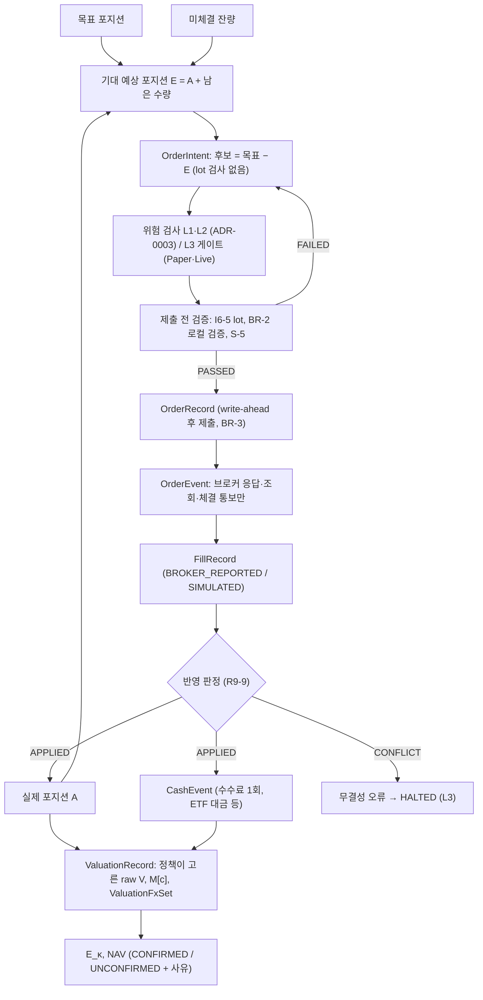

# P0-03B 최소 체결·회계 계약 (Minimum Execution & Accounting Contract)

| 항목 | 내용 |
|---|---|
| 작업 | P0-03B-MIN |
| 기준 커밋 | `345ade6` (`master`, `origin/master` `9a6efba`보다 1커밋 앞섬, 작업 트리 clean) |
| 테스트 기준 | `python -m pytest -q -W error` → 306 passed, 경고 0 |
| 작성일 | 2026-10-19 |
| 문서 상태 | **PROPOSED (설계 초안).** ADR이 아니다. 승인된 것은 Slice 1에 한한 B-1~B-5 선택(2026-10-19, §7), Slice 2에 한한 A안(2026-10-20, §7), Slice 4에 한한 결정(2026-10-20, §7 R7)뿐이며, 그 밖에 이 문서가 새로 제안하는 내용(표기 [제안])은 승인되지 않았다 |
| 구현 상태 | **Slice 1~4 구현** (Slice 1·2: 2026-10-19, Slice 3·4: 2026-10-20, `src/carver_quant/lab/`, `tests/lab/`). Slice 1: 체결 반영 판정, 실제 포지션, 단일 통화 주기 거래 손익. Slice 2: 주문 기록(ADR-0009 상태 11종), 미체결 잔량, 기대·최악 경우 예상 포지션, 주문 후보, 제출 전 로컬 검사(`LOCAL_VALID`는 제출 승인이 아님). Slice 3: 현금 이벤트 장부(ETF 매매대금·수수료·외부 입출금), 통화별 현금 잔액, ETF 평가액, 단일 통화 NAV(`COMPUTED`는 운영용 확정이 아님, §3.6 R5). Slice 4: 가상 ETF 한 종목의 체결 → 실제 포지션 → 현금 이벤트(체결당 매매대금·수수료, 결정적 ID) → NAV 통합, 체결과 현금 이벤트의 이벤트 단위 대조(누락·불일치·대응 없음이면 계산을 확정하지 않음), NAV 변화의 외부 흐름·투자 손익 분리. 주문 전송, 위험 한도(L1·L2), Trading State(L3), 결제 상태, 분배금, 선물 정산, FX와 기준통화 NAV, 브로커 대조는 미구현. V1 코드와 테스트는 바꾸지 않았다 |
| 기반 문서 | ACCEPTED ADR-0001, 0003, 0004, 0006, 0007, 0008, 0009, 0012, 0013. P0-03A 문서 4개 ([도메인 계약](P0-03A_DOMAIN_CONTRACTS.md) §13.1의 P0-03B 인계 목록, [타입 카탈로그](P0-03A_TYPE_CATALOG.md), [결정 등록부](P0-03A_DECISION_REGISTER.md), [인수 테스트 명세](../quality/P0-03A_CONTRACT_ACCEPTANCE_SPEC.md)) |

**표기**: [ACCEPTED] = ACCEPTED ADR의 승인 원칙·규칙 그대로. [ADR 본문] = ACCEPTED ADR 본문에 있지만 승인 원칙이 인용하지 않은 문장. [APPROVED_PRINCIPLE] = P0-03A D3A-19·49·50의 승인 원칙. [제안] = 이 문서의 새 설계 (미승인). [OPEN] = 미결정. 타입·필드 이름은 모두 가칭이며 Python 클래스 이름과 수치 자료형을 정하지 않는다.

---

## 1. 목표와 범위

**목표**: 주문부터 평가까지 한 줄로 이어지는 최소 계약을 정한다.

```
Order Intent → Order → Fill → Actual Position → Cash Events → Valuation / NAV
```

- Backtest·Paper·Live는 **같은 의미의 기록**을 쓴다. 모드의 차이는 (1) 체결을 누가 만드는가(시뮬레이션 정책 / Paper 시뮬레이터 / 브로커)와 (2) 상태 게이트(ADR-0003 L3)를 쓰는가뿐이다 [ACCEPTED] ADR-0009 §6.5, ADR-0004 R-4, ADR-0012 승인 원칙 2.
- 다섯 책임만 다룬다: A 주문과 주문 상태, B 체결, C 포지션, D 현금 이벤트 장부, E 평가와 NAV.
- **범위 밖**: 체결 모델과 시뮬레이터, 위험 한도 값과 L1·L2 판정(P0-03C 후보), Trading State 전이 구현(L3), 브로커 Adapter, 정산·결제·증거금 모델, 영속 저장, schema·fingerprint, Kill Switch 복구.
- P0-03A §13.1 인계 목록 가운데 이 문서가 다루는 것: 주문 의도·주문·식별자, 체결 기록과 주기 귀속, 실제·기대·최악 경우 예상 포지션, 통화별 현금 이벤트와 결제 상태, 수수료 현금 이벤트(형식은 [OPEN] D3A-30), NAV 기록, 분할·롤의 회계, 평가가격 선택 기록. `order_submitted_at`의 의미(D3A-23)와 브로커 port 결과 분류(ADR-0012)는 참조만 한다.

## 2. 기존 ACCEPTED ADR에서 확정된 사항

다시 설계하지 않고 그대로 쓴다. 원문은 출처 절에 있다.

| 주제 | 확정된 규칙 (요지) | 출처 |
|---|---|---|
| 세 포지션 | 목표·실제·예상 포지션 분리. 실제 = 검증된 기준 + 반영된 체결 합. 목표나 주문 수량에서 포지션을 만들지 않음 | ADR-0009 승인 원칙 1·3, §5.1, R9-2, ADR-0005 E-8 |
| 주문 후보 | 새 주문 의도 = 목표 − 기대 예상 포지션 (실제 + 진행 중 주문의 남은 수량) | R9-1 |
| 최악 경우 | `q_long_worst = q_filled + Σ미체결 매수 + 새 매수`, `q_short_worst = q_filled − Σ미체결 매도 − 새 매도`, 노출 = max(\|long\|, \|short\|) × \|P_ref\| × M[c] × fx[κ(c)]. 상태 불명확 주문은 체결로 간주. 미체결 위험 축소 주문으로 노출을 줄이지 않음 | ADR-0003 §6.3, R9-7 |
| 주문 상태 | 11종과 최악 경우 포함 여부. 상태는 브로커 응답·상태 조회·체결 통보로만 바뀜 | ADR-0009 §6.2 |
| `UNKNOWN` | 거부·취소·실패로 바꾸지 않음, 자동 재제출 금지, 같은 Client Order ID로 조회만, 계좌 `HALTED` | R9-4, R9-5, R9-12, BR-2, BR-4, ADR-0003 §6.3·§6.5 |
| 취소·정정 | 취소 요청 ≠ 취소. 정정 중 최악 경우는 기존 남은 수량 + 새 수량(합) | R9-6, RP-1~RP-5 |
| 체결 기록 | 체결마다 ID·수량·체결가·수수료와 통화·`fill_at`. 멱등 키 (계좌, 출처, 체결 ID). 같은 키의 내용이 다르면 무결성 오류·`HALTED`. 체결 정정은 명시적 정정 이벤트로만 | R9-3, R9-9, §6.4a, BR-11 |
| 롤 | 다리별 상태, 그룹 상태는 다리에서 계산. 롤은 월물별 체결 다리로만 반영 | R9-10, I6-3, I6-9 |
| 시점 | I-1 (입력 ≤ `decision_at`), I-2 (`decision_at ≤ order_submitted_at ≤ fill_at`), I-3 (주기 구간 (t−1, t]). 체결은 `fill_at`으로 유일한 주기에 귀속 | ADR-0001 §5.1.2, §5.1.3, R9-13 |
| 손익식 | 통화별 합산 후 환산. 체결마다 그 월물의 `M[c]`. 체결가 기준 손익에 체결 비용을 다시 빼지 않음. 결측·비유한값·`M ≤ 0`·없는 환율은 ValueError | ADR-0001 §6.2 |
| NAV | `E_κ = Cash_κ + MV_κ`, `NAV = Σ fx[κ,t] × E_κ`. 원장 항등식과 분해 항등식. 환율 결측이면 NAV 미확정 | ADR-0008 §6.2~§6.5 |
| 금지 | 매수 대금을 손익으로 처리(X8-1), 이중 차감(X8-2), 환율 1 대체(X8-3), 방향 혼합(X8-4), 같은 통화 두 환율(X8-5), 증거금을 비용으로(X8-6), 입출금을 손익으로(X8-7), 환산 전 통화 합산(X8-8) | ADR-0008 §6.8 |
| 수수료 | 부과 통화 현금에서 정확히 한 번, 손익에도 한 번. 수수료 통화는 ADR-0001 잠정 가정(상품 통화) | ADR-0008 원칙 9·14, F8-1·F8-2 원칙, ADR-0001 §6.2 `fee[k]` |
| 기업 행사 | ETF 분할은 수량과 기준가격 변환이며 손익·거래·비용이 아님. 분배금은 `D[c,t]` 항으로만 | I6-8, I6-9 |
| 수량 역할 | 실제 수량·브로커 보고 기록·기록된 잔량·파생 예상 포지션·계산된 주문 후보의 계산·기록에는 lot 배수 요구 없음. 신규 주문·목표·그 밖의 수량은 I6-5. 정수 규칙 유지, 자동 반올림 없음 | ADR-0013 §8.1, R13-1~R13-7 |
| 가격 역할 | Raw는 "조정하지 않음"이지 "체결 가능"이 아님. Quote ≠ Fill. 체결 기록은 실제 Fill이나 명시적 체결 시뮬레이션에서만 | [APPROVED_PRINCIPLE] D3A-50, INV-33 |
| 경계 | 쓰기 결과 4분류, 영속화 확인 후 전송(write-ahead), Adapter는 번역만. 핵심 계산은 Adapter·브로커를 호출하지 않음 | BR-2, BR-3, BR-6, ADR-0004 R-3 |
| 평가 | 마지막 공식 가격 평가는 정책이 고른 값이며 현재 시장가치로 단정하지 않음. 데이터 상태 4종 | ADR-0007 승인 원칙 5·7·8 |
| V1 | V1 타입·API·fingerprint를 바꾸지 않음. 새 코드는 V1과 분리 | ADR-0004 P-1~P-3, ADR-0005, ADR-0010 승인 원칙 1 |

## 3. 최소 도메인 계약

P0-03A의 값 객체(`TradableUnitRef` TC-A4, `Quantity` TC-B1, `Price` TC-B2, `ContractMultiplier` TC-B3, `CurrencyCode` TC-B4, `MoneyAmount` TC-B5, `Instant` TC-D1)와 관측·정책 타입(`RawPriceObservation` TC-C4, `MarketQuote` TC-C5, `ExecutionAssumptionSet` TC-F2, `ValuationPolicySelection` TC-F6, `DataStatusAssessment` TC-D9, `ValuationFxSet` TC-E4, `CorporateAction` TC-C8)을 재사용한다. 새 기록 타입은 아래 여덟 개만 둔다 [제안].

| 기록 (가칭) | 책임 | 절 |
|---|---|---|
| `OrderIntent` | 계산된 주문 후보와 제출 전 검증 결과 | §3.2 |
| `OrderRecord` / `OrderEvent` | 제출된 주문과 상태 변경 기록 (추가 전용) | §3.2 |
| `FillRecord` | 실제 또는 시뮬레이션 체결 한 건 | §3.3 |
| `PositionBaseline` / `PositionAdjustment` | 검증된 기준 포지션, 기업 행사에 의한 수량 변환 | §3.4 |
| `CashEvent` | 통화별 현금 이벤트 한 건 | §3.5 |
| `ValuationRecord` | 평가 시각의 통화별 순자산과 NAV(확정 / 미확정 + 사유) | §3.6 |

### 3.1 네 가지 수량과 세 가지 가격의 구분

**수량** (모두 정수, 부호 있음, 거래 단위별)

| 역할 | 정의 | lot 배수 검사 | 근거 |
|---|---|---|---|
| ① 실제 보유 수량 | 검증된 기준 + 반영된 체결 + 기업 행사 변환 | 하지 않음 | R9-2, R13-1, R13-3, I6-8 |
| ② 미체결 주문 잔량 | 주문 수량 − 체결 수량 − 취소 확정 수량 | 다시 하지 않음. `UNKNOWN` 주문의 수량은 확인된 잔량이 아님 | ADR-0009 §5.1, R13-2 |
| ③ 계산된 주문 후보 | 목표 − 기대 예상 포지션 | 계산·기록 시 하지 않음. 자동 반올림 없음 | R9-1, R13-5 |
| ④ 제출할 신규 주문 수량 | 제출 전 검증을 통과한 후보 | 함 (I6-5, BR-2 `NOT_SENT(LOCAL_VALIDATION)`, 위험 축소 후보는 S-5 `INVALID_LOT`) | R13-5, ADR-0003 S-5 |

**표현 [제안]**: 수량은 하나의 `Quantity` 값 객체를 쓰고, 역할은 **그 값을 담는 기록의 필드**가 나타낸다 (`FillRecord.quantity`는 ①의 재료, `OrderRecord.order_quantity`는 ④, `OrderIntent.candidate_quantity`는 ③). ④는 ③에서 L2 정책 결정을 거쳐 나온 주문 수량이 제출 전 검증을 통과한 것이다. 부호가 바뀌는 후보는 청산 다리와 신규 다리로 나뉘고(ADR-0003 §6.2), 선택 모드 `REDUCE_TO_LIMIT`([OPEN] Q3-2)는 수량을 줄일 수 있으므로 ④가 ③과 같다고 가정하지 않는다. 각 `OrderRecord`는 출처 `OrderIntent`를 참조한다. lot에 맞추려는 반올림은 어느 단계에서도 하지 않는다. 신규 주문 수량의 lot 검사는 제출 전 검증(`OrderIntent → OrderRecord` 전환)에서 한다. 목표 포지션의 lot 검사(I6-5)와 시뮬레이션 체결의 lot 검사(F-4)는 별도다. 역할별 타입을 따로 만들지는 [OPEN] D3A-49.9, 수량의 Python 자료형은 [OPEN] D3A-49.6·D3A-11.

**가격**

| 역할 | 만드는 곳 | 체결 기록이 될 수 있는가 | 근거 |
|---|---|---|---|
| 관측 가격 (공식 종가, 정산가, 마지막 체결가, quote) | 데이터 경계 | **아니오.** 관측에서 체결 기록으로 가는 변환 경로를 두지 않는다 | INV-33, D3A-50 (2)·(4)·(6), P0-03A AT-03A-25 |
| 시뮬레이션 체결 가격 | 명시적 체결 가정(`ExecutionAssumptionSet`)이 관측에 규칙을 적용해 만든 값 | 예. `origin = SIMULATED`와 가정 참조가 있어야 함 | D3A-50 (5), ADR-0004 승인 원칙 2 |
| 실제 체결 가격 | 브로커 체결 통보 원본 | 예. `origin = BROKER_REPORTED` | R9-3, BR-6 |

- 평가가격 `V[c,t]`는 네 번째 종류가 아니라 **평가 정책이 고른 관측 가격**이다. 어떤 관측을 골랐는지와 데이터 상태를 함께 기록한다 (ADR-0007 승인 원칙 7·8, D3A-50 (3)).
- 세 가격 모두 raw다. 조정 가격은 어느 기록에도 들어가지 않는다 (INV-04, I6-7).

### 3.2 A. 주문 (`OrderIntent`, `OrderRecord`, `OrderEvent`)

| 필드 | 의미 | 근거 / 상태 |
|---|---|---|
| `client_order_id` | 시스템이 주문 의도마다 만드는 고유 키. 재시도·조회·중복 방지에 같은 값 | ADR-0009 §6.4. 형식 [OPEN] D3A-02, Q12-4 |
| `broker_order_id` | 브로커 접수 후에만 있음 | §6.4 |
| `order_group_id` | 롤 다리 묶음. 단일 주문이면 없음 | §6.4, R9-10 |
| `account_ref`, `tradable_unit` | 계좌, 거래 단위 (선물은 월물 ID, ETF는 종목) | I6-3, I6-4 |
| `candidate_quantity` (`OrderIntent`) | ③. 목표 − 기대 예상 포지션 | R9-1 |
| `submit_validation` (`OrderIntent`) | `PASSED` / `FAILED(사유)`. 실패해도 후보는 기록에 남음 | R13-5, BR-2·BR-3 (0) |
| `order_quantity` (`OrderRecord`) | ④. L2 결정 뒤 제출 전 검증을 `PASSED`한 수량으로만 만들고 출처 후보를 참조한다. lot 위반 값으로 만들려 하면 ValueError | AT-0013-1. 정정 수량은 [OPEN] Q13-1 (그 전까지 I6-5) |
| 주문 유형·유효기간 | — | [OPEN] Q9-2, Q1-1 |
| `decision_at` | 후보 계산과 위험 검사를 끝낸 시각 | ADR-0001 §5.1.1 |
| `submit_attempted_at` | 제출 시도 기록 시각 (write-ahead) | BR-3 (가칭) |
| `order_submitted_at` | ADR-0001의 제출 시각 | 의미 [OPEN] D3A-23, Q12-13 |
| `status` | ADR-0009 §6.2의 11종 | [ACCEPTED] |
| `events` | `OrderEvent` 목록 (추가 전용): 시각, 이전 → 이후 상태, 출처(브로커 응답 / 상태 조회 / 체결 통보 / 로컬 검증), 원본 참조 | §6.1, §6.2. 보관 형식 [OPEN] Q9-9 |
| `filled_quantity` | 이 주문에 귀속된 반영 체결의 합 (파생값) | R9-3 |
| `cancelled_confirmed_quantity` | 브로커가 확인한 취소 수량 | §5.1 |
| `remaining_quantity` | ② = 주문 수량 − 체결 − 취소 확정 (파생값) | §5.1 |

**불변조건**

- O-1 상태는 브로커 응답·상태 조회·체결 통보로만 바뀐다. 로컬 검증 실패는 상태를 바꾸지 않고 `INTENT`로 남긴다 (ADR-0012 §6.5 (A), 제안).
- O-2 `UNKNOWN`은 확인 전까지 `UNKNOWN`이다. 자동 재제출은 없고 조회만 한다. 조회 결과 "찾지 못함"도 주문이 없다는 증거가 아니다 (R9-4, R9-5, BR-4).
- O-3 누적 체결 수량이 주문 수량을 넘으면 데이터 무결성 오류다 ([ADR 본문] AT-0009-1 예외조건 → `HALTED`).
- O-4 최악 경우에 넣는 수량: `PENDING_SUBMIT`, `ACCEPTED`, `PARTIALLY_FILLED`, `CANCEL_REQUESTED`의 남은 수량. `REPLACE_REQUESTED`는 기존 남은 수량 + 새 정정 수량 전체(RP-1). `UNKNOWN`은 주문 수량 − 확인된 체결을 전량 체결로 넣고, 브로커 취소 확정 수량으로 줄이지 않는다 (R9-7, BR-12, Q12-14).

### 3.3 B. 체결 (`FillRecord`)

| 필드 | 의미 | 근거 / 상태 |
|---|---|---|
| `fill_key` = (`account_ref`, `fill_source`, `fill_id`) | 멱등 키. `fill_source`는 체결 정보를 낸 주체 (브로커 / Paper 시뮬레이터 / 백테스트 시뮬레이션 실행) | §6.4a. 브로커의 실제 고유성 범위 [OPEN] Q9-11, Q12-3 |
| `client_order_id`, `broker_order_id` | 귀속 주문 | §6.4a |
| `tradable_unit` | 선물은 월물 ID | I6-3 |
| `quantity` | 부호 있는 정수, 0 아님. 매수 +, 매도 − | ADR-0001 §6.2 `Δq[k]` |
| `price` | `F[k]`, raw | ADR-0001 §6.2 |
| `fill_at` | 체결 시각 | ADR-0001 §5.1.1 |
| `fee`, `fee_currency` | 수수료 금액(≥ 0)과 통화. 브로커 보고값은 원본 그대로 기록. 통화 정보가 없으면 상품 통화 (ADR-0001 잠정 가정) | BR-15, AT-0008-7. 운영 통화 [OPEN] Q1-4, Q8-11, D3A-30 |
| `origin` | `BROKER_REPORTED` / `SIMULATED` (+ `execution_assumption_ref`) | D3A-50 (5) |
| `received_at` | 로컬 수신 시각 | BR-7 (시각과 의미 기록은 원칙 승인) |
| `venue`, `liquidity_flag` | 체결 시장, 유동성 구분 (브로커가 주는 경우 원본 그대로, 선택) | §6.4a |
| `raw_ref` | 원본 응답 참조 | R13-1a. 형식 [OPEN] Q9-9, Q12-7 |

**불변조건**

- F-1 **반영 판정** [제안 형태, 규칙은 ACCEPTED]: 체결 반영은 `APPLIED` / `DUPLICATE` / `CONFLICT` 가운데 하나를 낸다. 같은 키가 처음 오면 `APPLIED`. 같은 키에 §6.4a의 비교 필드(Client·Broker Order ID, 거래 단위, 부호 있는 수량, 체결가(원본 값 기준, B-3), `fill_at`, 수수료 금액과 통화, 있으면 체결 시장과 유동성 구분)가 모두 같으면 `DUPLICATE`이고 포지션·현금을 바꾸지 않는다. 수신마다 달라지는 `received_at`, `raw_ref`는 비교하지 않는다. 하나라도 다르면 `CONFLICT`이고 두 번째 기록을 반영하지 않으며 두 기록을 모두 보관한다 (R9-9, §6.4a).
- F-2 `CONFLICT`의 결과는 ACCEPTED 규칙대로 Paper/Live에서 `HALTED`다. 상태 전이는 L3(shell)가 한다. 계산 코어는 판정만 돌려준다 [제안]. Backtest에는 Trading State가 없으므로(ADR-0009 §6.5) `CONFLICT`는 실행을 즉시 실패시킨다 [제안: fail-fast].
- F-3 체결의 거래 단위·통화·승수는 주문과 상품 사양과 같아야 한다 (ADR-0001 §6.2 전제조건). I-2 위반은 거부한다.
- F-4 `SIMULATED` 체결은 가정 참조가 없으면 거부한다. lot 미만 시뮬레이션 체결은 승인된 시뮬레이션 정책 전까지 ValueError다 (R13-1, Q13-5, Q9-7).
- F-5 체결 정정·취소는 같은 ID 재전송이 아니라 명시적 정정 이벤트로만 받는다. 형식은 [OPEN] Q9-11 (BR-11).

### 3.4 C. 포지션

| 기록·값 | 정의 | 근거 |
|---|---|---|
| 목표 포지션 | 사이징이 정한 수량. 입력값. lot 배수 (I6-5). 주문이나 체결로 바꾸지 않음 | §5.1, I6-5 |
| `PositionBaseline` | (계좌, 거래 단위)별 검증된 기준 수량과 기준 시각 T0, 검증 근거 참조. Backtest는 초기 상태로 주어짐 | R9-2, R13-3. 도입·재기준 절차 [OPEN] Q13-2 |
| `PositionAdjustment` | 기업 행사(분할)에 의한 수량 변환 기록. 체결이 아님 | I6-8, ADR-0013 §7.1 실제 수량 (b) [제안 형태] |
| 실제 포지션 `A(t)` | 기준 + T0 < `fill_at` ≤ t인 `APPLIED` 체결의 합, 효력일에 분할 변환 적용. `fill_at` < T0인 체결은 기준에 이미 들어 있으므로 다시 더하지 않는다. `fill_at` = T0인 체결은 Q13-2가 정해질 때까지 ValueError로 거부한다 [제안: fail-fast, 경계를 정하지 않기 위함] | R9-2, R9-13, AT-0013-11. `fill_at = T0` 귀속 [OPEN] Q13-2 |
| 기대 예상 포지션 `E` | `A` + 진행 중 주문의 남은 수량 | §5.1 (a) |
| 최악 경우 `q_long_worst`, `q_short_worst` | §2의 ADR-0003 §6.3 식 (O-4의 수량 사용) | ADR-0003 §6.3, R9-7 |

- P-1 모든 포지션은 거래 단위별이다. 단위나 거래 단위가 다른 수량을 더하지 않는다. 선물은 월물별로 둔다 (I6-3, I6-5, INV-30).
- P-2 실제·잔량·예상 포지션은 lot에 맞추지 않는다. 후보는 기록하고, 신규 주문만 제출 전 검증에서 lot을 검사한다 (§3.1).
- P-3 분할 결과가 정수가 아니면 거부한다. 브로커가 정수가 아닌 수량을 보고하면 원본 증거로만 보존하고 실제 포지션에 반영하지 않는다 (R13-7, R13-1a).
- P-4 목표가 lot 배수이면 "후보가 lot 배수 ⇔ `E`가 lot 배수"다. 이것은 lot 적합성일 뿐 주문 승인이 아니다. 제출은 Trading State, 위험 한도, 중복 주문 검사, 시장 제약을 따로 통과해야 한다 (ADR-0013 AQ-13-4).
- 정정 중(`REPLACE_REQUESTED`) 기대 예상 포지션의 산정 규칙은 ACCEPTED ADR에 없다 [OPEN]. 그동안 그 상품의 위험 증가 자동 주문은 RP-3로 막힌다.

### 3.5 D. 현금 이벤트 장부 (`CashEvent`)

| 필드 | 의미 | 근거 / 상태 |
|---|---|---|
| `cash_event_id` | 고유 ID | ADR-0008 §6.1 |
| `kind` | `TRADE_CONSIDERATION`(ETF 매매대금), `COMMISSION`, `DISTRIBUTION`, `VARIATION_SETTLEMENT`(선물 일일 정산), `FX_CONVERSION_LEG`, `EXTERNAL_FLOW`, `SETTLEMENT_STATUS_CHANGE`. 세금은 [OPEN] Q6-5, Q6-7 | ADR-0008 §6.1, §6.6 [제안: 이름] |
| `cause_ref` | 원인 참조: `fill_key` / 기업 행사 ID / 환전 ID / 정산 참조 / 외부 참조 | F8-1 (체결 참조) |
| `currency`, `amount` | 통화와 부호 있는 금액 (κ 단위) | ADR-0008 §6.1, X8-8 |
| `occurred_at` | 경제적 발생 시각 (체결이면 `fill_at`). 평가 주기 귀속의 기준 | ADR-0001 §5.1.3 |
| `recorded_at` | 기록 시각 | [제안] |
| `settlement_due`, `settlement_status` | ETF 대금의 결제 예정일과 `UNSETTLED` / `SETTLED` | ADR-0008 §6.6. 결제일 규칙 [OPEN] Q8-5, Q3-7 |

**불변조건**

- C-1 **실제 현금 이동과 회계상 손익을 구분한다.** 장부는 통화별 현금(`Cash_κ`, 결제·미결제 포함)을 기록한다. 거래 손익은 ADR-0001 §6.2 식으로 따로 계산하고, 현금 이벤트를 더해서 만들지 않는다. 두 경로는 ADR-0008 §6.3 항등식 `E_κ(t) = E_κ(t−1) + PnL_κ + Conv_κ + Flow_κ`로 **서로 검증**한다 [제안: 검증 항등식으로 사용].
- C-2 **수수료는 정확히 한 번**: 체결 하나의 수수료는 `COMMISSION` 이벤트 하나로 부과 통화 현금에서 빠지고, 손익에는 수수료 항으로만 들어간다. 체결가에 이미 들어 있는 스프레드·슬리피지를 비용으로 다시 빼지 않는다 (F8-1, F8-2, X8-2, ADR-0001 이중 차감 금지).
- C-3 체결에서 생기는 현금 이벤트는 그 체결이 `APPLIED`일 때 한 번만 만든다. `DUPLICATE`·`CONFLICT`는 현금 이벤트를 만들지 않는다 (R9-9).
- C-4 **ETF 매매대금은 손익이 아니다**: 매수는 `−q × F`의 `TRADE_CONSIDERATION`(미결제)과 수수료 이벤트를 만들고, 자산은 평가에서 `q × V`로 잡힌다 (X8-1, AT-0008-3). 결제 상태 변경은 통화 안에서 미결제 → 결제 완료로 옮길 뿐 `Cash_κ`와 NAV를 바꾸지 않는다 (ADR-0008 §5.1, §6.6) [제안: 표현].
- C-5 **선물은 매매대금 이벤트가 없다.** 개시 증거금은 현금 이벤트나 비용이 아니며 사용 가능 현금만 줄인다 (X8-6). 증거금 요구량은 `MarginRequirementRecord`(TC-F7)로 따로 둔다.
- C-6 **선물 손익의 현금 반영 시점은 정하지 않는다** [OPEN] Q8-6, Q3-11. 계약은 두 경로를 모두 표현할 수 있어야 한다: (a) 정산 이벤트(`VARIATION_SETTLEMENT`)로 현금에 반영, (b) 정산 전까지 `MV_κ`의 평가손익으로 유지. 어느 쪽인지는 승인된 정산 정책이 정한다. **같은 손익을 두 경로에 함께 넣지 않는다** (이중 계산). 정산가와 평가가격이 다를 때의 잔여 평가손익 처리도 [OPEN] (Q8-6, Q1-2).
- C-7 환전은 두 통화 다리와 수수료로 기록하고(③ 환전 결과), 입출금은 `EXTERNAL_FLOW`로 기록한다(④, 손익 아님) (ADR-0008 §6.3, §6.4, X8-7). 환전 실행 방식은 [OPEN] Q8-4. 분배금 귀속일은 [OPEN] Q1-5.
- C-8 사용 가능 현금은 장부 잔액과 다른 값이다 (결제 상태와 예약 반영, ADR-0006 §6.5, ADR-0003 L1). 그 계산 규칙은 이 문서의 범위 밖이다.

### 3.6 E. 평가와 NAV (`ValuationRecord`)

| 필드 | 의미 | 근거 / 상태 |
|---|---|---|
| `valuation_at` | 평가 주기 t의 평가 시각 (계좌 일정) | ADR-0001 §5.1.1, ADR-0007 승인 원칙 3. 시각 [OPEN] Q7-1, D3A-21 |
| `information_cutoff` | 그 평가가 쓸 수 있는 정보의 마지막 시각. 반드시 명시 입력이며 `information_cutoff ≤ valuation_at` (V-1) | [제안, R1] |
| `computed_at` | 평가를 계산한 시각. 기록용이며 정보 이용 가능성 판정에 쓰지 않는다 (V-1) | [제안] |
| 거래 단위별 행 | 실제 포지션 `A(valuation_at)`, 평가가격 `V`(고른 관측 참조, `DataStatusAssessment`, `ValuationPolicySelection`), `M[c]`, 통화 κ(c), 평가액 기여 (ETF: `q × V`. 선물: C-6의 정산 정책에 따름) | ADR-0001 §6.2, ADR-0007 §6.5, ADR-0008 §6.2. 평가가격 정책 [OPEN] Q1-2, Q7-3, Q7-4, D3A-33 |
| 통화별 행 | `Cash_κ`(결제·미결제), `MV_κ`, `E_κ` | ADR-0008 §6.2 |
| 평가 FX | `ValuationFxSet`: 통화마다 하나, BC/κ 방향, `observed_at`·`data_available_at` | X8-4, X8-5, INV-26. 시각 [OPEN] Q8-1, D3A-27 |
| `nav` | `Σ fx[κ,t] × E_κ` (BC). **상태가 `CONFIRMED`일 때만 값이 있다** | ADR-0008 §6.2 |
| `nav_status`, `reasons` | `CONFIRMED` / `UNCONFIRMED`와 사유 (예: `FX_MISSING`, `VALUATION_PRICE_UNAVAILABLE`, `VALUATION_POLICY_NOT_CONFIGURED`, `SETTLEMENT_POLICY_UNDEFINED`, `BASE_CURRENCY_UNDEFINED`) | ADR-0008 §6.5. 사유 이름 [제안], 오류 계약 [OPEN] D3A-34 |
| 분해 (보고용) | ① 거래 손익, ② FX 환산, ③ 환전 결과, ④ 외부 현금흐름 | ADR-0008 §6.4 항등식. 보고 관례 [OPEN] Q8-3 |

**불변조건**

- V-1 **미래 가격 금지 (R1 보완)**: 평가 입력에는 명시적인 `information_cutoff`가 있어야 한다. 평가에 쓴 모든 가격·환율과 체결은 `information_cutoff`까지 알 수 있었던 것이어야 하고(가격·환율: `data_available_at ≤ information_cutoff`, 체결: `fill_at ≤ information_cutoff`), `information_cutoff ≤ valuation_at`이다. 그 평가를 의사결정 입력으로 쓰면 `data_available_at ≤ decision_at`도 만족해야 한다 (ADR-0001 I-1, INV-06). `computed_at`은 계산한 시각을 기록할 뿐 정보 이용 가능성의 판정 기준이 아니다. 예: `valuation_at` 16:30, 가격 도착 16:45, `computed_at` 17:00이면 16:30 기준 재현에서 그 가격을 쓸 수 없다. `valuation_at` 뒤에 도착한 가격으로 다시 평가하는 사후 재평가는 하지 않으며, 그 정책은 [OPEN] Q1-2·Q7-3·Q7-4로 남는다. 평가가격은 사용자가 출처·이용 가능 시각과 함께 지정한 값만 받고 자동으로 고르지 않는다 [제안].
- V-2 **계약승수**: 그 월물 사양의 `M[c]`만 쓴다. 다른 상품·공통 승수 금지 (I6-6, INV-19).
- V-3 **환율**: 순자산이 0이 아닌 통화의 환율이 없으면 NAV는 `UNCONFIRMED(FX_MISSING)`다. 1로 대신하지 않고 표시 없이 이전 값을 쓰지 않는다. 통화별 `E_κ`는 그래도 기록한다 (X8-3, AT-0008-8).
- V-4 **미승인 정책에 기본값을 두지 않는다**: 평가가격 정책, FX 시각, 정산 정책, 기준통화가 정해지지 않았으면 그 사유로 `UNCONFIRMED`다. 기본 정책을 만들어 `CONFIRMED`로 내지 않는다 (INV-17, ADR-0007 승인 원칙 8).
- V-5 거래 손익 ①은 ADR-0001 §6.2 식으로만 계산한다. NAV 분해는 그 값을 보여 줄 뿐 다시 더하지 않는다.

(R5) **Slice 3 구현 메모** (계좌 하나, 단일 통화, 가상 ETF. 전역 회계 정책이나 ETF 채택의 승인이 아니다): 현금 이벤트는 §3.5 가운데 `TRADE_CONSIDERATION`·`COMMISSION`·`EXTERNAL_FLOW`만 받고, 호출 경계가 확인 여부를 명시해 확인되지 않은 기록은 장부에 반영하지 않는다. 체결 참조마다 매매대금·수수료는 한 건이며, 다른 ID로 두 번째가 오면 더하지 않고 충돌로 보관한다(C-2, C-3). 결제 상태(`settlement_due`, `settlement_status`)와 `recorded_at`은 구현하지 않았다. NAV는 통화 하나의 `E_κ`이며 상태를 `COMPUTED` / `NOT_COMPUTABLE`(평가가격 없음, 다른 통화 순자산이 있어 FX 필요)로 표시한다. `CONFIRMED`라는 이름은 쓰지 않고, `COMPUTED`에는 운영용 확정에 남은 조건(평가가격 정책, 기준통화, 현금 대조, NAV 확정 규칙)을 함께 싣는다. 보유 수량은 평가 시각에 검증된 기록으로만 받는다.

## 4. 주문부터 평가까지의 데이터 흐름



| 단계 | 입력 | 출력 | Backtest | Paper | Live |
|---|---|---|---|---|---|
| 1 후보 계산 | 목표, `A`, 미체결 주문 | `OrderIntent` | 공유 순수 함수 | 같음 | 같음 |
| 2 위험·제출 전 검증 | 후보, 위험 입력, 참조 데이터(lot) | `PASSED` / `FAILED` | 공유 (L3 없음) | 공유 + L3 | 공유 + L3 |
| 3 제출·상태 추적 | `OrderRecord` | `OrderEvent` | 시뮬레이션 정책이 직접 만듦 | Paper 시뮬레이터 (port) | 브로커 Adapter (port) |
| 4 체결 반영 | `FillRecord`, 기존 키 | 판정, 새 `A` | 공유 순수 함수 | 같음 | 같음 |
| 5 현금 이벤트 | `APPLIED` 체결, 상품 사양, 정산 정책 | `CashEvent` | 공유 | 같음 | 같음 + 브로커 현금 보고와 대조 |
| 6 평가 | `A`, 현금, 정책이 고른 `V`, `ValuationFxSet` | `ValuationRecord` | 공유 | 같음 | 같음 |
| 7 대조 | 내부 기록, 브로커 보고 (같은 기준 시각) | 차이 | 내부 = 기준 | 시뮬레이터와 비교 | 브로커와 비교, 불일치면 `HALTED` (R9-8) |

## 5. 금융 계산과 장부 처리의 책임 분리

| 책임 | 성격 | 위치 (가칭, ADR-0004·0010 계층) | 하지 않는 것 |
|---|---|---|---|
| 후보·예상·최악 경우 계산 | 순수 함수 | 도메인 / 회계 계산 | 위험 한도 판정 (P0-03C) |
| 제출 전 검증 (lot, 필수 필드) | 순수 함수, 판정 반환 | 도메인 | 수량 보정, 반올림 |
| 체결 반영 판정과 실제 포지션 | 순수 함수 | 회계 계산 | Trading State 전이 |
| 거래 손익 (ADR-0001 §6.2) | 순수 함수 | 회계 계산 | 현금 이벤트 합산으로 손익 만들기 |
| 현금 이벤트 생성 | 순수 함수 | 회계 계산 | 정산·결제 규칙 발명 |
| 평가·NAV | 순수 함수, 정책은 입력 | 회계 계산 | 기본 평가 정책·환율 |
| 주문 제출·조회·상태 번역 | 부수효과 | Adapter (Paper 시뮬레이터 / 브로커) | 금융 계산, 위험 판단 (BR-6) |
| Trading State 전이, 알림 | 부수효과 | shell (`app`, L3) | — |

- 도메인 계약은 표준 라이브러리만 쓴다 (ADR-0004 R-1, ADR-0010 PK-1). 회계 계산 코어는 엔진·port·Adapter·`app`을 import하지 않고 I/O·현재 시각 조회·난수를 쓰지 않는다 (ADR-0004 R-2·R-3, PK-3). 코어의 V1 공식 모듈 재사용(PK-9)은 미승인이며 실행 금지다.
- 계산 코어는 오류를 **판정 값**(`DUPLICATE`, `CONFLICT`, `FAILED(사유)`, `UNCONFIRMED(사유)`)이나 ValueError로 돌려준다. 상태 전이는 shell이 ACCEPTED 규칙에 따라 한다 [제안]. 판정 값과 예외의 구체 형태는 [OPEN] D3A-34.

## 6. 인수 테스트 시나리오 (명세. AT-03B-01·03·07의 포지션·손익 부분만 Slice 1 단위 테스트로 구현)

공통: 가상 상품은 P0-03A 인수 테스트 명세 §0.1과 같다. 선물 `FUT.ALPHA` (통화 USD, 월물 `FUT.ALPHA.C1`·`C2`, `M[c]` = 10 USD/pt/계약, 이 문서에서는 lot 1로 가정), ETF `ETF.KR1` (통화 KRW, lot 10). 계좌 `A1`. 시장 사실을 주장하지 않는다 (UNVERIFIED). 숫자는 저장소 밖 일회성 스크립트로 독립 확인했다 (CONFIRMED). ID는 `AT-03B-n`.

### AT-03B-01 정상 체결과 평가 (CASE 1)

- **Given**: 실제 `C1` 0계약. 매수 주문 +2 `ACCEPTED`. 체결 `X-1`: +2계약 @ 101 pt, 수수료 1 USD/계약 → 2 USD (통화 USD = 상품 통화, ADR-0001 잠정 가정), `valuation_at(t−1) < fill_at ≤ valuation_at(t)`. 출처는 브로커 보고, 또는 명시적 체결 가정에 의한 시뮬레이션(가정 참조 있음). 평가가격 `V[C1,t]` = 103 pt (정책이 고른 raw 관측, 상태 `FRESH`)
- **When**: 체결을 반영하고 주기 t의 USD 손익을 계산한다
- **Then**: 실제 +2, 남은 수량 0, `FILLED`. 가격 손익 = Δq × (V − F) × M = 2 × (103 − 101) × 10 = **40 USD**. 수수료 = 2 × 1 = **2 USD** (`COMMISSION` 이벤트 1건, `X-1` 참조). `PnL_USD[t]` = 40 − 2 = **38 USD**. 선물이므로 매매대금 이벤트는 없다. **40 USD를 언제 현금에 반영할지는 정산 정책에 달려 있으므로(C-6, [OPEN] Q8-6) 이 사례로 USD 현금 잔액이나 NAV를 확정하지 않는다** (`nav_status = UNCONFIRMED(SETTLEMENT_POLICY_UNDEFINED)`)
- **잘못된 처리 (실패해야 함)**: 수수료를 두 번 빼서 36 USD (C-2, F8-2). 다른 승수 50을 써서 2 × 2 × 50 − 2 = 198 USD (I6-6). 관측가 101만 있고 체결 기록이 없는데 체결로 확정 (INV-33)
- **단위·시점**: 수량 계약, 가격 pt, 금액 USD. `fill_at`이 `valuation_at(t)` 뒤면 주기 t+1에 귀속 (ADR-0001 §5.1.3)
- **전제조건**: 체결·평가가격 모두 같은 월물의 raw. `M[C1]` 확정
- **예외조건**: `V` 없음, `M ≤ 0`, `fee < 0`, Δq = 0, 체결 월물이 상품 사양이나 주문과 다름 → 거부 (ADR-0001 §6.2 전제조건, F-3)
- **근거**: ADR-0001 §5.1.3, §6.2. ADR-0009 R9-3. ADR-0008 F8-1·F8-2, X8-2. I6-3, I6-6

### AT-03B-02 부분 체결 (CASE 2)

- **Given**: 실제 `C1` 0. 목표 +10. 매수 주문 +10 `ACCEPTED`. 체결 `X-2` +3 (브로커 보고). 취소 확정 0
- **When**: 체결을 반영하고 남은 수량, 예상 포지션, 다음 후보를 계산한다
- **Then**: 실제 **+3**, 남은 수량 10 − 3 − 0 = **+7**, `PARTIALLY_FILLED`. 기대 예상 포지션 3 + 7 = **+10**. `q_long_worst` = 3 + 7 = **10**, `q_short_worst` = **3** (미체결 매도 없음). 목표 +10에서 다음 후보 = 10 − 10 = **0** → 새 주문 없음
- **잘못된 처리**: 목표 − 실제 = +7을 새로 주문하면 최대 17계약 보유 가능 (R9-1)
- **단위·시점**: 계약. 같은 평가 주기
- **전제조건**: 주문 상태가 브로커 응답·체결 통보로 확인됨
- **예외조건**: 누적 체결 > 10 → 무결성 오류 (O-3). lot 10 ETF에서 같은 상황은 ADR-0013 AT-0013-3·4이며, 그때 lot 미만 체결은 브로커 보고여야 한다 (시뮬레이션이면 F-4)
- **근거**: R9-1, R9-2, R9-3, R9-7, ADR-0003 §6.3, ADR-0009 AT-0009-1

### AT-03B-03 중복 체결 (CASE 3)

- **Given**: AT-03B-01 직후. 키 (`A1`, `BRK`, `X-1`)가 `APPLIED`
- **When**: (a) 같은 키, 모든 비교 필드가 같은 기록이 다시 온다. (b) 같은 키인데 `fill_at`만 다르다. (c) 같은 키인데 수량이 +3이다
- **Then**: (a) `DUPLICATE`. 실제 +2 그대로, 수수료 이벤트 추가 없음 (2 USD 그대로). 중복 수신만 기록. (b)·(c) `CONFLICT`. 두 번째 기록은 반영하지 않고 두 기록을 모두 보관. Paper/Live에서는 무결성 오류로 `HALTED` (R9-9). Backtest에서는 실행 실패 [제안, F-2]
- **잘못된 처리**: 두 번 반영해 +4계약·수수료 4 USD. (b)를 "수량·가격이 같으니 중복"으로 처리 (AT-0009-10)
- **전제조건**: 멱등 키가 (계좌, 출처, 체결 ID)로 충분함 (브로커별 범위는 Q9-11)
- **예외조건**: 체결 정정은 명시적 정정 이벤트로만 (F-5)
- **근거**: R9-9, ADR-0009 §6.4a, AT-0009-4, AT-0009-10, BR-11

### AT-03B-04 UNKNOWN 주문 (CASE 4, Paper·Live)

- **Given**: 실제 `C1` 0. 주문 `C-4` +5. 제출 시도 기록의 영속화 확인 후 전송했으나 응답 timeout. 미전송을 증명할 수 없음
- **When**: 결과를 분류하고 최악 경우와 다음 의사결정을 계산한다. 그 뒤 체결 `X-4` +5가 늦게 도착한다
- **Then**: 결과 `UNKNOWN`, 주문 상태 `UNKNOWN` (`REJECTED`·`CANCELLED`로 바꾸지 않음). 실제 0, `q_long_worst` = 0 + 5 = **5**. 계좌 **`HALTED`**. 자동 재제출 없음, `C-4`로 조회만. 자동 주문 후보를 만들지 않음 (R9-12). 늦은 체결은 한 번 반영되어 실제 **+5**. 수량이 맞아도 `HALTED`는 원인 해소 확인 + 대조 + 사용자 승인 전까지 유지
- **잘못된 처리**: 미전송으로 보고 재제출하면 최대 +10 (AT-0009-2). 조회 결과 "찾지 못함"을 주문 없음으로 확정 (BR-4)
- **전제조건**: write-ahead 영속화 확인 (BR-3). 확인을 받지 못했으면 전송하지 않으며 그 경우는 `NOT_SENT` (그때의 계좌 상태는 [OPEN] Q12-16)
- **예외조건**: 최악 경우를 브로커 취소 확정 수량으로 줄이지 않음 (BR-12, Q12-14)
- **근거**: R9-4, R9-5, R9-12, BR-2, BR-3, BR-4, ADR-0003 §6.3, §6.5, AT-0009-2, AT-0012-1

### AT-03B-05 lot 불일치 (CASE 5)

- **Given**: `ETF.KR1` lot 10. 실제 15주 (검증됨), 미체결 없음, 목표 0
- **When**: 후보를 계산하고 제출 전 검증을 한다
- **Then**: 기대 예상 포지션 15, 후보 0 − 15 = **−15주**를 기록한다. 제출 전 검증은 `FAILED`: I6-5, `NOT_SENT(LOCAL_VALIDATION)`, 위험 축소 후보이므로 S-5 `INVALID_LOT`. −10주나 −20주로 바꾸지 않는다. 실제 15주 기록은 유효하다. 이 테스트는 Trading State를 검증하지 않는다 (R13-6, AT-0013-12, 기대 결과 보류)
- **대조 사례**: 실제 15주 + 이미 제출된 매수 주문의 확인된 잔량 +5주 → `E` = 20, 목표 30 → 후보 **+10주**는 lot 배수 조건만 통과한다 (P-4)
- **단위**: 주
- **예외조건**: 15주로 신규 주문 수량 객체를 만들려 하면 ValueError (AT-0013-1)
- **근거**: ADR-0013 R13-1, R13-5, R13-6, AT-0013-6, AT-0013-7 (iii), R9-1, ADR-0003 S-5, BR-2

### AT-03B-06 다통화 현금 (CASE 6)

- **Given**: 기준통화 KRW (가상 가정, 실제 선택은 [OPEN] Q8-9). `Cash_USD` = 1,000 USD, `Cash_KRW` = 1,000,000 KRW. 포지션 없음. (a) `ValuationFxSet`에 `fx[USD,t]` = 1,400 KRW/USD (시각 있음, `data_available_at ≤ information_cutoff`). (b) USD 환율 없음. (c) `ValuationFxSet`에 USD per KRW 0.000714가 방향 표시 없이 들어옴. 기준통화와 FX 기준 시각은 정책이 아니라 테스트 입력으로 명시한다
- **When**: 통화별 순자산과 NAV를 계산한다
- **Then**: `E_USD` = 1,000 USD, `E_KRW` = 1,000,000 KRW로 따로 기록하고 1,001,000으로 더하지 않는다 (X8-8). (a) NAV = 1,000,000 + 1,400 × 1,000 = **2,400,000 KRW**, `CONFIRMED` (기준통화·FX 시각·평가 대상이 테스트 입력으로 명시되어 있으므로. 실제 운영에서는 Q8-1·Q8-9 결정 전까지 V-4에 따라 `UNCONFIRMED`). (b) `UNCONFIRMED(FX_MISSING: USD)`. 1을 쓰면 1,001,000 KRW로 **−1,399,000 KRW** 오류이므로 금지, 이전 환율을 표시 없이 쓰지도 않음. LIVE에서는 USD 상품의 위험 증가 주문 차단. (c) 방향 불일치로 거부 (X8-4. 공급자의 반대 방향 값은 저장 단계에서 명시적으로 뒤집어야 하며, 뒤집지 않은 값이 평가 환율로 들어오면 거부)
- **단위·시점**: USD, KRW, KRW/USD. 환율은 주기마다 통화별 하나
- **예외조건**: 같은 주기에 USD 환율 두 개 → ValueError (X8-5)
- **근거**: ADR-0008 §6.2, §6.5, X8-3·X8-4·X8-5·X8-8, AT-0008-2, AT-0008-8, ADR-0001 R2

### AT-03B-07 선물 롤 (CASE 7)

- **Given**: 실제 `C1` +2계약. 그룹 `G-7`: 다리 1 `C1` −2, 다리 2 `C2` +2. 주기 t: `V[C1,t−1]` = 99.0, `V[C1,t]` = 100.5, `V[C2,t]` = 102.0 pt. 체결 `X-71` `C1` −2 @ 100.0, `X-72` `C2` +2 @ 101.5. 수수료 1 USD/계약 (각 체결 2 USD)
- **When**: 두 체결을 반영하고 주기 t의 USD 손익을 계산한다
- **Then**: `C1` 실제 **0**, `C2` 실제 **+2**, 그룹 `COMPLETE`. 두 체결은 월물 ID별 별도 기록이며 하나의 "롤" 기록으로 합치지 않는다. 손익: 보유분 `C1` 2 × (100.5 − 99.0) × 10 = **+30**, 체결분 `C1` −2 × (100.5 − 100.0) × 10 = **−10**, 체결분 `C2` +2 × (102.0 − 101.5) × 10 = **+10**, 수수료 **−4** → `PnL_USD[t]` = **26 USD** (검산: `C1` 2 × (100.0 − 99.0) × 10 = 20, `C2` 10, 수수료 −4). 수수료 이벤트는 체결마다 1건씩 2건. 롤 비용(체결가와 평가가격 차이, 수수료)을 상쇄하거나 0으로 두지 않는다. 조정 가격은 쓰지 않는다
- **변형**: 다리 2가 `ACCEPTED`(체결 0)이면 `C1` 0, `C2` 0, `C2` 남은 수량 +2, 그룹 `PARTIAL`, 같은 다리를 다시 내지 않음. 다리 2가 `UNKNOWN`이면 `HALTED` (AT-0009-6)
- **단위·시점**: 계약, pt, USD. 두 월물 모두 `V[·,t]`가 필요 (ADR-0001 §6.3)
- **예외조건**: 다리 순서는 정하지 않음 ([OPEN] Q9-3), 롤 시점은 [OPEN] Q1-6. 월물 포지션을 하나로 합치지 않음 (AT-0013-13)
- **근거**: ADR-0001 §6.2, §6.3, I6-3, I6-9, R9-10, AT-0009-6

### AT-03B-08 ETF 기업 행사 (CASE 8)

- **Given**: `ETF.KR1` 실제 10주, 분할 전 가격 30,000 KRW/주. 3:2 분할(`CorporateAction`: 효력일, 비율, `known_at`)
- **When**: 효력일에 분할을 반영하고 평가한다
- **Then**: `PositionAdjustment`로 실제 **15주** (lot에 맞추지 않음). 기준가격 30,000 × 2/3 = **20,000 KRW**, 평가액 15 × 20,000 = **300,000 KRW** = 분할 전 10 × 30,000. 체결·주문·현금 이벤트·비용·손익을 만들지 않는다. 보유분 손익은 효력일에 수량과 가격을 같은 비율로 변환한 뒤 계산하므로 분할 자체의 손익은 0이다
- **잘못된 처리**: 변환 없이 10 × (20,000 − 30,000) = **−100,000 KRW**의 가짜 손실 (I6-8, AT-0006-4). 15주를 10주(200,000 KRW, −33%)나 20주(400,000 KRW, +33%)로 기록
- **변형**: 실제 5주 × 3/2 = 7.5주 → 거부. 브로커가 7.5주를 보고하면 원본 증거로만 보존 (P-3). 15주의 신규 매도 주문은 AT-03B-05처럼 lot 검사로 거부
- **단위**: 주, KRW/주, KRW
- **근거**: I6-2, I6-8, AT-0006-4, ADR-0013 R13-1, R13-7, AT-0013-2, AT-0013-8

## 7. 실제 구현을 차단하는 미결정 사항

**BLOCKING NOW** (§8의 첫 Vertical Slice 전에 사용자 결정이 필요한 것. 모두 기존 질문이며 이 문서는 정하지 않았다)

(R2) 사용자는 2026-10-19 B-1~B-5를 **Slice 1에 한해** 승인했다: 가상 선물 월물·단일 계좌·USD (B-1), 코드 `src/carver_quant/lab/`·테스트 `tests/lab/` (B-2), 수량 `int`·가격·금액 `Decimal`과 수치 동일성 비교 (B-3), 체결 판정 값과 `ValueError`·`FillIntegrityError` (B-4), 키 (계좌, 출처, 체결 ID)와 월물 ID (B-5). 실거래 자산, 전역 패키지 구조, 전체 시스템 수치 자료형, 주문 정책을 정한 것이 아니며, 아래 기존 질문 ID는 전체 시스템 기준으로 계속 OPEN이다.

(R4) 사용자는 2026-10-20 A안을 **Slice 2에 한해** 승인했다: 취소 요청(`CANCEL_REQUESTED`) 중인 주문이 있는 월물에는 0이 아닌 신규 주문 후보를 만들지 않고 `BLOCKED(CANCEL_PENDING)`로 표시한다 (근거 ADR-0009 AT-0009-3). 전체 주문 정책의 승인은 아니다.

(R7) 사용자는 2026-10-20 **Slice 4에 한해** 다음을 결정했다: (1) 기준 시각 T0과 같거나 이른 새 체결은 통합 계좌에서 거부한다. (2) 기준 포지션에 이미 포함된 체결인지 자동 판정하지 않는다 (Q13-2와 검증된 기초 현금은 OPEN). (3) ETF 체결·평가 가격은 0보다 커야 한다 (선물 가격 규칙은 그대로). 전체 정책의 승인은 아니다.

| # | 질문 | 기존 ID | 왜 차단하는가 |
|---|---|---|---|
| B-1 | 첫 slice를 "가상 선물 월물, 단일 통화, 주어진 체결 기록"으로 시작해도 되는가? 새 엔진의 첫 자산 유형 결정은 아니라는 전제다 | ADR-0005 Q5-8, ADR-0006 Q6-1, D3A-07 | 테스트 데이터와 승수·통화 처리의 범위가 정해진다 |
| B-2 | 새 코드를 어디에 두는가: 우산 하위 패키지 이름과 생성, 회계 계산 모듈의 계층 분류 | ADR-0010 Q10-1, Q10-4, D3A-37, D3A-39 | 파일을 만들 위치와 import 규칙이 없다 |
| B-3 | 수치 표현: 수량은 정수, 가격·금액은 무엇으로 표현하고 체결 동일성 비교("원본 값 기준")를 어떻게 하는가 | ADR-0011 Q11-6, D3A-11, D3A-49.6 | 38 USD 같은 기대값의 비교 방식과 §6.4a 동일성 검사가 정해진다 |
| B-4 | 오류·판정 계약: `APPLIED`/`DUPLICATE`/`CONFLICT`와 `FAILED`를 값으로 돌려줄지 예외로 낼지, 값 객체를 어디까지 쓸지 | D3A-34, D3A-12 | 테스트의 기대 결과 형태가 정해진다 |
| B-5 | 식별자 표현: 체결 멱등 키 (계좌, 출처, 체결 ID), Client Order ID, `TradableUnitRef`, V1 이름과의 충돌 회피 | D3A-02, D3A-03, D3A-01 | 멱등 키와 거래 단위 비교가 정해진다 |

**DEFERRED** (Paper·Live, 다통화 NAV, 실제 브로커, 전략 확장 전에 정하면 되는 것)

| 영역 | 기존 ID |
|---|---|
| 주문·브로커 | Q9-1~Q9-6, Q9-10, Q9-11, Q12-1~Q12-16, D3A-22, D3A-23, Q13-1 |
| 체결 시뮬레이션 | Q9-7, Q13-5, Q1-1, D3A-50.1~50.4 |
| 포지션 | Q13-2, Q13-4, Q3-13, Q9-3, Q1-6, D3A-49.1~49.5, 49.7~49.9 |
| 현금·결제·정산 | Q8-4, Q8-5, Q8-6, Q8-8, Q3-7, Q3-11, Q6-5, Q1-5, Q6-7, D3A-30, D3A-47 |
| 평가·FX·NAV | Q1-2, Q7-1, Q7-3~Q7-5, D3A-19.1~19.8, D3A-21, D3A-33, Q8-1~Q8-3, Q8-7, Q8-9, Q8-10, D3A-26~D3A-29, Q12-10 |
| 위험 검사 | Q3-1, Q3-2, Q3-3, Q3-10 (P0-03C) |
| 기록·재현성 | Q9-9, Q12-7, D3A-40, D3A-43, Q11-x |

안전하게 구현할 수 있는 최소 범위는 정할 수 있다고 판단했다: §8의 Slice 1은 위 DEFERRED 항목을 하나도 정하지 않고 B-1~B-5만 필요로 한다.

## 8. 첫 구현 Vertical Slice 제안

**Slice 1: 검증된 Fill → 실제 포지션 반영 → 중복 체결 방지 → 평가 손익 검산** [제안]

| 항목 | 내용 |
|---|---|
| 포함 | 계좌 하나, 통화 하나, 가상 선물 월물 1~2개 (B-1 조건부). 검증된 기준 포지션과 체결 기록은 테스트 데이터로 주어진다 (기준 시각 T0와 같은 `fill_at`의 체결은 두지 않고, 들어오면 ValueError. §3.4). 평가가격 `V`와 `M[c]`는 출처와 함께 명시적으로 입력된다 (기본 정책 없음) |
| 순수 함수 (가칭) | (1) `apply_fill(장부, 체결) → (새 장부, 판정)`: 판정 `APPLIED`/`DUPLICATE`/`CONFLICT`, 단위·월물·정수·0 아님 검사. (2) `actual_position(기준, 반영 체결, 시각)`: R9-2, 주기 귀속 R9-13. (3) `period_trading_pnl_κ(...)`: ADR-0001 §6.2 식 (1)을 통화 하나에 대해 (환산 없음). 명시적 `information_cutoff`로 V-1을 검사 |
| 인수 테스트 | AT-03B-01 (38 USD), AT-03B-03 (중복·충돌), AT-03B-07 (롤 26 USD), ADR-0009 AT-0009-7의 주기 귀속 (5 × (105 − 104.1) × 10 − 10 = 35. 같은 구조의 ADR-0001 AT-0001-7은 10계약 기준). Slice 1에서는 AT-03B-01·07의 포지션·손익 부분만 쓰고, 수수료 현금 이벤트·NAV 상태·그룹 상태는 Slice 2·3에서 검증한다 |
| 제외 | 브로커 연결, Trading State 전이(판정만 반환), 주문·잔량(Slice 2), 현금 장부와 NAV·FX(Slice 3), ETF·기업 행사, 시뮬레이터, 영속 저장, V1 import |
| 지켜야 할 것 | 도메인 계약은 표준 라이브러리만 (R-1, PK-1), 회계 코어는 PK-3. V1 import 없음 (PK-9 미승인). V1 코드·테스트·fingerprint 불변, 기존 306개 테스트 유지. 새 금융 공식 구현이므로 CLAUDE.md §3.2·§5의 명세·독립 검산·단위 테스트·사용자 승인이 각각 필요 |

이후 slice 후보 (승인 대상 아님): Slice 2 주문 의도·주문 상태·잔량·예상 포지션·제출 전 검증 (AT-03B-02, 04, 05). Slice 3 현금 이벤트·평가·NAV 미확정 사유 (AT-03B-06, 08과 ETF 매수, ADR-0008 AT-0008-3).

**사용자가 Slice 1 범위를 승인하면 진행할 순서**

1. 입력·출력 계약: §3.3·§3.4의 필드 가운데 Slice 1이 쓰는 것만 고정 (B-3~B-5 결정 반영)
2. 의사코드: `apply_fill`의 판정 순서 (키 조회 → 비교 필드 동일성 → 반영), 주기 귀속, 손익 합산
3. 예외조건: ADR-0001 §6.2 예외조건, F-1~F-4, O-3
4. 독립 검산: 저장소 밖 스크립트로 기대값 계산 (38, 26, 35 등)
5. 단위 테스트: 위 인수 테스트를 실패하는 테스트로 먼저 작성
6. 모듈 구현: 최소 범위, 전체 회귀 테스트 (`python -m pytest -q -W error`)

## 9. 향후 단계로 넘길 기능

- 주문 상태 기계 전체, 정정·취소 흐름, 롤 그룹 상태 (Slice 2 이후)
- 통화별 현금 장부, ETF 결제 상태, 분배금, 세금, 환전, 입출금 (Slice 3 이후, Q8-x)
- 선물 일일 정산과 증거금 모델 (Q8-6, Q3-11), 사용 가능 현금 계산 (ADR-0003 L1)
- 평가 정책 선택과 데이터 상태 판정 연결 (ADR-0007, D3A-19, D3A-33), FX 시각 정책 (Q8-1), NAV 분해 보고 관례 (Q8-3)
- 체결 시뮬레이터와 부분 체결·거부 시뮬레이션 (Q9-7, Q13-5)
- Paper 시뮬레이터 Adapter, 브로커 Adapter, write-ahead 저장소 (ADR-0012, Q12-7)
- Reconciliation과 L3 상태 게이트, Kill Switch·복구 설계 (ADR-0003 §6.5, Q9-8)
- 결과·입력 schema와 fingerprint (ADR-0011), V1 golden master (ADR-0005)
- P0-03C 후보: 위험 L1·L2, 신호 snapshot, 결과 계약 (P0-03A §13.2)

## 10. 개정 이력

| 개정 | 날짜 | 내용 |
|---|---|---|
| R0 | 2026-10-19 | 최초 작성 (P0-03B-MIN). 상태 PROPOSED, 사용자 검토 대기. 기존 ADR과 P0-03A 문서는 바꾸지 않음. 읽기 전용 통합 검토 1회 반영: 주문 수량 ④가 후보 ③과 다를 수 있음(ADR-0003 반전 분할, `REDUCE_TO_LIMIT`), 기준 시각 T0 경계 체결은 Q13-2 전까지 fail-fast, 체결 동일성 비교 필드를 §6.4a대로 열거. 사실·인용 오류(36 USD 원인, AT-0001-7 숫자, 체결 월물 근거, AT-03B-06의 입력 명시, Q12-16) 정정 |
| R1 | 2026-10-19 | P0-03B-SLICE1. V-1만 보완: 평가 입력에 명시적 `information_cutoff`를 요구하고(`data_available_at ≤ information_cutoff ≤ valuation_at`, 체결 `fill_at ≤ information_cutoff`), `computed_at`을 정보 이용 가능성 판정에 쓰지 않음. 사후 재평가는 하지 않음. 평가 정책 Q1-2·Q7-3·Q7-4는 승인하지 않음 |
| R2 | 2026-10-19 | P0-03B-SLICE1-FINAL. 구현 상태 갱신(Slice 1만 구현), §7에 Slice 1 한정 B-1~B-5 승인 기록, §6 제목에 구현된 부분 표시. 규칙·숫자·질문 ID는 바꾸지 않음 |
| R3 | 2026-10-19 | P0-03B-SLICE2. 구현 상태만 갱신 (Slice 2 구현). 정정 요청 중 기대 예상 포지션은 승인된 규칙이 없어 계산 불가로 표시하고 후보를 막는다 (§3.4의 [OPEN] 그대로). 정정 주문은 자기 Client Order ID로 연결해 정정 수량을 한 번만 세고, 정정 timeout으로 UNKNOWN이 되어도 유지한다 (RP-1, RP-5). 취소 요청 중인 월물에는 0이 아닌 후보를 만들지 않는다 (AT-0009-3. AT-0012-5의 "정상 검사"와의 관계는 사용자 결정 대기). lot size 결측은 기본값 없이 로컬 검사 실패. 규칙·숫자·질문 ID는 바꾸지 않음 |
| R4 | 2026-10-20 | P0-03B-SLICE2-COMMIT. A안의 승인 범위만 기록 (§7, 문서 상태): 취소 요청 중 같은 월물의 0이 아닌 신규 주문 후보 `BLOCKED(CANCEL_PENDING)`를 Slice 2에 한해 승인, 전체 주문 정책 승인 아님. 코드·규칙·숫자·질문 ID는 바꾸지 않음 |
| R5 | 2026-10-20 | P0-03B-SLICE3. 구현 상태와 §3.6의 Slice 3 구현 메모만 추가. 정산·평가·환율 정책은 정하지 않았고 규칙·숫자·질문 ID는 바꾸지 않음 |
| R6 | 2026-10-20 | P0-03B-SLICE4. 구현 상태만 갱신. ETF 체결은 기존 체결 기록과 ETF 사양으로 만든 별도 체결 장부로 표현하고 선물 장부는 그대로 둠. 통합 계좌는 기준 시각 뒤의 체결만 받음(기준 이전 체결과 검증된 기초 현금은 OPEN, Q13-2). 결제·정산·FX·수수료 분할 보고·브로커 체결의 이용 가능 시각은 정하지 않았고 규칙·숫자·질문 ID는 바꾸지 않음 |
| R7 | 2026-10-20 | P0-03B-SLICE4-FINAL-COMMIT. §7과 문서 상태에 Slice 4 한정 사용자 결정만 기록. 구현: ETF 0 이하 가격 거부, 체결 반영 결과에 계좌 전체 결과(`POSTED` / `NO_CHANGE` / `BLOCKED`와 사유)를 체결 판정과 따로 표시. 규칙·숫자·질문 ID는 바꾸지 않음 |
