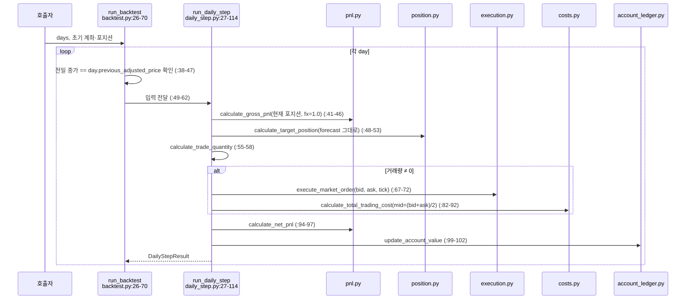
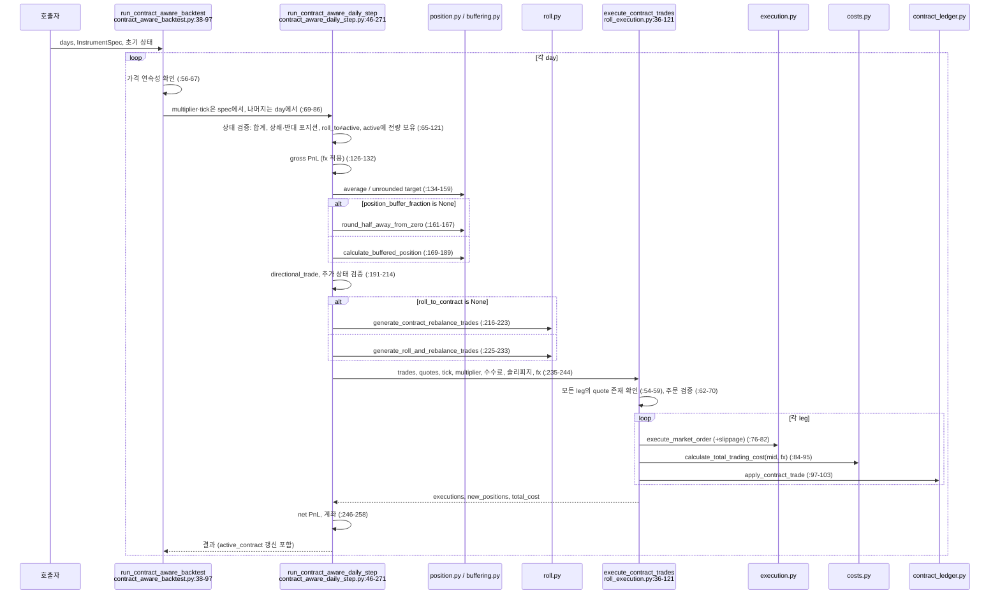
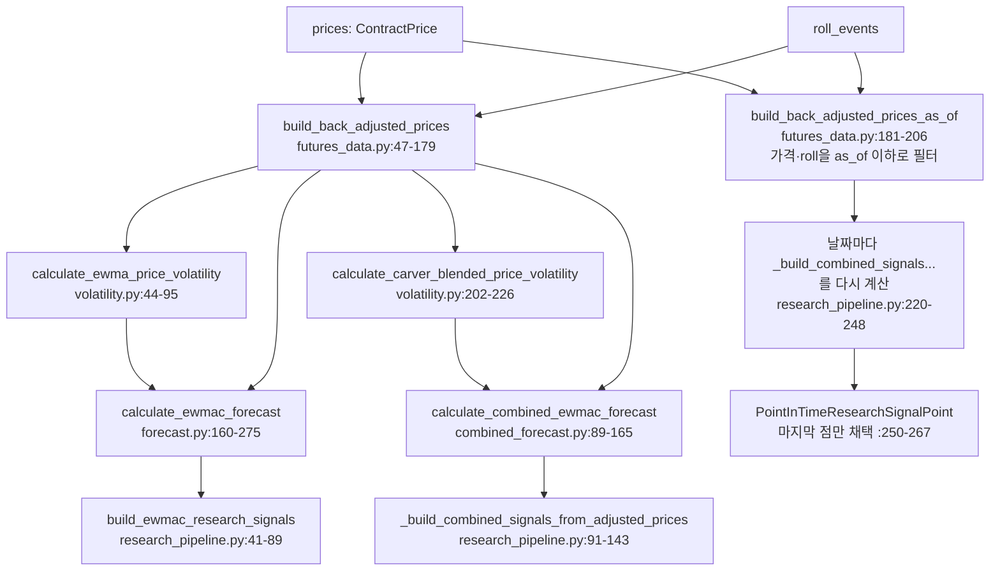
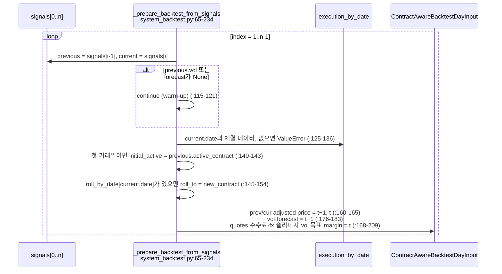
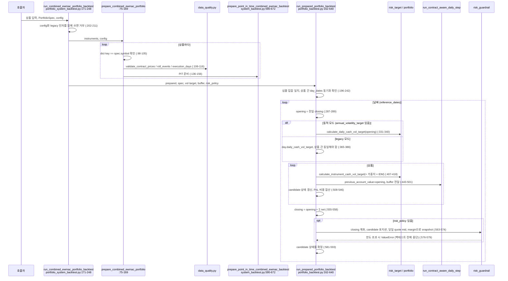
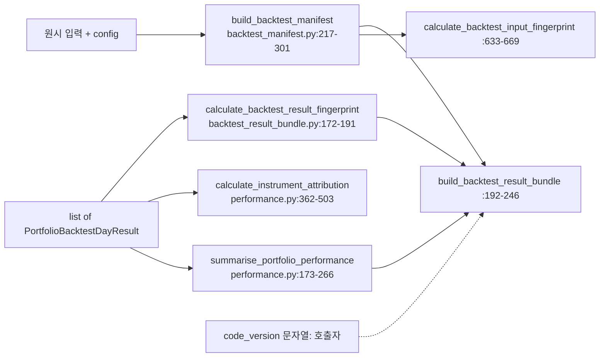

# V1 데이터 흐름 (V1 Data Flow)

- 작업: P0-01 V1 Architecture Inventory & Data Flow Audit (READ-ONLY)
- 감사 대상 커밋: `df6547e`
- 작성일: 2026-10-15
- 표기: `CONFIRMED` / `INFERRED` / `UNVERIFIED` ([V1_INVENTORY.md](V1_INVENTORY.md) §0과 같음). 코드 경로는 `src/carver_quant/` 기준이다.
- 다이어그램에는 코드에서 확인한 호출만 넣었다. 호출자 책임으로 남겨진 연결은 점선과 "호출자"로 표시했다.

이 문서는 **시점과 호출 순서를 기록**한다. 시점 무결성에 대한 최종 판정은 P0-04에서 한다 (§6 참조).

---

## 0. 공통 일간 회계 순서

경로 A, B, C, D에 공통으로 적용되는 하루 처리 순서다. 세 가지 daily step 모두 이 순서를 따른다 (CONFIRMED: `daily_step.py:41-102`, `roll_aware_daily_step.py:73-127`, `contract_aware_daily_step.py:126-258`).

1. **Gross PnL**: *전일에 보유한* 포지션 × (당일 adjusted price − 전일 adjusted price) × multiplier × fx
2. **목표 포지션**: 입력으로 받은 `forecast`와 `price_volatility`로 계산
3. **거래량**: 목표 − 현재
4. **시뮬레이션 체결**: 매수는 ask, 매도는 bid (+ 슬리피지 tick). 항상 전량 체결
5. **비용**: 수수료 + |체결가 − quote mid| × multiplier × |수량|, × fx
6. **Net PnL** = gross − 비용
7. **계좌**: 전일 계좌 + net PnL

따라서 **당일 거래한 수량은 당일 PnL에 반영되지 않는다.** 새 포지션은 다음 날 gross PnL에서 *당일 adjusted 종가*를 기준으로 평가된다. 체결가와 종가의 차이는 mid 대비 비용으로만 반영된다 (CONFIRMED: 코드 구조). 그 결과 **quote mid가 당일 종가와 같다는 가정이 숨어 있다** (INFERRED). 테스트는 실제로 quote mid를 종가에 맞춰 놓는다. 예: `tests/test_system_backtest.py:164-275`에서 종가 106에 bid 105.9 / ask 106.1을 둔다 (CONFIRMED). 코드는 이 정합성을 검증하지 않는다 (GAP `F-02`).

---

## A. 단일 상품 기본 백테스트 (`backtest.py` → `daily_step.py`)

### A.1 외부 입력

`BacktestDayInput` 목록 `backtest.py:10-23`. 각 항목은 전일·당일 adjusted price(pt), `daily_cash_vol_target`(BC/d), `price_volatility`(pt/d), `multiplier`, `forecast`, `execution_bid/ask`(pt), `tick_size`, `commission_per_contract`(IC/ct)를 담는다.
그 밖에 `initial_account_value`와 `initial_position`을 받는다. **날짜, fx, 슬리피지, 월물 정보는 없다** (CONFIRMED).

### A.2 호출 순서

### A.3 시점 정리

| 항목 | 내용 | 근거 |
|---|---|---|
| 신호 계산 시점 | **경로 밖**. `forecast`와 `price_volatility`를 호출자가 넘긴다. t−1 정렬은 호출자 책임 | `backtest.py:15-18` (CONFIRMED) |
| 포지션 계산 시점 | 당일 gross PnL을 계산한 직후 | `daily_step.py:48-53` |
| 체결 시점 | 같은 스텝 안. 입력 bid/ask의 시각은 정의되어 있지 않음 | `:67-72` (시각은 UNVERIFIED) |
| 비용 반영 위치 | `calculate_total_trading_cost`, fx 미전달 | `:86-92` |
| PnL / 계좌 반영 위치 | `calculate_net_pnl`, `update_account_value` | `:94-102` |
| 예외 조건 | 가격 구간 불연속 `backtest.py:45-47`. 비유한 가격·multiplier `pnl.py:17-25`. vol·목표 ≤ 0 `position.py:40-55`. bid>ask, tick 불일치 `execution.py:49-60`. 비용 < 0 `pnl.py:50-53` | CONFIRMED |
| 테스트 | `tests/test_daily_step.py`, `tests/test_backtest.py` | CONFIRMED |

---

## B. Roll-aware / Contract-aware 백테스트

### B.1 `roll_aware_daily_step.py` (러너 없음)

- 외부 입력: A의 입력 + `current_contract_positions`, `roll_from_contract`, `roll_to_contract`, `roll_quotes` `roll_aware_daily_step.py:40-55` (CONFIRMED)
- 순서: 포지션 합 검증 `:56-63` → roll_from 보유 검증 `:65-71` → gross PnL(fx 없음) `:73-78` → 목표 `:81-86` → `generate_roll_and_rebalance_trades` `:96-101` → `execute_contract_trades`(fx·슬리피지 없음) `:103-110` → net, 계좌 `:119-127`
- 특징: **매번 롤을 수행한다.** 방향성 거래 비용은 `0.0`으로 고정되고 `:94`, 비용 전체가 `roll_trading_cost`로 집계된다 `:112-117`. 새 상품 포지션은 `target_position` `:137`. 이 함수를 호출하는 src 러너는 없다 (CONFIRMED).
- 테스트: `tests/test_roll_aware_daily_step.py`

### B.2 `contract_aware_backtest.py` → `contract_aware_daily_step.py`

#### 외부 입력

`ContractAwareBacktestDayInput` `contract_aware_backtest.py:14-36`. 항목은 전일·당일 adjusted price, 일간 현금 vol 목표, price vol, forecast, `quotes: dict[월물, ContractQuote]`, 수수료, `roll_to_contract | None`, `slippage_ticks`, `fx_to_base`, `margin_per_contract_base`다.
그 밖에 초기 계좌, 상품 포지션, 월물별 포지션, `initial_active_contract`, `InstrumentSpec`을 받는다. **`margin_per_contract_base`는 이 러너에서 쓰이지 않는다** `:69-86` (CONFIRMED).

#### 호출 순서

#### 시점 정리

| 항목 | 내용 | 근거 |
|---|---|---|
| 신호 계산 시점 | **경로 밖**. 호출자가 넘김. 이 경로를 쓰는 C(`system_backtest`)가 t−1로 정렬함 | `contract_aware_backtest.py:19-21` |
| 포지션 계산 시점 | gross PnL 계산 직후. 버퍼링은 선택이지만 **러너는 `position_buffer_fraction`을 넘기지 않으므로** 이 러너로는 버퍼링을 쓸 수 없음 | `contract_aware_backtest.py:69-86` (CONFIRMED) |
| Roll 시점 | 일별 입력의 `roll_to_contract`가 있는 날. 구월물 전량 청산과 신월물 목표 진입을 같은 날 같은 quotes로 체결 | `roll.py:29-53` |
| 체결 시점 | 같은 스텝. quotes의 시각은 정의되어 있지 않음 | UNVERIFIED |
| 비용 반영 위치 | leg마다 `calculate_total_trading_cost`, fx 적용 | `roll_execution.py:88-95` |
| PnL / 계좌 반영 위치 | `contract_aware_daily_step.py:250-258` | CONFIRMED |
| 예외 조건 | 위 상태 검증들. quote 누락 `roll_execution.py:55-59`. 가격 불연속 `contract_aware_backtest.py:65-67`. 수수료·가격 검증은 A와 같음 | CONFIRMED |
| 테스트 | `test_contract_aware_daily_step.py`, `test_contract_aware_daily_step_buffering.py`, `test_contract_aware_backtest.py` (슬리피지, KRW 기준통화, 일별 fx 시나리오 포함), `test_roll_execution.py`, `test_contract_ledger.py`, `test_roll.py` | CONFIRMED |

---

## C. Forecast 기반 System Backtest (`research_pipeline.py` → `system_backtest.py`)

### C.1 외부 입력

- `prices: list[ContractPrice]`: 날짜, 월물, 종가(pt) `futures_data.py:6-17`
- `initial_contract`, `roll_events: list[RollEvent]` `futures_data.py:20-36`
- `execution_days: list[ExecutionMarketDay]` `system_backtest.py:28-47`. 각 항목은 날짜, `daily_cash_vol_target`, `quotes`, 수수료, `fx_to_base`, `slippage_ticks`, `margin_per_contract_base`를 담는다.
- 설정: `EWMACConfig` 또는 `fast_spans`, `volatility_span`, `long_run_window`
- `InstrumentSpec` (단일 EWMAC run 경로)

### C.2 세 가지 준비 경로

| 함수 | 신호 소스 | 변동성 | 실행 함수 | 근거 |
|---|---|---|---|---|
| `prepare_ewmac_backtest` / `run_ewmac_system_backtest` | full-history back-adjust, 단일 EWMAC | EWMA vol | `run_contract_aware_backtest` (flat 상태에서 시작) | `system_backtest.py:499-554` |
| `prepare_combined_ewmac_backtest` | full-history, 결합 EWMAC | blended vol | (prepare만 있음) | `:556-588` |
| `prepare_point_in_time_combined_ewmac_backtest` | **PIT** 결합 EWMAC (signal용) + full-history (PnL 가격용) | blended vol | (prepare만 있음. 포트폴리오 러너가 실행) | `:590-672` |

### C.3 신호 생성 흐름

### C.4 t−1 정렬과 일별 입력 조립

PIT 버전 `_prepare_backtest_from_point_in_time_signals` `:236-497`도 구조가 같다. 차이점은 다음과 같다.
- signal(vol, forecast)은 **t−1 PIT snapshot**에서 가져온다 `:430-437`.
- PnL용 adjusted price는 **full-history 연속 시계열**에서 날짜로 찾는다 `:258-261, 359-378`. 서로 다른 날의 PIT snapshot 가격끼리 빼지 않는다는 원칙이 주석과 테스트로 명시되어 있다 `research_pipeline.py:181-185`, `tests/test_system_backtest.py:275`.

### C.5 시점 정리

| 항목 | 내용 | 근거 |
|---|---|---|
| 신호 계산 시점 | t−1 종가까지의 데이터로 계산한 signal을 t일 입력에 넣음 | `system_backtest.py:176-183, 430-437` (CONFIRMED) |
| 신호 입력 범위 | full 경로: 모든 날짜의 가격과 모든 roll로 back-adjust (미래 roll 포함). PIT 경로: `date <= as_of`인 가격과 roll만 사용 | `research_pipeline.py:48-52`, `futures_data.py:187-197` |
| 포지션 계산 시점 | t일 스텝 안. t−1 vol·forecast와 **t일** `daily_cash_vol_target`, **t일** fx를 씀 | `contract_aware_daily_step.py:134-159` |
| 체결 시점 | t일 `ExecutionMarketDay.quotes`. 시각은 정의되어 있지 않음. 테스트는 t일 종가 주변의 quote를 씀 | UNVERIFIED (시각) / CONFIRMED (테스트 구성) |
| 비용 반영 | B.2와 같음 | — |
| PnL / 계좌 | B.2와 같음. 초기 포지션은 flat `system_backtest.py:541-549` | CONFIRMED |
| 예외 조건 | 체결 데이터 누락 `:129-132, 345-349`. 연속 가격 누락 `:375-378`. 거래 가능한 날이 없음 `:220-223, 476-480`. 중복 체결일 `:81-84`. back-adjust 단계의 roll chain 불일치, roll일 가격 누락, active 가격 누락 `futures_data.py:89-113, 151-155` | CONFIRMED |
| Warm-up | vol은 세 번째 관측일부터 존재 (`min_periods=2`) → forecast도 그날부터 존재. slow EWMA의 warm-up은 따로 강제하지 않음 | `volatility.py:65-75`, `tests/test_research_pipeline.py:60-84` (CONFIRMED). 위험은 GAP `F-01` |
| 테스트 | `test_backtest_uses_previous_days_signal`, `test_current_close_does_not_change_same_day_trade_signal`, `test_price_to_account_end_to_end`, `test_pit_replay_uses_pit_signal_but_continuous_price_for_pnl` (`tests/test_system_backtest.py`), `tests/test_combined_system_backtest.py`, `tests/test_research_pipeline.py` | CONFIRMED |

---

## D. Portfolio Backtest (`portfolio_system_backtest.py` → `portfolio_backtest.py`)

### D.1 외부 입력

- `dict[symbol, CombinedEWMACInstrumentInput]` `portfolio_system_backtest.py:38-61`. 각 항목은 `InstrumentSpec`, prices, initial_contract, roll_events, execution_days, (legacy) fast_spans·vol span·window를 담는다.
- `PortfolioSpec` (가중치, IDM) `portfolio.py:5-60`
- `BacktestConfig` 또는 legacy 인자 (`annual_volatility_target`, `position_buffer_fraction`, `risk_policy`)
- `initial_account_value`

### D.2 호출 순서

### D.3 시점 정리

| 항목 | 내용 | 근거 |
|---|---|---|
| 신호 계산 시점 | C의 PIT 경로와 같음 (t−1 PIT snapshot) | `portfolio_system_backtest.py:136-156` (CONFIRMED). `tests/test_portfolio_system_backtest.py:482` `test_portfolio_preparation_uses_point_in_time_signals` |
| 위험 예산 시점 | 동적 모드: t일 개장 계좌(= t−1 종가 기준 계좌). legacy 모드: 호출자가 넣은 t일 값 | `portfolio_backtest.py:331-340`. `test_next_day_risk_target_uses_previous_closing_account` (CONFIRMED). legacy 값을 어떻게 만들었는지는 UNVERIFIED |
| 포지션 계산 시점 | 상품마다 t일 스텝 안. 모든 상품이 **같은 opening 계좌**를 기준으로 계산함 | `:443-501`. `test_instrument_order_does_not_change_account_result` |
| 체결 시점 | 상품별 t일 quotes | C와 같음 |
| 비용 반영 | 상품별 스텝에서 계산하고 포트폴리오에서 합산 `:540-542` | CONFIRMED |
| PnL / 계좌 | 상품별 net을 합산한 뒤 계좌를 한 번만 갱신 `:544-558`. 상품 결과의 `closing_account_value`는 쓰지 않음 | CONFIRMED |
| 가드레일 시점 | **거래 후**, t일 종가 기준 계좌로 검사. 위반하면 예외로 전체 중단. 거래를 차단하거나 줄이지 않음 | `:560-579`, `risk_guardrail.py:188-210` (CONFIRMED) |
| 예외 조건 | 초기 계좌 ≤ 0 `:179-189`. 심볼 불일치 `:206-210`. 날짜 비동기 `:225-240`. vol 목표 불일치 (legacy) `:375-386`. quote·margin 누락 `:104-122`. leverage·margin 한도 초과 `risk_guardrail.py:192-210`. 계좌 ≤ 0 (snapshot 계산 시) `risk_guardrail.py:101-108` | CONFIRMED |
| 가격 연속성 | 이 러너는 `run_contract_aware_backtest`를 거치지 않으므로 **연속성 검사가 없다**. 준비 단계가 연속성을 보장한다고 가정함 | `portfolio_backtest.py:443-501` (CONFIRMED). GAP `A-05` |
| 테스트 | `tests/test_portfolio_backtest.py`, `tests/test_portfolio_system_backtest.py`, `tests/test_v1_acceptance.py`, `tests/test_performance.py` | CONFIRMED |

### D.4 사후 분석 흐름

---

## 6. 백테스트 시점 흐름 초기 검토

이 절은 **초기 위험 식별**이다. 최종 판정이 아니다.

| 질문 | 관찰 | 확인 수준 | 남은 위험 |
|---|---|---|---|
| 전일(t−1) 신호를 당일(t) 주문에 쓰는가? | **C, D 경로는 그렇다.** `system_backtest.py:176-183, 430-437`. 테스트 `test_backtest_uses_previous_days_signal`, `test_current_close_does_not_change_same_day_trade_signal`, `test_combined_system_uses_previous_days_combined_forecast`가 검증한다. **A, B 경로는 forecast를 직접 입력받으므로 정렬은 호출자 책임이다** | CONFIRMED | A, B를 직접 쓰는 호출자는 같은 날 신호를 넣을 수 있다 (가드 없음) |
| 신호 계산 입력 데이터의 범위는? | PIT: `price.date <= as_of`, `roll.date <= as_of` `futures_data.py:187-197`. full: 전체 기간의 가격과 roll | CONFIRMED | 아래 행 참조 |
| PIT 경로와 일반 back-adjustment 경로는 어떻게 다른가? | 일반 경로는 미래 roll gap이 과거 adjusted **수준**을 바꾼다 (`test_offline_back_adjustment_can_revise_historical_levels`). PIT는 그렇지 않다 (`test_as_of_back_adjustment_does_not_use_future_roll`). **하지만 forecast와 vol은 두 경로에서 수치적으로 같다.** 감사용 일회성 probe(roll 2회, 120일)에서 forecast 차이 최대 2.8e-13, vol 차이 최대 1.7e-15, adjusted 수준이 다른 날 80일이었다. 이유는 가산 조정이 각 날짜 t 이전 구간 전체에 상수를 더하고, EWMA(adjust=False) 차이와 가격 차이 기반 vol은 상수 이동에 불변이기 때문이다 | CONFIRMED (probe 실행) / INFERRED (원리) | **현재 규칙에서 우연히 성립하는 성질이다.** 가격 수준에 의존하는 규칙(% 변동성, carry, 비율 계산)이나 곱셈 방식 조정(ETF 배당 조정 등)이 들어오면 full 경로는 look-ahead가 된다. full 경로가 미래 roll을 쓰지 않는다는 회귀 테스트도 없다 (GAP `F-03`) |
| 주문에 쓰는 가격은 어느 시점의 가격인가? | t일 `ExecutionMarketDay.quotes`. **시각(시가, 종가, 특정 시각) 필드가 없다** | UNVERIFIED | quote가 시가라면 장중 손익이 체결 수량만큼 누락되거나 왜곡된다 (§0, GAP `F-02`) |
| 체결가, 수수료, PnL은 어떤 순서로 반영되는가? | gross(보유분, t−1→t) → 목표 → 체결(ask/bid ± 슬리피지) → 비용(수수료 + mid 대비) → net → 계좌 (§0) | CONFIRMED | 새 포지션의 평가 기준은 t일 adjusted 종가이고, mid와 종가의 차이는 반영되지 않는다 |
| FX 입력값에는 어떤 시점 가정이 있는가? | t일 스칼라 하나를 (1) t−1→t gross PnL 전체, (2) t일 사이징, (3) t일 비용, (4) t일 가드레일 명목가치에 모두 쓴다 `contract_aware_daily_step.py:126-159, 235-244`, `portfolio_backtest.py:129-136` | CONFIRMED (사용처) / UNVERIFIED (환율 관측 시각과 출처) | 환율 관측 시각과 체결 시각이 다르면 사이징에 미세한 look-ahead나 불일치가 생길 수 있다. 수수료 통화는 상품 통화로 가정되어 있다 (`costs.py:105-113`) |
| Roll event가 미래 정보를 참조할 가능성은? | 코드는 roll을 **날짜로만** 쓴다. PIT 신호는 `roll.date <= as_of`. 체결 경로는 `roll_by_date[t]`일 때 t일에 롤한다 `system_backtest.py:145-154`. back-adjust gap은 t일 두 월물 **종가**를 쓰고, t−1 signal snapshot에는 포함되지 않는다 | CONFIRMED (코드 사용 방식) | roll 일정 자체를 사후 정보(거래량 교차 등)로 만들었다면 look-ahead다. **roll event 생성 규칙과 출처는 정의되어 있지 않다** (UNVERIFIED, GAP `F-07`) |
| Warm-up | forecast는 세 번째 관측일부터 생긴다. slow EWMA(최대 span 256)와 long-run vol(2560)의 warm-up은 강제하지 않는다 | CONFIRMED | 초기 구간에 표본 2~3개로 만든 vol로 포지션을 정한다. vol이 작게 추정되면 포지션이 과대해질 수 있다 (GAP `F-01`) |
| 위험 예산과 계좌 시점 | 동적 모드는 t−1 종가 계좌를 씀 (CONFIRMED, 테스트 있음). legacy 모드는 호출자 값 | CONFIRMED / UNVERIFIED | legacy 값을 미래 계좌로 만들었다면 look-ahead |
| 데이터 공백 | 달력 공백은 허용 (`test_calendar_gaps_are_allowed`). t−1은 "직전 가격 날짜"라는 뜻. 체결 데이터가 빠지면 즉시 실패 | CONFIRMED | 다시장 포트폴리오에서 휴장일이 다르면 날짜 동기화 검사에서 실패한다 (정렬 정책 없음, GAP `A-06`) |

P0-04에 넘길 검증 항목은 [../quality/V1_GAP_ANALYSIS.md](../quality/V1_GAP_ANALYSIS.md) §6에 있다.
