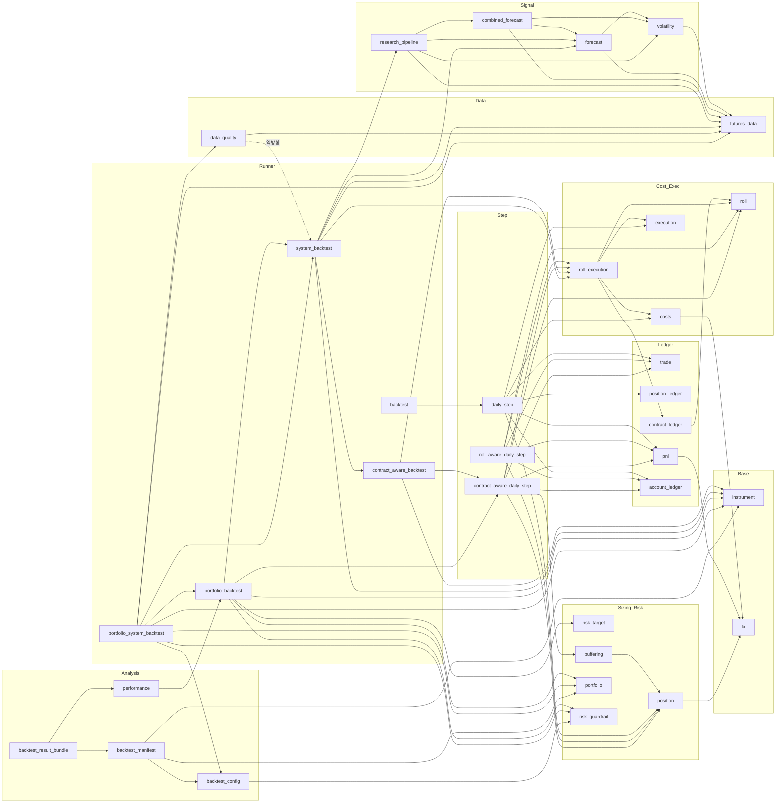

# V1 모듈 인벤토리 (V1 Module Inventory)

- 작업: P0-01 V1 Architecture Inventory & Data Flow Audit (READ-ONLY)
- 감사 대상 커밋: `df6547e` (작업 트리 clean, 감사 중 `src/`·`tests/` 변경 없음)
- 작성일: 2026-10-15
- 관련 문서: [V1_DATA_FLOW.md](V1_DATA_FLOW.md), [V1_DEPENDENCY_ANALYSIS.md](V1_DEPENDENCY_ANALYSIS.md), [../quality/V1_GAP_ANALYSIS.md](../quality/V1_GAP_ANALYSIS.md)

## 0. 표기 규칙

| 표기 | 의미 |
|---|---|
| `CONFIRMED` | 코드를 읽거나 실행해서 직접 확인함 |
| `INFERRED` | 근거로부터 추론함 |
| `UNVERIFIED` | 확인하지 못함 |

- 코드 근거는 `파일:라인` 형식으로 쓴다. 경로는 `src/carver_quant/` 기준이다.
- 이 문서는 **구현 위치와 책임**을 기록한다. 공식의 수치가 맞는지는 판정하지 않는다. 그 판정은 P0-04에서 한다.
- 모듈 하나에 표 한 행을 쓴다. 단위는 아래 약어를 쓴다.

| 약어 | 의미 |
|---|---|
| `pt` | 가격 포인트 (price points, 상품 호가 단위) |
| `IC` | 상품 통화 (instrument currency) 금액 |
| `BC` | 기준 통화 (base currency, 계좌 통화) 금액 |
| `ct` | 계약 수 (contracts, 정수) |
| `/d`, `/y` | 일율 (daily), 연율 (annualised) |
| `frac` | 소수 비율 (0.2 = 20%) |

## 1. 요약

| 항목 | 값 | 확인 수준 |
|---|---|---|
| 패키지 | `src/carver_quant/`, 하위 패키지 없는 평면 구조 | CONFIRMED |
| 파일 수 | `__init__.py`(빈 파일) + 모듈 34개, 6,500줄 | CONFIRMED (`wc -l`) |
| 외부 패키지 | `pandas` (`forecast.py`, `volatility.py` 두 곳만). 나머지는 표준 라이브러리 | CONFIRMED |
| 부수효과 | 파일·네트워크 I/O, 현재 시각 조회, 난수, 로깅, 환경변수 접근 **없음** | CONFIRMED (grep: `open(`, `datetime.now`, `date.today`, `time.time`, `random`, `requests`, `urllib`, `socket`, `os.`, `sys.`, `print(`, `logging`, `subprocess`, `pathlib` 모두 0건) |
| 순환 import | 없음 | CONFIRMED (import 그래프 수작업 확인, §4) |
| docstring | 없음 | CONFIRMED (CLAUDE.md §4.1과 일치) |
| 테스트 | 테스트 파일 39개, 306개 수집·통과 | CONFIRMED |

## 2. 계층별 모듈 분류

이 분류는 모듈 이름과 실제 책임을 보고 붙인 **감사용 분류**다. 코드에 이런 경계가 있는 것은 아니다 (INFERRED).

| 계층 | 모듈 |
|---|---|
| 기본 타입 / 상품 | `instrument`, `fx` |
| 데이터 | `futures_data`, `data_quality` |
| 신호 (Forecast) | `volatility`, `forecast`, `combined_forecast`, `research_pipeline` |
| 사이징 / 위험 | `risk_target`, `position`, `buffering`, `portfolio`, `risk_guardrail` |
| 비용 / 체결 (시뮬레이션) | `costs`, `execution`, `roll`, `roll_execution` |
| 장부 (Ledger) | `trade`, `position_ledger`, `contract_ledger`, `pnl`, `account_ledger` |
| 일간 스텝 (Daily Step) | `daily_step`, `roll_aware_daily_step`, `contract_aware_daily_step` |
| 백테스트 러너 | `backtest`, `contract_aware_backtest`, `system_backtest`, `portfolio_backtest`, `portfolio_system_backtest` |
| 설정 / 분석 / 재현성 | `backtest_config`, `performance`, `backtest_manifest`, `backtest_result_bundle` |

## 3. 모듈 인벤토리

"부수효과" 열은 34개 모듈 모두 **없음**(CONFIRMED, §1의 grep)이므로 표에서 생략한다. "외부 패키지" 열도 `pandas`를 쓰는 두 모듈을 빼면 표준 라이브러리(`math`, `dataclasses`, `datetime` 등)뿐이므로 해당하는 경우에만 적는다.

### 3.1 기본 타입 / 상품

| 모듈 | 책임 | 공개 API | 입력 → 출력 (단위) | 내부 의존 | 대표 테스트 | 상태 / 제약 |
|---|---|---|---|---|---|---|
| `instrument.py` (36줄) | 상품 사양 | `InstrumentSpec(symbol, currency, multiplier, tick_size)` `instrument.py:5-37` | multiplier: IC/pt/ct, tick_size: pt | 없음 | `test_instrument.py` | CONFIRMED. 빈 문자열, 비유한값, 0 이하 값을 거부함. **만기, 자산 유형, 거래소, 수수료 구조, lot size 필드 없음** |
| `fx.py` (22줄) | 통화 환산 | `convert_to_base_currency(amount_instrument_currency, fx_to_base)` `fx.py:4-23` | IC × (BC/IC) → BC | 없음 | `test_fx.py` | CONFIRMED. 스칼라 곱셈 하나. 환율 시계열, 환율 시점, 통화쌍 개념 없음 |

### 3.2 데이터

| 모듈 | 책임 | 공개 API | 입력 → 출력 (단위) | 내부 의존 | 대표 테스트 | 상태 / 제약 |
|---|---|---|---|---|---|---|
| `futures_data.py` (205줄) | 월물 가격, roll event, Panama 방식(가산) back-adjustment | `ContractPrice` `:6-17`, `RollEvent` `:20-36`, `BackAdjustedPrice` `:39-44`, `build_back_adjusted_prices` `:47-179`, `build_back_adjusted_prices_as_of` `:181-206` | 월물 종가(pt) + roll event → 날짜별 `raw_price`(pt), `adjusted_price`(pt) | 없음 | `test_futures_data.py`, `test_research_pipeline.py` | CONFIRMED. gap = roll일의 신월물 종가 − 구월물 종가 `:115-118`. roll일까지는 구월물, 다음 날부터 신월물이 active `:138-144`. 조정은 `date <= roll.date`인 날짜에 gap을 더함 `:159-168`. 하루 roll 1건만 허용 `:80-85`. active 월물 가격이 없으면 `ValueError` `:151-155`. 이 함수는 날짜를 오름차순으로 정렬하지만, 입력 정렬 자체를 검증하지는 않음 |
| `data_quality.py` (197줄) | 입력 데이터 검증 | `validate_contract_prices` `:12-45`, `validate_roll_events` `:48-94`, `validate_execution_days` `:97-198` | 입력 리스트 → `None` 또는 `ValueError` | `futures_data`, **`system_backtest`** (`ExecutionMarketDay`) `:7-9` | `test_data_quality.py` | CONFIRMED. 중복, 비유한값, 시간 순서, bid>ask, fx>0, slippage가 bool이 아닌 정수인지 검사. **역방향 의존** (분석: V1_DEPENDENCY_ANALYSIS §2). quote의 tick 정렬, roll chain과 initial contract의 정합성은 검사하지 않음 (tick 정렬은 체결 시점에, chain 정합성은 `build_back_adjusted_prices`에서 검사) |

### 3.3 신호 (Forecast)

| 모듈 | 책임 | 공개 API | 입력 → 출력 (단위) | 내부 의존 | 외부 | 대표 테스트 | 상태 / 제약 |
|---|---|---|---|---|---|---|---|
| `volatility.py` (225줄) | 가격 변화와 가격 변동성 | `VolatilityPoint` `:11-14`, `calculate_price_changes` `:17-41`, `calculate_ewma_price_volatility` `:44-95`, `blend_price_volatility` `:97-145`, `calculate_long_run_average_volatility` `:147-200`, `calculate_carver_blended_price_volatility` `:202-226` | adjusted price(pt) → 일간 가격 변동성 (pt/d, **수익률이 아니라 가격 차이 기준**) | `futures_data` | pandas | `test_volatility.py` | CONFIRMED. EWMA std는 `adjust=False, min_periods=2, bias=False` `:65-75`. 그래서 세 번째 관측일부터 값이 나옴. long-run은 `rolling(window=2560, min_periods=1)` `:173-176`. 기본 혼합 비율 0.7/0.3 `:100,206`. **연율 변동성 함수는 이 모듈에 없음** (연율화는 `performance.py`의 수익률에만 있음) |
| `forecast.py` (274줄) | EWMAC raw crossover, 위험 정규화, forecast scalar, cap | `AFTS_EWMAC_SCALARS` `:11-18`, `EWMACConfig` `:21-57`, `EWMACForecastPoint` `:60-73`, `make_afts_ewmac_config` `:76-91`, `scale_and_cap_forecast` `:94-157`, `calculate_ewmac_forecast` `:160-275` | adjusted price(pt), price vol(pt/d) → raw crossover(pt), 위험 정규화 값(무차원), scaled/capped forecast(무차원, ±20) | `futures_data`, `volatility` | pandas | `test_forecast.py` | CONFIRMED. `ewm(span, adjust=False)` `:190-206`. slow = fast × 4 `:86`. 변동성이 0이면 `None` `:132-133`. scalar 상수의 출처는 **UNVERIFIED** (CLAUDE.md §7) |
| `combined_forecast.py` (164줄) | 여러 EWMAC 결합, FDM, 결합 후 cap | `AFTS_TREND_RULE_SETS` `:16-23`, `CombinedTrendForecastPoint` `:26-39`, `get_afts_trend_fdm` `:42-52`, `combine_forecast_values` `:55-86`, `calculate_combined_ewmac_forecast` `:89-165` | 구성 capped forecast들 → 동일가중 평균 × FDM → cap ±20 | `forecast`, `futures_data`, `volatility` | — | `test_combined_forecast.py`, `test_combined_forecast_integration.py` | CONFIRMED. 가중치는 **동일가중(equal weight)으로 고정** `:65-68`. 구성 forecast 중 하나라도 `None`이면 결합값도 `None` `:133-138`. FDM 상수의 출처는 **UNVERIFIED** |
| `research_pipeline.py` (268줄) | 가격 → back-adjust → vol → forecast 조립. full-history 경로와 PIT 경로 | `ResearchSignalPoint` `:25-38`, `build_ewmac_research_signals` `:41-89`, `build_combined_ewmac_research_signals` `:145-171`, `PointInTimeResearchSignalPoint` `:173-189`, `build_point_in_time_combined_ewmac_signals` `:191-269` | `ContractPrice`, `RollEvent` → 날짜별 signal (adjusted price pt, vol pt/d, forecast) | `forecast`, `combined_forecast`, `futures_data`, `volatility` | — | `test_research_pipeline.py` | CONFIRMED. 단일 EWMAC 경로는 EWMA vol만 씀 `:54-57`, 결합 경로는 blended vol(0.7 하드코딩) `:97-104`. 결합 경로는 `raw_crossover=0.0`을 자리채움 값으로 넣음 `:132`. PIT 경로는 날짜마다 전체를 다시 계산함 (O(n²)) `:220-248`. `:235-239`의 `continue`는 실행될 수 없는 코드로 보임 (INFERRED, GAP 문서 참조) |

### 3.4 사이징 / 위험

| 모듈 | 책임 | 공개 API | 입력 → 출력 (단위) | 내부 의존 | 대표 테스트 | 상태 / 제약 |
|---|---|---|---|---|---|---|
| `risk_target.py` (72줄) | 연간·일간 현금 변동성 목표 | `calculate_annual_cash_vol_target` `:4-35`, `calculate_daily_cash_vol_target` `:38-73` | capital(BC) × 연율 vol target(frac/y) → BC/y, ÷√256 → BC/d | 없음 | `test_risk_target.py` | CONFIRMED. 연간 거래일 기본값 256 `:41` |
| `position.py` (154줄) | 평균 포지션, 목표 포지션, 반올림 | `round_half_away_from_zero` `:8-18`, `calculate_average_position` `:58-93`, `calculate_unrounded_target_position` `:96-129`, `calculate_target_position` `:132-155` | 일간 현금 vol 목표(BC/d), price vol(pt/d), multiplier(IC/pt/ct), fx(BC/IC), forecast → 계약 수(ct, float 또는 int) | `fx` | `test_position.py` | CONFIRMED. 평균 포지션 = 목표 ÷ (vol × multiplier × fx) `:74-91`. 목표 포지션 = 평균 × forecast ÷ 10 `:123-127` (10은 하드코딩된 평균 forecast). **이 모듈은 forecast를 cap하지 않음** (cap은 신호 계층에서 함) |
| `buffering.py` (103줄) | 포지션 버퍼링 (no-trade zone) | `BufferDecision` `:9-17`, `calculate_buffered_position` `:20-104` | 현재 포지션(ct), 최적 미반올림 포지션(ct), 평균 포지션(ct), buffer_fraction(frac) → 목표 포지션(ct), 거래량(ct) | `position` | `test_buffering.py`, `test_contract_aware_daily_step_buffering.py` | CONFIRMED. 버퍼 폭 = 평균 포지션 × fraction `:57-60`. 상한·하한은 반올림하고, 버퍼 밖이면 가까운 경계로 이동 `:76-93` |
| `portfolio.py` (101줄) | 포트폴리오 가중치, IDM, 상품별 현금 vol 목표 | `PortfolioSpec(instrument_weights, instrument_diversification_multiplier)` `:5-60`, `calculate_instrument_cash_vol_target` `:63-102` | 계좌 일간 현금 vol 목표(BC/d) × 가중치(frac) × IDM → 상품별 목표(BC/d) | 없음 | `test_portfolio.py` | CONFIRMED. 가중치는 양수이고 합이 1이어야 함 (abs_tol 1e-12) `:38-46`. IDM은 양수이기만 하면 됨 (상한 없음) |
| `risk_guardrail.py` (209줄) | 명목 노출, gross leverage, margin usage 검사 | `PortfolioRiskSnapshot` `:5-11`, `calculate_contract_notional_base` `:14-49`, `calculate_position_notional_base` `:52-69`, `calculate_margin_required` `:72-93`, `calculate_portfolio_risk_snapshot` `:96-155`, `PortfolioRiskPolicy` `:157-185`, `validate_risk_snapshot` `:188-210` | \|price\|(pt) × multiplier × fx × \|ct\| → BC. 노출 합 ÷ 계좌 → leverage(배수). margin(BC/ct) × \|ct\| ÷ 계좌 → frac | 없음 | `test_risk_guardrail.py`, `test_portfolio_backtest.py` | CONFIRMED. 음수 가격 때문에 `abs(price)`를 씀 `:43-49`. 한도를 넘으면 **`ValueError`를 던짐** `:192-210`. 거래를 막거나 줄이지 않고 백테스트를 중단시킴 |

### 3.5 비용 / 체결 (시뮬레이션)

| 모듈 | 책임 | 공개 API | 입력 → 출력 (단위) | 내부 의존 | 대표 테스트 | 상태 / 제약 |
|---|---|---|---|---|---|---|
| `costs.py` (112줄) | 수수료, 체결가 비용(스프레드+슬리피지), 총비용 | `calculate_commission` `:4-21`, `calculate_execution_price_cost` `:23-70`, `calculate_spread_cost` `:72-83`, `calculate_total_trading_cost` `:85-113` | \|ct\| × 수수료(IC/ct) + \|fill − mid\|(pt) × multiplier × \|ct\| → IC, × fx → BC | `fx` | `test_costs.py` | CONFIRMED. 수수료는 **상품 통화로 가정**하고 fx로 환산 `:105-113` (INFERRED: 실제 브로커 수수료 통화는 미정). `calculate_spread_cost`는 이름과 달리 슬리피지가 포함된 체결가 비용 전체를 계산하는 별칭 `:72-83`. 수량이 0이면 `ValueError` |
| `execution.py` (151줄) | **시뮬레이션** 시장가 체결, tick 검증, 슬리피지 | `validate_price_on_tick` `:5-26`, `Fill` `:29-32`, `validate_market_order` `:34-60`, `execute_market_order` `:62-109`, `apply_slippage` `:111-152` | 요청 수량(ct), bid/ask(pt), tick(pt), slippage_ticks(정수) → `Fill(quantity ct, price pt)` | 없음 | `test_execution.py`, `test_roll.py` | CONFIRMED. 매수는 ask, 매도는 bid `:86-89`. **항상 전량 체결** `:106-109`. 유동성, 거래량, 부분 체결 모델 없음. 슬리피지 정수 검사에서 bool을 거르지 않음 `:69` (`data_quality`는 거름). 실제 주문 기능이 아님 |
| `roll.py` (69줄) | 월물 단위 거래 생성 | `ContractTrade(contract, quantity)` `:4-7`, `generate_roll_trades` `:10-27`, `generate_roll_and_rebalance_trades` `:29-53`, `generate_contract_rebalance_trades` `:55-70` | 포지션(ct) → `ContractTrade` 목록 | 없음 | `test_roll.py`, `test_contract_ledger.py` | CONFIRMED. roll+rebalance는 구월물 전량 청산 후 신월물에 목표 수량을 신규 진입 `:37-51` |
| `roll_execution.py` (141줄) | 여러 월물 거래를 모두 검증한 뒤 체결하고 비용 집계 | `ContractQuote(bid, ask)` `:15-18`, `RollExecution` `:21-26`, `RollExecutionResult` `:29-33`, `execute_contract_trades` `:36-121`, `execute_roll_trades` `:123-142` | 월물 포지션(ct), 거래 목록, quote(pt) → 체결 내역, 새 포지션, 총비용(BC) | `contract_ledger`, `costs`, `execution`, `roll` | `test_roll_execution.py` | CONFIRMED. quote 누락과 주문 유효성을 모든 다리(leg)에 대해 **먼저 검사**한 뒤 체결함 `:54-70`. 다리별 mid 기준 비용 `:84-95`. `execute_roll_trades`는 단순 별칭이고 src 안에서는 쓰이지 않음 |

### 3.6 장부 (Ledger)

| 모듈 | 책임 | 공개 API | 입력 → 출력 (단위) | 내부 의존 | 대표 테스트 | 상태 / 제약 |
|---|---|---|---|---|---|---|
| `trade.py` (4줄) | 거래량 = 목표 − 현재 | `calculate_trade_quantity` `:1-5` | ct → ct | 없음 | `test_trade.py` | CONFIRMED. 검증 없음 |
| `position_ledger.py` (4줄) | 포지션 += 체결량 | `apply_fill` `:1-5` | ct → ct | 없음 | `test_position_ledger.py` | CONFIRMED. 검증 없음. `daily_step`에서만 사용 |
| `contract_ledger.py` (46줄) | 월물별 포지션 dict 갱신 (0이면 제거) | `apply_contract_trade` `:4-29`, `apply_contract_trades` `:31-47` | `dict[str, ct]` + `ContractTrade` → `dict[str, ct]` | `roll` | `test_contract_ledger.py` | CONFIRMED. 입력 dict를 바꾸지 않고 새 dict를 반환 |
| `pnl.py` (54줄) | 총손익(gross), 순손익(net) | `calculate_gross_pnl` `:4-36`, `calculate_net_pnl` `:38-55` | 보유(ct) × Δ가격(pt) × multiplier × fx → BC. gross − cost → BC | `fx` | `test_pnl.py` | CONFIRMED. 비용이 음수이면 `ValueError` `:50-53` |
| `account_ledger.py` (17줄) | 계좌 평가액 갱신 | `update_account_value` `:4-18` | BC + BC → BC | 없음 | `test_account_ledger.py` | CONFIRMED. 계좌가 0 이하여도 거부하지 않음 (유한값 검사만) |

### 3.7 일간 스텝 (Daily Step)

| 모듈 | 책임 | 공개 API | 주요 입력 | 내부 의존 | 대표 테스트 | 상태 / 제약 |
|---|---|---|---|---|---|---|
| `daily_step.py` (113줄) | 단일 상품, 단일 가격 시계열의 하루 처리 | `DailyStepResult` `:12-24`, `run_daily_step` `:27-114` | 전일·당일 adjusted price, 일간 현금 vol 목표, price vol, multiplier, forecast, bid/ask, tick, 수수료 | `account_ledger`, `costs`, `execution`, `pnl`, `position`, `position_ledger`, `trade` | `test_daily_step.py`, `test_backtest.py` | CONFIRMED. **fx와 슬리피지를 전달하지 않음** (gross PnL, 비용 모두 fx=1.0 기본값) `:41-46, 86-92`. 버퍼링 없음. 월물 개념 없음 |
| `roll_aware_daily_step.py` (140줄) | 롤하는 날 하루 처리 (롤 전용) | `RollAwareDailyStepResult` `:20-37`, `run_roll_aware_daily_step` `:40-141` | 위 입력 + 월물 포지션, roll_from/roll_to, roll quote | `account_ledger`, `pnl`, `position`, `roll`, `roll_execution`, `trade` | `test_roll_aware_daily_step.py` | CONFIRMED. **항상 롤을 수행함**. `directional_trading_cost`는 항상 0.0이고 비용 전체가 롤 비용으로 잡힘 `:94, 112-117`. fx, 슬리피지 미지원. `roll_from == roll_to` 검사 없음. 러너 없이 테스트에서만 호출됨 |
| `contract_aware_daily_step.py` (270줄) | 월물을 인식하는 하루 처리 (롤 여부 선택, 버퍼링 선택) | `ContractAwareDailyStepResult` `:28-43`, `run_contract_aware_daily_step` `:46-271` | 위 입력 + active_contract, roll_to_contract(선택), quotes dict, slippage_ticks, fx_to_base, position_buffer_fraction(선택) | `account_ledger`, `buffering`, `pnl`, `position`, `roll`, `roll_execution`, `trade` | `test_contract_aware_daily_step.py`, `test_contract_aware_daily_step_buffering.py` | CONFIRMED. 시스템 경로와 포트폴리오 경로가 모두 쓰는 **핵심 스텝**. 상태 일관성 검증 `:65-121, 196-214`. 새 상품 포지션 = target (전량 체결 가정) `:266` |

### 3.8 백테스트 러너

| 모듈 | 책임 | 공개 API | 주요 입력 → 출력 | 내부 의존 | 대표 테스트 | 상태 / 제약 |
|---|---|---|---|---|---|---|
| `backtest.py` (69줄) | `daily_step` 반복 | `BacktestDayInput` `:10-23`, `run_backtest` `:26-70` | 날짜 없는 일별 입력 목록 → `list[DailyStepResult]` | `daily_step` | `test_backtest.py` | CONFIRMED. 전일 종가와 당일 시작가가 이어지는지 검사 (abs_tol 1e-12) `:38-47`. 날짜 필드가 없음 |
| `contract_aware_backtest.py` (96줄) | `contract_aware_daily_step` 반복 | `ContractAwareBacktestDayInput` `:14-36`, `run_contract_aware_backtest` `:38-97` | 일별 입력 + `InstrumentSpec` → `list[ContractAwareDailyStepResult]` | `contract_aware_daily_step`, `instrument`, `roll_execution` | `test_contract_aware_backtest.py` | CONFIRMED. 가격 연속성 검사 `:56-67`. **`margin_per_contract_base` 필드 `:31-36`와 `position_buffer_fraction`을 스텝에 넘기지 않음** `:69-86` |
| `system_backtest.py` (671줄) | 가격 → signal → t−1 정렬 → 일별 입력 조립 → 실행 | `ExecutionMarketDay` `:28-47`, `PreparedEWMACBacktest` `:50-63`, `prepare_ewmac_backtest` `:499-519`, `run_ewmac_system_backtest` `:522-554`, `prepare_combined_ewmac_backtest` `:556-588`, `prepare_point_in_time_combined_ewmac_backtest` `:590-672` (+ 비공개 `_prepare_backtest_from_signals` `:65-234`, `_prepare_backtest_from_point_in_time_signals` `:236-497`) | 가격, roll, 체결일 데이터, 설정 → `PreparedEWMACBacktest` 또는 결과 목록 | `contract_aware_backtest`, `forecast`, `futures_data`, `instrument`, `research_pipeline`, `roll_execution` | `test_system_backtest.py`, `test_combined_system_backtest.py` | CONFIRMED. **t−1 signal(vol, forecast)과 t 체결 데이터를 결합하는 유일한 지점** `:176-183, 430-437`. 결합 forecast용 "run" 함수는 없고 prepare만 있음 (실행은 포트폴리오 러너가 함). `ExecutionMarketDay`가 시장 데이터, 비용 파라미터, 위험 파라미터를 한 타입에 섞어 담음 |
| `portfolio_backtest.py` (639줄) | 여러 상품, 한 계좌, 날짜 동기화, 동적 vol 목표, 가드레일 | `PreparedPortfolioInstrument` `:33-36`, `PortfolioBacktestDayResult` `:39-65`, `run_prepared_portfolio_backtest` `:162-640` | 준비된 상품별 일별 입력 + `PortfolioSpec` + 선택 설정 → `list[PortfolioBacktestDayResult]` | `contract_aware_daily_step`, `instrument`, `portfolio`, `risk_guardrail`, `risk_target`, `system_backtest` | `test_portfolio_backtest.py` | CONFIRMED. `run_contract_aware_backtest`를 쓰지 않고 `run_contract_aware_daily_step`을 **직접 호출하는 별도 루프**. 그래서 가격 연속성 검사가 없음 (GAP 참조). 동적 모드에서는 개장 시점 계좌(=전일 종가 기준 계좌)로 일간 목표를 계산 `:331-340`. 가드레일은 거래 **후** 검사 `:560-579`. `instrument_results: dict[str, object]`로 타입이 느슨함 `:52-55` |
| `portfolio_system_backtest.py` (250줄) | 최상위 진입점: 검증 → PIT 준비 → 포트폴리오 실행 | `CombinedEWMACInstrumentInput` `:38-61`, `PortfolioSystemBacktestResult` `:64-72`, `prepare_combined_ewmac_portfolio` `:75-169`, `run_combined_ewmac_portfolio_backtest` `:171-248` | 상품별 원시 입력 + 설정 → 준비 결과와 일별 결과 | `backtest_config`, `data_quality`, `futures_data`, `instrument`, `portfolio`, `portfolio_backtest`, `risk_guardrail`, `system_backtest` | `test_portfolio_system_backtest.py`, `test_v1_acceptance.py` | CONFIRMED. **항상 PIT 경로를 씀** `:136-156`. `BacktestConfig`와 개별 legacy 인자를 함께 넘기면 거부 `:202-211` |

### 3.9 설정 / 분석 / 재현성

| 모듈 | 책임 | 공개 API | 입력 → 출력 (단위) | 내부 의존 | 외부 | 대표 테스트 | 상태 / 제약 |
|---|---|---|---|---|---|---|---|
| `backtest_config.py` (190줄) | 백테스트 설정 검증 | `SUPPORTED_EWMAC_FAST_SPANS` `:10-17`, `V1_TRADING_DAYS_PER_YEAR=256` `:19`, `BacktestConfig` `:71-191` | 설정값 → frozen 설정 객체 | `risk_guardrail` | — | `test_backtest_config.py` | CONFIRMED. 연간 거래일은 256만 허용 `:140-147` (근거 주석 `:132-139`) |
| `performance.py` (502줄) | 성과 요약, 상품별 기여도, 회전율(turnover) | `PerformanceSummary` `:14-34`, `calculate_daily_net_returns` `:37-72`, `calculate_annualised_mean_return` `:75-86`, `calculate_annualised_volatility` `:89-100`, `calculate_sharpe_ratio` `:103-127`, `calculate_drawdowns` `:130-170`, `summarise_portfolio_performance` `:173-266`, `InstrumentPerformanceAttribution` `:268-286`, `calculate_afts_turnover` `:288-338`, `calculate_systematic_trading_turnover` `:340-360`, `calculate_instrument_attribution` `:362-503` | 일별 결과 → 일간 수익률 = net PnL ÷ 개장 계좌 (frac/d), 연율 평균 = 평균 × 256, 연율 vol = 표본 표준편차 × √256, Sharpe(무위험수익률 0), drawdown(frac) | `portfolio_backtest` | `statistics` | `test_performance.py` | CONFIRMED. 산술 연율화. 무위험수익률 미반영 |
| `backtest_manifest.py` (678줄) | 입력 manifest, canonical JSON, 입력 fingerprint(SHA-256) | `BacktestManifest` `:77-101`, `InstrumentManifest` `:48-74`, `build_backtest_manifest` `:217-301`, `to_canonical_json` `:385-403`, `build_backtest_input_payload` `:405-517` **및 동일한 재정의 `:519-631`**, `calculate_backtest_input_fingerprint` `:633-669`, `serialize_backtest_manifest` `:671-676` | 입력 객체 → JSON 문자열, hex 해시 | `backtest_config`, `instrument`, `portfolio` | `hashlib`, `json` | `test_backtest_manifest.py` | CONFIRMED. 비유한 float를 거부 `:320-325`. `build_backtest_input_payload`가 **두 번 정의됨** (두 번째 정의가 첫 번째를 덮어씀, 본문 동일) |
| `backtest_result_bundle.py` (254줄) | 결과 fingerprint, 성과 요약, code_version 묶음 | `BacktestResultBundle` `:27-39`, `build_backtest_result_payload` `:57-170`, `calculate_backtest_result_fingerprint` `:172-191`, `build_backtest_result_bundle` `:192-246`, `serialize_backtest_result_bundle` `:248-253` | 포트폴리오 결과 + manifest + code_version 문자열 → 묶음 | `backtest_manifest`, `performance` | `hashlib` | `test_backtest_result_bundle.py` | CONFIRMED. code_version은 호출자가 넣는 문자열이고 Git과 연동하지 않음. 결과 fingerprint에 체결 가격, 체결 내역, risk snapshot은 포함하지 않음 `:99-132` |

## 4. 내부 의존 그래프 (import 기준)

`from carver_quant.X import` 구문을 추출해서 만들었다 (CONFIRMED). 화살표는 "import한다"는 뜻이다.

의존 대상이 없는 말단 모듈 (CONFIRMED): `instrument`, `fx`, `futures_data`, `execution`, `roll`, `trade`, `position_ledger`, `account_ledger`, `risk_target`, `portfolio`, `risk_guardrail`.

src 안에서 아무도 import하지 않는 최상위 모듈 (CONFIRMED): `backtest`, `roll_aware_daily_step`, `portfolio_system_backtest`, `backtest_result_bundle`. 이 중 `backtest`와 `roll_aware_daily_step`은 테스트에서만 호출된다.

## 5. 핵심 금융 계산 책임 매트릭스

| 기능 | 담당 함수 (`파일:라인`) | 입력 (단위) | 출력 (단위) | 사용처 | 확인 |
|---|---|---|---|---|---|
| 가격 변화 (Price Change) | `calculate_price_changes` `volatility.py:17-41` | adjusted price (pt) | Δ가격 (pt), 첫 값은 `None` | `calculate_ewma_price_volatility` | CONFIRMED |
| 수익률 (Return) | `calculate_daily_net_returns` `performance.py:37-72` | net PnL (BC), 개장 계좌 (BC) | 일간 수익률 (frac/d) | 성과 요약 | CONFIRMED. **가격 수익률(%)을 계산하는 함수는 없음**. 신호 계층은 가격 차이만 씀 (`test_price_changes_are_not_percentage_returns`) |
| 일간 변동성 (Daily Vol) | `calculate_ewma_price_volatility` `volatility.py:44-95`, `calculate_carver_blended_price_volatility` `:202-226` | adjusted price (pt), span, window, 혼합 가중치 | price vol (pt/d) | `research_pipeline` → forecast, 사이징 | CONFIRMED |
| 연율 변동성 (Annualised Vol) | `calculate_annualised_volatility` `performance.py:89-100` | 일간 수익률 (frac/d) | 연율 vol (frac/y), × √256 | 성과 요약 | CONFIRMED. 계좌 수익률에만 적용. 가격 vol을 연율화하는 경로는 없음 |
| EWMAC raw | `calculate_ewmac_forecast` `forecast.py:160-275` | adjusted price (pt) | fast EWMA − slow EWMA (pt) | combined, research | CONFIRMED |
| Forecast Scalar / 위험 정규화 | `scale_and_cap_forecast` `forecast.py:94-157` | raw (pt), vol (pt/d), scalar, cap | 정규화 값, scaled, capped (무차원) | `calculate_ewmac_forecast` | CONFIRMED. scalar 값의 출처는 UNVERIFIED |
| Forecast 결합 / FDM / Cap | `combine_forecast_values` `combined_forecast.py:55-86`, `get_afts_trend_fdm` `:42-52` | capped 구성 forecast 목록, FDM, cap=20 | 동일가중 평균, 결합 capped forecast | `research_pipeline` | CONFIRMED. FDM 값의 출처는 UNVERIFIED |
| 변동성 목표 (Vol Targeting) | `calculate_daily_cash_vol_target` `risk_target.py:38-73`, `calculate_instrument_cash_vol_target` `portfolio.py:63-102` | capital (BC), 연율 vol target (frac/y), 가중치, IDM | 일간 현금 vol 목표 (BC/d) | `portfolio_backtest` 동적 모드 `:331-340, 407-418` | CONFIRMED. 단일 상품 경로에서는 호출자가 목표값을 직접 넘김 |
| 평균 포지션 / 목표 포지션 | `calculate_average_position` `position.py:58-93`, `calculate_unrounded_target_position` `:96-129`, `calculate_target_position` `:132-155` | 일간 현금 목표 (BC/d), vol (pt/d), multiplier (IC/pt/ct), fx (BC/IC), forecast | 포지션 (ct) | 모든 daily step | CONFIRMED |
| 포지션 반올림 | `round_half_away_from_zero` `position.py:8-18` | float (ct) | int (ct) | `position`, `buffering`, `contract_aware_daily_step` | CONFIRMED |
| 버퍼링 | `calculate_buffered_position` `buffering.py:20-104` | 현재 (ct), 최적 (ct), 평균 (ct), fraction | 목표 (ct), 거래 (ct) | `contract_aware_daily_step:169-189` (선택) | CONFIRMED |
| 수수료 | `calculate_commission` `costs.py:4-21` | \|ct\|, IC/ct | IC | `calculate_total_trading_cost` | CONFIRMED |
| 스프레드 + 슬리피지 | `execute_market_order` `execution.py:62-109` (체결가 결정), `apply_slippage` `:111-152`, `calculate_execution_price_cost` `costs.py:23-70` (mid 대비 비용) | bid/ask (pt), slippage tick 수, tick (pt) | 체결가 (pt), 비용 (IC) | `daily_step`, `roll_execution` | CONFIRMED. 스프레드 비용과 슬리피지 비용을 따로 보고하지 않고 합쳐서 계산 |
| FX 환산 | `convert_to_base_currency` `fx.py:4-23` | IC, BC/IC | BC | `pnl`, `costs`, `position`, (`risk_guardrail`은 직접 곱함 `:45-49`) | CONFIRMED |
| Back-adjustment | `build_back_adjusted_prices` `futures_data.py:47-179`, `build_back_adjusted_prices_as_of` `:181-206` | 월물 종가 (pt), roll event | adjusted price (pt) | `research_pipeline` | CONFIRMED. 가산 방식(Panama) |
| Roll 거래 생성 / 체결 | `generate_roll_and_rebalance_trades` `roll.py:29-53`, `execute_contract_trades` `roll_execution.py:36-121` | 현재/목표 포지션 (ct), quotes | 월물별 체결, 비용 (BC) | `roll_aware_daily_step`, `contract_aware_daily_step` | CONFIRMED |
| Multiplier / Tick | `InstrumentSpec` `instrument.py:5-37`, `validate_price_on_tick` `execution.py:5-26` | — | — | 모든 사이징·비용·체결 | CONFIRMED. tick 검증은 bid/ask에만 하고 adjusted price에는 하지 않음 (back-adjusted 가격은 tick에 맞지 않을 수 있으므로 의도된 것으로 보임, INFERRED) |
| Margin / Leverage | `calculate_portfolio_risk_snapshot` `risk_guardrail.py:96-155`, `validate_risk_snapshot` `:188-210` | 명목 (BC), margin (BC), 계좌 (BC) | leverage (배수), margin usage (frac) | `portfolio_backtest:560-579`만 사용 | CONFIRMED |
| Net PnL | `calculate_gross_pnl` `pnl.py:4-36`, `calculate_net_pnl` `:38-55` | 보유 (ct), Δadjusted price (pt), multiplier, fx | BC | 모든 daily step | CONFIRMED |
| 계좌 평가액 | `update_account_value` `account_ledger.py:4-18`, 포트폴리오는 직접 합산 `portfolio_backtest.py:555-558` | BC | BC | 모든 러너 | CONFIRMED |
| 성과 요약 | `summarise_portfolio_performance` `performance.py:173-266` | 포트폴리오 일별 결과 | `PerformanceSummary` | `backtest_result_bundle` | CONFIRMED. 포트폴리오 결과 타입에만 적용 가능 (단일 상품 결과에는 쓸 수 없음) |

## 6. 하드코딩된 상수 목록

| 상수 / 리터럴 | 위치 | 값 | 출처 표기 | 상태 |
|---|---|---|---|---|
| `AFTS_EWMAC_SCALARS` | `forecast.py:11-18` | 2→12.1 … 64→1.91 | 없음 | UNVERIFIED |
| `AFTS_TREND_RULE_SETS` (FDM) | `combined_forecast.py:16-23` | 1.26 … 1.00 | 없음 | UNVERIFIED |
| forecast cap | `forecast.py:26, 90, 98`, `combined_forecast.py:58` | 20.0 | 없음 | UNVERIFIED (CLAUDE.md에서 변경 금지 상수로 지정) |
| 평균 forecast 분모 | `position.py:126` | 10.0 | 없음 | UNVERIFIED |
| slow/fast 비율 | `forecast.py:86` | 4 | 없음 | UNVERIFIED |
| vol EWMA span | `volatility.py:46, 204`, `research_pipeline.py:46` 외 | 32 | 없음 | UNVERIFIED |
| long-run vol window | `volatility.py:149, 205` 외 | 2560 | 없음 | UNVERIFIED |
| 단기 vol 가중치 | `volatility.py:100, 206`, `research_pipeline.py:102` (하드코딩, 인자로 노출 안 됨) | 0.7 | 없음 | UNVERIFIED |
| 연간 거래일 | `risk_target.py:41`, `performance.py:11`, `backtest_config.py:19` | 256 | 없음 | UNVERIFIED |
| 버퍼 비율 기본값 | `buffering.py:24` | 0.10 | 없음 | UNVERIFIED |
| 부동소수점 허용 오차 | `backtest.py:43`, `contract_aware_backtest.py:62`, `portfolio.py:42`, `portfolio_backtest.py:380` | 1e-12 | — | 구현 상수 |
| tick 정렬 허용 오차 | `execution.py:22` | 1e-9 (tick 개수 기준) | — | 구현 상수 |
